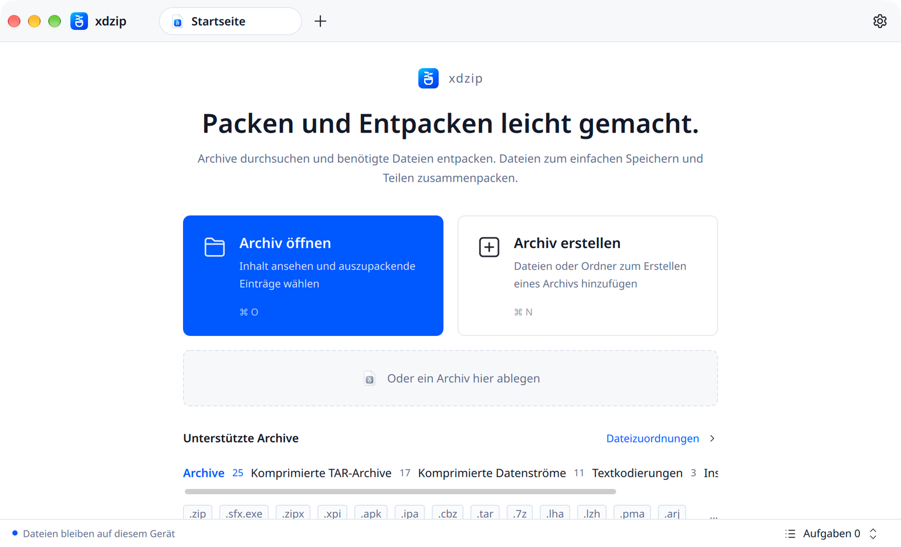

<p align="center">
  
</p>

<h1 align="center">xdzip</h1>

<p align="center"><a href="README.md">English</a> | <a href="README.zh-CN.md">简体中文</a> | <a href="README.zh-TW.md">繁體中文</a> | <a href="README.ja-JP.md">日本語</a> | <a href="README.ko-KR.md">한국어</a> | <a href="README.fr-FR.md">Français</a> | Deutsch | <a href="README.es-ES.md">Español</a> | <a href="README.pt-BR.md">Português (Brasil)</a> | <a href="README.ru-RU.md">Русский</a></p>

<p align="center"><strong>Packen und entpacken, ein bisschen einfacher</strong></p>

<p align="center">xdzip ist ein quelloffener, plattformübergreifender Archivmanager. Die in Rust implementierten Formate benötigen keine externen Entpackprogramme. Navigieren Sie durch Archive, suchen Sie nach Einträgen, entpacken Sie ausgewählte Dateien, öffnen Sie verschlüsselte Archive und Teilarchive und ändern Sie Einträge in geeigneten Formaten.<br>xdzip unterstützt ZIP, 7z, RAR, TAR, CAB, ISO/UDF und weitere Formate unter Windows, macOS und Linux.</p>

<p align="center">
  <a href="https://github.com/xiaodaozhi/xdzip/actions/workflows/docs.yml"></a>
  <a href="LICENSE"></a>
</p>

<p align="center">
  <a href="#xdzip-download-and-install">Download</a> / <a href="#xdzip-using-xdzip">Bedienung</a> / <a href="#xdzip-format-support">Archivformate</a> / <a href="#xdzip-build-from-source">Aus dem Quellcode bauen</a> / <a href="docs/de-DE/README.md">Dokumentation</a> / <a href="https://github.com/xiaodaozhi/xdzip/issues">Feedback</a>
</p>



<a name="xdzip-download-and-install"></a>

## Herunterladen und installieren

Suchen Sie unter Windows 11 x64 im Microsoft Store nach **XDZip**. Für direkte Downloads und die eigenständige Befehlszeilenversion wählen Sie Ihr System auf der Seite der [neuesten stabilen GitHub-Version](https://github.com/xiaodaozhi/xdzip/releases/latest).

| System | Unterstützte Umgebung | GitHub-Download |
| --- | --- | --- |
| Windows | Weiterhin gewartete Windows-11-Versionen auf x86_64 | `setup.exe` für die Installation pro Benutzer oder portables `.zip` |
| macOS | macOS 14 und neuer, Apple Silicon (arm64), Intel (x86_64) ab Version 0.3.2 | `.dmg` oder Anwendungspaket im Format `.app.zip` |
| Linux | Ubuntu 24.04 LTS, x86_64, X11, glibc 2.39 oder neuer | `.deb`-Paket oder Laufzeitverzeichnis im Format `.tar.gz` |

Die Dateinamen für die Desktopanwendung beginnen mit `xdzip-<version>-`. Dateien für die eigenständige [CLI](#xdzip-command-line) beginnen mit `xdzip-cli-<version>-`. Prüfen Sie direkte Downloads mit `SHA256SUMS` auf der Veröffentlichungsseite. Das Windows-Installationsprogramm von GitHub ist unsigniert. Der macOS-Download ist zur Integritätsprüfung ad hoc signiert und wurde nicht notarisiert. Die [Installationsanleitung](docs/de-DE/user-guide/install.md) erklärt den Start aus den einzelnen Paketen und das Einrichten von Dateizuordnungen.

Der Microsoft Store veröffentlicht seine Ausgabe unabhängig von GitHub und verwaltet ihre Updates. Rufen Sie bei GitHub-Downloads **Über xdzip** auf, um nach Aktualisierungen zu suchen. Installationen pro Benutzer unter Windows, im Ordner „Programme“ installierte macOS-Apps und Ubuntu-DEB-Installationen können direkt aus der App aktualisiert werden, sofern die Voraussetzungen erfüllt sind. Aktualisieren Sie portable Kopien manuell. Siehe [Einstellungen und Updates](docs/de-DE/user-guide/settings-and-updates.md) und [Supportrichtlinie](docs/de-DE/engineering/support-policy.md).

**Hinweis zur Version.** Die hier beschriebenen Funktionen entsprechen dem aktuellen Quellcode. Für veröffentlichte Pakete gelten die jeweiligen Versionshinweise. Selbst kompilierte Builds sind experimentelle Entwicklungsversionen.

<a name="xdzip-using-xdzip"></a>

## xdzip verwenden

Öffnen Sie ein Archiv, um Ordner zu durchsuchen, Einträge zu suchen und zu sortieren und Dateien zum Entpacken auszuwählen. Ordner stehen in beiden Sortierrichtungen zuerst. Verfügbar sind Listen- und Rasteransichten, Dateieigenschaften, zehn in den Einstellungen auswählbare Oberflächensprachen, ein helles und ein dunkles Design sowie eine einstellbare Schriftgröße und Anzeigedichte. Standardmäßig folgt die Sprache der unterstützten Systemsprache und fällt sonst auf Englisch (USA) zurück. Ein gewöhnliches ZIP/ZIP64 in einer einzelnen Datei kann bis zu eine Million Einträge für die Navigation indizieren. Für die meisten anderen Formate gelten niedrigere Grenzen. Entpacken, die Prüfung des gesamten Archivs und das Ändern von Archiven haben eigene Grenzen. Siehe [Benutzerhandbuch](docs/de-DE/user-guide/README.md) und [Indizierung großer Archive](docs/de-DE/engineering/large-index.md).

- **Vorschau.** Wenn die Dateieigenschaften sichtbar sind, erscheint beim Auswählen einer einzelnen Datei automatisch eine Vorschau für unterstützten Klartext, Rasterbilder oder statische SVG-Dateien. macOS unterstützt auch HEIC/HEIF. Die Vorschau erscheint nach dem vollständigen Lesen und nach den vom Format vorgesehenen Prüfungen. Sie kann abgebrochen werden. Siehe [Vorschau](docs/de-DE/engineering/content-preview.md) für Formate, Größen und Grenzen der Dekodierung.
- **Entpacken und öffnen.** Wählen Sie einen Zielordner und eine Regel für Namenskonflikte. Verfolgen Sie den Fortschritt und brechen Sie den Vorgang bei Bedarf ab. Beim Doppelklick auf eine reguläre Datei entpackt xdzip eine Kopie in einen privaten temporären Ordner und öffnet sie mit dem System. Änderungen an dieser Kopie werden nicht in das Archiv zurückgeschrieben. Nach sieben Tagen werden die zwischengespeicherten Kopien bei einem späteren Öffnen bereinigt.
- **Erstellen und ändern.** Erstellen Sie ZIP, TAR, TAR.GZ, GZIP, XZ, TAR.XZ, LZ4, TAR.LZ4, Zstandard, TAR.ZST, LZH, 7z und ISO9660/Joliet-Datenabbilder. Unter Windows x64 können Sie auch selbstentpackende ZIP-Dateien erstellen. In geeigneten gewöhnlichen Archiven, die aus einer Datei bestehen, können Einträge hinzugefügt, ersetzt, verschoben, umbenannt oder gelöscht werden. Sie können Dateien aus der Liste ziehen oder sie auf die Liste ziehen und das Hinzufügen bestätigen. Formate und Grenzen stehen in der Tabelle unten.
- **Prüfen.** Prüfen Sie ein vollständiges Archiv im Hintergrund, ohne Dateien zu schreiben. Was geprüft wird, hängt vom Format ab. TAR, ISO, UDF und Compound File (MSI) ermöglichen beispielsweise Struktur- und Lesbarkeitsprüfungen ohne Inhaltsprüfsummen für einzelne Dateien. Siehe [Integritätsprüfung von Archiven](docs/de-DE/engineering/archive-checking.md).
- **Mehrere Archive.** Standardmäßig öffnen sich Archive in neuen Tabs. Sie können in den Einstellungen auch neue Fenster wählen. In einer Anmeldesitzung werden der Anwendungsprozess und das Symbol im Infobereich gemeinsam verwendet. Hintergrundaufgaben bleiben nach dem Schließen der Archivansicht über die Aufgabenübersicht erreichbar.
- **Aktionen im Dateimanager.** Öffnen Sie bei installierten Windows-11-Ausgaben unter **Weitere Optionen anzeigen** das klassische Menü. Die Store-Ausgabe kann auch im modernen Menü erscheinen. Verwenden Sie unter Ubuntu Dateien (Nautilus) mit installierter Erweiterung. Aktivieren Sie unter macOS die Finder-Erweiterung in den Systemeinstellungen oder verwenden Sie den registrierten Finder-Dienst. Siehe [Entpacken im Dateimanager](docs/de-DE/user-guide/extract.md#xdzip-from-the-file-manager).

Beim Erstellen von Archiven und Hinzufügen von Dateien werden `.DS_Store`-Dateien und die Ordner `__MACOSX` und `_MACOSX` ausgelassen. Beim Entpacken prüft xdzip die Pfade und die Zugriffsrechte für das Ziel, behandelt Namenskonflikte und schreibt Ausgaben zunächst temporär. Unterstützte Formate prüfen auch den Inhalt. Die Behandlung besonderer Objekte und Links hängt vom Format und der Plattform ab. Siehe [Spezifikation zum sicheren Entpacken](docs/de-DE/engineering/zip-safe-extraction.md).

<a name="xdzip-format-support"></a>

## Unterstützte Formate

Die Tabelle zeigt, welche Archive xdzip öffnen, erstellen und ändern kann. „Ändern“ umfasst das Hinzufügen, Ersetzen, Verschieben, Umbenennen und Löschen von Einträgen in einem vorhandenen Archiv. Lese- und Prüfunterstützung hängen vom tatsächlichen Inhalt, vom Kompressionsverfahren und vom Eintragstyp ab. Beim Öffnen anhand der Dateiendung beginnt die Formaterkennung. Siehe [Register der eingebauten Formate](docs/de-DE/engineering/format-registry.md) und [Anleitung zur Integritätsprüfung](docs/de-DE/user-guide/checks-and-tasks.md) für die Einzelheiten.

| Format | Durchsuchen, entpacken und prüfen | Erstellen | Ändern |
| --- | --- | --- | --- |
| ZIP und mögliche ZIP-Dateien mit den Endungen ZIPX/XPI/APK/IPA/CBZ | Store, Deflate, Deflate64, BZip2, LZMA, XZ sowie unterstützte AES-256- und Teilarchivprofile | ZIP mit Store, Deflate, AES-256 und nummerierten Teilen | Geeignete ZIP/ZIPX-Archive mit den aufgeführten Verfahren |
| TAR, TAR.GZ (einschließlich `.tgz`) | Reguläre Dateien und Ordner | Unterstützt. TAR packt nur, ohne zu komprimieren | Geeignete gewöhnliche Archive aus einer Datei |
| GZIP (`.gz`) | Eine logische Datei, auch bei verketteten GZIP-Teilen. TAR in GZIP zeigt den TAR-Verzeichnisbaum | Eine reguläre Datei, Deflate 0/1/6/9 | Nicht unterstützt |
| BZip2, LZMA Alone, Lzip v1 | Eine reguläre Datei innerhalb der Datenstrom- und Speichergrenzen | Nicht unterstützt | Nicht unterstützt |
| TAR.BZ2, TAR.LZMA, TAR.LZ | Reguläre Dateien und Ordner | Nicht unterstützt | Geeignete Archive |
| XZ, TAR.XZ (einschließlich `.txz`) | Deklarierte Prüfungen, LZMA2, Delta/BCJ und verkettete Datenströme | LZMA2-Stufen 1/6/9, XZ mit einer regulären Datei | TAR.XZ |
| LZ4, TAR.LZ4 | Standardframes, unabhängige und verkettete Blöcke, Verkettung und deklarierte Prüfungen | LZ4-Stufen 1/6/9, gewöhnliches LZ4 mit einer regulären Datei | TAR.LZ4 |
| Zstandard, TAR.ZST (einschließlich `.tzst`) | Standardframes, unterstützte Fenster, Huffman/FSE, wiederholte Offsets und deklarierte Prüfungen | Zstandard-Stufen 1/6/9, gewöhnliches Zstandard mit einer regulären Datei | TAR.ZST |
| 7z | Passwörter, verschlüsselte Dateinamen, Solid-Archive und nummerierte Teile | Verschlüsselung, Solid-Archive und nummerierte Teile | Geeignete unverschlüsselte, ungeteilte Archive |
| DEB | Übliche ar-Mitglieder, TAR-Ansichten für Steuerung und Daten, unterstützte GZIP/XZ/Zstandard/BZip2/LZMA-Profile | Nicht unterstützt | Nicht unterstützt |
| LHA/LZH | Headerstufen 0–3, Store, LH1–LH7, LZS/LZ5 und deklarierte CRCs | LH5-Stufen 1/6/9, Headerstufe 2, reguläre Dateien und Ordner | Geeignete Archive mit Headerstufe 2 und CRC je Eintrag |
| [PMA](docs/de-DE/engineering/pma-streams.md) | Stufe 0 mit PM0/PM1/PM2, genaue CP/M-Struktur und deklarierte CRCs | Nicht unterstützt | Nicht unterstützt |
| [ARJ](docs/de-DE/engineering/arj-streams.md) | Store und Methoden 1–4, geprüfte Header und vollständige CRC-32 der Mitglieder | Nicht unterstützt | Nicht unterstützt |
| [ARC](docs/de-DE/engineering/arc-streams.md) | Alte und neue Store-Varianten, Methoden 3–9, genaue Struktur und vollständige CRC-16 der Mitglieder | Nicht unterstützt | Nicht unterstützt |
| [BH](docs/de-DE/engineering/bh-containers.md) | Gewöhnliche `BH 05 07`-Mitglieder, Methode 8 Raw Deflate, genaue Größen und CRC-32 | Nicht unterstützt | Nicht unterstützt |
| [ALZ](docs/de-DE/engineering/ace-alz-egg-format-sources.md) | Gewöhnliche Mitglieder eines Einzelvolumens mit Store oder Raw Deflate, genaue Größen und CRC-32 | Nicht unterstützt | Nicht unterstützt |
| [EGG](docs/de-DE/engineering/ace-alz-egg-format-sources.md) | Unverschlüsselte, nicht solide Mitglieder eines Einzelvolumens mit Store oder Raw Deflate, genaue Größen und CRC-32 | Nicht unterstützt | Nicht unterstützt |
| [PEA](docs/de-DE/engineering/disk-image-archive-format-sources.md) | PEA 1.x mit einem Volumen, UTF-8-Namen, unverschlüsselte gespeicherte PCOMPRESS0-Dateien und -Ordner. Keine Objekt-, Datenstrom- oder Volumenprüfung | Nicht unterstützt | Nicht unterstützt |
| [Compound File (MSI)](docs/de-DE/engineering/wim-msi-installer-format-sources.md#xdzip-compound-file-and-msi) | Speicherobjekte durchsuchen und Rohdatenströme entpacken. Struktur und Lesbarkeit prüfen | Nicht unterstützt | Nicht unterstützt |
| [NSIS (`.exe`)](docs/de-DE/engineering/wim-msi-installer-format-sources.md#xdzip-nsis-and-other-sfx) | Nur statische `firstheader`-Metadaten. Entpacken und vollständige Archivprüfung sind nicht verfügbar | Nicht unterstützt | Nicht unterstützt |
| ASAR | Gespeicherte Dateien und Ordner, gemeinsam genutzte Datenbereiche und deklarierte SHA-256-Werte für Dateien und Blöcke | Nicht unterstützt | Nicht unterstützt |
| Z, TAR.Z (einschließlich `.taz`) | Unix compress LZW, Wörterbücher mit 9–16 Bit und unterstützte CLEAR- und Ausrichtungsprofile | Nicht unterstützt | TAR.Z |
| Brotli, TAR.BR | Gewöhnliche RFC-7932-Datenströme, Fenster mit 10–24 Bit und alle statischen Wörterbuchtransformationen | Nicht unterstützt | TAR.BR |
| AES Crypt (`.aes`) | Versionen 0–3, Passwort zum Öffnen, HMAC über den gesamten Geheimtext und versionsabhängige Längenregeln | Nicht unterstützt | Nicht unterstützt |
| UU/UUE, XXE | Herkömmliche Zeilen mit Längenangabe und unterstützte begin-base64-Umschläge, auch mit mehreren Mitgliedern | Nicht unterstützt | Nicht unterstützt |
| RAR | Ältere RAR-Formate, RAR5 und RAR-7-Formaterweiterungen, einschließlich Passwörtern, Solid-Archiven und Teilarchiven | Nicht unterstützt | Nicht unterstützt |
| CAB | Store, MSZip, Quantum, LZX und Teile im selben Ordner | Nicht unterstützt | Nicht unterstützt |
| ISO | ISO9660, Joliet und Rock Ridge | ISO9660- und Joliet-Datenabbild | Nicht unterstützt |
| UDF | UDF | Nicht unterstützt | Nicht unterstützt |
| ZIP SFX | Geprüfte selbstentpackende ZIP-Archive | Windows x64, Store/Deflate, `.sfx.exe` | Nicht unterstützt |

- ZIP mit AES-256 verschlüsselt den Inhalt. Die Dateinamen bleiben sichtbar. AES-128/192 und herkömmliches ZipCrypto werden nicht unterstützt. Geteilte Archive können anhand von `.zip.001`, PKZIP `.z01` und verwandten Namenskonventionen gelesen werden. Beim Erstellen werden nummerierte Teile verwendet. Siehe [Entpacken mit Passwort](docs/de-DE/engineering/password-extraction.md) und [Teilarchive öffnen](docs/de-DE/engineering/archive-opening.md).
- Eigenständiges BZip2, LZMA Alone und Lzip v1 sind schreibgeschützt. LZMA enthält keine Inhaltsprüfsumme. Die Prüfung erfasst Struktur, Größen und Lesbarkeit. Endungen, Einträge, Speichergrenzen und Zulassung stehen in [Spezifikation für Ein-Datei-Datenströme](docs/de-DE/engineering/single-file-streams.md).
- XZ führt jede im Datenstrom deklarierte Inhaltsprüfung aus. Bei None werden nur Struktur und Lesbarkeit geprüft. ZIPX unterstützt die aufgeführten ZIP-Verfahren. PPMd-, JPEG- und WavPack-Varianten bleiben ausgeschlossen. Änderungen übernehmen die komprimierten Daten und das Verfahren beibehaltener ZIP/ZIPX-Einträge. Neue Einträge verwenden Deflate.
- Beim Ändern von 7z wird das Archiv neu aufgebaut. Für beibehaltene und hinzugefügte Inhalte sind höchstens 512 MiB Arbeitsspeicher vorgesehen. Neue Archive lesen Eingaben als Datenstrom und unterliegen dieser Grenze des Neuaufbaus nicht. Verschlüsselte oder geteilte ZIP- und 7z-Archive können nicht geändert werden. Siehe [Archive ändern](docs/de-DE/engineering/archive-transfers.md).
- RAR, CAB und UDF sind nur lesbar. Beim [Erstellen von ISO-Abbildern](docs/de-DE/engineering/iso-creation.md) werden reguläre Dateien und Ordner auf einem einzelnen Volumen unterstützt. Dateien müssen kleiner als 4 GiB sein. Joliet-Namen dürfen höchstens 64 UCS-2-Zeichen pro Namensbestandteil enthalten. Unterstützt werden weder startfähige Abbilder noch das Schreiben von UDF oder Rock Ridge oder das Ändern von Abbildern. Beim Lesen wird ein Abbild weder eingehängt noch ausgeführt. Siehe [RAR-Spezifikation](docs/de-DE/engineering/rar-format-sources.md) und [Spezifikation der Formatmodule](docs/de-DE/engineering/native-codecs.md).
- Die [SFX-Erstellung](docs/de-DE/engineering/sfx-creation.md) erzeugt einen eigenständigen ZIP-Entpacker für Windows x64, der ohne Qt und ohne installiertes xdzip läuft. Sie können den Zielordner wählen, Namenskonflikte behandeln und den Vorgang abbrechen. Der Entpacker führt entpackte Dateien nie aus. Passwörter, Teilarchive und automatische Startbefehle sind nicht verfügbar. Gewöhnliche `.exe`-Dateien bleiben von Dateizuordnungen ausgeschlossen.
- DEB bietet `members/`, `control/` und `data/` als Exportansichten. „Alles entpacken“ berücksichtigt sowohl rohe Mitglieder als auch entpackte Inhalte. Es wird nichts installiert und kein Skript gestartet. Die Steuerdaten akzeptieren keine Komprimierung oder GZIP/XZ/Zstandard. Die Nutzdaten unterstützen zusätzlich BZip2/LZMA. Die Prüfung bestätigt die Lesbarkeit des Containers und die deklarierten Prüfungen. Sie authentifiziert das Paket nicht. Siehe [DEB-Spezifikation](docs/de-DE/engineering/deb-containers.md).
- Z und TAR.Z prüfen Struktur und Lesbarkeit ohne Prüfsummen. Das Erstellen eigenständiger Z-Dateien und die Reparatur beschädigter älterer Datenströme werden nicht unterstützt. Siehe [Unix-compress-Spezifikation](docs/de-DE/engineering/compress-streams.md).
- UU/UUE und XXE werden ohne Prüfsummen auf Struktur und Lesbarkeit geprüft. Headerpfade und -modi erteilen keine Schreib- oder Ausführungsrechte. GNU-kodierte Dateinamen und die Reparatur mehrteiliger Dateien gehören nicht zum unterstützten [Textumschlagprofil](docs/de-DE/engineering/text-envelopes.md).
- Beim Öffnen oder Entpacken eines schreibgeschützten ASAR wird die darin enthaltene Anwendung nicht gestartet. Externe `unpacked`-Daten und deklarierte Links sind sichtbar und werden nicht unterstützt. Der Zugriff auf benachbarte Verzeichnisse und das Wiederherstellen von Ausführungsrechten sind ausgeschlossen. Optionale Hashes erkennen Beschädigungen. Ohne Hash werden nur Struktur und Lesbarkeit geprüft. Siehe [ASAR-Spezifikation](docs/de-DE/engineering/asar-containers.md).
- NSIS wird nur erkannt, wenn der PE-Anhang einen gültigen `firstheader`-Eintrag innerhalb der Größenobergrenze enthält. xdzip zeigt diesen statischen Metadateneintrag an. Der PE-Startcode, Installationsskripte, Plug-ins und Nutzdaten werden nicht ausgeführt. Der Installationsheader wird nicht dekomprimiert, und die Nutzdaten können nicht entpackt werden. `.exe` bleibt beim Ziehen und Ablegen und bei Dateimanager-Zuordnungen ausgeblendet. Allgemeine ausführbare Dateien werden nicht verarbeitet.
- LHA/LZH verwendet beim Erstellen LH5, Headerstufe 2 und UTF-8-Namen. Ältere Windows-Programme können die Namen mit ihrer alten Codepage anzeigen. Geeignete Archive mit Headerstufe 2 können geändert werden. Alte Namen werden vor der Auswertung von Trennzeichen dekodiert. Beim Dekodieren des Inhalts werden vorhandene CRCs geprüft. Bei alten Einträgen ohne CRC werden nur Struktur und Lesbarkeit geprüft. Passwörter, Volumes und Reparaturprofile sind ausgeschlossen. PMA hat ein eigenes schreibgeschütztes Profil. Siehe [LHA-Spezifikation](docs/de-DE/engineering/lha-containers.md).
- ARJ kann nur gelesen werden. Binärdateien und ältere Textmitglieder liefern genau die vom CRC erfassten Archivbytes ohne plattformabhängige Zeilenumbruchkonvertierung. Passwörter, Teilarchive, Wiederherstellungs- und Sicherheitsprofile, Links und besondere Objekte werden nicht unterstützt. Unbekannte Methoden bleiben sichtbar und verhindern eine erfolgreiche Prüfung des gesamten Archivs.
- ARC kann nur gelesen werden. Reguläre Dateien werden der Reihe nach gelesen, und das Ende wird exakt geprüft. Passwortdekodierung, Teilarchive, SFX und Spark-Erweiterungen werden nicht unterstützt. Unbekannte Methoden bleiben ohne ZIP-Methodenalias sichtbar und verhindern eine erfolgreiche vollständige Prüfung. Alte XOR-Verschlüsselung hat kein Header-Kennzeichen. Für die Dekodierung sind ein gültiger Datenstrom, die genaue Größe und die CRC erforderlich, ohne Rückfall auf Passwort oder Reparatur.
- BH unterstützt das Raw-Deflate-Profil der Methode 8 mit `BH 05 07`. Andere Methoden, Verschlüsselung, Ordner, Teilarchive, Nachlaufdaten und SFX-Präfixe sind ausgeschlossen.

- Große ZIP-Archive mit einem plattenbasierten Index können derzeit nicht vollständig geprüft oder geändert werden. Ausgewählte reguläre Dateien können innerhalb der Aufgabengrenzen entpackt werden. Siehe [Indizierung großer Archive](docs/de-DE/engineering/large-index.md).
- Sparse-Dateien in TAR und Erweiterungen von Drittanbietern werden derzeit nicht unterstützt. Gewöhnliches GZIP und als ZIP erkannte XPI/APK/IPA/CBZ-Dateien folgen der [Spezifikation für Ein-Datei-Datenströme](docs/de-DE/engineering/single-file-streams.md). Alte Dateinamenskodierungen werden nach Möglichkeit erkannt. Kurze Namen und gemischte Kodierungen sind nicht immer eindeutig. Siehe [Dateinamenskodierung](docs/de-DE/engineering/filename-encoding.md).

- AES Crypt benötigt vor dem Anzeigen der Metadaten ein Passwort zum Öffnen. Alle MACs des Geheimtexts müssen stimmen. Die Versionen 0–2 authentifizieren den abschließenden Längenrest nicht. Erweiterungen erteilen keine Berechtigungen. Siehe [AES-Crypt-Spezifikation](docs/de-DE/engineering/aescrypt-envelopes.md).
- Die Erkennung von Brotli und TAR.BR ohne eindeutige Signatur erfordert eine vollständige Inhaltsprüfung. Das Format hat keine Prüfsumme. Änderungen an TAR.BR schreiben standardkonforme unkomprimierte Metablöcke. Das Archiv kann dadurch größer werden. Gemeinsame Wörterbücher und Großfenster-Erweiterungen gehören nicht zum unterstützten [Brotli-Profil](docs/de-DE/engineering/brotli-streams.md).

<a name="xdzip-command-line"></a>

## Befehlszeile

Die eigenständige CLI benötigt weder Qt noch eine grafische Sitzung. Sie kann Archive auflisten, entpacken, erstellen, erweitern und prüfen und JSON ausgeben. Entpacken Sie die Datei mit dem Präfix `xdzip-cli-<version>-` und führen Sie unter macOS oder Linux `./bin/xdzip --help` beziehungsweise in Windows PowerShell `.\bin\xdzip.exe --help` aus. Lassen Sie das mitgelieferte Arbeitsprogramm neben der ausführbaren Datei. Der [Schnelleinstieg zur CLI](docs/de-DE/integration/README.md) erklärt die ersten Befehle und das Einrichten in PATH. Die CLI kann auch aus dem Quellcode gebaut werden.

```sh
git clone https://github.com/xiaodaozhi/xdzip.git
cd xdzip
python3 scripts/cli.py build
python3 scripts/cli.py test
build/cli/bin/xdzip --help
build/cli/bin/xdzip list archive.zip --json
build/cli/bin/xdzip extract archive.zip -C output
```

Verwenden Sie unter Windows `python` und hängen Sie `.exe` an den Namen der ausführbaren Datei an. Der Betrieb unter Linux erfordert OpenSSL 3 und die Systemzertifikate. Für den Build werden außerdem `libssl-dev` und `pkg-config` benötigt. Die [CLI-Anleitung](docs/de-DE/engineering/command-line.md) beschreibt Passwörter, nicht interaktive Nutzung, Rückgabecodes, die Installation des Befehls und Updategrenzen.

<a name="xdzip-build-from-source"></a>

## Aus dem Quellcode bauen

Die Desktop-Oberfläche verwendet Qt Quick/QML und ist über eine schlanke C++-Schicht mit dem Rust-Kern verbunden. Format-, Abfrage- und Aufgabenlogik sind unabhängig von Qt. Die Lesemodule für 7z, RAR, CAB, ISO und UDF sowie das Schreibmodul für 7z nutzen isolierte Prozesse. ISO-Abbilder werden im Rust-Hauptprozess erstellt. Der eigenständige Windows-SFX verwendet Systemdialoge ohne Qt.

Die Dokumentation steht in `docs/`. Visuelle Parameter, Terminologie und die für Generatoren und Prüfungen verwendeten Abhängigkeitslisten stehen in `specs/`. Die detaillierten Entwürfe liegen in `design/hifi/`.

Installieren Sie Python 3.10+, Git, CMake 3.24+, Ninja, rustup sowie den Compiler und das SDK Ihrer Plattform. Laden Sie dann den Quellcode herunter und bauen Sie das Programm. Wenn Sie das Repository für die CLI bereits geklont haben, beginnen Sie mit `prepare`.

```sh
git clone https://github.com/xiaodaozhi/xdzip.git
cd xdzip
python3 scripts/desktop.py prepare --install-rust --install-qt
python3 scripts/desktop.py doctor
python3 scripts/desktop.py build
python3 scripts/desktop.py test
```

Verwenden Sie unter Windows eine MSVC-x64-Entwicklungsumgebung. Verwenden Sie unter macOS ein natives Apple-Silicon-Terminal und die Xcode Command Line Tools. Die Standard-Toolchain für Qt 6.8.2 liegt unter `build/toolchain/`. Geben Sie `--qt-prefix` an, wenn Sie Qt bereits installiert haben. Die [Build-Anleitung](docs/de-DE/engineering/developer-build.md) beschreibt Abhängigkeiten, Start, Paketierung und Überprüfung. Für CLI und Desktop gibt es getrennte Build-Befehle. Der Desktop-Build enthält auch eine private CLI, deren Befehlseinstieg ausdrücklich aktiviert werden muss.

Entwicklungspakete sind experimentelle Builds. Windows- und Linux-Entwicklungsartefakte können auch aus erfolgreichen manuellen Läufen des [Workflows für Qt-Komponenten](https://github.com/xiaodaozhi/xdzip/actions/workflows/qt-components.yml) heruntergeladen werden. Die reguläre CI erstellt Entwicklungspakete nicht automatisch.

<a name="xdzip-documentation-and-contributing"></a>

## Dokumentation und Mitarbeit

| Thema | Einstieg |
| --- | --- |
| Desktopanwendung und Skripte | [Benutzerhandbuch](docs/de-DE/user-guide/README.md), [Befehlszeilenintegration](docs/de-DE/integration/README.md) |
| Produktdesign und Implementierung | [Technische Referenz](docs/de-DE/reference/README.md) |
| Datenschutz und Datenverarbeitung | [Datenschutzerklärung](PRIVACY.md), [chinesische Fassung](PRIVACY.zh-CN.md) |
| Bauen und mitarbeiten | [Anleitung zur Mitarbeit](docs/de-DE/contributing/README.md) |
| Änderungen und geplante Arbeiten | [Änderungsprotokoll](CHANGELOG.de-DE.md), [GitHub-Issues](https://github.com/xiaodaozhi/xdzip/issues) |
| Beiträge | [Beitragsrichtlinien](CONTRIBUTING.md), [Verhaltenskodex](CODE_OF_CONDUCT.md) |
| Projektrichtlinien | [Projektorganisation](GOVERNANCE.md), [Sicherheit](SECURITY.md) |

Feedback und Beiträge sind willkommen. Nennen Sie bei einer Fehlermeldung die Version oder den Commit, das Betriebssystem und die Architektur, die Schritte zum Reproduzieren sowie das tatsächliche Ergebnis. Erstellen Sie eigene Beispieldateien und vermeiden Sie vertrauliche Informationen. Melden Sie Sicherheitsprobleme vertraulich über [Report a vulnerability](https://github.com/xiaodaozhi/xdzip/security/advisories/new).

<a name="xdzip-license"></a>

## Lizenz

Die eigenen Projektinhalte stehen unter der [Apache License 2.0](LICENSE). Siehe auch [COPYRIGHT](COPYRIGHT). Für Qt, Codecs, Schriftarten und andere Abhängigkeiten gelten eigene Lizenzen. Die [Lizenzdokumentation](docs/de-DE/engineering/licensing.md) nennt Quellen und Lizenzhinweise. Offizielle Veröffentlichungen enthalten kein separates Archiv des entsprechenden Quellcodes. Siehe [Quellcodebereitstellung](docs/de-DE/engineering/source-delivery.md). Die geltenden Pflichten zum Quellcode, zum erneuten Linken und zu Lizenzhinweisen bleiben bestehen. Jeder Versionskandidat wird einzeln geprüft. Frühere Aufzeichnungen stehen in [#4](https://github.com/xiaodaozhi/xdzip/issues/4) und [#53](https://github.com/xiaodaozhi/xdzip/issues/53).
