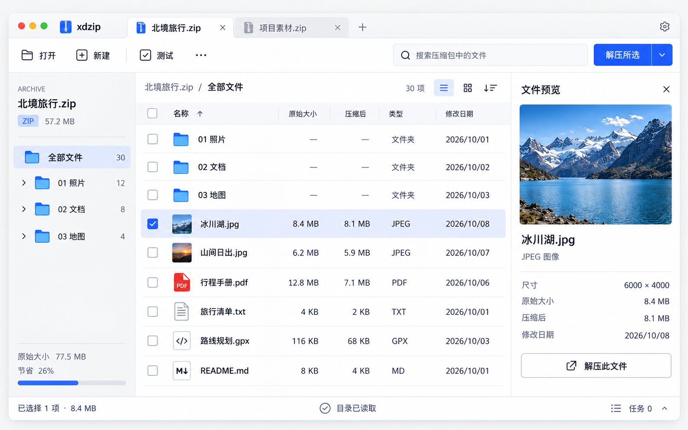

# xdzip

现代、轻量、可扩展的跨平台压缩文件管理工具。

**当前阶段：M3 安全 ZIP 解压已完成开发与三平台自动化验收。支持 Store/Deflate、解压所选或全部、重名处理、真实进度、取消与异步退出；开发包不作为正式签名发行。** 界面路线为 Qt Quick/QML，薄 C++ 适配层连接 Rust 核心；先浏览归档，再由用户明确选择压缩或解压。

## 从这里开始

- [文档总入口](docs/README.md)：按角色阅读全部设计和开发准备文档。
- [详细软件设计](docs/design/index.md)：需求、架构、领域、桥接、格式 SDK、安全、性能和实施路线。
- [HTML 高保真设计](design/html/index.html)：可操作界面、原稿对照和独立窗口预览；[目录职责](design/README.md)。
- [主窗口组件与交互](design/html/components.html)：共享菜单、按钮状态和键盘操作；[功能覆盖与验证](docs/qa/main-window-components.md)。
- [高保真设计统一入口](design/hifi/README.md)：当前主界面、操作窗口与设计参数；图标和原像素切片在[统一素材库](design/assets/index.html)。
- [M3 安全解压验收](docs/qa/m3-acceptance.md)：真实 Store／Deflate、冲突、取消与三平台开发包；[Qt／HTML／原稿对照](docs/qa/m3/index.html)。
- [M2 完整验收入口](docs/qa/m2-acceptance.md)：十万条真实 ZIP64、查询与实际测量。
- [M1 完整验收入口](docs/qa/m1-acceptance.md)：三平台检查和 Apple Silicon 开发构建。
- [开发就绪评审](docs/planning/readiness.md)：已确定事项、待验证项和实施门槛。
- [实施工作清单](docs/planning/backlog.md)：可直接拆为开发 issue 的工作包与验收条件。
- [贡献指南](CONTRIBUTING.md)与[编码规范](docs/design/10-quality-engineering.md)。

开发构建入口：[Qt 开发应用](apps/desktop/README.md)。`xdzip-browser` 读取真实 ZIP 目录，支持搜索、真实目录树、全结果排序、当前目录选择及解压元数据预检，`xdzip-ui-preview` 使用明确标识的示例任务。`xdzip-browser` 已执行真实 ZIP 解压，创建归档、TAR/GZIP 与加密格式仍待后续实现。边界见 [M3 实现契约](docs/engineering/m3-extraction.md)。

## 产品方向

首版计划支持 ZIP Store/Deflate 和 TAR/TAR.GZ 的浏览、创建和安全解压；提供真实进度、取消、路径保护和一致的跨平台交互。大索引、受限预览、额外格式及第三方进程扩展按后续里程碑逐项验证。发行性能预算仍待稳定参考机验证，元数据与 Qt 实测见 M2 验收，真实解压测量见 M3 验收。

Rust 核心独立于 Qt；内置格式通过源码接口扩展，第三方扩展通过版本化进程协议隔离。所有真实输出路径、冲突处理和提交由宿主统一控制。

## 仓库现状

`docs/design/` 为规范源文档，`design/hifi/` 为高保真原稿，`docs/visual/` 为视觉规范，`docs/engineering/` 为工程准备，`docs/planning/` 为阶段和风险，`docs/qa/` 为验收计划，`.github/` 为协作模板。文档构建工具仅用于生成 HTML，不构成产品代码。

项目原创内容采用 [Apache License 2.0](LICENSE)，详情见 [许可证说明](docs/engineering/licensing.md)。Qt、编解码器和其他依赖分别遵守自身许可证。
