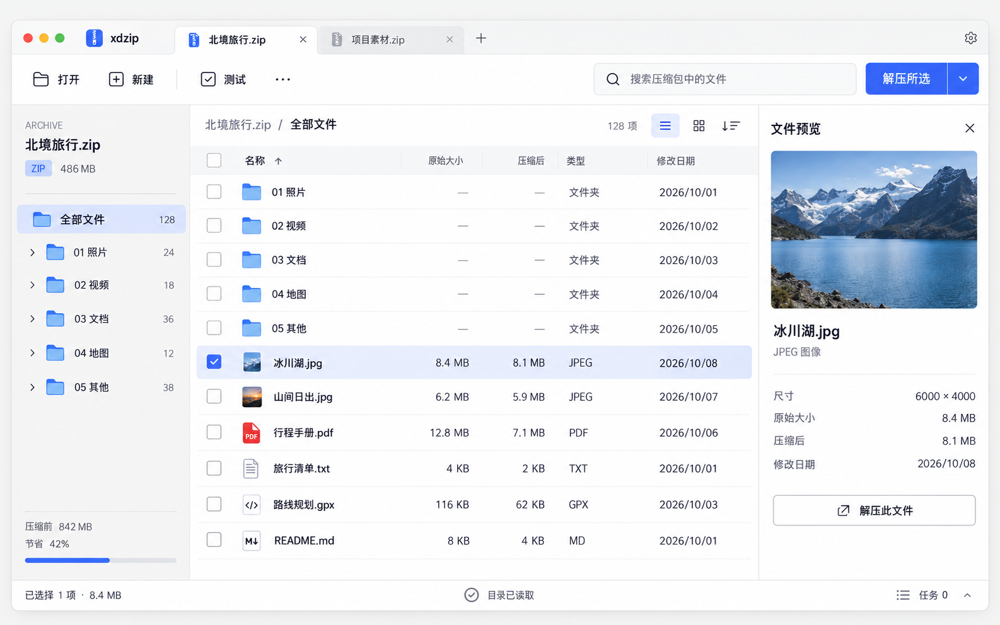

# xdzip

现代、轻量、可扩展的跨平台压缩文件管理工具。

**当前阶段：核心与界面基础开发。已有 Rust 领域类型、Qt 独立窗口组件预览及桥接探针，尚无可用压缩产品或安装包。** 界面路线为 Qt Quick/QML，薄 C++ 适配层连接 Rust 核心；先浏览归档，再由用户明确选择压缩或解压。

## 从这里开始

- [文档总入口](docs/README.md)：按角色阅读全部设计和开发准备文档。
- [详细软件设计](docs/design/index.md)：需求、架构、领域、桥接、格式 SDK、安全、性能和实施路线。
- [可交互设计原型](design/prototype/README.md)：解压、新建、任务、异常流程与需求标注。
- [已确认的视觉设计](docs/visual/README.md)：浅色、深色、解压面板与设计参数。
- [开发就绪评审](docs/planning/readiness.md)：已确定事项、待验证项和实施门槛。
- [实施工作清单](docs/planning/backlog.md)：可直接拆为开发 issue 的工作包与验收条件。
- [贡献指南](CONTRIBUTING.md)与[编码规范](docs/design/10-quality-engineering.md)。

开发构建入口：[Qt 组件预览](apps/desktop/README.md)。当前示例数据明确标识，不执行归档操作。

## 产品方向

首版计划支持 ZIP Store/Deflate 和 TAR/TAR.GZ 的浏览、创建和安全解压；提供真实进度、取消、路径保护和一致的跨平台交互。大索引、受限预览、额外格式及第三方进程扩展按后续里程碑逐项验证。性能数值均为待验证预算，不是当前产品成绩。

Rust 核心独立于 Qt；内置格式通过源码接口扩展，第三方扩展通过版本化进程协议隔离。所有真实输出路径、冲突处理和提交由宿主统一控制。

## 仓库现状

`docs/design/` 为规范源文档，`docs/visual/` 为已确认视觉资产，`docs/engineering/` 为工程准备，`docs/planning/` 为阶段和风险，`docs/qa/` 为验收计划，`.github/` 为协作模板。文档构建工具仅用于生成 HTML，不构成产品代码。

项目原创内容采用 [Apache License 2.0](LICENSE)，详情见 [许可证说明](docs/engineering/licensing.md)。Qt、编解码器和其他依赖分别遵守自身许可证；当前私有仓库保持原有可见性。
