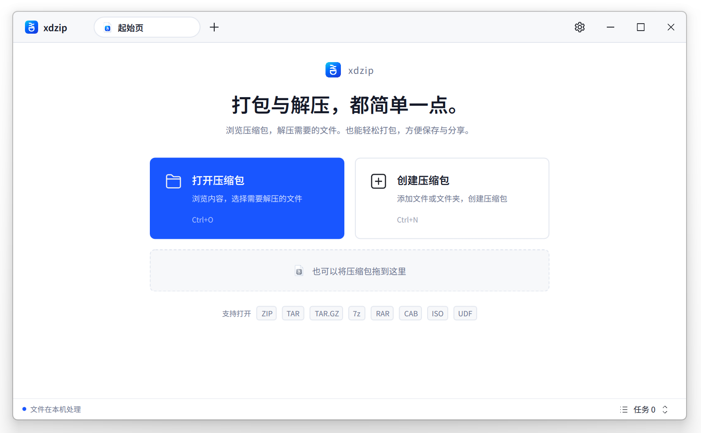

<p align="center">
  
</p>

<h1 align="center">xdzip</h1>

<p align="center"><strong>打包与解压，都简单一点。</strong></p>

<p align="center">xdzip 是一款开源跨平台压缩包管理工具。它使用 Rust 实现格式处理，无需依赖外部解压程序；支持浏览和搜索包内文件、选择性解压，以及加密、分卷和受支持格式的包内修改。<br>支持 ZIP、7z、RAR、TAR、CAB、ISO/UDF 等格式，适用于 Windows、macOS 和 Linux。</p>

<p align="center">
  <a href="https://github.com/xiaodaozhi/xdzip/actions/workflows/docs.yml"></a>
  <a href="LICENSE"></a>
</p>

<p align="center">
  <a href="#下载安装">下载安装</a> / <a href="#使用-xdzip">使用 xdzip</a> / <a href="#格式支持">格式支持</a> / <a href="#从源码构建">从源码构建</a> / <a href="docs/README.md">文档</a> / <a href="https://github.com/xiaodaozhi/xdzip/issues">反馈</a>
</p>



## 下载安装

当前稳定版是 [xdzip 0.2.0，build 27](https://github.com/xiaodaozhi/xdzip/releases/tag/v0.2.0)。在发布页选择与你的系统对应的文件：

| 系统 | 支持范围 | 下载选择 |
| --- | --- | --- |
| Windows | 仍受维护的 Windows 11，x86_64 | `setup.exe` 当前用户安装器，或 `.zip` 便携包 |
| macOS | macOS 14 及以上，Apple Silicon | `.dmg`，或 `.app.zip` 应用包 |
| Linux | Ubuntu 24.04 LTS，x86_64，X11，glibc 2.39 及以上 | `.deb` 安装包，或 `.tar.gz` 运行目录 |

桌面包以 `xdzip-0.2.0-` 开头，独立[命令行客户端](#命令行)的包以 `xdzip-cli-0.2.0-` 开头。发布页还提供校验清单和第三方组件材料。Windows 安装器未签署发行者证书，macOS 包使用 ad-hoc 完整性签名，未使用 Developer ID 签名或公证，系统可能显示安全提示。安装不会更改默认应用；文件关联和手动安装步骤见[安装指南](docs/engineering/installers-associations.md)。

应用的“关于 xdzip”可由用户主动检查更新。macOS 安装版的原生更新支持系统代理、自定义 HTTP CONNECT/SOCKS5 代理和直连设置。自动安装取决于有效的发布签名和安装身份，便携包及开发构建需要手动安装；详见[更新说明](docs/engineering/software-update.md)。旧版客户端首次升级的方式见[本版发布说明](release-notes/0.2.0.md)。其他系统、架构和桌面环境的范围见[支持政策](docs/engineering/support-policy.md)。

**版本说明**：本页的功能说明基于当前源码，发布包以对应版本的发布说明为准。源码构建属于实验性开发版本。

## 使用 xdzip

打开压缩包后可以先浏览目录、搜索和排序，再选择需要的文件解压。界面提供列表与网格视图、文件属性，以及中文 (简体) 和 English (US)、浅色和深色主题、字号与密度设置。默认自动识别系统界面语言，暂不支持的语言使用 English (US)，也可手动选择。普通单文件 ZIP/ZIP64 最多索引一百万条物理记录，其他格式和分卷路径保持十万条上限。大包的任务与修改边界见[大归档索引](docs/engineering/large-index.md)。

- **内容预览**：在属性卡主动预览受限纯文本、常见栅格图片和静态 SVG，macOS 还支持 HEIC／HEIF。完整读取并完成格式提供的校验后显示，可取消；格式、大小和解码预算见[预览说明](docs/engineering/content-preview.md)。
- **解压和打开**：选择目标位置与重名策略，查看进度并可请求取消。双击普通文件会先将副本解压到私有临时目录，再交给系统打开；修改副本不会写回压缩包，缓存会在七天后的后续打开操作中清理。
- **创建和修改**：可创建 ZIP、TAR、TAR.GZ 和 7z。支持对符合条件的普通单文件压缩包添加文件、替换文件和包内移动；也可从列表拖出文件，或拖入文件后确认添加。具体格式和限制见下表。
- **检查**：可在后台测试整包，不写出文件。TAR、ISO 和 UDF 只检查结构与可读性，不提供逐文件内容校验保证。详见[完整性检查](docs/engineering/archive-checking.md)。
- **多个归档**：默认在新标签页打开，也可设置为新窗口。同一登录会话共用应用进程和托盘，关闭浏览页面后后台任务仍可从任务入口访问。
- **文件管理器操作**：Windows 经典右键菜单、Ubuntu Files 子菜单及 macOS Finder Sync 动态子菜单可直接压缩或解压，macOS 保留 Finder 服务作为回退。操作使用独立窗口，默认不打开主窗口或目标目录；支持逐项 ZIP、智能解压目录与批次取消。入口、系统启用及安装范围见[文件管理器操作](docs/engineering/shell-actions.md)。

创建或添加时会排除 `.DS_Store` 文件及 `__MACOSX`、`_MACOSX` 目录。解压时执行路径检查、目标授权、重名处理和暂存，支持的格式还会校验内容；特殊对象和链接的处理因格式与平台而异，详见[安全解压契约](docs/engineering/m3-extraction.md)。

## 格式支持

下表中的“修改”指向已有压缩包添加、替换或移动条目。“支持”不意味着支持该格式的所有算法或扩展，具体限制见表后说明。

| 格式 | 浏览、解压和检查 | 创建 | 修改 |
| --- | --- | --- | --- |
| ZIP | 支持 Store、Deflate、AES-256 和分卷 | 支持 Store、Deflate、AES-256 和编号分卷 | 符合条件的普通单文件包 |
| TAR、TAR.GZ（含 `.tgz`） | 支持普通文件与目录 | 支持，TAR 仅打包 | 符合条件的普通单文件包 |
| 7z | 支持密码、文件名加密、固实和编号分卷 | 支持加密、固实和编号分卷 | 符合条件的未加密、非分卷包 |
| RAR | 支持旧版、RAR5 和 RAR 7 格式扩展，包括密码、固实及分卷 | 不支持 | 不支持 |
| CAB | 支持 Store、MSZip、Quantum、LZX 和同目录分卷 | 不支持 | 不支持 |
| ISO、UDF | 支持 ISO9660、Joliet、Rock Ridge 和 UDF | 不支持 | 不支持 |

- ZIP 的 AES-256 只加密内容，文件名仍可见；不支持 AES-128／192 或传统 ZipCrypto。分卷读取支持 `.zip.001` 及 PKZIP `.z01` 等命名，创建使用编号分卷。详见[密码解压](docs/engineering/password-extraction.md)和[分卷打开](docs/engineering/archive-opening.md)。
- 7z 修改通过重建完成，保留及新增文件内容的工作集上限为 512 MiB；新建使用流式输入，不受此重建限制。加密和分卷的 ZIP、7z 不支持修改。详见[归档修改](docs/engineering/archive-transfers.md)。
- RAR、CAB、ISO 和 UDF 为只读格式。ISO／UDF 映像用于读取文件，不会被挂载或执行。格式覆盖和资源限制分别见 [RAR 契约](docs/engineering/rar-format-sources.md)和[格式后端契约](docs/engineering/native-codecs.md)。
- 进入磁盘索引的大型 ZIP 暂不支持整包测试或修改，所选普通文件仍可按任务上限解压；详见[大归档索引](docs/engineering/large-index.md)。
- 暂不支持独立的非 TAR GZIP、稀疏 TAR 和第三方扩展。旧编码文件名会尝试识别，但短名称或混合编码无法保证唯一识别，详见[文件名编码](docs/engineering/filename-encoding.md)。

## 命令行

稳定版提供无需 Qt 或图形会话的独立 Rust CLI，可列举、解压、创建、添加和测试归档，也支持 JSON 输出。下载对应系统的 `xdzip-cli-0.2.0-` 包，解包后运行 `bin/xdzip --help`，Windows 使用 `bin/xdzip.exe`。也可按下面的源码步骤构建：

```sh
git clone https://github.com/xiaodaozhi/xdzip.git
cd xdzip
python3 scripts/cli.py build
python3 scripts/cli.py test
build/cli/bin/xdzip --help
build/cli/bin/xdzip list archive.zip --json
build/cli/bin/xdzip extract archive.zip -C output
```

Windows 使用 `python` 并为可执行文件加 `.exe`。Linux 运行需要系统 OpenSSL 3 和证书，构建还需要 `libssl-dev` 和 `pkg-config`。密码、非交互模式、退出码、命令安装及更新边界见[命令行指南](docs/engineering/command-line.md)。

## 从源码构建

桌面界面使用 Qt Quick/QML，通过薄 C++ 层连接 Rust 核心。格式、查询和任务逻辑独立于 Qt；7z、RAR、CAB、ISO 和 UDF 使用隔离工作进程。

项目文档位于 `docs/`，供生成和检查使用的视觉参数、术语及依赖清单位于 `specs/`，高保真设计原稿位于 `design/hifi/`。

准备 Python 3.10+、Git、CMake 3.24+、Ninja、rustup 和平台编译器／SDK，然后获取源码并构建。如果已按上面的命令行步骤克隆，直接从 `prepare` 开始：

```sh
git clone https://github.com/xiaodaozhi/xdzip.git
cd xdzip
python3 scripts/desktop.py prepare --install-rust --install-qt
python3 scripts/desktop.py doctor
python3 scripts/desktop.py build
python3 scripts/desktop.py test
```

Windows 使用 MSVC x64 开发环境；macOS 使用 Apple Silicon 原生终端及 Xcode Command Line Tools。默认 Qt 6.8.2 工具链位于 `build/toolchain/`。已有 Qt 时可指定 `--qt-prefix`。完整依赖、运行入口、打包及验证步骤见[开发构建指南](docs/engineering/developer-build.md)。命令行和桌面构建使用各自的入口；桌面构建也包含私有 CLI，命令入口需显式启用。

开发包不等同于正式 Release。也可按需从 [Qt components 工作流](https://github.com/xiaodaozhi/xdzip/actions/workflows/qt-components.yml)的成功手动运行下载 Windows、Linux 开发工件；日常 CI 不自动生成开发包。

## 文档与参与

| 需要了解 | 入口 |
| --- | --- |
| 项目文档、架构和格式契约 | [文档导航](docs/README.md) |
| 隐私与数据处理 | [隐私政策](PRIVACY.md)、[Privacy Policy](PRIVACY.en.md) |
| 构建、目录与测试 | [开发指南](docs/engineering/development.md)、[仓库结构](docs/engineering/repository-layout.md)、[验证方法](docs/qa/README.md) |
| 版本变化和待办 | [变更日志](CHANGELOG.md)、[工作包路线](docs/planning/backlog.md)、[Issues](https://github.com/xiaodaozhi/xdzip/issues) |
| 贡献 | [贡献指南](CONTRIBUTING.md)、[行为规范](CODE_OF_CONDUCT.md) |

欢迎反馈问题或参与贡献。报告缺陷时请提供版本或提交、系统与架构、复现步骤和实际结果；样本请自行生成，避免包含敏感内容。安全问题请通过 [Report a vulnerability](https://github.com/xiaodaozhi/xdzip/security/advisories/new) 私下报告。

## 许可证

项目原创内容采用 [Apache License 2.0](LICENSE)，版权声明见 [COPYRIGHT](COPYRIGHT)。Qt、编解码器、字体及其他依赖遵守各自许可证，来源和通知见[许可证文档](docs/engineering/licensing.md)。正式 Release 不提供单独的对应源码压缩包，相关说明见[源码交付](docs/engineering/source-delivery.md)；这一政策不改变适用的源码、重链接和通知义务。每个发行候选仍须单独复核，历史记录见 [#4](https://github.com/xiaodaozhi/xdzip/issues/4) 和 [#53](https://github.com/xiaodaozhi/xdzip/issues/53)。
