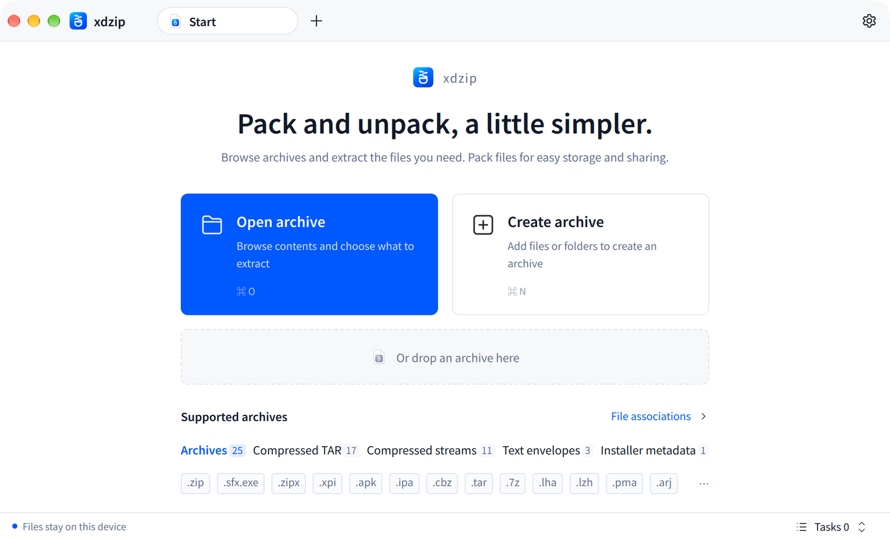

<p align="center">
  
</p>

<h1 align="center">xdzip</h1>

<p align="center"><a href="README.md">English</a> | <a href="README.zh-CN.md">简体中文</a> | <a href="README.zh-TW.md">繁體中文（台灣）</a> | <a href="README.ja-JP.md">日本語</a> | <a href="README.ko-KR.md">한국어</a> | <a href="README.fr-FR.md">Français</a> | <a href="README.de-DE.md">Deutsch</a> | <a href="README.es-ES.md">Español</a> | Português (Brasil) | <a href="README.ru-RU.md">Русский</a></p>

<p align="center"><strong>Compactar e extrair, com mais facilidade</strong></p>

<p align="center">O xdzip é um gerenciador de arquivos compactados multiplataforma e de código aberto. Os formatos são implementados em Rust e funcionam sem programas externos de extração. Navegue, procure entradas, extraia os arquivos selecionados, use arquivos criptografados e divididos em volumes e altere entradas nos formatos compatíveis.<br>O xdzip é compatível com ZIP, 7z, RAR, TAR, CAB, ISO/UDF e outros formatos no Windows, macOS e Linux.</p>

<p align="center">
  <a href="https://github.com/xiaodaozhi/xdzip/actions/workflows/docs.yml"></a>
  <a href="LICENSE"></a>
</p>

<p align="center">
  <a href="#xdzip-download-and-install">Baixar</a> / <a href="#xdzip-using-xdzip">Como usar</a> / <a href="#xdzip-format-support">Formatos compatíveis</a> / <a href="#xdzip-build-from-source">Compilar a partir do código-fonte</a> / <a href="docs/pt-BR/README.md">Documentação</a> / <a href="https://github.com/xiaodaozhi/xdzip/issues">Comentários</a>
</p>



<a name="xdzip-download-and-install"></a>

## Baixar e instalar

No Windows 11 x64, procure **XDZip** na Microsoft Store. Para baixar diretamente ou obter a CLI independente, escolha seu sistema na página da [versão estável mais recente no GitHub](https://github.com/xiaodaozhi/xdzip/releases/latest).

| Sistema | Ambiente compatível | Download no GitHub |
| --- | --- | --- |
| Windows | Versões do Windows 11 ainda mantidas, x86_64 | `setup.exe` por usuário ou `.zip` portátil |
| macOS | macOS 14 ou posterior, Apple Silicon | `.dmg` ou pacote de aplicativo `.app.zip` |
| Linux | Ubuntu 24.04 LTS, x86_64, X11, glibc 2.39 ou posterior | Pacote `.deb` ou pasta de execução `.tar.gz` |

Os arquivos de desktop começam com `xdzip-<version>-`. Os da [CLI](#xdzip-command-line) independente começam com `xdzip-cli-<version>-`. Use `SHA256SUMS` na página da versão para conferir a integridade de downloads diretos. O instalador do Windows no GitHub não é assinado. O download do macOS tem assinatura ad hoc de integridade e não é notarizado. Consulte o [guia de instalação](docs/pt-BR/user-guide/install.md) para saber como iniciar cada pacote e configurar associações de arquivos.

A Microsoft Store gerencia as atualizações de sua edição e publica de forma independente do GitHub. Para downloads do GitHub, procure atualizações em **Sobre o xdzip**. A instalação pelo aplicativo está disponível para instalações por usuário compatíveis no Windows, aplicativos instalados em Aplicativos no macOS e instalações via DEB no Ubuntu. Atualize as cópias portáteis manualmente. Consulte [configurações e atualizações](docs/pt-BR/user-guide/settings-and-updates.md) e a [política de suporte](docs/pt-BR/engineering/support-policy.md).

**Nota sobre as versões.** Os recursos desta página correspondem ao código-fonte atual. Para pacotes publicados, consulte as notas da versão correspondente. Compilações a partir do código-fonte são versões experimentais de desenvolvimento.

<a name="xdzip-using-xdzip"></a>

## Como usar o xdzip

Abra um arquivo compactado para navegar por suas pastas, buscar e ordenar entradas e escolher o que extrair. As pastas aparecem primeiro em ambas as ordens. A interface oferece visualizações em lista e grade, propriedades dos arquivos, seleção de idioma nas configurações, temas claro e escuro e ajustes de tamanho do texto e densidade. Por padrão, o aplicativo usa o idioma do sistema quando disponível e inglês dos Estados Unidos nos demais casos. Um ZIP ou ZIP64 comum em um só arquivo pode indexar até um milhão de registros para navegação. A maioria dos outros formatos tem limites menores. A extração, a verificação completa e a alteração têm limites individuais. Consulte o [manual do usuário](docs/pt-BR/user-guide/README.md) e a [indexação de arquivos grandes](docs/pt-BR/engineering/large-index.md).

- **Prévia do conteúdo.** Solicite no cartão de propriedades uma prévia de texto simples, imagens raster comuns e SVG estático dentro dos limites. No macOS, também há suporte a HEIC e HEIF. A prévia aparece após a leitura completa e as verificações previstas pelo formato. É possível cancelar. Consulte [formatos e limites da prévia](docs/pt-BR/engineering/content-preview.md), incluindo tamanhos e limites de decodificação.
- **Extrair e abrir.** Escolha o destino e a regra de conflito de nomes, acompanhe o progresso e solicite o cancelamento se necessário. Um clique duplo em um arquivo comum extrai uma cópia para uma pasta temporária privada antes de abri-la com o sistema. Alterações na cópia não são gravadas no arquivo compactado. Cópias em cache são removidas durante uma abertura posterior após sete dias.
- **Criar e alterar.** Crie arquivos ZIP, TAR, TAR.GZ, GZIP, XZ, TAR.XZ, LZ4, TAR.LZ4, Zstandard, TAR.ZST, LZH e 7z, além de imagens de dados ISO9660/Joliet. No Windows x64, também é possível criar arquivos ZIP autoextraíveis. Adicione, substitua ou mova entradas em arquivos comuns de um único arquivo que sejam compatíveis. Você também pode arrastar arquivos para fora da lista ou soltá-los nela e confirmar a inclusão. Consulte os formatos e limites na tabela abaixo.
- **Verificar.** Teste todo o arquivo em segundo plano sem gravar arquivos. As verificações dependem do formato. TAR, ISO, UDF e Compound File (MSI), por exemplo, verificam a estrutura e a legibilidade sem somas de verificação de conteúdo por arquivo. Consulte [verificação de integridade](docs/pt-BR/engineering/archive-checking.md).
- **Vários arquivos compactados.** Por padrão, abrem em novas abas. Também é possível configurá-los para abrir em novas janelas. Uma sessão de usuário compartilha o processo do aplicativo e o ícone da bandeja. As tarefas em segundo plano continuam acessíveis pela lista de tarefas após fechar as telas de navegação.
- **Ações no gerenciador de arquivos.** Nas edições instaladas no Windows 11, use **Mostrar mais opções** para acessar o menu clássico. A edição da Store também pode aparecer no menu moderno. No Ubuntu, use Arquivos (Nautilus) com a extensão instalada. No macOS, ative a extensão do Finder nos Ajustes do Sistema ou use o serviço registrado do Finder. Consulte [extração pelo gerenciador de arquivos](docs/pt-BR/user-guide/extract.md#xdzip-from-the-file-manager).

Ao criar arquivos compactados ou adicionar arquivos, são excluídos os arquivos `.DS_Store` e as pastas `__MACOSX` e `_MACOSX`. A extração verifica caminhos e permissões no destino, trata conflitos de nomes e usa arquivos temporários antes da gravação final. Os formatos compatíveis também verificam o conteúdo. O tratamento de objetos especiais e links depende do formato e da plataforma. Consulte as [regras de extração segura](docs/pt-BR/engineering/zip-safe-extraction.md).

<a name="xdzip-format-support"></a>

## Formatos compatíveis

Use a tabela para saber se o xdzip pode abrir, criar ou alterar um arquivo compactado. “Alterar” engloba adicionar, substituir e mover entradas em um arquivo já existente. A leitura e a verificação dependem do conteúdo real, do método de compactação e do tipo de registro. Ao abrir pela extensão, o xdzip inicia a detecção. Para detalhes dos limites, consulte o [registro de formatos internos](docs/pt-BR/engineering/format-registry.md) e o [guia de verificação de integridade](docs/pt-BR/user-guide/checks-and-tasks.md).

| Formato | Navegar, extrair e verificar | Criar | Alterar |
| --- | --- | --- | --- |
| ZIP e candidatos ZIPX/XPI/APK/IPA/CBZ | Store, Deflate, Deflate64, BZip2, LZMA e XZ, com perfis admitidos de AES-256 e volumes divididos | ZIP com Store, Deflate, AES-256 e volumes numerados | ZIP Store ou Deflate compatíveis |
| TAR, TAR.GZ (incluindo `.tgz`) | Arquivos comuns e pastas | Compatível. TAR reúne arquivos sem compactá-los | Arquivos comuns compatíveis em um só arquivo |
| GZIP (`.gz`) | Um arquivo lógico, incluindo membros GZIP concatenados. Um TAR dentro de GZIP exibe sua árvore TAR | Um arquivo comum, Deflate 0/1/6/9 | Sem suporte |
| BZip2, LZMA Alone, Lzip v1 | Um arquivo comum dentro dos limites de fluxo e memória | Sem suporte | Sem suporte |
| TAR.BZ2, TAR.LZMA, TAR.LZ | Arquivos comuns e pastas | Sem suporte | Sem suporte |
| XZ, TAR.XZ (incluindo `.txz`) | Verificações declaradas, LZMA2, Delta/BCJ e fluxos concatenados | LZMA2 nos níveis 1/6/9, XZ com um arquivo comum | Sem suporte |
| LZ4, TAR.LZ4 | Quadros padrão, blocos independentes ou vinculados, concatenação e verificações declaradas | LZ4 nos níveis 1/6/9, LZ4 comum com um arquivo normal | Sem suporte |
| Zstandard, TAR.ZST (incluindo `.tzst`) | Quadros padrão, janelas admitidas, Huffman/FSE, deslocamentos repetidos e verificações declaradas | Zstandard nos níveis 1/6/9, Zstandard comum com um arquivo normal | Sem suporte |
| 7z | Senhas, nomes de arquivos criptografados, arquivos sólidos e volumes numerados | Criptografia, arquivos sólidos e volumes numerados | Arquivos compatíveis sem criptografia e sem divisão em volumes |
| DEB | Membros ar comuns, visualizações TAR de controle e dados, perfis admitidos de GZIP/XZ/Zstandard/BZip2/LZMA | Sem suporte | Sem suporte |
| LHA/LZH | Cabeçalhos de nível 0–3, Store, LH1–LH7, LZS/LZ5 e CRCs declarados | LH5 nos níveis 1/6/9, cabeçalhos de nível 2, arquivos comuns e pastas | Sem suporte |
| [PMA](docs/pt-BR/engineering/pma-streams.md) | Nível 0, PM0/PM1/PM2, estrutura CP/M exata e CRCs declarados | Sem suporte | Sem suporte |
| [ARJ](docs/pt-BR/engineering/arj-streams.md) | Store e métodos 1–4, cabeçalhos validados e CRC-32 completo do membro | Sem suporte | Sem suporte |
| [ARC](docs/pt-BR/engineering/arc-streams.md) | Store antigo e novo, métodos 3–9, estrutura exata e CRC-16 completo do membro | Sem suporte | Sem suporte |
| [BH](docs/pt-BR/engineering/bh-containers.md) | Membros comuns `BH 05 07`, método 8 Deflate bruto, tamanhos exatos e CRC-32 | Sem suporte | Sem suporte |
| [ALZ](docs/pt-BR/engineering/ace-alz-egg-format-sources.md) | Membros comuns de volume único com Store ou Deflate bruto, tamanhos exatos e CRC-32 | Sem suporte | Sem suporte |
| [EGG](docs/pt-BR/engineering/ace-alz-egg-format-sources.md) | Membros de volume único sem criptografia e não sólidos com Store ou Deflate bruto, tamanhos exatos e CRC-32 | Sem suporte | Sem suporte |
| [PEA](docs/pt-BR/engineering/disk-image-archive-format-sources.md) | PEA 1.x de volume único, nomes UTF-8, arquivos e pastas PCOMPRESS0 armazenados sem criptografia. Sem verificações de objetos, fluxos ou volumes | Sem suporte | Sem suporte |
| [Compound File (MSI)](docs/pt-BR/engineering/wim-msi-installer-format-sources.md#xdzip-compound-file-and-msi) | Navegue pelos armazenamentos e extraia fluxos brutos. Verifique a estrutura e a legibilidade | Sem suporte | Sem suporte |
| [NSIS (`.exe`)](docs/pt-BR/engineering/wim-msi-installer-format-sources.md#xdzip-nsis-and-other-sfx) | Apenas metadados estáticos `firstheader`. A extração e o teste completo do arquivo estão indisponíveis | Sem suporte | Sem suporte |
| ASAR | Arquivos e pastas armazenados, intervalos de dados compartilhados e SHA-256 declarados de arquivos e blocos | Sem suporte | Sem suporte |
| Z, TAR.Z (incluindo `.taz`) | Unix compress LZW, dicionários de 9–16 bits e perfis admitidos de CLEAR e alinhamento | Sem suporte | Sem suporte |
| Brotli, TAR.BR | Fluxos RFC 7932 comuns, janelas de 10–24 bits e todas as transformações do dicionário estático | Sem suporte | Sem suporte |
| AES Crypt (`.aes`) | Versões 0–3, senha de abertura, HMAC de todo o texto criptografado e regras de comprimento específicas da versão | Sem suporte | Sem suporte |
| UU/UUE, XXE | Linhas tradicionais de comprimento declarado e envelopes begin-base64 admitidos, inclusive múltiplos membros | Sem suporte | Sem suporte |
| RAR | Formatos antigos, RAR5 e extensões RAR 7, com senhas, arquivos sólidos e volumes divididos | Sem suporte | Sem suporte |
| CAB | Store, MSZip, Quantum, LZX e volumes na mesma pasta | Sem suporte | Sem suporte |
| ISO | ISO9660, Joliet e Rock Ridge | Imagem de dados ISO9660 + Joliet | Sem suporte |
| UDF | UDF | Sem suporte | Sem suporte |
| ZIP SFX | Arquivos ZIP autoextraíveis validados | Windows x64, Store/Deflate, `.sfx.exe` | Sem suporte |

- ZIP AES-256 criptografa apenas o conteúdo. Os nomes dos arquivos ficam visíveis. AES-128/192 e ZipCrypto tradicional são incompatíveis. É possível ler arquivos divididos com `.zip.001`, PKZIP `.z01` e convenções relacionadas. A criação usa volumes numerados. Consulte [extração com senha](docs/pt-BR/engineering/password-extraction.md) e [abertura de arquivos multivolume](docs/pt-BR/engineering/archive-opening.md).
- BZip2, LZMA Alone, Lzip v1 e suas combinações com TAR são atualmente somente leitura. LZMA Alone não tem soma de verificação de conteúdo. Os testes confirmam a estrutura, os tamanhos e a legibilidade. Consulte a [especificação de fluxos de um único arquivo](docs/pt-BR/engineering/single-file-streams.md) para extensões, membros, limites de memória e condições de aceitação.
- XZ verifica cada teste de conteúdo declarado. Fluxos que declaram None têm apenas verificações de estrutura e legibilidade. A leitura ZIPX aceita os métodos ZIP listados. As variantes PPMd, JPEG e WavPack continuam incompatíveis. Métodos ZIP adicionais são somente leitura. Eles não ampliam os perfis AES nem permitem criar ZIPX.
- Alterar um 7z reconstrói o arquivo compactado. O conjunto de trabalho para o conteúdo preservado e adicionado tem limite de 512 MiB. Arquivos novos leem a entrada em fluxo e não têm esse limite de reconstrução. ZIP e 7z criptografados ou divididos não podem ser alterados. Consulte [alteração de arquivos compactados](docs/pt-BR/engineering/archive-transfers.md).
- RAR, CAB e UDF são somente leitura. A [criação de ISO](docs/pt-BR/engineering/iso-creation.md) aceita arquivos comuns e pastas de um único volume, arquivos menores que 4 GiB e nomes Joliet com até 64 caracteres UCS-2 por componente. Não há suporte a imagens inicializáveis, gravação de UDF ou Rock Ridge nem atualização de imagens. Ler uma imagem nunca a monta nem executa. Consulte a [especificação de RAR](docs/pt-BR/engineering/rar-format-sources.md) e a [especificação dos módulos de formato](docs/pt-BR/engineering/native-codecs.md).
- A [criação de SFX](docs/pt-BR/engineering/sfx-creation.md) gera um extrator ZIP independente para Windows x64, sem precisar de Qt ou do xdzip instalado. Ele permite escolher o destino, tratar conflitos e cancelar, e nunca executa os arquivos extraídos. Senhas, volumes e comandos de início automático são incompatíveis. Arquivos `.exe` genéricos ficam fora das associações de arquivos.
- DEB exibe `members/`, `control/` e `data/` como visualizações de exportação. Extrair tudo inclui os membros brutos e o conteúdo expandido. Nada é instalado e nenhum script é executado. A área de controle aceita dados sem compactação, GZIP, XZ e Zstandard. A de dados aceita também BZip2 e LZMA. A verificação cobre a legibilidade do contêiner e os testes declarados, sem autenticar o pacote. Consulte a [especificação de DEB](docs/pt-BR/engineering/deb-containers.md).
- Z e TAR.Z verificam a estrutura e a legibilidade sem somas de verificação. Não há criação nem reparo de fluxos legados danificados. Consulte a [especificação de Unix compress](docs/pt-BR/engineering/compress-streams.md).
- UU/UUE e XXE validam a estrutura e a legibilidade sem somas de verificação. Os caminhos e modos dos cabeçalhos não concedem permissão para gravar ou executar. Nomes codificados no padrão GNU e reparo de arquivos multipartes estão fora do [perfil de envelopes de texto](docs/pt-BR/engineering/text-envelopes.md).
- Abrir ou extrair um ASAR somente leitura não inicia o aplicativo contido nele. Dados externos `unpacked` e links declarados ficam visíveis e não são processados. Não há acesso a pastas vizinhas nem restauração de permissões de execução. Hashes opcionais detectam danos. Os registros sem hash oferecem apenas verificações de estrutura e legibilidade. Consulte a [especificação de ASAR](docs/pt-BR/engineering/asar-containers.md).
- NSIS só é reconhecido se a sobreposição PE contiver um registro `firstheader` válido e limitado. O xdzip mostra essa linha de metadados estáticos. Nunca executa o inicializador PE, o script de instalação, extensões ou a carga, nem descompacta o cabeçalho do instalador ou permite extrair a carga. A entrada `.exe` fica oculta em arrastar e soltar e em associações do sistema. O suporte é restrito a esse perfil.
- A criação LHA/LZH usa LH5 e nomes UTF-8 com cabeçalhos de nível 2. Ferramentas antigas do Windows podem mostrar esses nomes em sua página de código anterior. Arquivos compactados existentes não podem ser alterados. Nomes legados são decodificados antes de processar separadores. CRCs presentes são verificados ao decodificar. Membros muito antigos sem CRC têm apenas verificações de estrutura e legibilidade. Não são aceitos senhas, volumes ou perfis de reparo. PMA tem perfil de leitura separado. Consulte a [especificação de LHA](docs/pt-BR/engineering/lha-containers.md).
- ARJ é somente leitura. Membros binários e de texto legado entregam os bytes cobertos pelo CRC sem converter quebras de linha. Senhas, volumes, perfis de recuperação ou segurança, links e objetos especiais são incompatíveis. Métodos desconhecidos permanecem visíveis e impedem a verificação completa.
- ARC é somente leitura. Arquivos comuns são processados em sequência com término exato. Decodificação por senha, volumes, SFX e extensões do Spark são incompatíveis. Métodos desconhecidos ficam visíveis sem equivalentes ZIP e impedem a verificação completa. A criptografia XOR antiga não tem sinalizador no cabeçalho. A decodificação exige fluxo válido, tamanho exato e CRC, sem recorrer a senha ou reparo.
- A leitura de BH aceita o perfil `BH 05 07` de método 8 Deflate bruto. Métodos desconhecidos, criptografia, pastas, volumes, dados finais e prefixos SFX ficam excluídos.

- ZIP grandes que usam o índice em disco atualmente não podem ser verificados por inteiro nem alterados. Você ainda pode extrair arquivos comuns selecionados dentro dos limites da tarefa. Consulte a [indexação de arquivos grandes](docs/pt-BR/engineering/large-index.md).
- Arquivos esparsos em TAR e extensões de terceiros não são compatíveis no momento. GZIP normal e candidatos XPI/APK/IPA/CBZ derivados de ZIP seguem a [especificação de fluxos de um único arquivo](docs/pt-BR/engineering/single-file-streams.md). Codificações antigas de nomes são detectadas quando possível. Nomes curtos ou codificações misturadas nem sempre podem ser identificados de forma conclusiva. Veja [codificação de nomes de arquivos](docs/pt-BR/engineering/filename-encoding.md).

- AES Crypt exige a senha de abertura antes de exibir os metadados. Todos os MACs do texto criptografado precisam ser válidos. As versões 0–2 deixam sem autenticação o resto do comprimento final. Extensões não concedem permissões. Consulte a [especificação de AES Crypt](docs/pt-BR/engineering/aescrypt-envelopes.md).

- Brotli e TAR.BR são somente leitura, exigem a validação completa do conteúdo quando a detecção se baseia em indícios fracos e não têm soma de verificação. Dicionários compartilhados e extensões de janelas grandes ficam fora do [perfil Brotli aceito](docs/pt-BR/engineering/brotli-streams.md).

<a name="xdzip-command-line"></a>

## Linha de comando

A CLI independente funciona sem Qt ou sessão gráfica. Ela lista, extrai, cria, adiciona arquivos a um arquivo compactado e verifica, com suporte a saída JSON. Descompacte o arquivo `xdzip-cli-<version>-` e execute `./bin/xdzip --help` no macOS ou Linux, ou `.\bin\xdzip.exe --help` no Windows PowerShell. Mantenha o programa auxiliar incluído ao lado do executável. O [guia rápido da CLI](docs/pt-BR/integration/README.md) explica os primeiros comandos e a instalação no PATH. Também é possível compilar a partir do código-fonte.

```sh
git clone https://github.com/xiaodaozhi/xdzip.git
cd xdzip
python3 scripts/cli.py build
python3 scripts/cli.py test
build/cli/bin/xdzip --help
build/cli/bin/xdzip list archive.zip --json
build/cli/bin/xdzip extract archive.zip -C output
```

No Windows, use `python` e acrescente `.exe` ao nome do executável. No Linux, a execução requer OpenSSL 3 e certificados do sistema. A compilação requer também `libssl-dev` e `pkg-config`. Consulte o [guia da CLI](docs/pt-BR/engineering/command-line.md) para senhas, uso não interativo, códigos de saída, instalação do comando e limites de atualização.

<a name="xdzip-build-from-source"></a>

## Compilar a partir do código-fonte

A interface de desktop usa Qt Quick/QML conectado ao núcleo Rust por uma camada fina de C++. A lógica de formato, consulta e tarefas é independente do Qt. A leitura de 7z, RAR, CAB, ISO e UDF e a gravação de 7z usam processos isolados. A criação de ISO ocorre no processo principal Rust. O SFX independente do Windows usa caixas de diálogo do sistema sem Qt.

A documentação fica em `docs/`. Os parâmetros visuais, a terminologia e as listas de dependências usados por geradores e verificações ficam em `specs/`. Os projetos de alta fidelidade ficam em `design/hifi/`.

Instale Python 3.10+, Git, CMake 3.24+, Ninja, rustup e o compilador e SDK da sua plataforma. Em seguida, obtenha o código-fonte e compile. Se já clonou o repositório para a CLI, comece por `prepare`.

```sh
git clone https://github.com/xiaodaozhi/xdzip.git
cd xdzip
python3 scripts/desktop.py prepare --install-rust --install-qt
python3 scripts/desktop.py doctor
python3 scripts/desktop.py build
python3 scripts/desktop.py test
```

No Windows, use um ambiente de desenvolvimento MSVC x64. No macOS, use um terminal Apple Silicon nativo e Xcode Command Line Tools. As ferramentas padrão do Qt 6.8.2 ficam em `build/toolchain/`. Use `--qt-prefix` se o Qt já estiver instalado. O [guia de compilação](docs/pt-BR/engineering/developer-build.md) descreve dependências, inicialização, empacotamento e verificação. A CLI e o desktop usam pontos de entrada separados. A compilação para desktop também inclui uma CLI privada cujo ponto de entrada deve ser ativado explicitamente.

Os pacotes de desenvolvimento são experimentais. Os arquivos de desenvolvimento para Windows e Linux também ficam disponíveis em execuções manuais bem-sucedidas do [fluxo de componentes Qt](https://github.com/xiaodaozhi/xdzip/actions/workflows/qt-components.yml). A CI habitual não gera pacotes de desenvolvimento automaticamente.

<a name="xdzip-documentation-and-contributing"></a>

## Documentação e contribuições

| Tema | Onde começar |
| --- | --- |
| Uso no desktop e scripts | [Manual do usuário](docs/pt-BR/user-guide/README.md), [integração pela linha de comando](docs/pt-BR/integration/README.md) |
| Projeto e implementação | [Referência técnica](docs/pt-BR/reference/README.md) |
| Privacidade e tratamento dos dados | [Política de privacidade](PRIVACY.md), [versão em chinês](PRIVACY.zh-CN.md) |
| Compilar e contribuir | [Guia de contribuição](docs/pt-BR/contributing/README.md) |
| Alterações e trabalho planejado | [Histórico de alterações](CHANGELOG.md), [issues do GitHub](https://github.com/xiaodaozhi/xdzip/issues) |
| Contribuições | [Regras de contribuição](CONTRIBUTING.md), [código de conduta](CODE_OF_CONDUCT.md) |
| Políticas do projeto | [Governança](GOVERNANCE.md), [segurança](SECURITY.md) |

Comentários e contribuições são bem-vindos. Ao reportar um erro, inclua a versão ou o commit, o sistema e a arquitetura, etapas de reprodução e o resultado observado. Crie suas próprias amostras e evite incluir informações sensíveis. Relate problemas de segurança de forma privada em [Report a vulnerability](https://github.com/xiaodaozhi/xdzip/security/advisories/new).

<a name="xdzip-license"></a>

## Licença

O conteúdo original do projeto é licenciado sob a [Apache License 2.0](LICENSE). Consulte também [COPYRIGHT](COPYRIGHT). Qt, codecs, fontes e outras dependências têm as próprias licenças. A [documentação de licenças](docs/pt-BR/engineering/licensing.md) lista origens e avisos. As publicações oficiais não fornecem um arquivo separado do código-fonte correspondente. Consulte a [entrega do código-fonte](docs/pt-BR/engineering/source-delivery.md). As obrigações aplicáveis relativas ao código-fonte, à religação e aos avisos continuam valendo. Cada candidato a lançamento requer uma revisão própria. Os registros históricos estão em [#4](https://github.com/xiaodaozhi/xdzip/issues/4) e [#53](https://github.com/xiaodaozhi/xdzip/issues/53).
