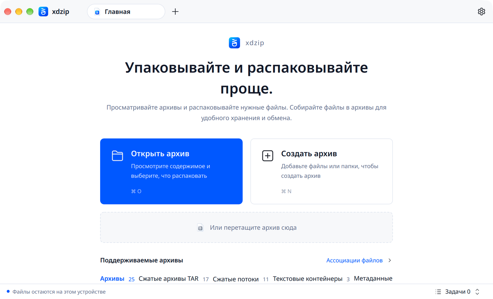

<p align="center">
  
</p>

<h1 align="center">xdzip</h1>

<p align="center"><a href="README.md">English</a> | <a href="README.zh-CN.md">简体中文</a> | <a href="README.zh-TW.md">繁體中文</a> | <a href="README.ja-JP.md">日本語</a> | <a href="README.ko-KR.md">한국어</a> | <a href="README.fr-FR.md">Français</a> | <a href="README.de-DE.md">Deutsch</a> | <a href="README.es-ES.md">Español</a> | <a href="README.pt-BR.md">Português (Brasil)</a> | Русский</p>

<p align="center"><strong>Упаковка и распаковка стали немного проще</strong></p>

<p align="center">xdzip — кроссплатформенный менеджер архивов с открытым исходным кодом. Обработка форматов реализована на Rust и не требует внешних распаковщиков. Просматривайте архивы, ищите записи, извлекайте выбранные файлы, работайте с зашифрованными и многотомными архивами и изменяйте записи в поддерживаемых форматах.<br>xdzip поддерживает ZIP, 7z, RAR, TAR, CAB, ISO/UDF и другие форматы в Windows, macOS и Linux.</p>

<p align="center">
  <a href="https://github.com/xiaodaozhi/xdzip/actions/workflows/docs.yml"></a>
  <a href="LICENSE"></a>
</p>

<p align="center">
  <a href="#xdzip-download-and-install">Скачать</a> / <a href="#xdzip-using-xdzip">Использование</a> / <a href="#xdzip-format-support">Поддерживаемые форматы</a> / <a href="#xdzip-build-from-source">Сборка из исходного кода</a> / <a href="docs/ru-RU/README.md">Документация</a> / <a href="https://github.com/xiaodaozhi/xdzip/issues">Обратная связь</a>
</p>



<a name="xdzip-download-and-install"></a>

## Скачивание и установка

В Windows 11 x64 найдите **XDZip** в Microsoft Store. Для прямой загрузки и автономной CLI выберите свою систему на странице [последнего стабильного выпуска GitHub](https://github.com/xiaodaozhi/xdzip/releases/latest).

| Система | Поддерживаемая среда | Загрузка на GitHub |
| --- | --- | --- |
| Windows | Версии Windows 11, которые ещё сопровождаются, x86_64 | `setup.exe` для текущего пользователя или переносимый `.zip` |
| macOS | macOS 14 и новее, Apple Silicon | `.dmg` или пакет приложения `.app.zip` |
| Linux | Ubuntu 24.04 LTS, x86_64, X11, glibc 2.39 и новее | Пакет `.deb` или каталог среды выполнения `.tar.gz` |

Имена файлов настольной версии начинаются с `xdzip-<version>-`. Имена файлов автономной [CLI](#xdzip-command-line) начинаются с `xdzip-cli-<version>-`. Для проверки прямой загрузки используйте `SHA256SUMS` на странице выпуска. Установщик Windows с GitHub не подписан. Сборка macOS имеет подпись ad hoc для проверки целостности и не нотариально заверена. Как запустить отдельные пакеты и настроить ассоциации файлов, описано в [руководстве по установке](docs/ru-RU/user-guide/install.md).

Microsoft Store управляет обновлениями своей версии и публикует её независимо от GitHub. Для файлов с GitHub проверяйте обновления в окне **О xdzip**. Установка из приложения доступна для подходящих установок Windows на пользователя, для приложений macOS, помещённых в «Программы», и для установок из DEB в Ubuntu. Переносимые копии обновляйте вручную. См. [настройки и обновления](docs/ru-RU/user-guide/settings-and-updates.md) и [политику поддержки](docs/ru-RU/engineering/support-policy.md).

**Примечание о версиях.** На этой странице описаны возможности текущего исходного кода. Состав выпущенного пакета указан в примечаниях к соответствующему выпуску. Сборки из исходного кода являются экспериментальными версиями для разработки.

<a name="xdzip-using-xdzip"></a>

## Использование xdzip

Откройте архив, чтобы просматривать папки, искать и сортировать записи и выбирать файлы для распаковки. При сортировке в любом направлении папки остаются в начале. Доступны список и сетка, свойства файлов, выбор одного из десяти языков интерфейса в настройках, светлая и тёмная темы, размер текста и плотность интерфейса. По умолчанию используется язык системы, если он поддерживается, иначе английский (США). Обычный однофайловый ZIP/ZIP64 может индексировать для просмотра до миллиона записей. У большинства других форматов пределы ниже. У распаковки, проверки всего архива и изменения есть отдельные пределы. См. [руководство пользователя](docs/ru-RU/user-guide/README.md) и [индексацию больших архивов](docs/ru-RU/engineering/large-index.md).

- **Предпросмотр содержимого.** Если карточка свойств открыта, при выборе одного файла автоматически показывается предпросмотр поддерживаемого текста, растрового изображения или статического SVG. В macOS также поддерживаются HEIC и HEIF. Предпросмотр появляется после полного чтения содержимого и предусмотренных форматом проверок. Операцию можно отменить. Форматы, размеры и ограничения декодирования описаны на странице [предпросмотра](docs/ru-RU/engineering/content-preview.md).
- **Распаковка и открытие.** Выберите папку назначения и способ разрешения конфликтов имён, следите за ходом выполнения и при необходимости запросите отмену. Двойной щелчок по обычному файлу распаковывает копию в закрытую временную папку и открывает её системным приложением. Изменения копии не записываются обратно в архив. Копии в кэше очищаются при последующем открытии после семи дней.
- **Создание и изменение.** Можно создавать архивы ZIP, TAR, TAR.GZ, GZIP, XZ, TAR.XZ, LZ4, TAR.LZ4, Zstandard, TAR.ZST, LZH и 7z, а также образы данных ISO9660/Joliet. В Windows x64 также можно создавать самораспаковывающиеся ZIP. В подходящих обычных однофайловых архивах можно добавлять, заменять, перемещать, переименовывать и удалять записи. Можно перетащить файлы из списка или перетащить их в список и подтвердить добавление. Форматы и ограничения приведены в таблице.
- **Проверка.** Можно проверить весь архив в фоне без записи файлов. Состав проверок зависит от формата. Например, TAR, ISO, UDF и Compound File (MSI) проверяются на структуру и читаемость без контрольных сумм содержимого отдельных файлов. См. [проверку целостности архивов](docs/ru-RU/engineering/archive-checking.md).
- **Несколько архивов.** Архивы по умолчанию открываются в новых вкладках. В настройках можно выбрать отдельные окна. В одной пользовательской сессии используется общий процесс приложения и значок в области уведомлений. После закрытия вкладок фоновые операции остаются доступны из списка задач.
- **Действия файлового менеджера.** В установленных версиях для Windows 11 выберите **Показать дополнительные параметры**, чтобы открыть классическое меню. Версия из Store также может отображаться в современном меню. В Ubuntu используйте «Файлы» (Nautilus) с установленным расширением. В macOS включите расширение Finder в системных настройках или используйте зарегистрированную службу Finder. См. [распаковку из файлового менеджера](docs/ru-RU/user-guide/extract.md#xdzip-from-the-file-manager).

При создании архивов и добавлении файлов исключаются файлы `.DS_Store` и папки `__MACOSX` и `_MACOSX`. При распаковке проверяются пути и права доступа к папке назначения, разрешаются конфликты имён, а результат сначала записывается во временное место. Поддерживаемые форматы также проверяют содержимое. Обработка особых объектов и ссылок зависит от формата и платформы. См. [правила безопасной распаковки](docs/ru-RU/engineering/zip-safe-extraction.md).

<a name="xdzip-format-support"></a>

## Поддерживаемые форматы

Таблица показывает, может ли xdzip открыть, создать или изменить архив. Изменение включает добавление, замену, перемещение, переименование и удаление записей в существующем архиве. Чтение и проверка зависят от фактического содержимого, метода сжатия и типа записи. При открытии по расширению запускается распознавание формата. Подробнее об ограничениях см. [реестр встроенных форматов](docs/ru-RU/engineering/format-registry.md) и [руководство по проверке целостности](docs/ru-RU/user-guide/checks-and-tasks.md).

| Формат | Просмотр, распаковка и проверка | Создание | Изменение |
| --- | --- | --- | --- |
| ZIP и файлы ZIPX/XPI/APK/IPA/CBZ, которые могут содержать ZIP | Store, Deflate, Deflate64, BZip2, LZMA, XZ и поддерживаемые профили AES-256 и многотомных архивов | ZIP с Store, Deflate, AES-256 и нумерованными томами | Подходящие архивы ZIP/ZIPX с указанными методами |
| TAR, TAR.GZ (включая `.tgz`) | Обычные файлы и папки | Поддерживается. TAR упаковывает без сжатия | Подходящие обычные однофайловые архивы |
| GZIP (`.gz`) | Один логический файл, включая соединённые элементы GZIP. TAR внутри GZIP показывает дерево TAR | Один обычный файл, Deflate 0/1/6/9 | Не поддерживается |
| BZip2, LZMA Alone, Lzip v1 | Один обычный файл в пределах ограничений потока и памяти | Не поддерживается | Не поддерживается |
| TAR.BZ2, TAR.LZMA, TAR.LZ | Обычные файлы и папки | Не поддерживается | Подходящие архивы |
| XZ, TAR.XZ (включая `.txz`) | Заявленные проверки, LZMA2, Delta/BCJ и соединённые потоки | LZMA2 на уровнях 1/6/9, XZ с одним обычным файлом | TAR.XZ |
| LZ4, TAR.LZ4 | Стандартные кадры, независимые и связанные блоки, соединение потоков и заявленные проверки | LZ4 на уровнях 1/6/9, обычный LZ4 с одним обычным файлом | TAR.LZ4 |
| Zstandard, TAR.ZST (включая `.tzst`) | Стандартные кадры, допустимые окна, Huffman/FSE, повторяющиеся смещения и заявленные проверки | Zstandard на уровнях 1/6/9, обычный Zstandard с одним обычным файлом | TAR.ZST |
| 7z | Пароли, зашифрованные имена файлов, непрерывные архивы и нумерованные тома | Шифрование, непрерывные архивы и нумерованные тома | Подходящие незашифрованные однотомные архивы |
| DEB | Обычные элементы ar, представления TAR для управления и данных, допустимые профили GZIP/XZ/Zstandard/BZip2/LZMA | Не поддерживается | Не поддерживается |
| LHA/LZH | Заголовки уровней 0–3, Store, LH1–LH7, LZS/LZ5 и заявленные CRC | LH5 на уровнях 1/6/9, заголовки уровня 2, обычные файлы и папки | Подходящие архивы уровня 2 с CRC для записей |
| [PMA](docs/ru-RU/engineering/pma-streams.md) | PM0/PM1/PM2 уровня 0, точная структура CP/M и заявленные CRC | Не поддерживается | Не поддерживается |
| [ARJ](docs/ru-RU/engineering/arj-streams.md) | Store и методы 1–4, проверенные заголовки и полная CRC-32 элемента | Не поддерживается | Не поддерживается |
| [ARC](docs/ru-RU/engineering/arc-streams.md) | Старая и новая разновидности Store, методы 3–9, точная структура и полная CRC-16 элемента | Не поддерживается | Не поддерживается |
| [BH](docs/ru-RU/engineering/bh-containers.md) | Обычные элементы `BH 05 07`, метод 8, Deflate без обёртки, точные размеры и CRC-32 | Не поддерживается | Не поддерживается |
| [ALZ](docs/ru-RU/engineering/ace-alz-egg-format-sources.md) | Обычные однотомные элементы Store или Deflate без обёртки, точные размеры и CRC-32 | Не поддерживается | Не поддерживается |
| [EGG](docs/ru-RU/engineering/ace-alz-egg-format-sources.md) | Незашифрованные однотомные элементы без непрерывного сжатия, Store или Deflate без обёртки, точные размеры и CRC-32 | Не поддерживается | Не поддерживается |
| [PEA](docs/ru-RU/engineering/disk-image-archive-format-sources.md) | Однотомный PEA 1.x, имена UTF-8, незашифрованные файлы и папки PCOMPRESS0. Проверка объектов, потоков и томов отсутствует | Не поддерживается | Не поддерживается |
| [Compound File (MSI)](docs/ru-RU/engineering/wim-msi-installer-format-sources.md#xdzip-compound-file-and-msi) | Просмотр хранилищ и извлечение необработанных потоков. Проверка структуры и читаемости | Не поддерживается | Не поддерживается |
| [NSIS (`.exe`)](docs/ru-RU/engineering/wim-msi-installer-format-sources.md#xdzip-nsis-and-other-sfx) | Только статические метаданные `firstheader`. Извлечение и проверка всего архива недоступны | Не поддерживается | Не поддерживается |
| ASAR | Сохранённые файлы и папки, общие диапазоны данных и заявленные SHA-256 файлов и блоков | Не поддерживается | Не поддерживается |
| Z, TAR.Z (включая `.taz`) | Unix compress LZW, словари 9–16 бит и допустимые профили CLEAR и выравнивания | Не поддерживается | TAR.Z |
| Brotli, TAR.BR | Обычные потоки RFC 7932, окна 10–24 бит и все преобразования статического словаря | Не поддерживается | TAR.BR |
| AES Crypt (`.aes`) | Версии 0–3, пароль для открытия, HMAC всего шифротекста и правила длины конкретной версии | Не поддерживается | Не поддерживается |
| UU/UUE, XXE | Традиционные строки с указанной длиной и допустимые оболочки begin-base64, включая несколько элементов | Не поддерживается | Не поддерживается |
| RAR | Устаревшие форматы, RAR5 и расширения RAR 7, включая пароли, непрерывные и многотомные архивы | Не поддерживается | Не поддерживается |
| CAB | Store, MSZip, Quantum, LZX и тома в одной папке | Не поддерживается | Не поддерживается |
| ISO | ISO9660, Joliet и Rock Ridge | Образ данных ISO9660 + Joliet | Не поддерживается |
| UDF | UDF | Не поддерживается | Не поддерживается |
| ZIP SFX | Самораспаковывающиеся ZIP, прошедшие проверку | Windows x64, Store/Deflate, `.sfx.exe` | Не поддерживается |

- ZIP с AES-256 шифрует только содержимое. Имена файлов видны. AES-128/192 и традиционный ZipCrypto не поддерживаются. Многотомные архивы читаются по схемам `.zip.001`, PKZIP `.z01` и родственным схемам. При создании используются нумерованные тома. См. [распаковку с паролем](docs/ru-RU/engineering/password-extraction.md) и [открытие многотомных архивов](docs/ru-RU/engineering/archive-opening.md).
- Отдельные потоки BZip2, LZMA Alone и Lzip v1 доступны только для чтения. LZMA не содержит контрольной суммы содержимого. Проверка охватывает структуру, размеры и читаемость. Расширения, записи, ограничения памяти и область поддержки описаны в документе [спецификацию однофайловых потоков](docs/ru-RU/engineering/single-file-streams.md).
- XZ выполняет каждую указанную в потоке проверку содержимого. У потоков с None проверяются только структура и читаемость. ZIPX читает приведённые в таблице методы ZIP. Варианты PPMd, JPEG и WavPack по-прежнему не поддерживаются. При изменении ZIP/ZIPX сохраняются сжатые данные и метод оставленных записей. Новые записи используют Deflate.
- Изменение 7z пересобирает архив. Рабочий набор для сохраняемого и добавляемого содержимого ограничен 512 MiB. При создании новых архивов входные данные читаются потоком и этот предел пересборки не применяется. Зашифрованные или многотомные ZIP и 7z нельзя изменить. См. [изменение архивов](docs/ru-RU/engineering/archive-transfers.md).
- RAR, CAB и UDF доступны только для чтения. [Создание ISO](docs/ru-RU/engineering/iso-creation.md) поддерживает обычные файлы и папки, один том, файлы меньше 4 GiB и до 64 символов UCS-2 на компонент имени Joliet. Загрузочные образы, запись UDF и Rock Ridge и изменение образов недоступны. При чтении образ не монтируется и не исполняется. См. [спецификацию RAR](docs/ru-RU/engineering/rar-format-sources.md) и [спецификацию модулей форматов](docs/ru-RU/engineering/native-codecs.md).
- [Создание SFX](docs/ru-RU/engineering/sfx-creation.md) формирует автономный распаковщик ZIP для Windows x64, которому не нужны Qt и установленный xdzip. Он позволяет выбрать папку назначения, обработать конфликты и отменить операцию. Извлечённые файлы никогда не запускаются. Пароли, тома и команды автоматического запуска недоступны. Обычные `.exe` не участвуют в ассоциациях файлов.
- DEB представляет `members/`, `control/` и `data/` в виде представлений экспорта. При полной распаковке извлекаются необработанные элементы и распакованное содержимое. Ничего не устанавливается, сценарии не запускаются. Секция управления допускает отсутствие сжатия, GZIP, XZ и Zstandard. Секция данных дополнительно поддерживает BZip2 и LZMA. Проверка подтверждает читаемость контейнера и заявленные проверки без аутентификации пакета. См. [спецификацию DEB](docs/ru-RU/engineering/deb-containers.md).
- Проверка Z и TAR.Z охватывает структуру и читаемость без контрольных сумм. Создание отдельных файлов Z и восстановление повреждённых старых потоков недоступны. См. [спецификацию Unix compress](docs/ru-RU/engineering/compress-streams.md).
- UU/UUE и XXE проверяются на структуру и читаемость без контрольных сумм. Пути и режимы в заголовках не предоставляют права записи или запуска. Кодированные имена GNU и восстановление из нескольких частей находятся вне поддерживаемого [профиля текстовых оболочек](docs/ru-RU/engineering/text-envelopes.md).
- Открытие и распаковка ASAR, доступного только для чтения, не запускают приложение. Внешние данные `unpacked` и объявленные ссылки видны и не обрабатываются. Доступ к соседним каталогам и восстановление прав исполнения не предоставляются. Необязательные хеши выявляют повреждения. Без хеша проверяются только структура и читаемость. См. [спецификацию ASAR](docs/ru-RU/engineering/asar-containers.md).
- NSIS распознаётся только при наличии в оверлее PE действительной записи `firstheader` ограниченного размера. xdzip отображает строку статических метаданных. Код запуска PE, сценарий установки, модули и полезная нагрузка никогда не исполняются. Заголовок установщика не распаковывается, извлечение полезной нагрузки недоступно. `.exe` скрыт для перетаскивания и ассоциаций оболочки. Поддержка ограничена этим профилем.
- При создании LHA/LZH используются LH5, заголовки уровня 2 и имена UTF-8. Старые инструменты Windows могут отображать имена в прежней кодовой странице. Подходящие архивы уровня 2 можно изменять. Старые имена декодируются до обработки разделителей, а имеющиеся CRC проверяются при декодировании содержимого. Для старых записей без CRC проверяются только структура и читаемость. Пароли, тома и восстановление не поддерживаются. PMA имеет отдельный профиль только для чтения. См. [спецификацию LHA](docs/ru-RU/engineering/lha-containers.md).
- ARJ доступен только для чтения. Двоичные и устаревшие текстовые элементы возвращают байты, охваченные CRC, без преобразования переводов строк. Пароли, тома, профили восстановления или безопасности, ссылки и особые объекты не допускаются. Неизвестные методы остаются видимыми и препятствуют успешной проверке всего архива.
- ARC доступен только для чтения. Обычные файлы обрабатываются по порядку с точной проверкой окончания. Декодирование с паролем, тома, SFX и расширения Spark не допускаются. Неизвестные методы видны без подмены методами ZIP и не позволяют завершить успешную проверку. Старое шифрование XOR не имеет флага в заголовке. Для декодирования нужны корректный поток, точный размер и CRC. Запасные пути с паролем или восстановлением недоступны.
- Чтение BH поддерживает профиль `BH 05 07` метода 8 с Deflate без обёртки. Неизвестные методы, шифрование, папки, тома, данные после конца и префиксы SFX исключены.

- Большие ZIP с индексом на диске пока нельзя проверять целиком или изменять. Выбранные обычные файлы можно распаковать в пределах ограничений задачи. См. [индексацию больших архивов](docs/ru-RU/engineering/large-index.md).
- Разреженные файлы TAR и сторонние расширения сейчас не поддерживаются. Обычный GZIP и кандидаты XPI/APK/IPA/CBZ на основе ZIP следуют [спецификации однофайловых потоков](docs/ru-RU/engineering/single-file-streams.md). Устаревшая кодировка имён определяется по возможности. Короткие имена и смешанные кодировки не всегда удаётся распознать однозначно. См. [кодировку имён файлов](docs/ru-RU/engineering/filename-encoding.md).

- AES Crypt требует пароль для открытия до показа метаданных. Все MAC шифротекста должны пройти проверку. Версии 0–2 не аутентифицируют остаток конечной длины, расширения не предоставляют полномочий. См. [спецификацию AES Crypt](docs/ru-RU/engineering/aescrypt-envelopes.md).

- Распознавание Brotli и TAR.BR без однозначной сигнатуры требует полной проверки содержимого. Контрольных сумм в формате нет. При изменении TAR.BR записываются стандартные несжатые метаблоки, поэтому архив может увеличиться. Общие словари и расширения для больших окон не входят в [профиля Brotli](docs/ru-RU/engineering/brotli-streams.md).

<a name="xdzip-command-line"></a>

## Командная строка

Автономная CLI работает без Qt и графической сессии. Она показывает список, распаковывает, создаёт, дополняет и проверяет архивы и поддерживает вывод JSON. Распакуйте файл с префиксом `xdzip-cli-<version>-` и запустите `./bin/xdzip --help` в macOS или Linux либо `.\bin\xdzip.exe --help` в Windows PowerShell. Оставьте комплектный вспомогательный файл рядом с исполняемым файлом. [Быстрый старт CLI](docs/ru-RU/integration/README.md) описывает первые команды и добавление в PATH. Можно также собрать CLI из исходного кода.

```sh
git clone https://github.com/xiaodaozhi/xdzip.git
cd xdzip
python3 scripts/cli.py build
python3 scripts/cli.py test
build/cli/bin/xdzip --help
build/cli/bin/xdzip list archive.zip --json
build/cli/bin/xdzip extract archive.zip -C output
```

В Windows используйте `python` и добавьте `.exe` к имени исполняемого файла. Для запуска в Linux нужны системные OpenSSL 3 и сертификаты. Для сборки также нужны `libssl-dev` и `pkg-config`. Использование паролей, неинтерактивный режим, коды выхода, установка команды и ограничения обновления описаны в [руководстве по CLI](docs/ru-RU/engineering/command-line.md).

<a name="xdzip-build-from-source"></a>

## Сборка из исходного кода

Настольный интерфейс использует Qt Quick/QML и связан с ядром Rust через тонкий слой C++. Логика форматов, запросов и задач не зависит от Qt. Модули чтения 7z, RAR, CAB, ISO и UDF и модуль записи 7z используют изолированные рабочие процессы. ISO создаётся в основном процессе Rust. Автономный SFX для Windows использует системные диалоги без Qt.

Документация находится в `docs/`. Визуальные параметры, терминология и списки зависимостей для генераторов и проверок находятся в `specs/`. Детальные макеты хранятся в `design/hifi/`.

Установите Python 3.10 или новее, Git, CMake 3.24 или новее, Ninja, rustup, компилятор и SDK для своей платформы. Затем получите исходный код и соберите программу. Если репозиторий уже клонирован для CLI, начните с `prepare`.

```sh
git clone https://github.com/xiaodaozhi/xdzip.git
cd xdzip
python3 scripts/desktop.py prepare --install-rust --install-qt
python3 scripts/desktop.py doctor
python3 scripts/desktop.py build
python3 scripts/desktop.py test
```

В Windows используйте среду разработки MSVC x64. В macOS используйте нативный терминал Apple Silicon и Xcode Command Line Tools. Стандартный набор Qt 6.8.2 расположен в `build/toolchain/`. Если Qt уже установлен, укажите `--qt-prefix`. Зависимости, запуск, упаковку и проверки описывает [руководство по сборке](docs/ru-RU/engineering/developer-build.md). CLI и настольное приложение собираются отдельными командами. Настольная сборка включает собственную CLI, которую нужно явно активировать для вызова команд.

Пакеты для разработки являются экспериментальными. Сборки для Windows и Linux также можно скачать из успешных ручных запусков [процесса сборки компонентов Qt](https://github.com/xiaodaozhi/xdzip/actions/workflows/qt-components.yml). Обычная CI не создаёт пакеты разработки автоматически.

<a name="xdzip-documentation-and-contributing"></a>

## Документация и участие

| Тема | С чего начать |
| --- | --- |
| Работа в приложении и сценарии | [Руководство пользователя](docs/ru-RU/user-guide/README.md), [интеграция через командную строку](docs/ru-RU/integration/README.md) |
| Проектирование и реализация | [Технический справочник](docs/ru-RU/reference/README.md) |
| Конфиденциальность и обработка данных | [Политика конфиденциальности](PRIVACY.md), [версия на китайском](PRIVACY.zh-CN.md) |
| Сборка и участие | [Руководство для участников](docs/ru-RU/contributing/README.md) |
| Изменения и планы | [Журнал изменений](CHANGELOG.ru-RU.md), [задачи GitHub](https://github.com/xiaodaozhi/xdzip/issues) |
| Вклад в проект | [Правила участия](CONTRIBUTING.md), [кодекс поведения](CODE_OF_CONDUCT.md) |
| Политика проекта | [Управление проектом](GOVERNANCE.md), [безопасность](SECURITY.md) |

Отзывы и участие приветствуются. В отчёте об ошибке укажите версию или коммит, систему и архитектуру, шаги воспроизведения и фактический результат. Создавайте собственные образцы и не включайте конфиденциальные сведения. О проблемах безопасности сообщайте конфиденциально через [Report a vulnerability](https://github.com/xiaodaozhi/xdzip/security/advisories/new).

<a name="xdzip-license"></a>

## Лицензия

Оригинальные материалы проекта предоставляются по [Apache License 2.0](LICENSE). См. также [COPYRIGHT](COPYRIGHT). Для Qt, кодеков, шрифтов и других зависимостей действуют собственные лицензии. Источники и уведомления указаны в [документации по лицензиям](docs/ru-RU/engineering/licensing.md). Официальные выпуски не содержат отдельного архива соответствующего исходного кода. См. [предоставление исходного кода](docs/ru-RU/engineering/source-delivery.md). Обязанности по предоставлению исходников, повторной компоновке и уведомлениям сохраняются. Каждый кандидат в выпуски проходит собственную проверку. Предыдущие записи находятся в [#4](https://github.com/xiaodaozhi/xdzip/issues/4) и [#53](https://github.com/xiaodaozhi/xdzip/issues/53).
