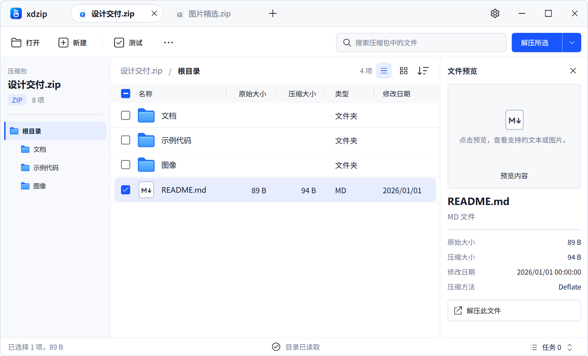

<p align="center">
  
</p>

<h1 align="center">xdzip</h1>

<p align="center"><strong>打包与解压，都简单一点。</strong></p>

<p align="center">xdzip 是一款开源跨平台压缩包管理工具。它使用 Rust 实现格式处理，无需依赖外部解压程序；支持浏览和搜索包内文件、选择性解压，以及加密、分卷和受支持格式的包内修改。<br>支持 ZIP、7z、RAR、TAR、CAB、ISO/UDF 等格式，适用于 Windows、macOS 和 Linux。</p>

<p align="center">
  <a href="https://github.com/xiaodaozhi/xdzip/actions/workflows/docs.yml"></a>
  <a href="LICENSE"></a>
</p>

<p align="center"><a href="README.md">English</a> | 简体中文</p>

<p align="center">
  <a href="#下载安装">下载安装</a> / <a href="#使用-xdzip">使用 xdzip</a> / <a href="#格式支持">格式支持</a> / <a href="#从源码构建">从源码构建</a> / <a href="docs/zh-CN/README.md">文档</a> / <a href="https://github.com/xiaodaozhi/xdzip/issues">反馈</a>
</p>



## 下载安装

Windows 11 x64 用户可以在 Microsoft Store 搜索 **XDZip**。如需直接下载安装包或独立命令行工具，请到 [GitHub 最新稳定版](https://github.com/xiaodaozhi/xdzip/releases/latest)选择对应系统的文件。

| 系统 | 支持范围 | GitHub 下载包 |
| --- | --- | --- |
| Windows | 仍受维护的 Windows 11，x86_64 | 当前用户安装器 `setup.exe` 或便携 `.zip` |
| macOS | macOS 14 及以上，Apple Silicon | `.dmg`，或 `.app.zip` 应用包 |
| Linux | Ubuntu 24.04 LTS，x86_64，X11，glibc 2.39 及以上 | `.deb` 安装包，或 `.tar.gz` 运行目录 |

桌面包以 `xdzip-<版本>-` 开头，独立[命令行工具](#命令行)以 `xdzip-cli-<版本>-` 开头。直接下载后可用发布页的 `SHA256SUMS` 核对文件。GitHub 的 Windows 安装器未签名，macOS 包采用 ad-hoc 完整性签名，未经过 Apple 公证。各安装包的启动方法和文件关联设置见[安装指南](docs/zh-CN/user-guide/install.md)。

Microsoft Store 负责该渠道的更新，与 GitHub 独立发布。GitHub 版可在“关于 xdzip”中主动检查更新。符合条件的 Windows 当前用户安装版、macOS“应用程序”中的副本及 Ubuntu DEB 安装版可以在应用内安装更新。便携版请手动更新。详见[设置与更新](docs/zh-CN/user-guide/settings-and-updates.md)与[支持政策](docs/zh-CN/engineering/support-policy.md)。

**版本说明**：本页的功能说明基于当前源码，发布包以对应版本的发布说明为准。源码构建属于实验性开发版本。

## 使用 xdzip

打开压缩包后可以浏览目录、搜索和排序，再选择需要解压的条目。升序和降序都将目录排在文件之前。界面提供列表和网格视图、文件属性、简体中文和美式英语、浅色和深色主题，以及可调的字号和界面密度。自动语言在支持时跟随系统，否则使用美式英语。普通单文件 ZIP／ZIP64 最多可索引一百万条记录供浏览。多数其他格式的上限更低，解压、整包检查和修改也各有独立限制。详见[用户手册](docs/zh-CN/user-guide/README.md)与[大归档索引](docs/zh-CN/engineering/large-index.md)。

- **内容预览**：在属性卡主动预览受限纯文本、常见栅格图片和静态 SVG，macOS 还支持 HEIC／HEIF。完整读取并完成格式提供的校验后显示，可取消；格式、大小和解码预算见[预览说明](docs/zh-CN/engineering/content-preview.md)。
- **解压和打开**：选择目标位置与重名策略，查看进度并可请求取消。双击普通文件会先将副本解压到私有临时目录，再交给系统打开；修改副本不会写回压缩包，缓存会在七天后的后续打开操作中清理。
- **创建和修改**：可创建 ZIP、TAR、TAR.GZ、GZIP、XZ、TAR.XZ、LZ4、TAR.LZ4、Zstandard、TAR.ZST、LZH 和 7z，也能创建 ISO9660/Joliet 数据镜像。Windows x64 还可以创建 ZIP 自解压包。支持对符合条件的普通单文件压缩包添加文件、替换文件和包内移动；也可从列表拖出文件，或拖入文件后确认添加。具体格式和限制见下表。
- **检查**：可在后台测试整包，不写出文件。校验范围取决于格式。TAR、ISO、UDF 和复合文件（MSI）等格式检查结构与可读性，没有逐文件内容校验和。详见[完整性检查](docs/zh-CN/engineering/archive-checking.md)。
- **多个归档**：默认在新标签页打开，也可设置为新窗口。同一登录会话共用应用进程和托盘，关闭浏览页面后后台任务仍可从任务入口访问。
- **文件管理器操作。** Windows 11 安装版可在“显示更多选项”中使用经典菜单，商店版还可以在现代菜单中显示。Ubuntu 通过已安装的 Files（Nautilus）扩展提供操作。macOS 可在系统设置中启用 Finder 扩展，或使用已登记的 Finder 服务。详见[从文件管理器解压](docs/zh-CN/user-guide/extract.md#从文件管理器解压)。

创建或添加时会排除 `.DS_Store` 文件及 `__MACOSX`、`_MACOSX` 目录。解压时执行路径检查、目标授权、重名处理和暂存，支持的格式还会校验内容；特殊对象和链接的处理因格式与平台而异，详见[安全解压契约](docs/zh-CN/engineering/zip-safe-extraction.md)。

## 格式支持

下表可用于确认 xdzip 能否打开、创建或修改某类压缩包。“修改”指向已有压缩包添加、替换或移动条目。能否读取或检查取决于实际内容、压缩方法和条目类型。后缀只提供探测入口。详细限制见[内置格式登记](docs/zh-CN/engineering/format-registry.md)与[完整性检查指南](docs/zh-CN/user-guide/checks-and-tasks.md)。

| 格式 | 浏览、解压和检查 | 创建 | 修改 |
| --- | --- | --- | --- |
| ZIP 及 ZIPX、XPI、APK、IPA、CBZ 候选 | Store、Deflate、Deflate64、BZip2、LZMA、XZ，已准入 AES-256 和分卷配置 | 支持 ZIP，Store、Deflate、AES-256 和编号分卷 | 符合条件的 Store/Deflate ZIP 包 |
| TAR、TAR.GZ（含 `.tgz`） | 支持普通文件与目录 | 支持，TAR 仅打包 | 符合条件的普通单文件包 |
| GZIP（`.gz`） | 一个逻辑文件，可由串联的 GZIP 成员组成。内部为 TAR 时按目录树浏览。 | 一个普通文件，Deflate 0/1/6/9 | 不支持 |
| BZip2、独立 LZMA、Lzip v1 | 在流与内存限制内读取一个普通文件 | 不支持 | 不支持 |
| TAR.BZ2、TAR.LZMA、TAR.LZ | 支持普通文件与目录 | 不支持 | 不支持 |
| XZ、TAR.XZ（含 `.txz`） | 声明的校验、LZMA2、Delta/BCJ 和串联流 | LZMA2 1/6/9 级，XZ 仅一个普通文件 | 不支持 |
| LZ4、TAR.LZ4 | 标准帧、独立块和关联块、串联及声明的校验 | LZ4 1/6/9 级，普通 LZ4 仅一个普通文件 | 不支持 |
| Zstandard、TAR.ZST（含 `.tzst`） | 标准帧、已准入窗口、Huffman/FSE、重复偏移及声明的校验 | Zstandard 1/6/9 级，普通 Zstandard 仅一个普通文件 | 不支持 |
| 7z | 支持密码、文件名加密、固实和编号分卷 | 支持加密、固实和编号分卷 | 符合条件的未加密、非分卷包 |
| DEB | 普通 ar 成员、control/data TAR 视图，已准入 GZIP/XZ/Zstandard/BZip2/LZMA 配置 | 不支持 | 不支持 |
| LHA/LZH | 0–3 级头部，Store、LH1–LH7、LZS/LZ5 及声明 CRC | LH5 1/6/9 级，2 级头部，普通文件与目录 | 不支持 |
| [PMA](docs/zh-CN/engineering/pma-streams.md) | 0 级头部 PM0/PM1/PM2，准确 CP/M 结构与声明 CRC | 不支持 | 不支持 |
| [ARJ](docs/zh-CN/engineering/arj-streams.md) | Store 和方法 1–4，完整头部校验及成员 CRC-32 | 不支持 | 不支持 |
| [ARC](docs/zh-CN/engineering/arc-streams.md) | 旧/新 Store 与方法 3–9，完整结构及成员 CRC-16 | 不支持 | 不支持 |
| [BH](docs/zh-CN/engineering/bh-containers.md) | `BH 05 07` 普通成员、方法 8 raw Deflate、准确长度与 CRC-32 | 不支持 | 不支持 |
| [ALZ](docs/zh-CN/engineering/ace-alz-egg-format-sources.md) | 普通单卷成员，支持 Store 或原始 Deflate，准确尺寸与 CRC-32 | 不支持 | 不支持 |
| [EGG](docs/zh-CN/engineering/ace-alz-egg-format-sources.md) | 无加密、非固实的普通单卷成员，支持 Store 或原始 Deflate，准确尺寸与 CRC-32 | 不支持 | 不支持 |
| [PEA](docs/zh-CN/engineering/disk-image-archive-format-sources.md) | PEA 1.x 单卷、UTF-8 名称、无加密 PCOMPRESS0 存储文件与目录，不含对象、流或卷校验 | 不支持 | 不支持 |
| [复合文件（MSI）](docs/zh-CN/engineering/wim-msi-installer-format-sources.md#compound-file-与-msi) | 浏览存储目录、提取原始数据流，检查结构和可读性 | 不支持 | 不支持 |
| [NSIS（`.exe`）](docs/zh-CN/engineering/wim-msi-installer-format-sources.md#nsis-与其他-sfx) | 仅查看静态 `firstheader` 元数据。不支持解压或整包测试。 | 不支持 | 不支持 |
| ASAR | 存储文件与目录、共享载荷区间及声明的文件/块 SHA-256 | 不支持 | 不支持 |
| Z、TAR.Z（包括 `.taz`） | Unix compress LZW、9–16 位字典及已准入 CLEAR/对齐配置 | 不支持 | 不支持 |
| Brotli、TAR.BR | 普通 RFC 7932 流，10–24 位窗口和全部静态词典变换 | 不支持 | 不支持 |
| AES Crypt（`.aes`） | 0–3 版，打开密码、完整密文 HMAC 和逐版本长度规则 | 不支持 | 不支持 |
| UU/UUE、XXE | 传统计数行与已准入 begin-base64 封装，包括多成员 | 不支持 | 不支持 |
| RAR | 支持旧版、RAR5 和 RAR 7 格式扩展，包括密码、固实及分卷 | 不支持 | 不支持 |
| CAB | 支持 Store、MSZip、Quantum、LZX 和同目录分卷 | 不支持 | 不支持 |
| ISO | 支持 ISO9660、Joliet 和 Rock Ridge | ISO9660 + Joliet 数据映像 | 不支持 |
| UDF | 支持 UDF | 不支持 | 不支持 |
| ZIP SFX | 经校验的 ZIP 自解压包 | Windows x64，Store/Deflate，`.sfx.exe` | 不支持 |

- ZIP 的 AES-256 只加密内容，文件名仍可见；不支持 AES-128／192 或传统 ZipCrypto。分卷读取支持 `.zip.001` 及 PKZIP `.z01` 等命名，创建使用编号分卷。详见[密码解压](docs/zh-CN/engineering/password-extraction.md)和[分卷打开](docs/zh-CN/engineering/archive-opening.md)。
- BZip2、独立 LZMA、Lzip v1 及其 TAR 组合目前只读。LZMA 没有内容校验和，测试检查结构、尺寸和可读性。后缀、成员、内存限制与识别边界见[单文件流契约](docs/zh-CN/engineering/single-file-streams.md)。
- XZ 验证各流声明的内容校验，声明 None 的流只提供结构与可读性检查。ZIPX 读取限于表内 ZIP 方法，PPMd、JPEG 和 WavPack 变体尚不支持；新增 ZIP 压缩方法只读，不扩展 AES 组合，也不增加 ZIPX 创建。
- 7z 修改通过重建完成，保留及新增文件内容的工作集上限为 512 MiB；新建使用流式输入，不受此重建限制。加密和分卷的 ZIP、7z 不支持修改。详见[归档修改](docs/zh-CN/engineering/archive-transfers.md)。
- RAR、CAB 和 UDF 为只读格式。[ISO 创建](docs/zh-CN/engineering/iso-creation.md)支持普通文件与目录、单卷、单文件小于 4 GiB，每个 Joliet 名称分量最多 64 个 UCS-2 字符。不提供启动镜像、UDF 或 Rock Ridge 写入及镜像更新。读取镜像不会挂载或执行内容。格式覆盖和资源限制见 [RAR 契约](docs/zh-CN/engineering/rar-format-sources.md)和[格式后端契约](docs/zh-CN/engineering/native-codecs.md)。
- [自有 SFX 创建](docs/zh-CN/engineering/sfx-creation.md)生成可独立运行的 Windows x64 ZIP 自解压包，无需 Qt 或已安装的 xdzip。支持选择目标目录、冲突处理与取消，绝不执行解压出的文件。不提供密码、分卷和自动运行命令，普通 `.exe` 不参与文件关联。
- DEB 提供 `members/`、`control/`、`data/` 导出视图，全部提取包含原始成员和展开内容，不安装软件包、不执行脚本。control 接受无压缩、GZIP、XZ、Zstandard，data 另接受 BZip2、LZMA。检查验证容器可读性和声明的校验，不代表软件包认证，详见 [DEB 契约](docs/zh-CN/engineering/deb-containers.md)。
- Z 与 TAR.Z 只检查结构与可读性，没有校验和，不提供创建或损坏历史流修复，详见 [Unix compress 契约](docs/zh-CN/engineering/compress-streams.md)。
- UU/UUE 与 XXE 只检查结构与可读性，不提供校验和。头部路径和权限不直接授予输出或执行能力；GNU 编码文件名和多段修复不属于已准入的[文本封装配置](docs/zh-CN/engineering/text-envelopes.md)。
- LHA/LZH 创建采用 LH5、2 级头部和 UTF-8 名称，旧 Windows 工具可能按旧代码页显示这些名称；现有归档不能修改。读取时先解码旧名称再解释分隔符，实际解码时验证存在的 CRC，无 CRC 的古老成员只提供结构与可读性检查。密码、分卷和修复配置尚未准入，PMA 使用独立只读配置，详见 [LHA 契约](docs/zh-CN/engineering/lha-containers.md)。
- ARJ 为只读格式，二进制及旧文本成员均交付归档中 CRC 覆盖的原始字节，不按平台转换换行。密码、分卷、恢复/安全配置、链接和特殊对象尚未准入。未知方法保持可见，并阻止整包检查成功。
- ARC 采用只读顺序普通文件配置，验证精确结束。密码解码、分卷、SFX 和 Spark 扩展尚未准入。未知方法保留原始编号，不使用 ZIP 方法别名，并阻止整包检查成功。旧 XOR 加密没有头部标记，解码仍须通过码流、尺寸和 CRC 检查，不进行密码或修复回退。
- BH 仅支持读取 `BH 05 07` 方法 8 的原始 Deflate 配置。未知方法、加密、目录、分卷、尾部和自解压前缀不在范围内。

- 浏览或提取只读 ASAR 不启动其中的应用。外置 `unpacked` 数据和声明的链接可见但不支持提取，不授予相邻目录访问或可执行权限恢复能力。可选摘要检查损坏，无摘要条目只提供结构与可读性检查，详见 [ASAR 契约](docs/zh-CN/engineering/asar-containers.md)。
- NSIS 只有在 PE overlay 中发现有界且有效的 `firstheader` 记录时才按内容识别。xdzip 只发布静态元数据行，绝不执行 PE stub、安装器脚本、插件或载荷，不解压安装器头部，也不提供载荷提取；`.exe` 登记项不参与拖放和系统关联，这不是通用可执行文件处理器。
- 进入磁盘索引的大型 ZIP 暂不支持整包测试或修改，所选普通文件仍可按任务上限解压；详见[大归档索引](docs/zh-CN/engineering/large-index.md)。
- 暂不支持稀疏 TAR 和第三方扩展。普通 GZIP 及 XPI/APK/IPA/CBZ 候选遵循[单文件流契约](docs/zh-CN/engineering/single-file-streams.md)。旧编码文件名会尝试识别，但短名称或混合编码无法保证唯一识别，详见[文件名编码](docs/zh-CN/engineering/filename-encoding.md)。

- AES Crypt 在发布元数据前必须提供打开密码并验证完整密文认证码。0–2 版的尾部长度模值未认证，扩展字段不授予权限。详见 [AES Crypt 契约](docs/zh-CN/engineering/aescrypt-envelopes.md)。

- Brotli 和 TAR.BR 只读，无魔数候选必须完整验证内容，没有校验和；共享词典与大窗口扩展不在准入 [Brotli 范围](docs/zh-CN/engineering/brotli-streams.md)内。

## 命令行

独立 CLI 无需 Qt 或图形会话，支持列举、解压、创建、添加和测试压缩包，以及 JSON 输出。解开 `xdzip-cli-<版本>-` 下载包后，macOS 或 Linux 运行 `./bin/xdzip --help`，Windows PowerShell 运行 `.\bin\xdzip.exe --help`。保留可执行文件旁的配套工作进程文件。[命令行入门](docs/zh-CN/integration/README.md)提供使用示例及 PATH 设置方法。也可从源码构建：

```sh
git clone https://github.com/xiaodaozhi/xdzip.git
cd xdzip
python3 scripts/cli.py build
python3 scripts/cli.py test
build/cli/bin/xdzip --help
build/cli/bin/xdzip list archive.zip --json
build/cli/bin/xdzip extract archive.zip -C output
```

Windows 使用 `python` 并为可执行文件加 `.exe`。Linux 运行需要系统 OpenSSL 3 和证书，构建还需要 `libssl-dev` 和 `pkg-config`。密码、非交互模式、退出码、命令安装及更新边界见[命令行指南](docs/zh-CN/engineering/command-line.md)。

## 从源码构建

桌面界面使用 Qt Quick/QML，通过薄 C++ 层连接 Rust 核心。格式、查询和任务逻辑独立于 Qt；7z、RAR、CAB、ISO、UDF 读取与 7z 写入使用隔离工作进程，ISO 创建在 Rust 宿主中运行。独立 Windows 自解压程序使用系统对话框，不依赖 Qt。

项目文档位于 `docs/`，供生成和检查使用的视觉参数、术语及依赖清单位于 `specs/`，高保真设计原稿位于 `design/hifi/`。

准备 Python 3.10+、Git、CMake 3.24+、Ninja、rustup 和平台编译器／SDK，然后获取源码并构建。如果已按上面的命令行步骤克隆，直接从 `prepare` 开始：

```sh
git clone https://github.com/xiaodaozhi/xdzip.git
cd xdzip
python3 scripts/desktop.py prepare --install-rust --install-qt
python3 scripts/desktop.py doctor
python3 scripts/desktop.py build
python3 scripts/desktop.py test
```

Windows 使用 MSVC x64 开发环境；macOS 使用 Apple Silicon 原生终端及 Xcode Command Line Tools。默认 Qt 6.8.2 工具链位于 `build/toolchain/`。已有 Qt 时可指定 `--qt-prefix`。完整依赖、运行入口、打包及验证步骤见[开发构建指南](docs/zh-CN/engineering/developer-build.md)。命令行和桌面构建使用各自的入口；桌面构建也包含私有 CLI，命令入口需显式启用。

开发包不等同于正式 Release。也可按需从 [Qt components 工作流](https://github.com/xiaodaozhi/xdzip/actions/workflows/qt-components.yml)的成功手动运行下载 Windows、Linux 开发工件；日常 CI 不自动生成开发包。

## 文档与参与

| 需要了解 | 入口 |
| --- | --- |
| 桌面使用与脚本集成 | [用户手册](docs/zh-CN/user-guide/README.md)、[命令行与集成](docs/zh-CN/integration/README.md) |
| 产品设计与实现 | [技术参考](docs/zh-CN/reference/README.md) |
| 隐私与数据处理 | [隐私政策](PRIVACY.zh-CN.md)、[Privacy Policy](PRIVACY.md) |
| 开发与贡献 | [开发与贡献指南](docs/zh-CN/contributing/README.md) |
| 版本变化和待办 | [变更日志](CHANGELOG.md)、[GitHub Issues](https://github.com/xiaodaozhi/xdzip/issues) |
| 贡献 | [贡献指南](CONTRIBUTING.md)、[行为规范](CODE_OF_CONDUCT.md) |

欢迎反馈问题或参与贡献。报告缺陷时请提供版本或提交、系统与架构、复现步骤和实际结果；样本请自行生成，避免包含敏感内容。安全问题请通过 [Report a vulnerability](https://github.com/xiaodaozhi/xdzip/security/advisories/new) 私下报告。

## 许可证

项目原创内容采用 [Apache License 2.0](LICENSE)，版权声明见 [COPYRIGHT](COPYRIGHT)。Qt、编解码器、字体及其他依赖遵守各自许可证，来源和通知见[许可证文档](docs/zh-CN/engineering/licensing.md)。正式 Release 不提供单独的对应源码压缩包，相关说明见[源码交付](docs/zh-CN/engineering/source-delivery.md)；这一政策不改变适用的源码、重链接和通知义务。每个发行候选仍须单独复核，历史记录见 [#4](https://github.com/xiaodaozhi/xdzip/issues/4) 和 [#53](https://github.com/xiaodaozhi/xdzip/issues/53)。
