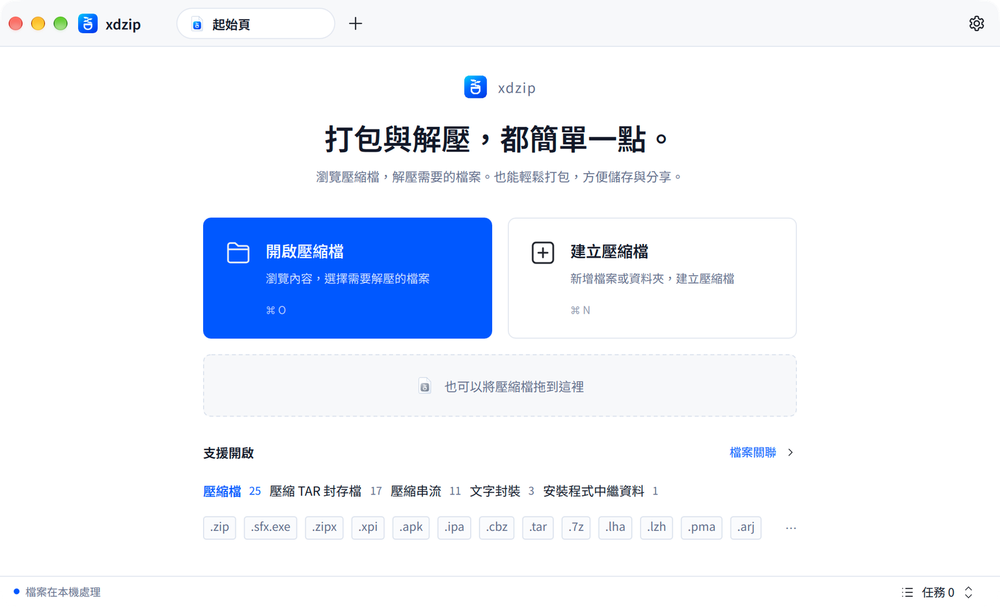

<p align="center">
  
</p>

<h1 align="center">xdzip</h1>

<p align="center"><a href="README.md">English</a> | <a href="README.zh-CN.md">简体中文</a> | 繁體中文 | <a href="README.ja-JP.md">日本語</a> | <a href="README.ko-KR.md">한국어</a> | <a href="README.fr-FR.md">Français</a> | <a href="README.de-DE.md">Deutsch</a> | <a href="README.es-ES.md">Español</a> | <a href="README.pt-BR.md">Português (Brasil)</a> | <a href="README.ru-RU.md">Русский</a></p>

<p align="center"><strong>打包與解壓，都簡單一點。</strong></p>

<p align="center">xdzip 是一款開源跨平臺壓縮檔管理工具。它使用 Rust 實現格式處理，無需依賴外部解壓程式；支援瀏覽和搜尋包內檔案、選擇性解壓，以及加密、分卷和受支援格式的包內修改。<br>支援 ZIP、7z、RAR、TAR、CAB、ISO/UDF 等格式，適用於 Windows、macOS 和 Linux。</p>

<p align="center">
  <a href="https://github.com/xiaodaozhi/xdzip/actions/workflows/docs.yml"></a>
  <a href="LICENSE"></a>
</p>

<p align="center">
  <a href="#xdzip-%E4%B8%8B%E8%BD%BD%E5%AE%89%E8%A3%85">下載安裝</a> / <a href="#xdzip-%E4%BD%BF%E7%94%A8-xdzip">使用 xdzip</a> / <a href="#xdzip-%E6%A0%BC%E5%BC%8F%E6%94%AF%E6%8C%81">格式支援</a> / <a href="#xdzip-%E4%BB%8E%E6%BA%90%E7%A0%81%E6%9E%84%E5%BB%BA">從原始碼構建</a> / <a href="docs/zh-TW/README.md">文件</a> / <a href="https://github.com/xiaodaozhi/xdzip/issues">意見回饋</a>
</p>



<a name="xdzip-下载安装"></a>

## 下載安裝

Windows 11 x64 使用者可以在 Microsoft Store 搜尋 **XDZip**。如需直接下載安裝包或獨立命令列工具，請到 [GitHub 最新穩定版](https://github.com/xiaodaozhi/xdzip/releases/latest)選擇對應系統的檔案。

| 系統 | 支援範圍 | GitHub 下載包 |
| --- | --- | --- |
| Windows | 仍受維護的 Windows 11，x86_64 | 目前使用者安裝器 `setup.exe` 或便攜 `.zip` |
| macOS | macOS 14 及以上，Apple Silicon | `.dmg`，或 `.app.zip` 應用包 |
| Linux | Ubuntu 24.04 LTS，x86_64，X11，glibc 2.39 及以上 | `.deb` 安裝包，或 `.tar.gz` 執行目錄 |

桌面包以 `xdzip-<版本>-` 開頭，獨立[命令列工具](#xdzip-%E5%91%BD%E4%BB%A4%E8%A1%8C)以 `xdzip-cli-<版本>-` 開頭。直接下載後可用釋出頁的 `SHA256SUMS` 核對檔案。GitHub 的 Windows 安裝器未簽名，macOS 包採用 ad-hoc 完整性簽名，未經過 Apple 公證。各安裝包的啟動方法和檔案關聯設定見[安裝指南](docs/zh-TW/user-guide/install.md)。

Microsoft Store 負責該渠道的更新，與 GitHub 獨立釋出。GitHub 版可在“關於 xdzip”中主動檢查更新。符合條件的 Windows 目前使用者安裝版、macOS“應用程式”中的副本及 Ubuntu DEB 安裝版可以在應用內安裝更新。便攜版請手動更新。詳見[設定與更新](docs/zh-TW/user-guide/settings-and-updates.md)與[支援政策](docs/zh-TW/engineering/support-policy.md)。

**版本說明**：本頁的功能說明基於目前原始碼，釋出包以對應版本的發行說明為準。原始碼構建屬於實驗性開發版本。

<a name="xdzip-使用-xdzip"></a>

## 使用 xdzip

開啟壓縮檔後可以瀏覽目錄、搜尋和排序，再選擇需要解壓的條目。升序和降序都將目錄排在檔案之前。介面提供列表和網格檢視、檔案屬性、淺色與深色主題，以及可調的字級和介面密度。可在設定中選擇十種介面語言。自動偵測優先使用支援的系統語言，否則使用美式英語。普通單檔案 ZIP／ZIP64 最多可索引一百萬條記錄供瀏覽。多數其他格式的上限更低，解壓、整包檢查和修改也各有獨立限制。詳見[使用者手冊](docs/zh-TW/user-guide/README.md)與[大歸檔索引](docs/zh-TW/engineering/large-index.md)。

- **內容預覽**：選取單一檔案時，可見的屬性卡會自動預覽支援的純文字、點陣影像或靜態 SVG。macOS 還支援 HEIC／HEIF。完整讀取並完成格式提供的校驗後顯示，可取消；格式、大小和解碼預算見[預覽說明](docs/zh-TW/engineering/content-preview.md)。
- **解壓和開啟**：選擇目標位置與重名策略，檢視進度並可請求取消。雙擊普通檔案會先將副本解壓到私有臨時目錄，再交給系統開啟；修改副本不會寫回壓縮檔，快取會在七天後的後續開啟操作中清理。
- **建立和修改**：可建立 ZIP、TAR、TAR.GZ、GZIP、XZ、TAR.XZ、LZ4、TAR.LZ4、Zstandard、TAR.ZST、LZH 和 7z，也能建立 ISO9660/Joliet 資料映象。Windows x64 還可以建立 ZIP 自解壓包。支援對符合條件的普通單檔案壓縮檔新增、取代、移動、重新命名或刪除項目；也可從列表拖出檔案，或拖入檔案後確認新增。具體格式和限制見下表。
- **檢查**：可在背景測試整包，不寫出檔案。校驗範圍取決於格式。TAR、ISO、UDF 和複合檔案（MSI）等格式檢查結構與可讀性，沒有逐檔案內容校驗和。詳見[完整性檢查](docs/zh-TW/engineering/archive-checking.md)。
- **多個歸檔**：預設在新標籤頁開啟，也可設定為新視窗。同一登入會話共用應用程序和托盤，關閉瀏覽頁面後背景任務仍可從任務入口訪問。
- **檔案管理器操作。** Windows 11 安裝版可在“顯示更多選項”中使用經典選單，商店版還可以在現代選單中顯示。Ubuntu 透過已安裝的 Files（Nautilus）擴充套件提供操作。macOS 可在系統設定中啟用 Finder 擴充套件，或使用已登記的 Finder 服務。詳見[從檔案管理器解壓](docs/zh-TW/user-guide/extract.md#xdzip-%E4%BB%8E%E6%96%87%E4%BB%B6%E7%AE%A1%E7%90%86%E5%99%A8%E8%A7%A3%E5%8E%8B)。

建立或新增時會排除 `.DS_Store` 檔案及 `__MACOSX`、`_MACOSX` 目錄。解壓時執行路徑檢查、目標授權、重名處理和暫存，支援的格式還會校驗內容；特殊物件和連結的處理因格式與平臺而異，詳見[安全解壓契約](docs/zh-TW/engineering/zip-safe-extraction.md)。

<a name="xdzip-格式支持"></a>

## 格式支援

下表可用於確認 xdzip 能否開啟、建立或修改某類壓縮檔。“修改”指向已有壓縮檔新增、取代、移動、重新命名或刪除項目。能否讀取或檢查取決於實際內容、壓縮方法和條目型別。字尾只提供探測入口。詳細限制見[內建格式登記](docs/zh-TW/engineering/format-registry.md)與[完整性檢查指南](docs/zh-TW/user-guide/checks-and-tasks.md)。

| 格式 | 瀏覽、解壓和檢查 | 建立 | 修改 |
| --- | --- | --- | --- |
| ZIP 及 ZIPX、XPI、APK、IPA、CBZ 候選 | Store、Deflate、Deflate64、BZip2、LZMA、XZ，已准入 AES-256 和分卷配置 | 支援 ZIP，Store、Deflate、AES-256 和編號分卷 | 使用表列方法且符合條件的 ZIP/ZIPX 壓縮檔 |
| TAR、TAR.GZ（含 `.tgz`） | 支援普通檔案與目錄 | 支援，TAR 僅打包 | 符合條件的普通單檔案包 |
| GZIP（`.gz`） | 一個邏輯檔案，可由串聯的 GZIP 成員組成。內部為 TAR 時按目錄樹瀏覽。 | 一個普通檔案，Deflate 0/1/6/9 | 不支援 |
| BZip2、獨立 LZMA、Lzip v1 | 在流與記憶體限制內讀取一個普通檔案 | 不支援 | 不支援 |
| TAR.BZ2、TAR.LZMA、TAR.LZ | 支援普通檔案與目錄 | 不支援 | 符合條件的壓縮檔 |
| XZ、TAR.XZ（含 `.txz`） | 宣告的校驗、LZMA2、Delta/BCJ 和串聯流 | LZMA2 1/6/9 級，XZ 僅一個普通檔案 | TAR.XZ |
| LZ4、TAR.LZ4 | 標準幀、獨立塊和關聯塊、串聯及宣告的校驗 | LZ4 1/6/9 級，普通 LZ4 僅一個普通檔案 | TAR.LZ4 |
| Zstandard、TAR.ZST（含 `.tzst`） | 標準幀、已准入視窗、Huffman/FSE、重複偏移及宣告的校驗 | Zstandard 1/6/9 級，普通 Zstandard 僅一個普通檔案 | TAR.ZST |
| 7z | 支援密碼、檔名加密、固實和編號分卷 | 支援加密、固實和編號分卷 | 符合條件的未加密、非分捲包 |
| DEB | 普通 ar 成員、control/data TAR 檢視，已准入 GZIP/XZ/Zstandard/BZip2/LZMA 配置 | 不支援 | 不支援 |
| LHA/LZH | 0–3 級頭部，Store、LH1–LH7、LZS/LZ5 及宣告 CRC | LH5 1/6/9 級，2 級頭部，普通檔案與目錄 | 具有第 2 級標頭及項目 CRC 且符合條件的壓縮檔 |
| [PMA](docs/zh-TW/engineering/pma-streams.md) | 0 級頭部 PM0/PM1/PM2，準確 CP/M 結構與宣告 CRC | 不支援 | 不支援 |
| [ARJ](docs/zh-TW/engineering/arj-streams.md) | Store 和方法 1–4，完整頭部校驗及成員 CRC-32 | 不支援 | 不支援 |
| [ARC](docs/zh-TW/engineering/arc-streams.md) | 舊/新 Store 與方法 3–9，完整結構及成員 CRC-16 | 不支援 | 不支援 |
| [BH](docs/zh-TW/engineering/bh-containers.md) | `BH 05 07` 普通成員、方法 8 raw Deflate、準確長度與 CRC-32 | 不支援 | 不支援 |
| [ALZ](docs/zh-TW/engineering/ace-alz-egg-format-sources.md) | 普通單捲成員，支援 Store 或原始 Deflate，準確尺寸與 CRC-32 | 不支援 | 不支援 |
| [EGG](docs/zh-TW/engineering/ace-alz-egg-format-sources.md) | 無加密、非固實的普通單捲成員，支援 Store 或原始 Deflate，準確尺寸與 CRC-32 | 不支援 | 不支援 |
| [PEA](docs/zh-TW/engineering/disk-image-archive-format-sources.md) | PEA 1.x 單卷、UTF-8 名稱、無加密 PCOMPRESS0 儲存檔案與目錄，不含物件、流或卷校驗 | 不支援 | 不支援 |
| [複合檔案（MSI）](docs/zh-TW/engineering/wim-msi-installer-format-sources.md#xdzip-compound-file-%E4%B8%8E-msi) | 瀏覽儲存目錄、提取原始資料流，檢查結構和可讀性 | 不支援 | 不支援 |
| [NSIS（`.exe`）](docs/zh-TW/engineering/wim-msi-installer-format-sources.md#xdzip-nsis-%E4%B8%8E%E5%85%B6%E4%BB%96-sfx) | 僅檢視靜態 `firstheader` 後設資料。不支援解壓或整包測試。 | 不支援 | 不支援 |
| ASAR | 儲存檔案與目錄、共享載荷區間及宣告的檔案/塊 SHA-256 | 不支援 | 不支援 |
| Z、TAR.Z（包括 `.taz`） | Unix compress LZW、9–16 位字典及已准入 CLEAR/對齊配置 | 不支援 | TAR.Z |
| Brotli、TAR.BR | 普通 RFC 7932 流，10–24 位視窗和全部靜態詞典變換 | 不支援 | TAR.BR |
| AES Crypt（`.aes`） | 0–3 版，開啟密碼、完整密文 HMAC 和逐版本長度規則 | 不支援 | 不支援 |
| UU/UUE、XXE | 傳統計數行與已准入 begin-base64 封裝，包括多成員 | 不支援 | 不支援 |
| RAR | 支援舊版、RAR5 和 RAR 7 格式擴充套件，包括密碼、固實及分卷 | 不支援 | 不支援 |
| CAB | 支援 Store、MSZip、Quantum、LZX 和同目錄分卷 | 不支援 | 不支援 |
| ISO | 支援 ISO9660、Joliet 和 Rock Ridge | ISO9660 + Joliet 資料映像 | 不支援 |
| UDF | 支援 UDF | 不支援 | 不支援 |
| ZIP SFX | 經校驗的 ZIP 自解壓包 | Windows x64，Store/Deflate，`.sfx.exe` | 不支援 |

- ZIP 的 AES-256 只加密內容，檔名仍可見；不支援 AES-128／192 或傳統 ZipCrypto。分卷讀取支援 `.zip.001` 及 PKZIP `.z01` 等命名，建立使用編號分卷。詳見[密碼解壓](docs/zh-TW/engineering/password-extraction.md)和[分卷開啟](docs/zh-TW/engineering/archive-opening.md)。
- 獨立的 BZip2、LZMA Alone 和 Lzip v1 為唯讀。LZMA 沒有內容總和檢查碼，檢查會驗證結構、大小與可讀性。副檔名、項目、記憶體上限和支援範圍見[單檔案流契約](docs/zh-TW/engineering/single-file-streams.md)。
- XZ 會執行各串流宣告的內容檢查。宣告 None 的串流只檢查結構與可讀性。ZIPX 可讀取表列 ZIP 方法，PPMd、JPEG 和 WavPack 變體仍不支援。修改 ZIP/ZIPX 時會保留未移除項目的原始壓縮資料及方法，新項目使用 Deflate。
- 7z 修改透過重建完成，保留及新增檔案內容的工作集上限為 512 MiB；新建使用流式輸入，不受此重建限制。加密和分卷的 ZIP、7z 不支援修改。詳見[歸檔修改](docs/zh-TW/engineering/archive-transfers.md)。
- RAR、CAB 和 UDF 為只讀格式。[ISO 建立](docs/zh-TW/engineering/iso-creation.md)支援普通檔案與目錄、單卷、單檔案小於 4 GiB，每個 Joliet 名稱分量最多 64 個 UCS-2 字元。不提供啟動映象、UDF 或 Rock Ridge 寫入及映象更新。讀取映象不會掛載或執行內容。格式覆蓋和資源限制見 [RAR 契約](docs/zh-TW/engineering/rar-format-sources.md)和[格式後端契約](docs/zh-TW/engineering/native-codecs.md)。
- [自有 SFX 建立](docs/zh-TW/engineering/sfx-creation.md)生成可獨立執行的 Windows x64 ZIP 自解壓包，無需 Qt 或已安裝的 xdzip。支援選擇目標目錄、衝突處理與取消，絕不執行解壓出的檔案。不提供密碼、分卷和自動執行命令，普通 `.exe` 不參與檔案關聯。
- DEB 提供 `members/`、`control/`、`data/` 匯出檢視，全部提取包含原始成員和展開內容，不安裝軟體包、不執行指令碼。control 接受無壓縮、GZIP、XZ、Zstandard，data 另接受 BZip2、LZMA。檢查驗證容器可讀性和宣告的校驗，不代表軟體包認證，詳見 [DEB 契約](docs/zh-TW/engineering/deb-containers.md)。
- Z 和 TAR.Z 檢查結構與可讀性，格式沒有總和檢查碼。無法建立獨立的 Z 檔案或修復損壞的舊式串流。詳見[Unix compress 契約](docs/zh-TW/engineering/compress-streams.md)。
- UU/UUE 與 XXE 只檢查結構與可讀性，不提供校驗和。頭部路徑和許可權不直接授予輸出或執行能力；GNU 編碼檔名和多段修復不屬於已准入的[文字封裝配置](docs/zh-TW/engineering/text-envelopes.md)。
- 建立 LHA/LZH 時使用 LH5、第 2 級標頭及 UTF-8 名稱。舊版 Windows 工具仍可能依舊字碼頁顯示名稱。符合條件的第 2 級壓縮檔可以修改。讀取時先解碼舊名稱，再解讀分隔符號。解碼內容時會驗證已有的 CRC。沒有 CRC 的早期項目只檢查結構與可讀性。密碼、分卷和修復不在支援範圍內。PMA 採獨立的唯讀設定檔。詳見[LHA 契約](docs/zh-TW/engineering/lha-containers.md)。
- ARJ 為只讀格式，二進位制及舊文字成員均交付歸檔中 CRC 覆蓋的原始位元組，不按平臺轉換換行。密碼、分卷、恢復/安全配置、連結和特殊物件尚未准入。未知方法保持可見，並阻止整包檢查成功。
- ARC 採用只讀順序普通檔案配置，驗證精確結束。密碼解碼、分卷、SFX 和 Spark 擴充套件尚未准入。未知方法保留原始編號，不使用 ZIP 方法別名，並阻止整包檢查成功。舊 XOR 加密沒有頭部標記，解碼仍須透過碼流、尺寸和 CRC 檢查，不進行密碼或修復回退。
- BH 僅支援讀取 `BH 05 07` 方法 8 的原始 Deflate 配置。未知方法、加密、目錄、分卷、尾部和自解壓字首不在範圍內。

- 瀏覽或提取只讀 ASAR 不啟動其中的應用。外接 `unpacked` 資料和宣告的連結可見但不支援提取，不授予相鄰目錄訪問或可執行許可權恢復能力。可選摘要檢查損壞，無摘要條目只提供結構與可讀性檢查，詳見 [ASAR 契約](docs/zh-TW/engineering/asar-containers.md)。
- NSIS 只有在 PE overlay 中發現有界且有效的 `firstheader` 記錄時才按內容識別。xdzip 只發布靜態後設資料行，絕不執行 PE stub、安裝器指令碼、外掛或載荷，不解壓安裝器頭部，也不提供載荷提取；`.exe` 登記項不參與拖放和系統關聯，這不是通用可執行檔案處理器。
- 進入磁碟索引的大型 ZIP 暫不支援整包測試或修改，所選普通檔案仍可按任務上限解壓；詳見[大歸檔索引](docs/zh-TW/engineering/large-index.md)。
- 暫不支援稀疏 TAR 和第三方擴充套件。普通 GZIP 及 XPI/APK/IPA/CBZ 候選遵循[單檔案流契約](docs/zh-TW/engineering/single-file-streams.md)。舊編碼檔名會嘗試識別，但短名稱或混合編碼無法保證唯一識別，詳見[檔名編碼](docs/zh-TW/engineering/filename-encoding.md)。

- AES Crypt 在釋出後設資料前必須提供開啟密碼並驗證完整密文認證碼。0–2 版的尾部長度模值未認證，擴充套件欄位不授予許可權。詳見 [AES Crypt 契約](docs/zh-TW/engineering/aescrypt-envelopes.md)。

- Brotli 和 TAR.BR 的弱辨識候選必須通過完整內容驗證，格式不提供總和檢查碼。修改 TAR.BR 時使用標準未壓縮中繼區塊，結果可能比原檔更大。共享字典和大視窗擴充不在支援的[Brotli 範圍](docs/zh-TW/engineering/brotli-streams.md)內。

<a name="xdzip-命令行"></a>

## 命令列

獨立 CLI 無需 Qt 或圖形會話，支援列舉、解壓、建立、新增和測試壓縮檔，以及 JSON 輸出。解開 `xdzip-cli-<版本>-` 下載包後，macOS 或 Linux 執行 `./bin/xdzip --help`，Windows PowerShell 執行 `.\bin\xdzip.exe --help`。保留可執行檔案旁的配套工作程序檔案。[命令列入門](docs/zh-TW/integration/README.md)提供使用示例及 PATH 設定方法。也可從原始碼構建：

```sh
git clone https://github.com/xiaodaozhi/xdzip.git
cd xdzip
python3 scripts/cli.py build
python3 scripts/cli.py test
build/cli/bin/xdzip --help
build/cli/bin/xdzip list archive.zip --json
build/cli/bin/xdzip extract archive.zip -C output
```

Windows 使用 `python` 併為可執行檔案加 `.exe`。Linux 執行需要系統 OpenSSL 3 和證書，構建還需要 `libssl-dev` 和 `pkg-config`。密碼、非互動模式、退出碼、命令安裝及更新邊界見[命令列指南](docs/zh-TW/engineering/command-line.md)。

<a name="xdzip-从源码构建"></a>

## 從原始碼構建

桌面介面使用 Qt Quick/QML，透過薄 C++ 層連線 Rust 核心。格式、查詢和任務邏輯獨立於 Qt；7z、RAR、CAB、ISO、UDF 讀取與 7z 寫入使用隔離工作程序，ISO 建立在 Rust 宿主中執行。獨立 Windows 自解壓程式使用系統對話方塊，不依賴 Qt。

專案文件位於 `docs/`，供生成和檢查使用的視覺引數、術語及依賴清單位於 `specs/`，高保真設計原稿位於 `design/hifi/`。

準備 Python 3.10+、Git、CMake 3.24+、Ninja、rustup 和平臺編譯器／SDK，然後獲取原始碼並構建。如果已按上面的命令列步驟克隆，直接從 `prepare` 開始：

```sh
git clone https://github.com/xiaodaozhi/xdzip.git
cd xdzip
python3 scripts/desktop.py prepare --install-rust --install-qt
python3 scripts/desktop.py doctor
python3 scripts/desktop.py build
python3 scripts/desktop.py test
```

Windows 使用 MSVC x64 開發環境；macOS 使用 Apple Silicon 原生終端及 Xcode Command Line Tools。預設 Qt 6.8.2 工具鏈位於 `build/toolchain/`。已有 Qt 時可指定 `--qt-prefix`。完整依賴、執行入口、打包及驗證步驟見[開發構建指南](docs/zh-TW/engineering/developer-build.md)。命令列和桌面構建使用各自的入口；桌面構建也包含私有 CLI，命令入口需顯式啟用。

開發包不等同於正式 Release。也可按需從 [Qt components 工作流](https://github.com/xiaodaozhi/xdzip/actions/workflows/qt-components.yml)的成功手動執行下載 Windows、Linux 開發工件；日常 CI 不自動生成開發包。

<a name="xdzip-文档与参与"></a>

## 文件與參與

| 需要了解 | 入口 |
| --- | --- |
| 桌面使用與指令碼整合 | [使用者手冊](docs/zh-TW/user-guide/README.md)、[命令列與整合](docs/zh-TW/integration/README.md) |
| 產品設計與實現 | [技術參考](docs/zh-TW/reference/README.md) |
| 隱私與資料處理 | [隱私政策](PRIVACY.zh-CN.md)、[Privacy Policy](PRIVACY.md) |
| 開發與貢獻 | [開發與貢獻指南](docs/zh-TW/contributing/README.md) |
| 版本變化和待辦 | [變更日誌](CHANGELOG.zh-TW.md)、[GitHub Issues](https://github.com/xiaodaozhi/xdzip/issues) |
| 貢獻 | [貢獻指南](CONTRIBUTING.zh-CN.md)、[行為規範](CODE_OF_CONDUCT.zh-CN.md) |
| 專案政策 | [專案治理](GOVERNANCE.zh-CN.md)、[安全政策](SECURITY.zh-CN.md) |

歡迎意見回饋問題或參與貢獻。報告缺陷時請提供版本或提交、系統與架構、復現步驟和實際結果；樣本請自行生成，避免包含敏感內容。安全問題請透過 [Report a vulnerability](https://github.com/xiaodaozhi/xdzip/security/advisories/new) 私下報告。

<a name="xdzip-许可证"></a>

## 許可證

專案原創內容採用 [Apache License 2.0](LICENSE)，版權宣告見 [COPYRIGHT](COPYRIGHT)。Qt、編解碼器、字型及其他依賴遵守各自許可證，來源和通知見[許可證文件](docs/zh-TW/engineering/licensing.md)。正式 Release 不提供單獨的對應原始碼壓縮檔，相關說明見[原始碼交付](docs/zh-TW/engineering/source-delivery.md)；這一政策不改變適用的原始碼、重連結和通知義務。每個發行候選仍須單獨複核，歷史記錄見 [#4](https://github.com/xiaodaozhi/xdzip/issues/4) 和 [#53](https://github.com/xiaodaozhi/xdzip/issues/53)。
