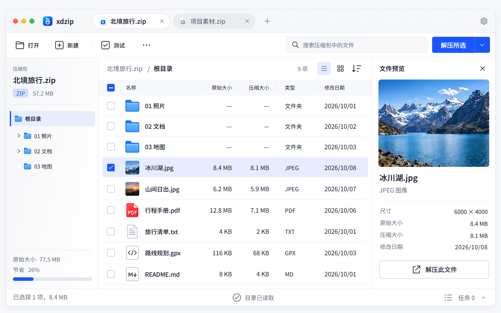

# xdzip 高保真设计统一入口

[完整图片画廊](index.html)，[原稿清单与 SHA-256](catalog.json)，[统一素材库](../assets/index.html)，[颜色尺寸规范](../../docs/visual/tokens.json)

页面原稿、当前可编辑修订与目录树 B 组件图板统一放在 `screens/`，按页面功能命名。主窗口、独立解压确认与各操作状态共同构成当前视觉依据；不再按交付批次拆成不同目录。原始生成式设计图与可编辑源导出图在清单中区分，功能边界和精确几何仍以对应规范为准。

## 主界面与解压确认

| 原稿 | 状态 |
| --- | --- |
| [主窗口，浅色](screens/main-capsule-light.png) | 当前胶囊标签修订 |
| [主窗口，深色](screens/main-capsule-dark.png) | 同源深色设计导出 |
| [多标签溢出，浅色](screens/tabs-overflow-light.png) | 横向视口、滚动按钮、标签列表与常规字重的非活动标签 |
| [多标签溢出，深色](screens/tabs-overflow-dark.png) | 同源深色设计导出，支持窗口内拖动排序 |
| [解压确认，macOS 独立窗口](screens/extract-macos.png) | 当前解压确认视觉参考 |

[主窗口与目录树可编辑设计源](sources/main.html)复用现行 HTML 标题栏，冻结 48 高标题栏、32 高胶囊、16 圆角、上下各 8 的逻辑尺寸。浅深色主窗口与多级目录图均从该源导出；它们用于查看当前设计，不作为独立量测输入或原生 Qt 验收证据。

[多标签交互稿](sources/main.html?tabs=overflow)展示标签收窄与溢出、左右滚动及标签列表，支持拖动和 Control+Shift+Page Up/Down 重排。活动标签字重 600，其他标签字重 400；原历史主图及量测哈希继续保留。

当前菜单状态可直接查看：[根目录](sources/main.html?menu=directory-root)、[无子目录的节点](sources/main.html?menu=directory-leaf&theme=dark)、[解压下拉](sources/main.html?menu=extract)、[文件右键](sources/main.html?menu=context)与[视图子菜单](sources/main.html?menu=submenu)。禁用项保留置灰与无障碍描述，不在菜单下方显示原因，也不显示浮动提示。入口复用共享 HTML 菜单，支持 `lang=en-US`、`theme=dark` 和 `textScale=1.25`／`1.5` 的设计配置；截图与量测只输出到 build，不作为原生 Qt 验收或既有 PNG 已更新的声明。

## 操作窗口与功能状态

| 原稿 | 状态 |
| --- | --- |
| [新建归档](screens/create.png) | C01 创建计划 |
| [添加到压缩包](sources/archive-add.html) | 参照 C01 的图标标题、三卡片和共用文件选择区 |
| [重名冲突](screens/conflict.png) | E02 等待决策 |
| [任务进度](screens/progress.png) | T01 执行中 |
| [部分失败](screens/partial-result.png) | R01 部分未完成 |
| [设置](sources/settings.html) | S01 主题、文字大小、打开方式与界面语言，当前修订 |
| [任务状态](screens/task-states.png) | 成功 / 正在停止 / 已取消 |
| [完整性检查进度](screens/integrity-progress.png) | 复用任务进度布局，只读对象、读取速度与校验阶段 |
| [创建覆盖确认](screens/create-overwrite.png) | C02 覆盖准入 |
| [Windows / Linux 平台对照](screens/platforms.png) | 平台窗口装饰示例 |

操作、关闭与恢复行为见 [功能状态契约](../../docs/ux/hifi-state-spec.md)。原稿中的静态进度、计数和示例路径不作为真实运行结果。

## 目录树 B 组件修订

| 原稿 | 定义范围 |
| --- | --- |
| [多级展开](screens/directory-tree-capsule.png) | 当前胶囊标题栏、独立箭头槽、多级连接线、同层对齐 |
| [节点与交互状态](screens/directory-tree-states.png) | 折叠 / 展开、空 / 非空叶子、当前 / 悬停 / 焦点、长名称、大字号 |
| [空态与导航边界](screens/directory-tree-boundaries.png) | 读取、空归档、根文件、超限、失败、隐藏当前目录 |

[集中查看图板与切图](directory-tree.html)，[交互与接入规格](../../docs/ux/directory-tree.md)，[逻辑参数](../../docs/visual/directory-tree.json)，[实际交付检查（本地／CI 工件）](../../docs/qa/README.md)。B 为已确认的目录树修订。多级目录图已同步当前标题栏，其余状态图不包含标题栏；26 张原像素切片继续绑定[历史目录树图](screens/directory-tree.png)。图板比例不同，HTML 示例与 Qt 只读目录树已接入核心交互，专用边界图标／骨架与完整深色状态图板仍待补齐；既有人工专项以 [WP-12 issue](https://github.com/xiaodaozhi/xdzip/issues/5)结论为准，不以图板交付替代实际验收。

## 原稿与素材的职责

`hifi/` 保留完整原稿、可编辑设计源、当前修订导出、清单与画廊。图标、切片和素材预览统一放在 [design/assets](../assets/README.md)，从统一入口查看与维护。

- `assets/svg/`、`assets/png/`：HTML 和 Qt 共用的透明运行图标。
- `assets/reference/`：原图直接裁切的精美对照素材；保留原背景和原像素，用于评审透明重建的差异。
- `assets/demo/`：HTML 示例照片。
- `docs/visual/`：视觉规范与实现约束。
- `docs/qa/`：可复用验证方法与清单；实际证据放本地 build/ 或 CI 工件，结论由 issue 跟踪。

目录合并及后续修订保持旧原稿和原像素切片的字节不变。[历史主窗口](screens/main-light.png)与[历史目录树](screens/directory-tree.png)在画廊历史区展示，继续作为原始锚点和切片来源，不定义当前 tab 样式。历史 QA JSON 保留当时输入路径与哈希，结合 [迁移清单](../assets/migration.json) 或其记录的 Git 提交追溯，不回写历史测量。

新增原稿时更新 `catalog.json` 的用途、标题和 SHA-256，再运行 `python scripts/build-hifi-gallery.py`。CI 通过 `--check` 校验图片完整性及画廊同步，不重新生成图像。清单中的 schema 版本仅用于数据兼容，不是素材分组。

主窗口与多级目录修订可执行 `python scripts/export-hifi-titlebars.py --write-design` 重新导出，再显式更新清单哈希。省略 `--write-design` 时只写入 `build/review/hifi-titlebars/`；同一流程量测胶囊完整边框、上下留白、DPR 1／1.25／2 及主窗口与菜单比例，不自动覆盖冻结的原图或量测记录。

手机离线阅读可运行 `python scripts/build-hifi-gallery.py --standalone dist/xdzip-hifi-gallery.html`，导出内嵌全部原图的单文件 HTML；其他文档链接仍需仓库访问权限。

## 当前交互与尺寸修订

[操作窗口、按钮与任务状态修订](operation-revisions.html)覆盖 2026-10-15 的 491 逻辑像素统一宽度、动态结果高度、分段圆角、按下和禁用状态、重名正常密度及任务菜单。原始位图继续作为历史依据；当前行为及参数以该状态稿、docs/visual/layout-scale.json 和设计规范的修订段为准。

## W01 欢迎页候选

[欢迎页状态稿](sources/welcome.html)提供浅色、深色、832×544 最小窗口和拖入状态。对应原稿为 screens/welcome-*.png，布局与交互见[欢迎页设计](../../docs/ux/welcome.md)。设计已确认并接入正式 HTML，Qt 已接入真实打开与新建，桌面人工验收另行登记。sources/ 保存可编辑设计源，不是产品界面原型。

欢迎页标题栏修订见 screens/welcome-titlebar-*.png，原有 welcome-*.png 与 sources/welcome-initial.html 保留历史。修订只设计正文，标题栏与主窗口共用，不再另设品牌、标签或按钮几何。

S01 当前设置窗口修订见[主题、文字与语言设计源](sources/settings.html)，逻辑参数见[设置参数](../../docs/visual/settings-reference.json)，保存／取消与重启生效见[设置契约](../../docs/ux/settings-localization.md)。[历史 settings.png](screens/settings.png) 保留原图和哈希，不再定义当前设置功能范围。

会话模式修订的[浅色图稿](screens/settings-open-mode-light.png)与[深色图稿](screens/settings-open-mode-dark.png)增加“在新标签页打开／在新窗口打开”，默认新标签页。可编辑源与正式 HTML 共用设置布局；正文超出可用高度时滚动，footer 保持可达。运行 `python scripts/export-settings-design.py --write-design` 导出，再显式更新 catalog 哈希与画廊。导出日志仅写入 build，不是原生视觉验收。settings-current 图稿和 settings-reference 的历史几何依据保持字节与哈希不变。

P01 解压元数据预检修订：[设计源](sources/preflight.html)、[浅色](screens/preflight-body-note-light.png)、[深色](screens/preflight-body-note-dark.png)，参数见 [preflight-reference.json](../../docs/visual/preflight-reference.json)。客户区 491 逻辑像素宽，按内容自适应，最高 600，使用共享操作 footer。

预检的元数据边界说明位于可滚动正文末尾，footer 仅放返回按钮并保持共享操作栏高度；原 footer 含说明的浅深色稿保留在历史画廊。

## 中文文案修订

[当前术语状态稿](terminology.html)覆盖主窗口、欢迎页、解压、创建、进度、结果和设置的浅深色设计。容器名称为“压缩包”，范围为“全部内容”“所选文件和文件夹”，大小属性为“原始大小”“压缩大小”。历史 PNG、初版欢迎页和原始墨迹量测保留原文与哈希，其文字不再定义当前产品用词；布局、密度和控件尺寸保持既定规范。详见[中文术语规范](../../docs/ux/chinese-terminology.md)。

当前操作窗口的中性描边按 [2026-10-15 描边校正](../../docs/visual/design-standard.md#2026-10-15-操作控件描边校正) 统一使用浅色 #DCE2EC。上述动态状态稿与 HTML 共用生成参数，历史位图及其哈希保持不变。

欢迎页新增 [正在打开的浮动遮罩](sources/welcome.html?opening=1)，与 Qt、HTML 共用 [参数和交互契约](../../docs/ux/welcome-opening.md)，支持浅深色，保留原有标题栏。

当前新增设计：[A01 关于 xdzip](about.html)，统一版本信息、开发状态与复制操作。参数来自 [about-reference.json](../../docs/visual/about-reference.json)，不覆盖历史原稿。

[系统菜单与托盘，D01](sources/desktop-integration.html)：原生菜单结构、关闭驻留及恢复交互，实际装饰由系统绘制。

[退出与重启确认状态稿](sources/confirmations.html)覆盖退出、正在停止及重启确认，采用共享 491 宽、20 标题、13 正文和内容自适应高度。中英文、大字号、正文滚动与 footer 规则见[窗口规范](../../docs/visual/design-standard.md)。

[密码解压，P02](sources/password-extraction.html)冻结输入、错误重试与提交中三种状态。采用 491 宽、20 标题、13 正文、12 说明和固定共享 footer，密码字段在截图时保持为空。参数见 [password-reference.json](../../docs/visual/password-reference.json)，真实行为见[密码解压交互](../../docs/ux/password-extraction.md)。

起始页当前采用顶部固定布局，[打开失败状态](sources/welcome.html?error=1)显示红色反馈与警告图标，错误增长不推动上方内容。旧 welcome-titlebar PNG 保留原稿，当前正文与错误样式由可编辑源及 welcome-reference.json 定义。

顶部布局的新图稿为 [浅色](screens/welcome-top-light.png)、[深色](screens/welcome-top-dark.png)、[最小窗口](screens/welcome-top-narrow.png)与[错误反馈](screens/welcome-top-error.png)。使用 scripts/export-welcome-design.py 从同一可编辑源导出；旧居中图稿与哈希保持历史记录，导出图不替代独立量测。
