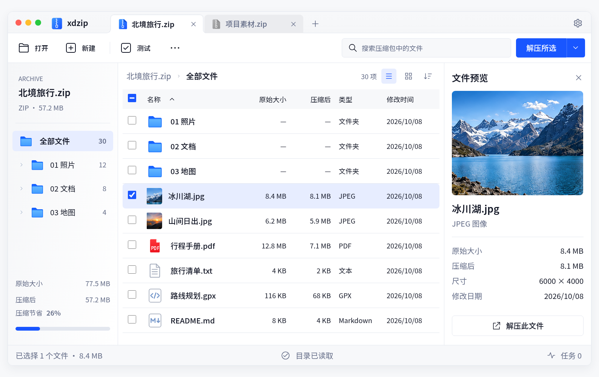
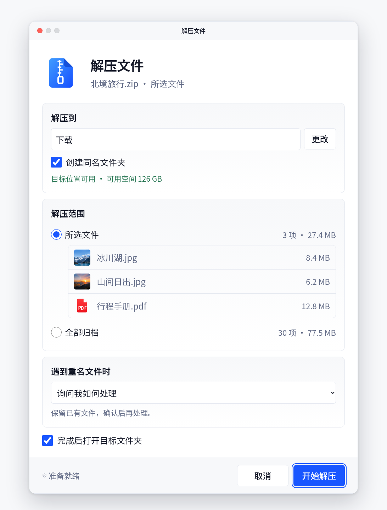

# xdzip HTML 高保真设计

[打开审阅入口](index.html) · [直接打开桌面画布](canvas.html) · [设计目录职责](../README.md) · [已确认图片](../hifi/index.html)

本交付以 v1 主窗口和解压确认、v2 操作状态为视觉依据。主界面采用可编辑 HTML/CSS，操作和状态由示例数据驱动；不是把完整设计图片贴在界面上。图标从与 Qt 相同的 SVG 源生成，照片来自已确认图片的示例切片。

## 如何查看

- 在浏览器打开 `index.html`，选择主窗口、解压确认、新建、任务进度、冲突、设置及异常状态。
- 手机默认等比缩放完整桌面画布，切换“100%”可滚动检查细节；不把桌面界面改排成手机产品。
- “对照原稿”单独展示对应原始图片；深色主窗口是适配稿，目前没有同版本完整深色原图。
- “独立预览窗口”打开独立浏览器窗口。浏览器可能需要允许弹窗；HTML 内的 macOS/Windows/Linux 装饰仍是设计说明，正式应用使用原生 Qt 顶层窗口。
- 文件选择、搜索、目录切换、解压范围、创建与任务恢复均为示例流程，不读取归档或写磁盘。固定进度场景暂停在 60%，速度和剩余时间都是设计示例。

## 离线单文件

执行 `python scripts/build-html-design.py`，生成 `dist/xdzip-hifi-design.html`。文件包含界面、SVG、示例照片及原稿对照图，无需下载字体或其他网络资源。目录说明等仓库文档链接不包含在单文件中。

## 源文件职责

| 文件 | 用途 |
| --- | --- |
| index.html、review.css、review.js | 外部审阅工具、等比缩放、原稿对照、独立预览窗口 |
| canvas.html | 桌面主窗口结构 |
| styles.css | 交互控件、状态和平台窗口基础样式 |
| hifi.css | 按当前原稿校准的画布、间距、字号、卡片和窗口样式 |
| app.js | 内存示例数据和操作状态，不含压缩库 |
| assets.js | 自动生成的共享素材，修改 SVG 后重新生成，不手改 |
| screenshots/ | 本次 HTML 实际渲染结果，不是设计原图或 Qt 截图 |

## 视觉覆盖与剩余差异

- 主窗口恢复双标签、正面文件夹图标、工具栏、文件缩略图和图片预览结构；画布为 1548×940。
- 解压确认恢复目标、范围和重名策略的分组卡片；任务窗口恢复目标、进度、指标、当前文件和两行提示。
- 新建、设置及异常流程保留可操作的功能逻辑并使用同一素材与窗口规范；尚未逐像素匹配每张 v2 原稿，不能把这些页面称为全部完成视觉验收。
- 系统字体在不同平台的字形与抗锯齿不同。大图标的高光、阴影、拉链微字样仍有重建差异。
- 原稿中只有部分输入、状态和数据；真实交互需要显示的搜索反馈、半选复选框、动态计数等遵循功能语义，不强行伪造静态状态。

验证运行 `python scripts/check-html-design.py`，报告位于 `dist/html-design-review/validation.json`。它验证示例流程和交付可用性，不代表产品格式、安全或原生窗口验收。

原稿加载专项检查：`python scripts/check-html-references.py`，覆盖普通网页、断网单文件和隔离来源画布，验证六个原稿均可解码、两个无原稿状态正确隐藏图片，以及画布配置不依赖同源 DOM 访问。
