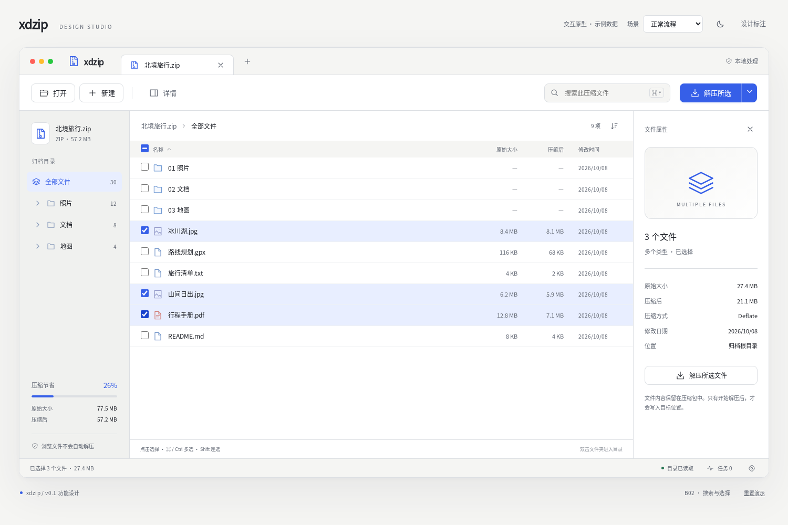
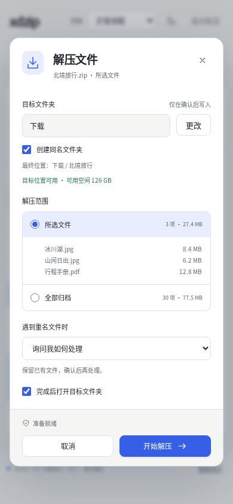

# xdzip 功能交互原型

使用 HTML/CSS/JavaScript 验证 v0.1 的界面、操作和状态。正式产品仍采用 Qt Quick + 薄 C++ + Rust；这里的源文件不进入产品运行时。

## 打开与操作

直接在现代浏览器中打开 index.html，保持 styles.css、app.js 与其同目录。也可在仓库执行 `python3 scripts/build-prototype.py`，然后打开 dist/xdzip-interactive-design.html；单文件包含全部样式、脚本和内联图标，无需安装依赖或连接网络。

1. 在文件列表勾选冰川湖.jpg、山间日出.jpg、行程手册.pdf，合计 27.4 MB。
2. 点击解压所选，检查目标位置、范围、同名策略，再开始解压。
3. 顶部“场景”可演示重名、权限、磁盘满、源变化、取消、空归档、无搜索结果、损坏、不支持和读取过程。
4. 点击新建，添加或移除示例文件，切换 ZIP / TAR / TAR.GZ。更多选项提供已有目标的覆盖确认演示。
5. 使用月亮/太阳切换主题；设计标注显示当前页面的需求、行为和验收边界。

设计审阅栏、场景选择器和重置按钮位于产品窗口之外，不属于正式产品界面。手机窄屏适配用于审阅设计，不表示计划发布手机应用。

## 数据与实现边界

全部数据来自内存 fixture：30 个文件、3 个目录。目录计数、选择数量、原始/压缩大小、节省比例和任务结果相互对应。进度、磁盘可用空间与权限检查均为演示值，不是实测。

原型不读取本地归档、不调用真实压缩库、不写输出文件、不上传内容。打开/添加按钮提供示例数据；打开目标文件夹使用说明提示替代系统调用。只有一个归档会话和一个活跃任务，既有任务可返回浏览并重新打开详情。

文件选择以稳定 ID 保存；搜索提交或切换目录清空选择。无选择的“全部解压”始终指全部归档；“解压搜索结果”单独提供。目录选择展开为去重后的后代文件。正式核心中的快照、授权和安全原语仍按软件设计实现。

## 界面预览

其余关键状态见 screenshots 目录。完整验证记录见 [原型检查报告](../../docs/qa/prototype-validation.json)。

## 维护

- index.html：应用外壳与设计审阅工具。
- styles.css：深浅主题、桌面布局、控件及手机审阅布局。
- app.js：示例数据、选择与任务状态、对话框及需求标注。
- [需求映射和交互规格](../../docs/ux/prototype-spec.md)：设计决策与覆盖范围。
- scripts/check-prototype.py：实际操作浏览器检查流程并生成截图；依赖 Playwright 和 Chromium。它验证设计原型，不代替产品安全或格式测试。

格式化采用 Prettier 3.6.2 和仓库 EditorConfig。图标为本项目内联 SVG 路径，无第三方图片、字体下载、CDN 或框架依赖。
