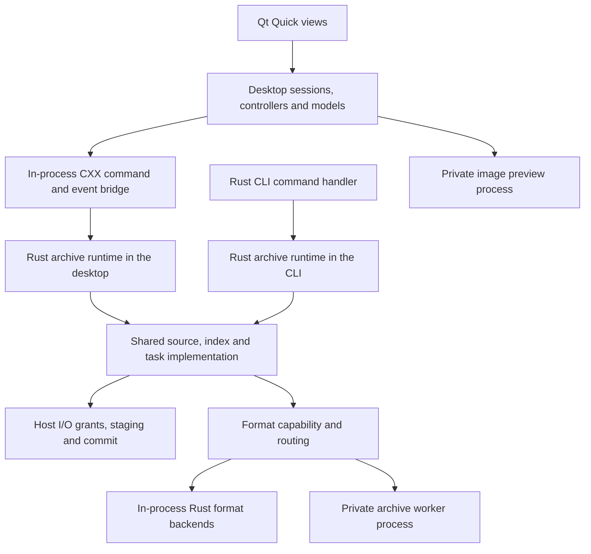
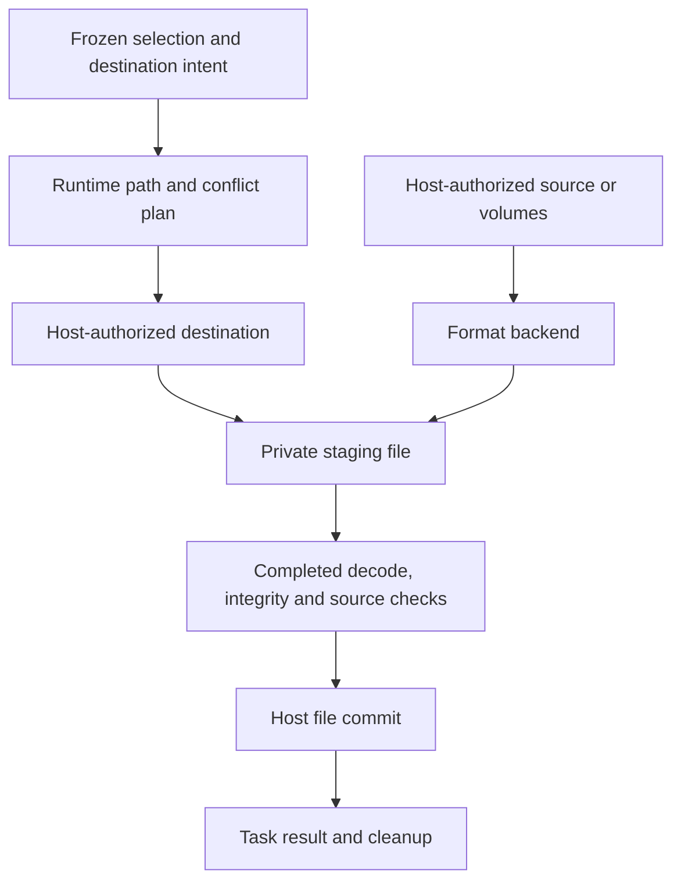

# XDZip-Systemarchitektur

[English](../../design/system-architecture.md) | [简体中文](../../zh-CN/design/system-architecture.md) | [繁體中文](../../zh-TW/design/system-architecture.md) | [日本語](../../ja-JP/design/system-architecture.md) | [Français](../../fr-FR/design/system-architecture.md) | Deutsch | [Español](../../es-ES/design/system-architecture.md) | [Português (Brasil)](../../pt-BR/design/system-architecture.md)

Desktop- und Befehlszeilen-Clients teilen die Rust-Archivlaufzeit. Die Laufzeit macht eine ausgewählte Quelle zu einer indexierten Sitzung und eine Operation zu einer begrenzten Aufgabe. Format-Backends interpretieren Archivdaten. Der Host autorisiert Dateien, kontrolliert Ausgabeorte und veröffentlicht verifizierte Ergebnisse.

## Architekturüberblick

Die beiden Laufzeitblöcke stellen getrennte Instanzen derselben Implementierung dar. Desktop und CLI besitzen jeweils ihren eigenen Archivzustand und ihre Aufgaben. Das lokale Desktop-IPC leitet Aktivierungs- und Integrationsanfragen an die primäre GUI-Instanz weiter. Archivbefehle laufen durch die Laufzeit im Prozess. [Anwendungssitzungen](../../engineering/application-sessions.md), [CLI-Vertrag](../engineering/command-line.md).

## Modulzuständigkeiten und Aufrufrichtung

| Modul | Verantwortung und Aufrufe |
| --- | --- |
| Desktop-Einstieg und Qt Quick | `xdzip-browser`, als Desktop-Programm `xdzip` gebaut, startet in `browser_main.cpp` und lädt `Browser.qml`. `SessionPage.qml` und seine Ansichten stellen Listen, Auswahl, Dialoge und Aufgabenstatus dar. Sie senden Benutzerabsichten an C++-Controller. [Desktop-Einstieg](https://github.com/xiaodaozhi/xdzip/blob/main/apps/desktop/browser_main.cpp), [QML-Entwurf](qt-quick-ui.md). |
| Desktop-C++-Adapter | `ApplicationSessions` koordiniert Tabs, Fenster und den gemeinsamen Aufgabeneinstieg. Ein `BrowserController` besitzt Listenmodell und Anfragezustand seiner Sitzung, übersetzt UI-Absicht in typisierte Befehle und leitet Fortschritt, Fehler und Rückfragen an die UI zurück. `RuntimeConnection` besitzt Bridge-Handles und Ereigniszustellung. Einstellungen, Tray, Dateizuordnungen und natives Ziehen oder Shell-Integration liegen in Desktop-Adaptern. [Sitzungskoordinator](https://github.com/xiaodaozhi/xdzip/blob/main/apps/desktop/ApplicationSessions.cpp), [Controller](https://github.com/xiaodaozhi/xdzip/blob/main/apps/desktop/BrowserController.cpp). |
| `xdzip-qt-bridge` | Die eingebundene CXX-Grenze wandelt C++-Befehle, Zeilen, Aufgaben-Snapshots und Fehler in Rust-Typen und zurück um. Sie kapselt `Client` und `Receiver` einer Laufzeit als getrennt besessene Befehls- und Ereignis-Handles. [Bridge-Quelle](https://github.com/xiaodaozhi/xdzip/blob/main/crates/xdzip-qt-bridge/src/lib.rs), [Bridge-Vertrag](qt-rust-bridge.md). |
| `xdzip-cli` | Analysiert Argumente, behandelt Terminalrückfragen und Abbruch, ruft `xdzip-runtime` direkt auf und bildet Ereignisse auf Text oder JSON und Exit-Codes ab. Archivbefehle verwenden dieselben Quell- und Aufgabenregeln wie der Desktop. Installations- und Update-Befehle haben eigene Einstiegspfade. [CLI-Laufzeitadapter](https://github.com/xiaodaozhi/xdzip/blob/main/crates/xdzip-cli/src/runtime.rs), [CLI-Integration](../integration/README.md). |
| `xdzip-runtime` | Besitzt das aktuelle `Archive` jeder Serviceinstanz. `source` löst Volumes auf und verfolgt Quellversionen. `formats` erkennt und verteilt Formate. `index`, `navigation`, `query`, `listing` und `disk_index` erstellen und durchsuchen Metadaten. Der Service validiert Befehle und reiht Aufgaben für `extraction`, `creation`, `updating`, `checking` und `exporting` ein. `preview` behandelt begrenzte Lesevorgänge für die Eigenschaftsansicht. [Laufzeitmodule](https://github.com/xiaodaozhi/xdzip/blob/main/crates/xdzip-runtime/src/lib.rs), [Produktlaufzeit](../engineering/product-runtime.md). |
| `xdzip-domain`, `xdzip-codec-api` und `xdzip-extract-plan` | Die Domäne definiert Identitäten, Metadaten und Pfadinvarianten. Die Codec-API definiert Formatfähigkeiten und Verträge wie `ReadSource`, `PayloadCodec`, `DecodedSink`, `EncodeInput` und `EncodeOutput`. Der Extraktionsplaner leitet aus Metadaten und Auswahl einen Bericht ab. Die Zielautorisierung bleibt beim Host. [Domäne und Daten](domain-data.md), [Codec-Schnittstelle](https://github.com/xiaodaozhi/xdzip/blob/main/crates/xdzip-codec-api/src/lib.rs), [Extraktionsvorprüfung](../engineering/extraction-preflight.md). |
| `xdzip-codec-*`, `xdzip-compression` und `xdzip-crypto` | Die Codec-Crates implementieren Containerrahmung, Metadatenscans, Nutzdatenlesen und je Format verfügbare Schreiboperationen. Kompressions- und Kryptografie-Crates liefern wiederverwendbare Algorithmen. Codec-Schnittstellen verwenden vom Host bereitgestellte Streams und Sinks. Das Fähigkeitsregister beschreibt verfügbare Operationen, während die Laufzeitsteuerung das tatsächliche Archiv und seine Einträge prüft. [Laufzeitsteuerung](https://github.com/xiaodaozhi/xdzip/blob/main/crates/xdzip-runtime/src/formats.rs), [Formatregister](../engineering/format-registry.md). |
| `xdzip-io` | Öffnet reguläre Eingabedateien, identifiziert native Dateiobjekte, fixiert autorisierte Erstellungseingaben und stellt Zielberechtigungen, Vorbereitung und Commit bereit. Es implementiert Plattformprüfungen an der Dateigrenze; die Laufzeit entscheidet über Operation und Veröffentlichungszeitpunkt. [Eingabeautorisierung](https://github.com/xiaodaozhi/xdzip/blob/main/crates/xdzip-io/src/input.rs), [Ausgabeberechtigungen und Commit](https://github.com/xiaodaozhi/xdzip/blob/main/crates/xdzip-io/src/target.rs), [Dateisicherheit](file-security.md). |
| Update und Entwicklungswerkzeuge | `UpdateController` und `xdzip-update` behandeln Auswahl, Prüfung und Übergabe von Updates. Installierte Builds verwenden plattformspezifische Installationspfade. SDK-Host und Formatsonden haben unabhängige Einstiege. Die Archiverkennung des Produkts verwendet das eingebaute Register. [Softwareupdates](../../engineering/software-update.md), [SDK-Erprobung](../engineering/sdk-trial.md), [Repository- und Modulübersicht](../engineering/repository-layout.md). |

## Desktop-Anfragen und Lebenszyklus

1. **Einstieg und Weiterleitung.** Normaler Desktop-Start, Dateizuordnung und Shell-Anfragen gelangen in die Desktop-Anwendung. `SingleInstance` wählt für denselben Benutzer und dieselbe Anmeldung eine primäre Instanz. Sie behandelt weitergeleitete Anfragen und öffnet oder verwendet die passende Navigations- oder Operationssitzung erneut. Ein Archivbefehl des eigenständigen CLI startet einen eigenen Rust-Service. Das mitgelieferte CLI kann eine Desktop-Update-Anfrage über den lokalen Kanal an die GUI übergeben.
2. **Befehlsannahme.** Ein Navigationscontroller verwendet seine eigene `RuntimeConnection`. Die GUI sendet einen typisierten Befehl und erhält Annahmeergebnis und Anfrage-ID. Eine begrenzte Wiederholung in der Ereignisschleife behandelt vorübergehende Konkurrenz bei der Annahme. Archiv-E/A läuft außerhalb des GUI-Threads.
3. **Ausführung und Zustellung.** Jeder Service betreibt einen Rust-Befehlsthread für aktuelles Archiv, Metadatenanfragen und Aufgabenvorbereitung sowie einen separaten Rust-Aufgabenthread, dessen begrenzte Warteschlange jeweils eine schwere Aufgabe ausführt. Eine zusätzliche Desktop-Annahmeregel serialisiert schwere Operationen über Controller hinweg. Auf Qt-Seite überträgt ein Empfangsthread Rust-Ereignisse in eine begrenzte Mailbox für den GUI-Thread. Der Controller gleicht Anfrage- und Sitzungsidentität ab und prüft bei Seitenanwendung Abfragegeneration und Revision. Das CLI sendet Befehle und konsumiert deren Ereignisse im eigenen Prozess.
4. **Aufgabenbesitz.** Annahme und Fortschritt sind vom terminalen Aufgaben-Snapshot getrennt. Der Aufgabenthread besitzt die fixierte Auftragseingabe. Passwörter, Konfliktentscheidungen und Abbruch gehen an die besitzende Aufgabe. Bedienelemente verwenden Aufgaben- und Rückfrageidentität. Die numerische ID einer Aufgabe gehört zu ihrer Laufzeitverbindung. Abbruch und Herunterfahren warten nicht auf Platz in der normalen Befehlswarteschlange. Das Schließen eines Tabs verwirft dessen Navigationsdarstellung, während angenommene Aufgaben weiterlaufen können und Ergebnisse über den gemeinsamen Aufgabeneinstieg erreichbar bleiben. Ein ausdrückliches Beenden der Anwendung stoppt die Annahme, verarbeitet terminale Ereignisse und wartet auf das Herunterfahren der Worker.

[Laufzeit-Ereignisservice](https://github.com/xiaodaozhi/xdzip/blob/main/crates/xdzip-runtime/src/service.rs), [Aufgabenwarteschlange](https://github.com/xiaodaozhi/xdzip/blob/main/crates/xdzip-runtime/src/service/tasks.rs), [Qt-Ereigniszustellung](https://github.com/xiaodaozhi/xdzip/blob/main/apps/desktop/RuntimeConnection.cpp), [Aufgabenplanung](task-scheduling.md).

## Prozess- und Plattformgrenzen

| Ausführungsgrenze | Daten und Zuständigkeiten |
| --- | --- |
| Primärer Desktop-Prozess | Qt-GUI, C++-Adapter, CXX-Bridge und Rust-Laufzeitthreads teilen einen Adressraum. Der Host besitzt offene Archivsitzungen und native Dateiautorisierung. Spätere Desktop-Starts können Anfragen über benutzerbezogenes lokales IPC weiterleiten und enden. |
| CLI-Befehlsprozess | Der CLI-Befehlshandler ruft dieselbe Rust-Laufzeit als Bibliothek im eigenen Prozess auf. Paketierter CLI-Start oder Update-Übergabe kann getrennte Prozesse einbeziehen. Archivzustand und Aufgabenergebnisse gehören zum eigenen Service des Befehls. |
| Archivformat-Worker | Die Laufzeit leitet 7z-, RAR-, CAB- und ISO/UDF-Lesevorgänge an `xdzip-codec-native`. Sie startet den mitgelieferten `xdzip-native-codec` und kommuniziert über begrenzt gerahmtes stdin/stdout. Die dünne C++-Protokollschicht des Workers ruft Rust-Backends über `xdzip-codec-bridge` auf. Der Host bedient autorisierte Bereichs- oder Volume-Lesevorgänge und prüft Ausgabeframes. Für 7z-Schreiben akzeptiert er begrenzte Offset-Schreibvorgänge in private Vorbereitung. Archiv- und Zielpfade bleiben im Host. Worker-Fehler oder Abbruch beendet die Operation und verwirft unvollständige Vorbereitung. Die Prozessgrenze begrenzt Fehler und Ressourcenverbrauch. Ihr Protokoll erteilt keine Dateisystemberechtigung und der Prozess läuft ohne Kernel-Berechtigungs-Sandbox. |
| Bildvorschau-Worker | Nachdem Rust einen geeigneten Archiveintrag gelesen und geprüft hat, sendet der Desktop begrenzte kodierte Bildbytes an `xdzip-image-preview`. Der Worker gibt eine begrenzte RGBA-Miniatur zurück. Die Anfrage enthält weder Archivpfad noch Passwort oder Ziel-Handle. Der Vorschauanbieter veröffentlicht das Ergebnis nur für die passende aktuelle Anfrage. Textvorschau wird in der Rust-Laufzeit behandelt. |
| Plattformübergabe | Desktop-Adapter koordinieren Dateimanager-Aktivierung, Öffnen einer privaten extrahierten Kopie in einer externen App und Update-Installation. Update-Helfer oder macOS Sparkle führen ihre eigene Installationsübergabe aus. Store-verwaltete Updates folgen dem Plattformkanal. Der Format-Worker behandelt diese Anfragen nicht. |

[Archiv-Worker-Protokoll](../engineering/native-codecs.md), [Bildvorschauvertrag](../engineering/content-preview.md), [Plattformintegration](../../engineering/installers-associations.md), [Archivübertragungen](../../engineering/archive-transfers.md), [Update-Übergabe](../../engineering/software-update.md).

## Archiv öffnen und durchsuchen

1. **Quelle autorisieren.** `Archive::open_with_password` fordert `Source::open` auf, über `xdzip-io` eine reguläre Datei zu öffnen und unterstützte geteilte Volume-Sätze aufzulösen. Der Host erfasst Identität, Größe und Zeitstempel jedes zugelassenen Teils. Codecs erhalten eine positionierbare Eingabe und gegebenenfalls vom Host bereitgestellte Volume-Metadaten.
2. **Format erkennen und scannen.** Die Laufzeit untersucht den Inhalt und validiert relevante Containerstruktur. Namen und Erweiterungen können die Volume-Suche leiten oder bestimmte Mehrdeutigkeiten auflösen. Das gewählte Backend scannt innerhalb seiner Ressourcengrenzen. Ein passwortgeschütztes Verzeichnis kann vor Scanabschluss ein Passwort erfordern. Ein fehlgeschlagener oder unvollständiger Scan veröffentlicht keine partielle Archivsitzung.
3. **Sitzungs-Snapshot erstellen.** Die Laufzeit trennt physische Eintrags-IDs von Namen und synthetisierten Navigationsordnern. Doppelte Namen bleiben damit unabhängig adressierbar. Gewöhnliches ZIP/ZIP64 in einer Datei kann Metadaten bei Überschreiten des Speicherbudgets in einen privaten Festplattenindex streamen. Diese erweiterte Navigationskapazität hat eigene Grenzen gegenüber der Extraktion. Sitzungen mit Festplattenindex unterstützen derzeit weder vollständige Archivprüfung noch Änderung.
4. **Abfragen und auswählen.** Eine Desktop-Navigationsanfrage liefert Sitzung, Verzeichnis sowie Such- und Sortierabsicht. Rust gibt Ergebnisidentität und begrenzte Seiten zurück. Eine Fortsetzung muss aktueller Sitzung, Abfrage, Generation und Revision entsprechen. Bevor eine Aufgabe seitenübergreifende logische Auswahl verwendet, löst Rust sie in physische Einträge oder Navigationsidentitäten auf. Das CLI verwendet den physischen Katalog und explizite Elementpfade oder Eintrags-IDs. Sichtbare Zeilenposition und Ausgabepfad sind von der physischen Eintrags-ID getrennt.

Der Snapshot beschreibt das in die Sitzung aufgenommene Archiv. Identität und Metadaten der Quelle werden bei relevanten Lese- und Schreibvorgängen erneut geprüft, um Änderungen zu erkennen. Die Quelldatei kann weiterhin gleichzeitig geändert werden; die Erkennung erfolgt daher nach bestem Bemühen. Eine erkannte Änderung invalidiert den betroffenen Navigationszustand und blockiert die Veröffentlichung aus der veralteten Quelle.

[Quell- und Volume-Verarbeitung](https://github.com/xiaodaozhi/xdzip/blob/main/crates/xdzip-runtime/src/source.rs), [Abfrage und Auswahl](https://github.com/xiaodaozhi/xdzip/blob/main/crates/xdzip-runtime/src/query.rs), [Index großer Archive](../engineering/large-index.md).

## Einträge lesen, prüfen und extrahieren

| Operation | Datenfluss und Ergebnis |
| --- | --- |
| Navigation oder Extraktionsvorprüfung | Verwendet indexierte Metadaten. Die Vorprüfung fasst Auswahl, Pfad- und Größenbeschränkungen zusammen, ohne eine Ausgabeberechtigung zu öffnen oder zu beweisen, dass alle ausgewählten Daten decodierbar sind. |
| Vorschau | Löst einen geeigneten regulären Eintrag der aktuellen Sitzung auf. Rust liest und decodiert ihn vollständig über einen begrenzten Sink und führt verfügbare Integritäts- oder Authentifizierungsprüfungen des Formats aus. Der Desktop zeigt freigegebenen Text oder sendet verifizierte kodierte Bildbytes an den Bild-Worker. |
| Archiv testen | Fixiert die Eingabe und liest das gesamte geeignete Archiv über einen begrenzten Verwerfungs-Sink oder einen formatspezifischen Scan. Autorisiert niemals Ausgabe. Das Format bestimmt verfügbare Prüfungen. TAR und ISO/UDF können beispielsweise Struktur und Lesbarkeit ohne Prüfsummengarantie pro Datei feststellen. |
| Extrahieren, öffnen oder exportieren | Fixiert ausgewählte Datensätze und liest aus der autorisierten Quelle. Extraktion veröffentlicht im gewählten Ziel. Beim Öffnen einer Datei wird eine private verifizierte Kopie an das System übergeben. Drag-Export kann zunächst private vorbereitete Ausgabe erstellen und anschließend an ein validiertes Ziel veröffentlichen. |

Die Extraktion regulärer Dateien verdeutlicht die Trennung von Decodierung und Veröffentlichung.

1. **Planen.** Die Laufzeit verwendet die fixierte Auswahl, um portable relative Pfade zu prüfen und Ausgabekollisionen zu erkennen. `xdzip-io` verankert das Ziel in einem autorisierten Verzeichnis. Die Laufzeit löst Fragen, Überspringen, Umbenennen oder zulässiges Überschreiben auf. Ein Codec kann geschützte Eingaben, geänderte Ziele oder unsichere Linkdurchquerung nicht autorisieren.
2. **Decodieren.** Das Backend liest die zugelassene Quelle direkt oder über den Archiv-Worker. Es sendet Bytes an einen gemessenen Sink mit privater Vorbereitungsdatei. Passwortwiederholungen, Expansion und Hilfsarbeit unterliegen den Grenzen der Operation. Vorbereitete Bytes sind vorläufig, bis Decodierung, Größenprüfungen und verfügbare Formatprüfung erfolgreich sind.
3. **Commit und Bericht.** Vor Veröffentlichung prüft der Host die Identität der Quelle und des relevanten Ziels erneut. Er bestätigt jede geeignete Datei einzeln und erfasst tatsächlich veröffentlichte Dateien und Bytes. Spätere Fehler oder Abbruch können zuvor bestätigte Dateien belassen. Nicht veröffentlichte Vorbereitung wird nach Möglichkeit bereinigt; das terminale Ergebnis meldet Fehler, Abbruch, Übersprungenes und Bereinigungswarnungen.

[Extraktionsausführung](https://github.com/xiaodaozhi/xdzip/blob/main/crates/xdzip-runtime/src/extraction/execute.rs), [Archivprüfung](../engineering/archive-checking.md), [Passwortinteraktionen](../engineering/password-extraction.md), [sichere ZIP-Extraktion](../../engineering/zip-safe-extraction.md).

## Archiv erstellen oder ändern

Erstellung und Archivänderung bereiten ein Archiv als Einheit vor und prüfen es. Die Laufzeit koordiniert den Auftrag, und der Formatencoder schreibt über eine hosteigene Ausgabeschnittstelle. Nur der Host kann das Ergebnis veröffentlichen.

1. **Erstellen.** Die Laufzeit prüft Ausgabeformat und Einstellungen, erhält ein autorisiertes Ziel und durchläuft und fixiert den zugelassenen Eingabebaum. Der Encoder erhält Metadaten und kann Streams nach Eingabeindex öffnen. Er schreibt in private Vorbereitung. ZIP- und TAR-Writer laufen im Prozess, 7z verwendet den Archiv-Worker und ISO-Erstellung den Rust-Optical-Writer im Prozess, obwohl ISO-Navigation den Worker verwendet. [Erstellungsaufgabe](https://github.com/xiaodaozhi/xdzip/blob/main/crates/xdzip-runtime/src/creation.rs), [ISO-Writer](../engineering/iso-creation.md).
2. **Ändern.** Für ein geeignetes Archiv fixiert die Laufzeit Quelle und Ergänzungen und plant beibehaltene, hinzugefügte, ersetzte oder verschobene Einträge. Die Neuschreibung erzeugt ein neues Archiv in Vorbereitung. Die Laufzeit öffnet das Ergebnis erneut und prüft erwartete Einträge und Inhalte, bevor sie das Original über die Archiv-Update-Berechtigung des Hosts ersetzt. Nicht unterstützte Einträge, verschlüsselte oder geteilte Quellen und andere unvereinbare Fälle werden nach Format- und Auftragsregeln abgelehnt. Nach erfolgreicher Ersetzung aktualisiert eine Desktop-Sitzung, die die Quelle noch ansieht, ihren Snapshot. [Archiv-Update-Aufgabe](https://github.com/xiaodaozhi/xdzip/blob/main/crates/xdzip-runtime/src/updating.rs), [Archivänderung und Übertragungen](../../engineering/archive-transfers.md).
3. **Prüfen und veröffentlichen.** Der Host öffnet die vorbereitete Erstellungsausgabe erneut und prüft Struktur, erwartete Einträge und Inhalt nach Format und Erstellungsprofil. Er löst Ausgabekonflikte und prüft vor dem Commit die relevante Berechtigung erneut. Ein Archiv in einer Datei hat einen Commit-Punkt. Geteilte Erstellung bereitet alle Teile vor Veröffentlichung eines neuen Satzes vor, lehnt das Überschreiben bestehender Sätze ab und versucht bei teilweisem Veröffentlichungsfehler einen Rollback. Jeder Teil hat einen eigenen Veröffentlichungsschritt. Der Aufgabenbericht kann Bereinigungs- oder Rollback-Probleme festhalten. [ZIP-Erstellung](../../engineering/zip-creation.md), [Datei-Commit-Vertrag](file-security.md).

**Ergebnis lesen.** `TaskAccepted` identifiziert den eingereihten Auftrag. `Finished` beendet die gewöhnliche Anfrage. Der separate terminale Aufgaben-Snapshot meldet, was verifiziert, veröffentlicht, übersprungen oder unvollendet blieb. Decodierte und veröffentlichte Bytes können sich unterscheiden. Abbruch ist kooperativ und eine Anfrage nach erfolgreichem Commit des gesamten Archivs macht die Veröffentlichung nicht rückgängig.

[Aufgabenstatus und Abbruch](task-scheduling.md), [Produktentwurf und technische Referenz](../reference/README.md).
