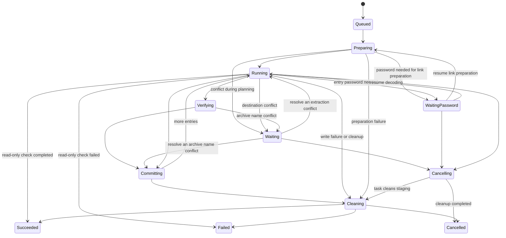

# Aufgabenplanung, Fortschritt und Abbruch

[English](../../design/task-scheduling.md) | [简体中文](../../zh-CN/design/task-scheduling.md) | [繁體中文](../../zh-TW/design/task-scheduling.md) | [日本語](../../ja-JP/design/task-scheduling.md) | [한국어](../../ko-KR/design/task-scheduling.md) | [Français](../../fr-FR/design/task-scheduling.md) | Deutsch | [Español](../../es-ES/design/task-scheduling.md) | [Português (Brasil)](../../pt-BR/design/task-scheduling.md) | [Русский](../../ru-RU/design/task-scheduling.md)

XDZip verwendet pro Laufzeitverbindung einen Rust-Befehls- und einen Aufgabenthread. Der Befehlsthread besitzt das aktuelle Archiv und bereitet Aufgabeneingaben vor. Der Aufgabenthread führt angenommene Arbeiten aus, während der Befehlsthread weiter Metadatenanfragen bedienen kann. Die [Systemarchitektur](../../design/system-architecture.md) beschreibt die Ausführung dieser Threads, die [Qt/Rust-Brücke](qt-rust-bridge.md) die Zustellung der Ergebnisse.

## Zulassung und Aufgabenbesitz

| Ebene | Aktuelles Verhalten |
| --- | --- |
| Desktop-Controller | `BrowserController::attemptSubmission` serialisiert schwere Vorgänge über Controller im Desktopprozess hinweg, einschließlich Vorbereitung und Bereinigung. Ein auf Zulassung wartender Controller hält einen begrenzten Befehl und kann die Wartezeit abbrechen. Das Durchsuchen von Metadaten nutzt den gewöhnlichen Befehlsweg. |
| Laufzeit-Befehlsthread | Prüft die Anfrage und bildet einen Auftrag. Entpacken, Prüfen und Bearbeiten behalten relevante Quelle und Metadaten oder Auswahl. Erstellen erhält begrenzte Optionen und scannt den Eingabebaum im Aufgabenthread. Metadatenvorprüfung oder Zielprüfung erzeugt keine schwere Aufgabe. |
| Laufzeit-Aufgabenwarteschlange | Führt Entpacken, temporäres Öffnen, Erstellen, Prüfungen, Änderungen und Exporte je nach Fall einzeln in Warteschlangenreihenfolge innerhalb der Verbindung aus. Pro Dienst können bis zu 32 Aufgaben mit insgesamt 64 MiB Budget für gehaltene Aufträge verfolgt werden. Das umfasst gehaltene Eingaben und reservierten Geheimnisspeicher. Tatsächliches Decodieren, Indexieren, Worker und Ausgaben haben separate Grenzen. Auslastung wird als `task_busy` gemeldet. |
| Eigenständige CLI | Verwendet dieselben Rust-Planungsregeln im eigenen Befehlsprozess. Mehrere unabhängige CLI-Prozesse besitzen getrennte Warteschlangen, ebenso der Desktop. Sichere Ausgabeautorisierung und Konfliktprüfungen gelten für jeden Prozess. |

`TaskAccepted` identifiziert einen zugelassenen Auftrag. Das `Finished` der gewöhnlichen Anfrage schließt diese Anfrage. Der Auftrag kann weiter `TaskUpdate`-Snapshots mit ursprünglicher Anfrage-ID zur Zuordnung und Aufgaben-ID zur Steuerung erzeugen. Der Anwendungseintrag behält den zuständigen Controller auch nach Schließen des Tabs, damit Prompts und Ergebnisse der richtigen Verbindung zugeordnet bleiben. [Aufgabenwarteschlange](https://github.com/xiaodaozhi/xdzip/blob/main/crates/xdzip-runtime/src/service/tasks.rs), [Desktopzulassung und Aufgabenrouting](https://github.com/xiaodaozhi/xdzip/blob/main/apps/desktop/BrowserController.cpp), [Desktop-Sitzungen](../../engineering/application-sessions.md)

## Zustände und gemeldeter Fortschritt

Das Diagramm zeigt beispielhafte Wege. Eine Aufgabe kann je nach Vorgang Phasen überspringen oder wiederholen. Eine schreibgeschützte Prüfung kann ohne Übernahme enden. Erstellung oder Änderung prüft normalerweise das vorbereitete Archiv vor Veröffentlichung; Entpacken kann wiederholt übernehmen.

| Laufzeitstatus | Was der Client erhält |
| --- | --- |
| `queued`, `preparing` | Ein Auftrag wartet oder bereitet autorisierte Quellen, Zielzugriff und Formatzustand vor. Die Gesamtsumme kann noch unbekannt sein. |
| `running`, `verifying` | Inhalt wird gelesen, codiert, decodiert oder geprüft. `verifying` beschreibt auch das erneute Lesen vorbereiteter Archivausgabe. Prüfung erhöht keine Übernahmezähler. |
| `waiting`, `waiting_password` | Die Aufgabe wartet auf ihre aktuelle Konflikt- oder Passwortantwort. |
| `committing` | Die Aufgabe hat die Erlaubnis erhalten, eine Datei, ein Archiv oder eine Volume-Menge zu veröffentlichen. |
| `cancelling`, `cleaning` | Abbruch wurde angefordert oder private Objekte werden geschlossen und freigegeben. Ein Snapshot kann einen Übergangszustand auslassen, weil Fortschritt zusammengefasst wird. |
| `succeeded`, `failed`, `cancelled` | Der gewöhnliche Ausführungsweg ist abgeschlossen. Der End-Snapshot enthält das tatsächliche Ergebnis einschließlich früherer Übernahmen und Bereinigungswarnungen. |

`total_known` unterscheidet unbekannte Gesamtsumme von null. Der Snapshot trennt gelesene, decodierte, geschriebene, geprüfte und übernommene Bytes. Solid-Block-Arbeit oder wiederholtes Decodieren kann die Arbeitsmenge erhöhen, ohne weitere Dateien zu veröffentlichen. Erstellung zählt Eingabedateien und -bytes erst nach Archivveröffentlichung als übernommen. Ihr `written_bytes` misst Ausgabeschreibvorgänge einschließlich möglicher Header-Neuschreibungen. Die Warteschlange begrenzt gewöhnliche `running`-, `verifying`- und `committing`-Updates auf eines pro 100 ms und hält nur den neuesten ausstehenden Snapshot pro Aufgabe. Prompts, Abbruch, Bereinigung und Endergebnisse umgehen diese Drossel. Ergebnisdetails sind auf 128 Datensätze begrenzt, einschließlich eines Auslassungszählers. [Statuscodes und Snapshotfelder](https://github.com/xiaodaozhi/xdzip/blob/main/crates/xdzip-runtime/src/extraction/mod.rs)

## Warten auf eine Entscheidung

- Bei der Regel Nachfragen kann ein Namenskonflikt auf eine ausdrückliche Entscheidung warten. Eine Passwortanfrage verwendet einen getrennten einmaligen Antwortplatz. Aufgaben-ID, Prompt-ID und Prompt-Typ müssen zur aktuellen Wartebedingung passen. Antworten auf alte oder bereits beantwortete Prompts werden abgelehnt.
- Das Warten behält den begrenzten Auftragszustand und seinen Warteschlangenplatz. Die Aufgabe wartet auf einer Bedingungsvariablen, die dabei den Antwortmutex freigibt. Entscheidung oder Abbruch weckt sie unabhängig von freiem Platz in der gewöhnlichen Befehlswarteschlange. Der wartende Auftrag belegt weiterhin den Aufgabenworker. Der separate Befehlsthread kann Navigationsbefehle weiter bearbeiten.
- Der Passwortpfad verwendet aufgabenlokale Geheimnisse. Unterstützte wiederholbare Passwortfehler sind pro Eintrag begrenzt; bereits geleistete Arbeit zählt zu den Aufgabenbudgets. Ausdrückliche Integritätsfehler stoppen den Vorgang. Fehlendes Volume, erschöpfte harte Quote oder geänderte Quelle werden über den jeweiligen Fehlerpfad gemeldet. Auf Eingabe zu warten ist keine benutzergesteuerte Pause. [Passwortinteraktion](../engineering/password-extraction.md), [Ressourcen- und Dateiregeln](file-security.md)

## Abbruch und Übernahmegrenze

`cancel` fordert den Abbruch einer gewöhnlichen Anfrage an. Sobald eine Aufgabe existiert, adressiert `cancel_task` die Aufgabe selbst. Diese Steuerungen bestätigen eine Stoppanforderung. Das Ergebnis erfährt der Aufrufer über den passenden Anfrageabschluss oder den End-Snapshot. Für kooperativen Abbruch gibt es keine feste Abschlussfrist, insbesondere bei blockiertem Host-Systemaufruf. Der Archivworker hat eine getrennte Prozessüberwachung. [Brückensteuerung](qt-rust-bridge.md), [Überwachung des Archivworkers](../engineering/native-codecs.md)

| Zeitpunkt des Abbruchs | Wirkung |
| --- | --- |
| Bevor `begin_commit()` die Sperre gewinnt | Die aktuelle Veröffentlichung beginnt nicht. Die Aufgabe verwirft oder bereinigt unveröffentlichte Vorbereitung und behält frühere Quittungen. |
| Während einer Entpack- oder Dateiversprechen-Veröffentlichung | Der Veröffentlichungsaufruf kann enden. Wurde die Datei veröffentlicht, erfasst die Aufgabe sie. Abbruch kann weitere Arbeit stoppen und der End-Snapshot kann `cancelled` mit Übernahmezählern größer null sein. |
| Während der endgültigen Archivveröffentlichung | Erstellung und Änderung behalten ein erfolgreiches Ergebnis, sobald das geprüfte einzelne Archiv oder die vollständige Volume-Menge veröffentlicht ist. Bei geteilter Erstellung muss die Übernahmeroutine einen teilweise veröffentlichten Satz gegebenenfalls selbst zurückrollen. Ein Rückrollfehler kann `outcome_uncertain` setzen. |
| Nachdem ein Endergebnis feststeht | Ein später Abbruch kann eine erfolgreiche Übernahme nicht in ein Abbruchergebnis ändern. |

Die Sperre bestimmt, wann Aufgabenabbruch eine Veröffentlichung verhindern kann. Ausgabeautorisierung und Validierung der Vorbereitung bleiben erforderlich. Ein autorisierter Schreibvorgang kann scheitern und seinen tatsächlichen Dateisystemfehler zurückgeben. [Abbruchsperre](https://github.com/xiaodaozhi/xdzip/blob/main/crates/xdzip-runtime/src/extraction/control.rs), [Dateiveröffentlichung](file-security.md)

## Fehler, Tab-Schließung und Anwendungsende

Überspringen gilt für unterstützte Konfliktentscheidungen. Ein Decodier-, Ressourcen-, Quell- oder Zielsicherheitsfehler kann den Auftrag stoppen. Bereits veröffentlichte Dateien bleiben erfasst; ein Bereinigungsfehler kann eine erfolgreiche Veröffentlichung begleiten. Unerwarteter Workerfehler oder ein abwickelbarer Aufgaben-Panic kann ein fehlgeschlagenes oder unsicheres Ergebnis erzeugen. Der Panic-Pfad meldet `task_abandoned` und setzt die betroffene Laufzeit in den Fehlerzustand. Das Fehlen einer Endantwort nach Prozessende belegt nicht, was auf dem Datenträger ankam.

Das Schließen eines Fortschrittsfensters oder Archivtabs ist eine Darstellungsaktion. Angenommene Aufträge und Ergebnisse bleiben über den Anwendungseintrag verfügbar. Das Schließen eines aktiven Passwortprompts kann dessen Aufgabe abbrechen. Explizites Beenden behandelt aktive Arbeit, stoppt bei Beginn des Herunterfahrens die Zulassung, weckt Wartende und leert weiter Ereignisse. Der Empfänger wartet auf die Rust-Worker, bevor er `ShutdownReady` ausgibt. Qt beendet das Leeren und wartet ohne blockierenden GUI-Thread-Join auf das Ende des Empfängers. Auch eine externe native Übertragung muss möglicherweise enden. [Lebenszyklus der Laufzeit](../engineering/product-runtime.md), [Archivübertragungen](../../engineering/archive-transfers.md)
