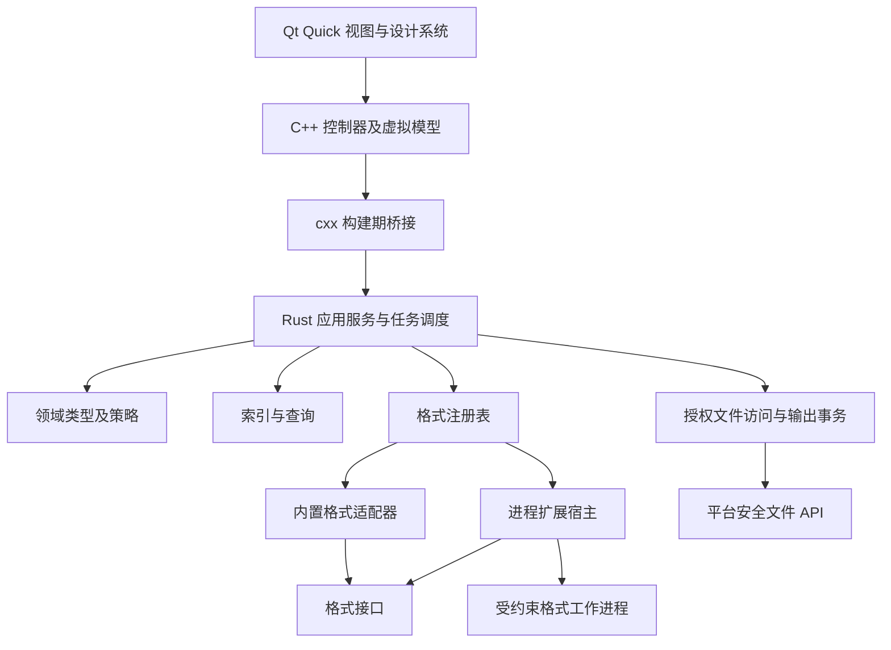

# xdzip：02 系统架构

## 1. 架构目标

Rust 负责所有归档语义、任务、格式选择和文件安全。QML 负责视图与轻量交互，C++ 负责 Qt 对象、模型、系统桌面接口和 Rust 类型适配。更换 UI 时保留核心和格式适配器；增加格式时不改列表视图和任务状态机。

MVP 采用一个应用进程、一个 Rust 核心运行时及可选格式工作进程。内置纯 Rust 后端可进程内运行；使用大规模原生解析库的适配器优先放在官方工作进程。第三方扩展一定经过受约束工作进程，不能以“进程隔离”代替沙箱。

箭头表示调用方向。格式适配器通过 SDK 的受限读取/输出对象请求 I/O；图中未画出的受限端口不构成任意文件系统访问。

## 2. 拟建模块

下表是正式仓库的目标结构，当前实验仓库尚未创建这些 crate。

| 模块 | 职责 | 不允许的依赖/行为 |
|---|---|---|
| `xdzip-domain` | ID、能力、状态、错误、计划、策略值 | Qt、文件系统、线程、具体格式 |
| `xdzip-codec-api` | 受限流、探测、扫描、读写接口、能力 | QML、用户设置、真实输出路径 |
| `xdzip-index` | 元数据、分页、排序、筛选、索引存储 | UI 对象、直接解压 |
| `xdzip-io` | 授权根、安全遍历、配额、暂存、提交、清理 | 格式魔数、界面弹窗 |
| `xdzip-runtime` | 会话 actor、计划、任务、资源预算、事件 | Qt、任何 QML 状态 |
| `xdzip-codec-zip` / `xdzip-codec-tar` | 格式适配、CRC/结构检查、参数映射 | 自定义覆盖策略、任意路径写入 |
| `xdzip-plugin-host` | 工作进程、协议、权限、限额、健康检查 | 放宽宿主路径政策、直接加载 Rust dylib |
| `xdzip-platform` | 安全文件 API、凭据、平台能力 | QML，重复业务策略 |
| `xdzip-qt-bridge` | cxx DTO、命令投递、事件接收、异常边界 | QAbstractItemModel、格式实现 |
| `apps/desktop` | C++、QML、系统对话框、主题、无障碍 | 核心文件写入和密码日志 |
| `tools/codec-conformance` | 扩展契约及互操作测试 | 发布产品运行时依赖 |

`xdzip-runtime` 组合索引、I/O、后端和扩展宿主。`xdzip-codec-api` 依赖领域；`xdzip-io` 实现受限流端口；格式实现只依赖领域与 SDK。平台与桥接通过小接口注入，禁止核心反向调用 Qt 全局对象。不存在一个容纳所有工具函数的 `common` crate。

## 3. 进程与线程

| 执行位置 | 工作 | 生命周期 |
|---|---|---|
| Qt GUI 线程 | QML、控制器属性、模型更新、文件对话框 | 应用主线程；不能等待扫描或解压 |
| Qt 事件接收线程 | 等待 Rust 事件，转换成批量 Qt 值对象，发送 queued signal | 启动时创建；关闭通过独立控制通道唤醒 |
| Rust 调度线程 | 轻量命令、会话/任务状态、资源准入 | 核心运行时；不执行长时间 codec 调用 |
| Rust 有界工作池 | 扫描、查询、解压、压缩、校验、文件提交 | 队列有上限，工作项检查取消 |
| 格式工作进程 | 特定后端、官方原生库或第三方扩展 | 按任务/会话复用，限制并发与内存 |

没有为每个文件创建线程。压缩后端自带并行线程必须纳入任务 CPU 额度，不能在外层四线程任务里再启动四个无限线程池。任务状态变化集中到调度器，工作线程只发送结果/进度。

UI 提交接口只完成校验和非阻塞入队。结果采用事件推送；空闲时事件接收线程阻塞等待，不常驻 100ms 状态轮询。计时和指标采样只在诊断或运行任务时启用。

## 4. 服务和所有权

`ApplicationRuntime` 持有会话管理、任务调度、能力注册表及事件通道。每个 `ArchiveSession` 持有源文件授权、格式后端、索引状态、源版本和生命周期计数。查询产生不可变 `QuerySnapshot`，计划产生不可变 `OperationPlan`。

任务不依赖某个标签页存活。关闭标签页释放浏览订阅；有关任务持有其源快照和文件授权，继续运行或根据用户选择取消。关闭整个应用则进入统一 shutdown：停止新命令、请求取消、等待提交安全点、收尾工作进程，再回收模型与运行时。

一条归档会话允许多个读取任务，但具体并发由后端声明限制。禁止原位修改源；创建新归档或“另存为”使用新输出事务。因此读取任务不会与产品自身的原地写入竞争。

## 5. 配置与持久化

小型用户设置使用 Qt 设置适配器：主题、窗口、上次目录、快捷键选项。Rust 只接受验证后的策略快照，不直接读取 GUI 设置。设置分 schema 版本，有迁移和备份；读取异常恢复默认，并显示一次非阻塞提示。

归档索引先采用内存紧凑结构，达到预算阈值后迁移到临时磁盘索引。每会话独立 SQLite 候选后端仅用于产品自己的元数据，不保存密码或文件内容；是否采用 SQLite 由内存阶段实测决定，但 `IndexStore` 接口从首版提供。默认不跨启动持久缓存归档索引，避免源身份和隐私问题。

输出事务日志保存在授权目标内的随机私有工作目录。全局应用数据只保存用户设置、扩展清单和低敏诊断；不能因为打不开一个用户路径就把原始内容搬入全局缓存。

## 6. 可替换性和边界检查

单元测试使用内存源、故障注入文件端口、假后端和无 Qt 的事件客户端。界面集成测试使用同一个应用服务，不重复实现“假核心业务”。未来 CLI 是另一个适配器，可复用 `xdzip-runtime`，不通过 GUI 或 cxx 间接调用。

架构检查在 CI 禁止核心 crate 依赖 Qt/桥接，禁止格式 crate 依赖桌面应用，检查 Cargo features 不拉入未使用后端。代码审查关注调用方向和资源所有权，不能只以目录拆分作为解耦证据。

## 7. 故障边界

工作进程崩溃使相关任务失败，宿主回收未提交文件；既已提交的文件留在结果摘要中。格式错误成为领域错误。Rust 内部不变量崩溃和无法恢复的内存错误是进程级故障，不能声明一切 panic 都可捕获继续。桥接入口禁止 panic 越过 FFI；发行 panic 策略在桥接验证阶段确定，并配合输出恢复日志处理异常终止。

Qt 渲染故障不允许触发重复提交。GUI 断开订阅后核心仍按状态机收尾。关闭等待超过软期限时提供“继续等待/强制退出”；强制退出不承诺零遗留，由下次启动恢复流程处理。
