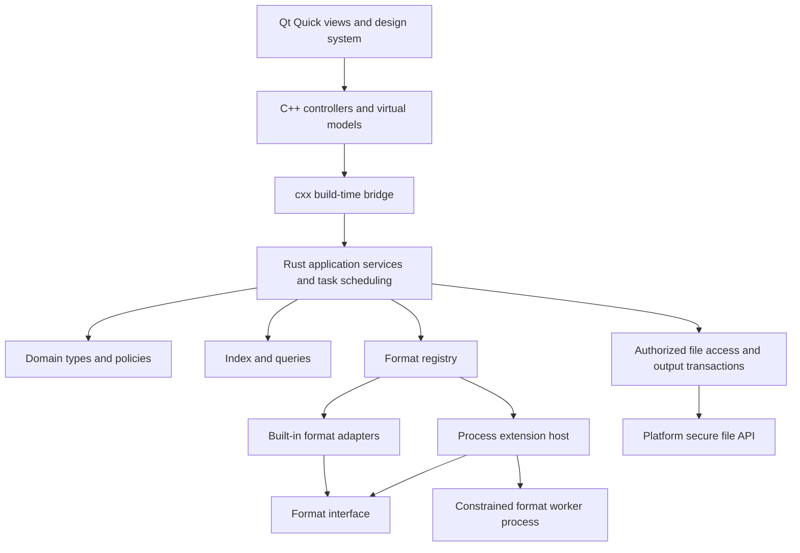

# xdzip: 02 System architecture

## 1. Architecture goals

Rust owns all archive semantics, tasks, format selection, and file security. QML owns views and lightweight interaction; C++ owns Qt objects, models, desktop system interfaces, and Rust type adaptation. Replacing the UI retains the core and format adapters; adding a format does not change the list view or task state machine.

The MVP uses one application process, one Rust core runtime, and optional format worker processes. Built-in pure Rust backends may run in process; adapters using large native parsing libraries should preferably run in official worker processes. Third-party extensions always run through constrained worker processes. Process isolation does not replace sandboxing.

Arrows indicate call direction. Format adapters request I/O through the SDK's restricted read/output objects. Restricted ports omitted from the diagram do not grant arbitrary filesystem access.

## 2. Proposed modules

The table describes the target structure of the production repository. At the time of this design, the experimental repository had not yet created these crates.

| Module | Responsibility | Disallowed dependencies/behavior |
|---|---|---|
| `xdzip-domain` | IDs, capabilities, states, errors, plans, policy values | Qt, filesystem, threads, concrete formats |
| `xdzip-codec-api` | Constrained streams, probing, scanning, read/write interfaces, capabilities | QML, user settings, actual output paths |
| `xdzip-index` | Metadata, pagination, sorting, filtering, index storage | UI objects, direct extraction |
| `xdzip-io` | Authorized roots, secure traversal, quotas, staging, commit, cleanup | Format magic, UI dialogs |
| `xdzip-runtime` | Session actors, plans, tasks, resource budgets, events | Qt, any QML state |
| `xdzip-codec-zip` / `xdzip-codec-tar` | Format adaptation, CRC/structure checks, parameter mapping | Custom overwrite policy, arbitrary path writes |
| `xdzip-plugin-host` | Worker processes, protocol, permissions, limits, health checks | Relaxing host path policy, directly loading Rust dylibs |
| `xdzip-platform` | Secure file APIs, credentials, platform capabilities | QML, duplicated business policy |
| `xdzip-qt-bridge` | cxx DTOs, command dispatch, event reception, exception boundary | QAbstractItemModel, format implementations |
| `apps/desktop` | C++, QML, system dialogs, themes, accessibility | Core file writes and password logging |
| `tools/codec-conformance` | Extension contract and interoperability tests | Released product runtime dependencies |

`xdzip-runtime` composes the index, I/O, backends, and extension host. `xdzip-codec-api` depends on the domain; `xdzip-io` implements constrained stream ports; format implementations depend only on the domain and SDK. Platform and bridge services are injected through small interfaces. The core must not call back into Qt global objects. There is no `common` crate containing every utility function.

## 3. Processes and threads

| Execution context | Work | Lifetime |
|---|---|---|
| Qt GUI thread | QML, controller properties, model updates, file dialogs | Application main thread; must not wait for scanning or extraction |
| Qt event receiver thread | Wait for Rust events, convert them to batches of Qt value objects, emit queued signals | Created at startup; a separate control channel wakes it for shutdown |
| Rust scheduler thread | Lightweight commands, session/task state, resource admission | Core runtime; does not perform long codec calls |
| Rust bounded worker pool | Scanning, queries, extraction, compression, verification, file commits | Bounded queue; work items check cancellation |
| Format worker process | A particular backend, official native library, or third-party extension | Reused by task/session, with concurrency and memory limits |

A thread is not created for every file. Parallel threads created by a compression backend count against the task's CPU allowance; an outer four-thread task must not start four more unbounded thread pools. Task state changes are centralized in the scheduler; workers send only results and progress.

The UI submission interface only validates and enqueues without blocking. Results are pushed as events. When idle, the event receiver blocks instead of continuously polling status every 100 ms. Timing and metrics sampling are enabled only for diagnostics or running tasks.

## 4. Services and ownership

`ApplicationRuntime` owns session management, task scheduling, the capability registry, and event channels. Each `ArchiveSession` owns source file authorization, the format backend, index state, source version, and lifetime counts. A query produces an immutable `QuerySnapshot`; planning produces an immutable `OperationPlan`.

A task does not depend on a particular tab remaining open. Closing a tab releases its browsing subscription; related tasks retain their source snapshots and file authorizations and continue or cancel according to the user's choice. Closing the whole application enters a unified shutdown: stop new commands, request cancellation, wait for safe commit points, finish worker processes, then reclaim models and the runtime.

An archive session permits multiple read tasks, with actual concurrency limited by the backend's declaration. In-place source modification is forbidden; creating a new archive or “Save As” uses a new output transaction. Read tasks therefore do not compete with the product's own in-place writes.

## 5. Configuration and persistence

Small user settings use a Qt settings adapter: theme, window, last directory, and shortcut options. Rust receives only validated policy snapshots and does not read GUI settings directly. Settings have schema versions, migration, and backup. On a read error, restore defaults and show a one-time non-blocking notice.

The archive index begins with a compact in-memory structure and migrates to a temporary disk index when its budget threshold is reached. A per-session SQLite candidate backend is only for the product's own metadata; it stores neither passwords nor file contents. Whether to use SQLite depends on measurements during the in-memory phase, but the `IndexStore` interface is provided from the first version. Archive indexes are not persisted across launches by default, avoiding source identity and privacy problems.

Output transaction logs are stored in a random private working directory inside the authorized destination. Global application data stores only user settings, the extension manifest, and low-sensitivity diagnostics. Raw content must not be moved into a global cache merely because a user path cannot be opened.

## 6. Replaceability and boundary checks

Unit tests use memory sources, fault-injection file ports, fake backends, and event clients without Qt. UI integration tests use the same application service rather than reimplementing fake core business logic. A future CLI is another adapter that can reuse `xdzip-runtime` without calling through the GUI or cxx.

Architecture checks in CI prohibit core crates from depending on Qt or the bridge and format crates from depending on the desktop application; they also check that Cargo features do not pull in unused backends. Code review focuses on call direction and resource ownership. Directory separation alone is not evidence of decoupling.

## 7. Failure boundaries

A worker-process crash fails its associated tasks, and the host cleans up uncommitted files. Already committed files remain in the result summary. Format errors become domain errors. Rust internal invariant failures and unrecoverable memory errors are process-level failures; it is not valid to claim that every panic can be caught and execution continued. Bridge entry points must not allow panics across FFI. The release panic policy is decided during bridge verification and used with output recovery logs to handle abnormal termination.

A Qt rendering failure must not trigger duplicate commits. After the GUI unsubscribes, the core still finishes according to the state machine. If shutdown exceeds the soft deadline, offer “Keep waiting” or “Force quit.” Forced exit does not promise zero leftovers; the next startup's recovery process handles them.
