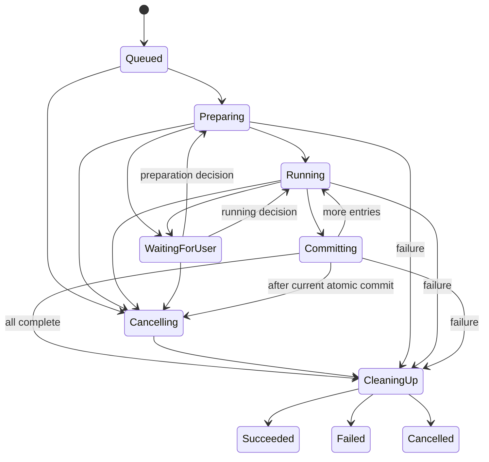

# xdzip: 08 Task states, resource admission, and concurrency

This page describes both scheduling goals and implemented rules. The application maintains separate runtime connections for independent sessions. Each connection retains a single session and one heavy-task worker; creation and extraction are coordinated through serial application-level admission. Closing a page does not cancel background tasks. See the [application sessions contract](../engineering/application-sessions.md). A complete CPU token pool, two concurrent heavy tasks, external workers, and general pause are future designs; the target budgets below are not current settings. Actual task boundaries are defined by the [safe extraction](../engineering/m3-extraction.md), [creation](../engineering/m4-creation.md), and [password extraction](../engineering/password-extraction.md) contracts.

## 1. State machine

A Task is created after StartPlan is accepted. An operation plan is not a task; preparing a plan is itself a cancellable background request.

Terminal states are irreversible and a terminal event is emitted once. The scheduler serially decides internal state transitions and outcome. `CleaningUp` can be entered from success, failure, or cancellation; it retains the final intent and does not change itself to success. Cleanup failure adds a leftover warning. If all data was correctly committed, a temporary directory that was not deleted is not treated as content corruption.

`TaskPhase` further identifies scanning, input preparation, decoding, writing, verification, publication, and cleanup. State and phase differ: Running+Verifying does not require dozens of extra top-level states.

## 2. Progress

Record processed input, actual decoded bytes, actual output bytes, completed/skipped/failed entries, current phase, and total reliability. Unknown totals show indeterminate progress and processed counts; estimated percentages are not presented as exact completion. Verification, solid-block skipping, and publication can change the distribution of elapsed time.

External progress is initially coalesced to 10 Hz; high-frequency background counts use atomic/local accumulation. User waits, cancellation feedback, and terminal states are delivered immediately. Estimate remaining time only after throughput has been stable for at least several seconds, reset on phase changes, and do not display highly volatile numbers by default.

Frequent Running/Committing transitions between files may be coalesced with progress; every transient need not reach the GUI. User waits, cancellation feedback, and terminal states remain immediate. The core still maintains the complete state machine for every transition. Coalescing affects presentation only and cannot omit commit permission or terminal-state decisions.

## 3. Admission and thread budgets

| Resource | Initial policy |
|---|---|
| Concurrent heavy tasks | At most 2; reduce to 1 for the same source/destination or high-memory backends |
| CPU workers | According to logical CPUs and user limit; default `max(1, min(4, cores-1))` |
| Backend internal threads | Borrow from the same CPU token pool without expanding it |
| Queued tasks | At most 32; return busy when full, and the GUI retains the plan for later start |
| Total codec memory | Default admission budget of 512 MiB, with index and GUI accounted separately |
| Stream buffers | Default 256 KiB, pooled and reused, counted against each task's budget |
| Same-destination conflicts | Coordinate destination roots and mapped scopes; serialize overlapping writes |

Budgets are admission and monitoring policies; in-process library memory estimates are not OS hard limits. Native/third-party backends whose allocation cannot be audited and bounded must use worker processes with platform hard limits. Users can select a lower-resource mode. High-dictionary backends must declare estimated memory and check it before start.

Admit tasks jointly by CPU, memory, source reading mode, and destination scope. Do not acquire CPU and then wait forever for a destination lock. Acquire leases in a consistent order; if all cannot be obtained, return to the queue. Reserve separate lightweight execution capacity for read queries/GUI requests so that searches do not completely stop when two compression tasks occupy workers.

## 4. Fairness and priority

Cancellation/shutdown > interactive pages and prompt decisions > current-session queries > task scheduling > scanning and prefetch. Priority must not starve background tasks indefinitely; use bounded bursts and queue-wait weighting. Prefetch may be dropped, but explicitly requested user actions should yield a result or cancellation.

Read concurrency for the same ZIP is the smaller of the backend limit and global budget. TAR/solid blocks are generally processed sequentially. SSD/NVMe may differ from mechanical and network disks, but the first version does not guess hardware and enable unlimited concurrency. Performance data determines whether to add a block-level pipeline.

## 5. Cancellation linearization

CancelTask requests a stop; it does not mean work has stopped when the function returns. The scheduler registers the cancellation token and immediately reports accepted. Work items check at read blocks, write blocks, entry transitions, user waits, and before publication. Waiting I/O uses cancellable/timeout policies; an uninterruptible system call is explicitly shown as finishing up in the UI.

When cancellation races with commit, a commit permit/state gate controls the outcome. Once a permit is obtained, finish the short atomic publication before responding to cancellation; if the permit was not obtained, clean the current temporary file. Published items cannot be unconditionally deleted. If cancellation arrives after the last commit and successful terminal state have linearized, return “Completed” and do not change the task to Cancelled.

Workers may be terminated after a two-second cooperation period. First revoke new write credit and subsequent authorizations; after termination reclaim uncommitted Sinks. An uncooperative in-process library cannot be solved by killing one thread; isolate it or do not claim to meet the cancellation budget.

Cancellation reaches a terminal state only after work stops, commit permits are released, and cleanup results are known. The UI must not show “Cancellation complete” merely on CancelAck. Restarting after cancellation creates a new TaskId and a new valid plan.

## 6. Waiting for users and pausing

Conflicts, secrets, volumes, and quotas trigger WaitingForUser. Release unnecessary CPU tokens and do not hold filesystem mutexes while waiting for dialogs. Retain constrained temporary objects and necessary resources and count them against the waiting budget. User decisions carry PromptId; expired or repeated decisions are invalid.

Quota prompts are only for preparation-stage risk/estimate decisions. Reaching a hard output quota during execution discards the current staged item and stops as Failed. Increasing the limit requires a new plan/task; it cannot silently enlarge the immutable original plan and continue.

The MVP has no general pause button. Reliable pause requires backend checkpoints, source versions, and persisted state; pausing a UI timer must not masquerade as pausing the codec. In future, enable it only for backends declaring safe-point pause and explain resources still held while paused.

## 7. Failure policy

By default, stop on content/structure, security, permission, or quota errors. A user may select “skip permitted individual errors and continue” in the plan, limited to explicitly defined error categories. Path escape, protocol errors, source changes, and a globally full disk cannot be broadly ignored.

Failure summaries retain paged results and bounded error samples. “Retry failed items” reacquires authorization, checks source version, and creates a new plan rather than reusing potentially stale write handles. Repeated plugin crashes trip a circuit breaker; there is no infinite automatic retry.

## 8. Application shutdown

Closing a window differs from exiting the application. The current [tray](../ux/desktop-integration.md) is enabled by default; when available, closing the main window only hides it. Explicit exit and restart still enter active-task confirmation and asynchronous shutdown; without a tray, normal close is the fallback. While tasks run, the user may keep waiting or cancel tasks and exit. After choosing cancellation, stop new commands, wake pending prompts, and wait for workers and the receiver thread to finish.

A five-second soft wait, general force-quit choice, and automatic recovery checks are target designs; the complete flow is not currently provided. Actual shutdown follows the asynchronous barrier in [runtime lifecycle](../engineering/m1-runtime.md). Crash staging is only reported and retained; unknown content is not automatically recovered or deleted. Shutdown control must not deadlock on a full queue or blocked GUI join.

## 9. Concurrency verification

Model-check state transitions, cancel/commit races, independent task survival after tab closure, event reordering, full-queue shutdown, duplicate starts, resource reclamation, and overlapping destinations for two tasks. Tests use synchronization barriers and fault points rather than depending only on arbitrary sleeps. Where needed, use tools such as Loom for small shared-state regions; do not force the whole Qt application into concurrency model tests.

## WP-10 creation tasks

Creation reuses one heavy-task thread and a bounded task mailbox; the GUI does not recursively scan inputs. After freezing the input tree, report known totals, encode sequentially into private staging, then re-decode and verify each entry before obtaining the whole-archive commit permit. Ordinary snapshots are coalesced to approximately 100 ms; conflicts and terminal states are retained. Cancellation and shutdown use existing control channels. Input file count and source bytes enter committed counts only after the archive is saved as a whole; written represents actual ZIP output bytes. See the [implementation contract](../engineering/m4-creation.md) for phases, budgets, and failure behavior.

## WP-14 waiting for extraction passwords

The current single heavy-task worker uses a separate `waiting_password` state and one-shot password response slot. It holds bounded source and task state without holding a filesystem mutex while waiting for input. Responses, cancellation, and exit can wake the task even when the ordinary queue is full. Cached passwords exist only within the current task; a correct response does not change frozen selection or output authorization. Actual bytes from failed attempts continue to count against budgets. Prompts, cleanup, cancellation, and terminal states bypass progress throttling.

Close/exit while waiting for a password and commit after authentication use existing cancellation linearization. Closing a password request window cancels the task; closing an ordinary progress window still only hides it. Ten verification-value failures per entry terminate the task; authentication or structural corruption fails immediately, and previously committed files remain. See the [password extraction contract](../engineering/password-extraction.md) for secret, link, and resource prerequisites.
