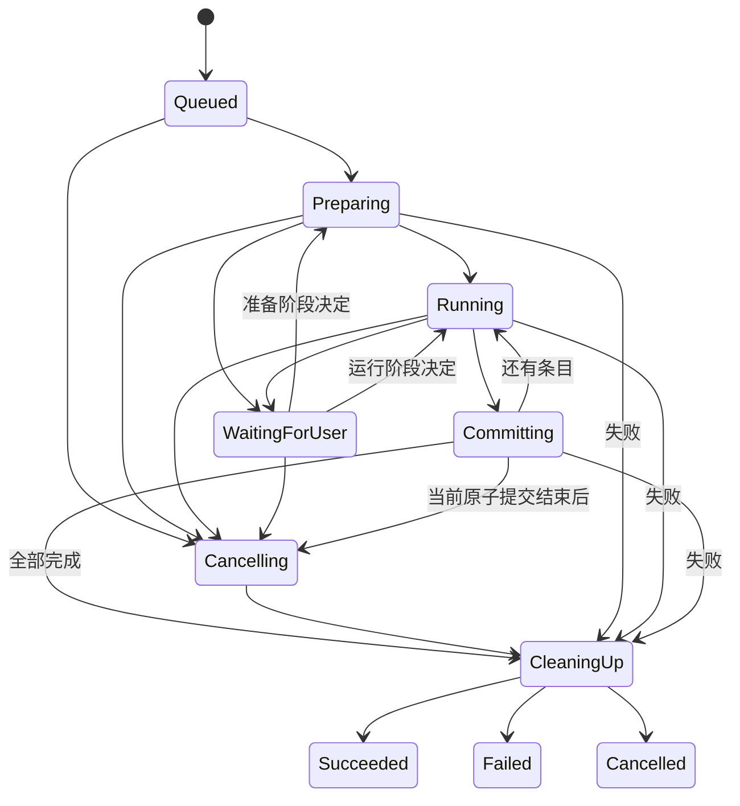

# xdzip：08 任务状态、资源准入和并发

本页同时描述调度目标设计与已实现规则。当前运行时使用单会话和单重任务 worker，完整 CPU token 池、双重任务并发、外部工作进程及通用暂停属于后续设计；不能将下方目标预算当作当前设置。实际任务边界见[安全解压](../engineering/m3-extraction.md)、[创建](../engineering/m4-creation.md)和[密码解压](../engineering/password-extraction.md)契约。

## 1. 状态机

Task 在 StartPlan 接受后创建。操作计划不是任务；准备计划本身作为可取消后台请求处理。

终态不可逆，终态事件只发一次；内部状态转换和 outcome 在调度器串行决定。`CleaningUp` 可由成功、失败或取消进入，它保存最终意图，不自行改成成功。清理失败附带遗留警告；如果数据已全部正确提交，不把“临时目录未删”混同为内容损坏。

`TaskPhase` 进一步表示扫描/准备输入/解码/写入/校验/发布/清理。状态和阶段不同：Running+Verifying 不需要额外制造几十个顶级状态。

## 2. 进度

记录已处理输入、实际解码字节、实际输出字节、完成/跳过/失败项、当前阶段及总量可信度。未知总量显示不定进度和已处理数量，不把估算百分比宣传成精确完成度。校验、固实块跳读和发布均可能改变耗时分布。

任务对外进度合并频率初始为 10Hz，后台高频计数用原子/局部累加；等待用户、取消反馈和终态即时投递。剩余时间在至少数秒稳定吞吐后才估算，阶段变化时重置；默认不展示高波动数字。

单文件之间高频 Running/Committing 转换可与进度合并，不要求每个瞬态都穿过 GUI；等待用户、取消反馈和终态即时。核心仍逐次维护完整状态机，合并只影响展示，不能省略提交许可或终态判断。

## 3. 准入和线程预算

| 资源 | 初始政策 |
|---|---|
| 重任务并发 | 最多 2；同源/同目标或高内存后端可降到 1 |
| CPU worker 数 | 按逻辑 CPU 与用户限额，默认 `max(1, min(4, cores-1))` |
| 后端内部线程 | 从同一 CPU token 池借额度，不额外扩张 |
| 队列任务数 | 最多 32；满时返回 busy，GUI 保留计划供稍后启动 |
| Codec 总内存 | 默认 512MiB 的准入预算，此外另计索引和 GUI |
| 流缓冲 | 默认 256KiB，池化复用，按任务计入预算 |
| 同目标冲突 | 目标根及映射范围协调，重叠写任务串行 |

预算为资源准入及监控政策，进程内库的内存估算不是 OS 硬限额。不能审计并限制分配的原生/第三方后端必须使用工作进程，再加平台硬限制。用户可选择更低资源模式；高字典后端需声明预计内存并在启动前检查。

任务根据 CPU、内存、源读取模式和目标范围联合准入，不能先拿 CPU 再永久等待目标锁。按统一顺序获取 lease，无法获得全部就退回队列。读取查询/GUI请求单独保留轻量执行容量，避免两个压缩任务占满后搜索完全停顿。

## 4. 公平和优先级

取消/关闭 > 交互页与提示决定 > 当前会话查询 > 任务调度 > 扫描与预取。优先级不允许长期饿死后台任务，使用有限 burst 和队列等待加权。预取可丢弃，用户已经明确请求的操作应给出结果或取消。

对同源 ZIP 的读并发取后端限制与全局预算较小者；TAR/固实块通常顺序处理。SSD/NVMe 可不同于机械盘和网络盘，但首版不自动猜测硬件后开无限并发。性能数据决定是否增加块级流水线。

## 5. 取消线性化

CancelTask 是请求停止，不是函数返回时已停止。调度器登记取消 token 并立即回报 accepted；工作项在读取块、写入块、条目切换、等待用户和发布前检查。等待 I/O 使用可取消/有超时策略；无法打断的系统调用要在 UI 中明确显示正在收尾。

取消和提交并发时以一个提交许可/状态门控制：取得提交许可后，短原子发布完成再响应取消；未取得许可的当前临时文件清理。已发布项不可无条件删除。最后一项提交及成功终态已线性化后收到取消，返回“已完成”，不把任务改为 Cancelled。

工作进程 2 秒合作期限后允许终止；先撤销新写信用和后续授权，终止后回收未提交 Sink。进程内不可合作的库不能依靠 kill 一个线程解决；应隔离或不宣称满足取消预算。

取消终态需等待工作停止、提交许可释放和清理结果确定。UI 不得仅收到 CancelAck 就显示“取消完成”。取消后重新启动创建新 TaskId 和新的有效计划。

## 6. 等待用户和暂停

冲突/秘密/卷/配额触发 WaitingForUser。释放不必要 CPU token，不持有文件系统互斥锁等待对话框；保留受限临时对象及必要资源，并计入等待预算。用户决定携带 PromptId，过期重复决定无效。

配额提示只用于准备阶段的风险/估算决策。运行中达到硬输出配额时丢弃当前暂存项并停止为 Failed；提高限额需生成新计划/任务，不能在原不可变计划内静默扩额后继续。

MVP 不提供通用暂停按钮。可靠暂停需要后端可检查点、源版本和持久化状态，不能用“暂停界面计时”假装暂停 codec。后续只对声明 safe-point pause 的后端开放，且暂停仍占用的资源必须说明。

## 7. 失败策略

默认遇内容/结构、安全、权限或配额错误停止任务。用户可在计划中选择“跳过允许的单项错误继续”，限于明确错误类别；路径逃逸、协议错误、源变化和全局磁盘满不被宽泛忽略。

失败摘要保存分页结果和有限错误样例。“重试失败项”重新获取授权、检查源版本并生成新计划，不复用可能过期的写句柄。插件连续崩溃有熔断，无自动无限重试。

## 8. 应用关闭

关闭窗口与退出应用分开。当前[托盘](../ux/desktop-integration.md)默认启用，可用时关闭主窗口仅隐藏；明确退出和重启仍进入活动任务确认及异步关闭路径，无托盘时回退正常关闭。任务运行时可继续等待，或取消任务后退出。用户选择取消后停止新命令，唤醒等待提示，等待工作与接收线程收尾。

5 秒软等待、通用强制退出选择与自动恢复检查属于目标设计，当前不提供该完整流程。实际关闭遵循[运行时生命周期](../engineering/m1-runtime.md)的异步屏障，崩溃暂存仅提示并保留，不自动恢复或删除未知内容。shutdown 控制不能被满队列或阻塞 GUI join 卡死。

## 9. 并发验证

模型化验证状态转移、cancel/commit 竞争、关标签页/任务独立生存、事件乱序、满队列 shutdown、重复启动、资源回收和两任务重叠目标。测试通过同步屏障和故障点驱动，避免只依赖任意 sleep。必要时对小范围共享状态采用 Loom 等工具，不能把整个 Qt 应用塞进并发模型测试。

## WP-10 创建任务

创建任务沿用单重任务线程和有界任务 mailbox，不在 GUI 递归扫描输入。冻结输入树后报告已知总量，顺序编码并写入私有暂存，完成后逐条重新解码校验，再取得整体提交许可。普通状态快照合并至约 100 ms，冲突和终态保留；取消与关闭沿用现有控制通道。整体保存后的输入文件数与源字节数才进入 committed 计数；written 表示实际 ZIP 输出字节。阶段、预算与失败行为见 [实现契约](../engineering/m4-creation.md)。

## WP-14 等待解压密码

当前单重任务 worker 使用独立 `waiting_password` 状态与一次性密码响应槽，持有有界来源与任务状态，不持有文件系统互斥锁等待输入。普通队列满时响应、取消及退出仍可唤醒任务。缓存密码只存在当前任务内，正确响应不改变冻结的选择或输出授权；失败尝试的实际字节继续计入预算。提示、清理、取消与终态绕过进度节流。

密码等待中的关闭／退出和认证后提交沿用既有取消线性化；关闭密码请求窗口取消任务，关闭普通进度窗口仍只隐藏。每条目十次验证值失败终止，认证或结构损坏直接失败，早前已经提交的文件保留。具体秘密、链接及资源前提见[密码解压契约](../engineering/password-extraction.md)。
