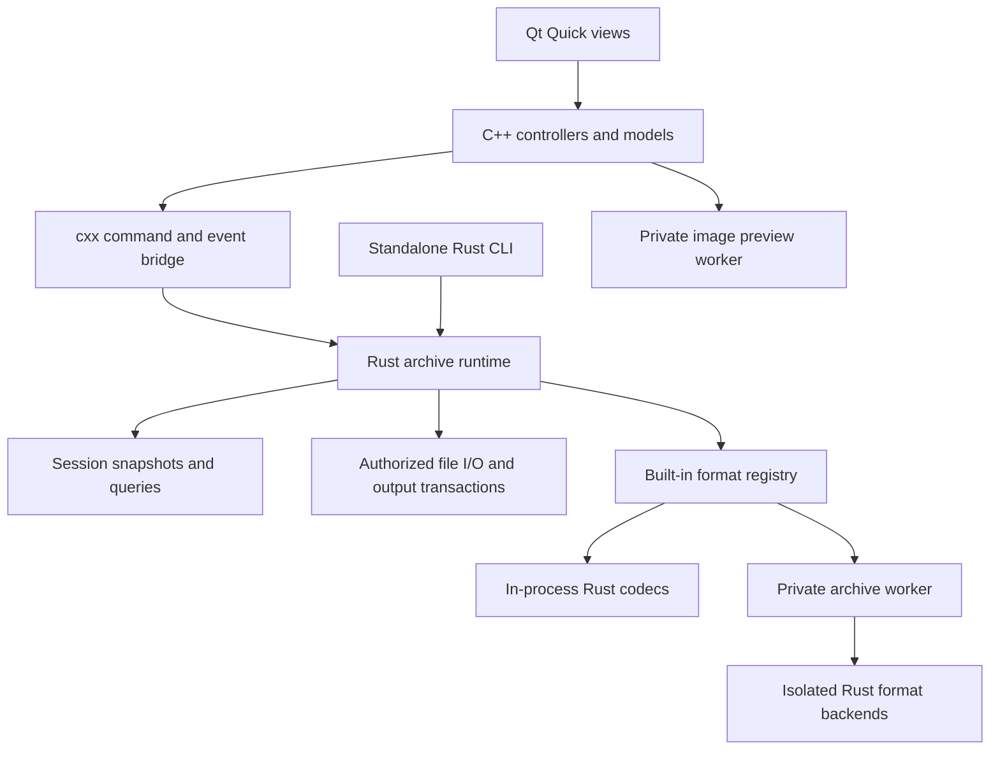

# XDZip system architecture

English | [简体中文](../zh-CN/design/system-architecture.md)

The desktop and standalone CLI share the Rust archive runtime. Desktop clients express intent through Qt Quick. Rust selects formats, owns sources and indexes, and applies task and file policies. The CLI calls the runtime without Qt. [Repository and module map](../engineering/repository-layout.md)

## Desktop requests and lifecycle

`ApplicationSessions` owns browsing sessions and the shared task entry. A session's `BrowserController` submits commands through `RuntimeConnection`. The cxx bridge gives the application separate command and event handles. A receiver thread waits for runtime events and delivers bounded batches. The GUI applies a response only when its request, session and query identity still match. It can then discard a stale page after a search, sort or tab change. [Bridge and session contracts](qt-rust-bridge.md), [application sessions](../engineering/application-sessions.md)

Closing a browsing tab releases its UI state. A running task can retain its session and source while the task entry remains available. Heavy tasks are admitted serially across the application. The runtime handles cancellation cooperatively and protects the actual terminal result when a commit has already completed. [Runtime](../engineering/product-runtime.md), [task lifecycle](task-scheduling.md)

## Archive operations from open to output

1. **Open.** The runtime authorizes input, resolves any volume set and selects a backend by content. It records physical entry identities. Duplicate names keep separate identities.
2. **Browse.** Memory or bounded disk indexes retain metadata and support stable searches, sorting and paging. Queries and selection are tied to the session and snapshot. Ordinary single-file ZIP/ZIP64 can use a larger streaming index, subject to separate task limits. [Index behavior](../engineering/large-index.md)
3. **Read or write.** For extraction, the runtime freezes the requested entries and chooses a safe output plan rooted at the user's selected destination. Codecs read authorized ranges and deliver bytes to a bounded sink. The host handles target conflicts, verification, staging and commit. Creation and modification use their own archive-level publication rules. [File security](file-security.md), [archive modification](../engineering/archive-transfers.md)
4. **Report.** The final result distinguishes what was verified, committed, skipped or left unfinished. Output committed before a failure or cancellation can remain. A metadata preflight or successful archive check has its own scope. [Preflight](../engineering/extraction-preflight.md), [integrity checking](../engineering/archive-checking.md)

## Process and platform boundaries

| Component | Responsibility |
| --- | --- |
| `xdzip-domain` and `xdzip-codec-api` | Domain identities, capability declarations and bounded codec interfaces. |
| `xdzip-runtime` and `xdzip-io` | Session, index, query and task policy, plus platform file authorization and output publication. |
| `xdzip-codec-*` | Built-in format readers and writers with a registry of available operations. ZIP and TAR use in-process Rust. Supported 7z, RAR, CAB and optical reading routes use the bundled worker. |
| Desktop image preview worker | Receives bounded encoded bytes only after the archive read. Produces a limited thumbnail for the corresponding request. |
| Desktop adapters and updater | Handle Qt models, appearance and settings, tray, file associations, native menus and platform-specific update delivery. |

The index lives in the runtime. Platform file operations live in the I/O crate and desktop adapters. The format worker and image preview worker have separate roles and resource limits. The experimental SDK host runs separately from the product. Third-party extensions are disabled in current product builds. [Archive worker contract](../engineering/native-codecs.md), [preview contract](../engineering/content-preview.md), [SDK trial](../engineering/sdk-trial.md)

The desktop keeps user preferences outside format code. Index and staging lifetimes are tied to their own sessions and tasks. Keep the dependency direction from UI through runtime toward domain, format and I/O interfaces. [Data boundaries](domain-data.md), [privacy](../engineering/privacy.md)
