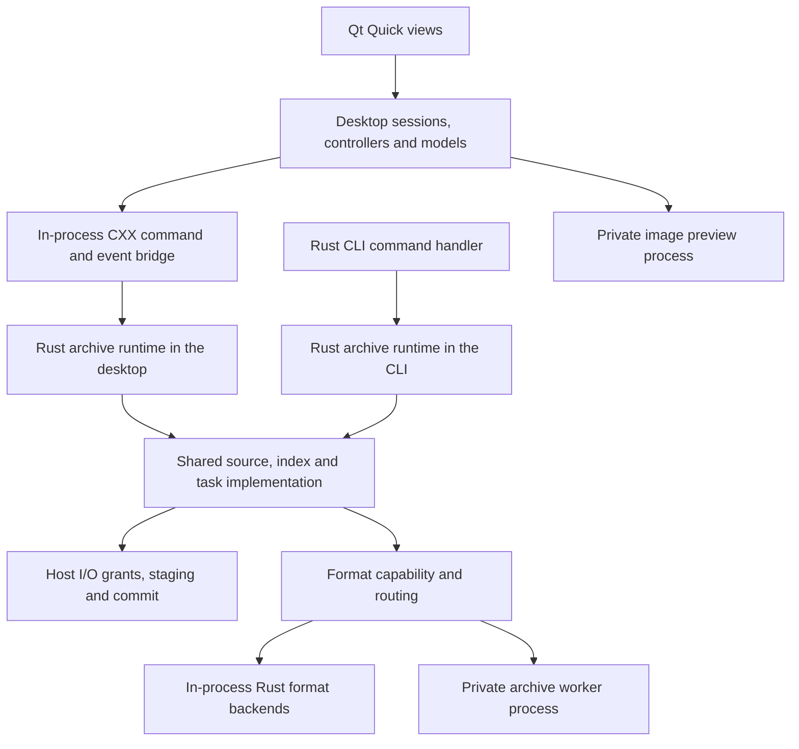

# XDZip system architecture

English | [简体中文](../zh-CN/design/system-architecture.md) | [繁體中文](../zh-TW/design/system-architecture.md) | [日本語](../ja-JP/design/system-architecture.md) | [한국어](../ko-KR/design/system-architecture.md) | [Français](../fr-FR/design/system-architecture.md) | [Deutsch](../de-DE/design/system-architecture.md) | [Español](../es-ES/design/system-architecture.md) | [Português (Brasil)](../pt-BR/design/system-architecture.md)

The desktop and command-line clients share the Rust archive runtime. The runtime turns a selected source into an indexed session and turns an operation into a bounded task. Format backends interpret archive data. The host authorizes files, controls output placement and publishes verified results.

## Architecture at a glance

The two runtime boxes represent separate instances of the same implementation. The desktop and CLI each own their archive state and tasks. The desktop's local IPC forwards desktop activation and integration requests to the primary GUI instance. Archive commands go through the in-process runtime. [Application sessions](../engineering/application-sessions.md), [CLI contract](../engineering/command-line.md)

## Module responsibilities and call direction

| Module | What it owns and calls |
| --- | --- |
| Desktop entry and Qt Quick | `xdzip-browser`, built as the desktop executable `xdzip`, starts at `browser_main.cpp` and loads `Browser.qml`. `SessionPage.qml` and its views present lists, selection, dialogs and task state. They send user intent to C++ controllers. [Desktop entry](https://github.com/xiaodaozhi/xdzip/blob/main/apps/desktop/browser_main.cpp), [QML design](qt-quick-ui.md) |
| Desktop C++ adapters | `ApplicationSessions` coordinates tabs, windows and the shared task entry. A `BrowserController` owns the list model and request state for its session, translates UI intent into typed commands and routes progress, errors and prompts back to the UI. `RuntimeConnection` owns the bridge handles and event delivery. Settings, tray, file associations and native drag or shell integration live in desktop adapters. [Session coordinator](https://github.com/xiaodaozhi/xdzip/blob/main/apps/desktop/ApplicationSessions.cpp), [Controller](https://github.com/xiaodaozhi/xdzip/blob/main/apps/desktop/BrowserController.cpp) |
| `xdzip-qt-bridge` | The linked CXX boundary converts C++ commands, rows, task snapshots and errors to and from Rust types. It wraps a runtime `Client` and `Receiver` as separately owned command and event handles. [Bridge source](https://github.com/xiaodaozhi/xdzip/blob/main/crates/xdzip-qt-bridge/src/lib.rs), [Bridge contract](qt-rust-bridge.md) |
| `xdzip-cli` | Parses arguments, handles terminal prompts and cancellation, invokes `xdzip-runtime` directly and maps events to text or JSON and exit codes. The archive commands use the same source and task rules as the desktop. Installation and update commands have their own entry paths. [CLI runtime adapter](https://github.com/xiaodaozhi/xdzip/blob/main/crates/xdzip-cli/src/runtime.rs), [CLI integration](../integration/README.md) |
| `xdzip-runtime` | Owns the current `Archive` for each service instance. `source` resolves volumes and tracks source versions. `formats` detects and dispatches formats. `index`, `navigation`, `query`, `listing` and `disk_index` build and query metadata. The service validates commands and queues tasks for `extraction`, `creation`, `updating`, `checking` and `exporting`. `preview` handles bounded reads for the properties view. [Runtime modules](https://github.com/xiaodaozhi/xdzip/blob/main/crates/xdzip-runtime/src/lib.rs), [Product runtime](../engineering/product-runtime.md) |
| `xdzip-domain`, `xdzip-codec-api` and `xdzip-extract-plan` | The domain defines identities, metadata and path invariants. The codec API defines format capabilities and contracts such as `ReadSource`, `PayloadCodec`, `DecodedSink`, `EncodeInput` and `EncodeOutput`. The extraction planner derives a report from metadata and selection. Destination authorization stays with the host. [Domain and data](domain-data.md), [Codec interface](https://github.com/xiaodaozhi/xdzip/blob/main/crates/xdzip-codec-api/src/lib.rs), [Extraction preflight](../engineering/extraction-preflight.md) |
| `xdzip-codec-*`, `xdzip-compression` and `xdzip-crypto` | The codec crates implement container framing, metadata scans, payload reads and the write operations available for each format. The compression and crypto crates supply reusable algorithms. Codec interfaces consume host-provided streams and sinks. The capability registry describes available operations while runtime routing checks the actual archive and its entries. [Runtime routing](https://github.com/xiaodaozhi/xdzip/blob/main/crates/xdzip-runtime/src/formats.rs), [Format registry](../engineering/format-registry.md) |
| `xdzip-io` | Opens regular input files, identifies native file objects, freezes authorized creation inputs and provides destination grants, staging and commit. It implements platform checks at the file boundary while the runtime decides which operation to perform and when to publish. [Input authorization](https://github.com/xiaodaozhi/xdzip/blob/main/crates/xdzip-io/src/input.rs), [Output grants and commit](https://github.com/xiaodaozhi/xdzip/blob/main/crates/xdzip-io/src/target.rs), [File safety](file-security.md) |
| Update and development tooling | `UpdateController` and `xdzip-update` handle update selection, verification and handoff. Installed builds use platform-specific installation paths. The SDK host and format probes have independent entry points. Product archive discovery uses the built-in registry. [Software updates](../engineering/software-update.md), [SDK trial](../engineering/sdk-trial.md), [Repository and module map](../engineering/repository-layout.md) |

## Desktop requests and lifecycle

1. **Entry and routing.** Normal desktop launch, file association and shell requests enter the desktop application. `SingleInstance` elects a primary instance for the same user and login session. The primary instance handles forwarded requests and opens or reuses the appropriate browsing or operation session. A standalone CLI archive command starts its own Rust service. The bundled CLI can hand a desktop update request to the GUI over the local channel.
2. **Command admission.** A browsing controller uses its own `RuntimeConnection`. The GUI submits a typed command and receives an admission result and request ID. A bounded retry on the event loop handles temporary admission contention. Archive I/O runs off the GUI thread.
3. **Execution and delivery.** Each service runs a Rust command thread for the current archive, metadata requests and task preparation, and a separate Rust task thread whose bounded queue runs one heavy task at a time. An additional desktop admission rule serializes heavy operations across controllers. On the Qt side, a receiver thread drains Rust events into a bounded mailbox for the GUI thread. The controller matches request and session identity and checks query generation and revision when applying pages. The CLI submits commands and consumes their events within its own process.
4. **Task ownership.** Acceptance and progress are separate from the terminal task snapshot. The task thread owns the frozen job input. Passwords, conflict decisions and cancellation are sent to the owning task. Task controls use task and prompt identity. A task's numeric ID belongs to its runtime connection. Cancellation and shutdown do not wait for normal command-queue space. Closing a tab discards its browsing presentation while accepted tasks can continue and results remain accessible from the shared task entry. Explicit application exit stops admission, drains terminal events and waits for worker shutdown.

[Runtime event service](https://github.com/xiaodaozhi/xdzip/blob/main/crates/xdzip-runtime/src/service.rs), [Task queue](https://github.com/xiaodaozhi/xdzip/blob/main/crates/xdzip-runtime/src/service/tasks.rs), [Qt event delivery](https://github.com/xiaodaozhi/xdzip/blob/main/apps/desktop/RuntimeConnection.cpp), [Task scheduling](task-scheduling.md)

## Process and platform boundaries

| Execution boundary | Data and responsibilities |
| --- | --- |
| Primary desktop process | The Qt GUI, C++ adapters, CXX bridge and Rust runtime threads share an address space. The host owns open archive sessions and native file authorization. Subsequent desktop launches can forward requests over user-scoped local IPC and exit. |
| CLI command process | The CLI command handler calls the same Rust runtime as a library in its process. Packaged CLI launch or update handoff may involve separate processes. Archive state and task results belong to the command's own service. |
| Archive format worker | The runtime routes 7z, RAR, CAB and ISO/UDF reads through `xdzip-codec-native`. It launches the bundled `xdzip-native-codec` and communicates over bounded framed stdin/stdout. The worker's thin C++ protocol layer calls Rust backends through `xdzip-codec-bridge`. The host services authorized range or volume reads and validates output frames. For 7z writing it accepts bounded offset writes into private staging. Archive and destination paths stay in the host. Worker failure or cancellation terminates the operation and incomplete staging is discarded. This process boundary limits faults and resource usage. Its protocol grants no filesystem authority, and it runs without a kernel permission sandbox. |
| Image preview worker | After Rust has read and verified an eligible archive entry, the desktop sends bounded encoded image bytes to `xdzip-image-preview`. The worker returns a bounded RGBA thumbnail. The request carries no archive path, password or destination handle. The preview provider publishes the result only to the matching current request. Text preview is handled in the Rust runtime. |
| Platform handoff | Desktop adapters coordinate file-manager activation, opening a private extracted copy in an external app, and update installation. Update helpers or macOS Sparkle perform their own installation handoff. Store-managed updates follow the platform channel. The format worker does not handle these requests. |

[Archive worker protocol](../engineering/native-codecs.md), [Image preview contract](../engineering/content-preview.md), [Platform integration](../engineering/installers-associations.md), [Archive transfers](../engineering/archive-transfers.md), [Update handoff](../engineering/software-update.md)

## Opening and browsing an archive

1. **Authorize the source.** `Archive::open_with_password` asks `Source::open` to open a regular file through `xdzip-io` and resolve any supported split-volume set. The host records the identity, size and timestamps of each admitted part. Codecs receive a seekable input and, where applicable, host-provided volume metadata.
2. **Identify the format and scan.** The runtime probes the contents and validates relevant container structure. Names and extensions can guide volume discovery or resolve specific ambiguities. The selected backend scans within its resource limits. A password-protected directory can require a password before the scan completes. A failed or incomplete scan does not publish a partial archive session.
3. **Build the session snapshot.** The runtime keeps physical entry IDs separate from names and from synthesized navigation folders. Duplicate names therefore remain independently addressable. Ordinary single-file ZIP/ZIP64 can stream metadata into a private disk index when the in-memory budget is exceeded. That expanded browsing capacity has separate limits from extraction. Sessions using the disk index currently do not support whole-archive testing or modification.
4. **Query and select.** A desktop browse request supplies the session, directory, search and sort intent. Rust returns the result identity and bounded pages. A continuation must match the current session, query, generation and revision. Before a task uses logical selection across pages, Rust resolves it to physical entries or navigation identities. The CLI uses the physical catalog and explicit member paths or entry IDs. The visible row position and the output pathname are separate from the physical entry ID.

The snapshot describes the archive admitted into the session. Source identity and metadata are checked again at relevant reads and writes to detect changes. The source file can still be modified concurrently, so this is best-effort detection. A detected change invalidates the affected browsing state and blocks publication from the stale source.

[Source and volume handling](https://github.com/xiaodaozhi/xdzip/blob/main/crates/xdzip-runtime/src/source.rs), [Query and selection](https://github.com/xiaodaozhi/xdzip/blob/main/crates/xdzip-runtime/src/query.rs), [Large archive index](../engineering/large-index.md)

## Reading, checking and extracting entries

| Operation | Data flow and outcome |
| --- | --- |
| Browse or extraction preflight | Uses indexed metadata. The preflight summarizes selection, path and size constraints without opening an output grant or proving that all selected data can be decoded. |
| Preview | Resolves a single eligible regular entry from the current session. Rust reads and decodes it fully through a bounded sink and performs the format's available integrity or authentication checks. The desktop displays approved text or sends verified encoded image bytes to the image worker. |
| Test archive | Freezes the input and reads the entire eligible archive through a bounded discard sink or a format-specific scan. It never authorizes output. The format determines which checks are available. For example, TAR and ISO/UDF can establish structure and readability without a per-file checksum guarantee. |
| Extract, open or export | Freezes selected records and reads from the authorized source. Extraction publishes into the chosen destination. Opening a file uses a private verified copy and hands it to the system. Drag export can prepare private staged output first, then publish to a validated target. |

The regular-file extraction path illustrates the separation of decoding and publication.

```mermaid
flowchart TB
  INTENT[Frozen selection and destination intent] --> PLAN[Runtime path and conflict plan]
  PLAN --> AUTH[Host-authorized destination]
  SOURCE[Host-authorized source or volumes] --> DECODE[Format backend]
  AUTH --> STAGE[Private staging file]
  DECODE --> STAGE
  STAGE --> VERIFY[Completed decode, integrity and source checks]
  VERIFY --> COMMIT[Host file commit]
  COMMIT --> RESULT[Task result and cleanup]
```

1. **Plan.** The runtime uses the frozen selection to validate portable relative paths and detect output collisions. `xdzip-io` anchors the destination to an authorized directory. The runtime resolves ask, skip, rename or eligible overwrite. Protected inputs, changed targets and unsafe link traversal cannot be authorized by a codec.
2. **Decode.** The backend reads the admitted source, directly or through the archive worker. It sends bytes to a metered sink backed by a private stage. Password retries, expansion and auxiliary work remain subject to the operation's limits. Bytes sent to staging are provisional until decoding, size checks and available format verification succeed.
3. **Commit and report.** Before publication, the host rechecks the source and relevant destination identity. It commits each eligible file separately and records actual published files and bytes. A later failure or cancellation can leave earlier committed files in place. Unpublished staging is cleaned up where possible, and the terminal result reports failure, cancellation, skips and any cleanup warning.

[Extraction execution](https://github.com/xiaodaozhi/xdzip/blob/main/crates/xdzip-runtime/src/extraction/execute.rs), [Archive checking](../engineering/archive-checking.md), [Password interactions](../engineering/password-extraction.md), [ZIP safe extraction](../engineering/zip-safe-extraction.md)

## Creating or modifying an archive

Creation and archive modification stage and validate an archive as a unit. The runtime coordinates the job and the format encoder writes through a host-owned output interface. Only the host can publish the result.

1. **Create.** The runtime validates output format and settings, obtains an authorized destination, and walks and freezes the admitted input tree. The encoder receives metadata and can open streams by input index. It writes to a private stage. ZIP and TAR writers run in-process, 7z uses the archive worker, and ISO creation uses the in-process Rust optical writer even though ISO browsing uses the worker. [Creation task](https://github.com/xiaodaozhi/xdzip/blob/main/crates/xdzip-runtime/src/creation.rs), [ISO writer](../engineering/iso-creation.md)
2. **Modify.** For an eligible archive the runtime freezes the source and additions and builds a plan for retained, added, replaced or moved entries. The rewrite produces a new archive in staging. The runtime reopens the result and verifies the expected entries and content before replacing the original through the host's archive-update authority. Unsupported entries, encrypted or split sources and other incompatible cases are rejected according to the format and job rules. After a successful replacement, a desktop session still viewing the source refreshes its snapshot. [Archive update task](https://github.com/xiaodaozhi/xdzip/blob/main/crates/xdzip-runtime/src/updating.rs), [Archive modification and transfers](../engineering/archive-transfers.md)
3. **Verify and publish.** The host reopens staged creation output and checks its structure, expected entries and content according to the format and creation profile. It resolves output conflicts and rechecks the relevant authority before committing. A single-file archive has one commit point. Split creation stages all parts before publishing a new set, rejects overwrite of existing sets, and attempts rollback if publication fails partway. Each part has its own publication step. The task report can record cleanup or rollback problems. [ZIP creation](../engineering/zip-creation.md), [File commit contract](file-security.md)

**Reading a result.** `TaskAccepted` identifies the job that was queued. `Finished` ends the ordinary request. The separate terminal task snapshot reports what was verified, published, skipped or left unfinished. Decoded bytes and published bytes can differ. Cancellation is cooperative and a request made after a successful whole-archive commit does not undo publication.

[Task state and cancellation](task-scheduling.md), [Product design and technical reference](../reference/README.md)
