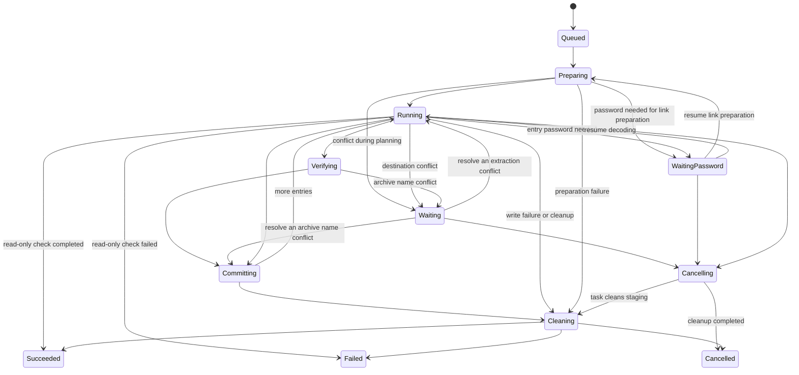

# Task scheduling, progress and cancellation

English | [简体中文](../zh-CN/design/task-scheduling.md) | [繁體中文（台灣）](../zh-TW/design/task-scheduling.md)

XDZip uses one Rust command thread and one task thread per runtime connection. The command thread owns the current archive and prepares task inputs. The task thread runs accepted jobs while the command thread can still serve metadata requests. The [system architecture](system-architecture.md) explains where these threads run, and the [Qt/Rust bridge](qt-rust-bridge.md) explains how results reach the client.

## Admission and task ownership

| Layer | Current behavior |
| --- | --- |
| Desktop controller | `BrowserController::attemptSubmission` serializes heavy operations across controllers in the desktop process, including preparation and cleanup. A controller waiting for admission retains a bounded command and can cancel that wait. Metadata browsing uses the ordinary command path. |
| Runtime command thread | Validates the request and forms a job. Extraction, checking and editing retain the relevant source and metadata or selection. Creation receives bounded options and scans its input tree on the task thread. A metadata preflight or target check creates no heavy task. |
| Runtime task queue | Runs extraction, temporary opening, creation, checks, edits and exports as appropriate, one job at a time in queue order within the connection. Per service, up to 32 tasks may remain tracked, with a 64 MiB aggregate retained-job budget. This budget covers retained inputs and reserved secret space. Actual decoding, indexing, worker and output resources have separate limits. Saturation is reported as `task_busy`. |
| Standalone CLI | Uses the same Rust scheduling rules within its own command process. Multiple independent CLI processes have separate queues, as does the desktop. Safe output authorization and conflict checks still apply to each process. |

`TaskAccepted` identifies an admitted job. The ordinary request's `Finished` closes that request. The job can continue producing `TaskUpdate` snapshots using the original request ID for correlation and the task ID for control. The application task entry retains the owning controller even when its tab closes, so prompts and results remain attributable to the right connection. [Task queue source](https://github.com/xiaodaozhi/xdzip/blob/main/crates/xdzip-runtime/src/service/tasks.rs), [Desktop admission and task routing](https://github.com/xiaodaozhi/xdzip/blob/main/apps/desktop/BrowserController.cpp), [Desktop sessions](../engineering/application-sessions.md)

## States and reported progress

The diagram shows representative routes. A task can skip phases or repeat a phase according to its operation. A read-only check can finish without a commit. A creation or edit task normally verifies the staged archive before publishing, and extraction can commit repeatedly.

| Runtime status | What the client receives |
| --- | --- |
| `queued`, `preparing` | A job is queued or preparing authorized sources, destination access and format state. The total may still be unknown. |
| `running`, `verifying` | Content is being read, encoded, decoded or checked. `verifying` also describes rereading staged archive output. Verification does not increase committed counts. |
| `waiting`, `waiting_password` | The task is waiting for its current conflict or password response. |
| `committing` | The task obtained permission to publish a file, archive, or volume set. |
| `cancelling`, `cleaning` | Cancellation has been requested, or private objects are being closed and reclaimed. A snapshot may skip a transient state because progress is coalesced. |
| `succeeded`, `failed`, `cancelled` | The ordinary execution path has settled. The final snapshot carries the actual result, including previous commits and cleanup warnings. |

`total_known` distinguishes an unknown total from zero. The snapshot separates bytes read, decoded, written, verified and committed. Solid-block work or repeated decoding can increase the amount of work without publishing additional files. Creation counts its input files and input bytes as committed only after archive publication. Its `written_bytes` measures output writes, which can include header rewrites. The queue limits routine `running`, `verifying` and `committing` updates to one per 100 ms and retains only the latest pending snapshot per task. Prompts, cancellation, cleanup and terminal results bypass that throttle. Outcome details are bounded to 128 records, with an omitted count. [Status codes and snapshot fields](https://github.com/xiaodaozhi/xdzip/blob/main/crates/xdzip-runtime/src/extraction/mod.rs)

## Waiting for a decision

- A name conflict can wait for an explicit decision when the policy is ask. A password request uses a separate one-shot response slot. Task ID, prompt ID and prompt type must match the current wait. Responses to an old or already answered prompt are rejected.
- Waiting retains the job's bounded state and its queue slot. The task waits on a condition variable, which releases the response mutex while waiting. A decision or cancellation wakes it without depending on ordinary command-queue space. The waiting job still occupies the task worker. The separate command thread can continue handling browsing commands.
- The password path uses task-local secrets. Supported retryable password failures are capped per entry and work already performed counts against the task's budgets. Explicit integrity failures stop the operation. A missing volume, an exhausted hard quota or a changed source is reported through the appropriate error path. Waiting for input is distinct from a user-controlled pause. [Password interaction](../engineering/password-extraction.md), [Resource and file rules](file-security.md)

## Cancellation and the commit boundary

`cancel` requests cancellation of an ordinary request. Once a task exists, `cancel_task` addresses the task itself. These controls acknowledge a stop request. The caller learns the outcome from the relevant request completion or terminal task snapshot. There is no fixed completion deadline for a cooperative cancellation, especially while a host system call is blocked. The archive worker has separate process supervision. [Bridge control methods](qt-rust-bridge.md), [Archive worker supervision](../engineering/native-codecs.md)

| When cancellation arrives | Effect |
| --- | --- |
| Before `begin_commit()` wins the gate | The current publication does not begin. The task drops or cleans unpublished staging and keeps previous receipts. |
| During one extraction or file-promise publication | The publication call can finish. If the file was published, the task records it. Cancellation can stop subsequent work and the terminal snapshot can be `cancelled` with nonzero committed counts. |
| During final archive publication | Creation and modification preserve the successful result once the verified single archive or full volume set is published. For split creation, the commit routine may have to roll back its own partially published set. A rollback failure can set `outcome_uncertain`. |
| After a final outcome has been fixed | A late cancellation cannot turn the successful commit into a cancelled result. |

The gate controls when task cancellation can prevent publication. Output authorization and staging validation are still required. An authorized write can fail and return its actual filesystem error. [Cancellation gate](https://github.com/xiaodaozhi/xdzip/blob/main/crates/xdzip-runtime/src/extraction/control.rs), [File publication](file-security.md)

## Failure, tab closure and application exit

Skip applies to supported conflict decisions. A decode, resource, source or target safety error can stop the job. Already published files remain recorded, and a staging cleanup error can accompany a successful publication. Unexpected worker failure or an unwindable task panic can produce a failed or uncertain outcome. The panic path reports `task_abandoned` and faults the affected runtime. Absence of a terminal response after process exit does not establish what reached disk.

Closing a progress window or archive tab is a presentation action. Accepted jobs and their results remain available through the application task entry. Closing an active password prompt can cancel its task. Explicit exit handles active work, stops admission when shutdown starts, wakes waiters and continues draining events. The receiver joins the Rust workers before producing `ShutdownReady`. Qt finishes draining and waits for the receiver to end without a blocking GUI-thread join. An external native transfer may also need to finish. [Runtime lifecycle](../engineering/product-runtime.md), [Archive transfers](../engineering/archive-transfers.md)
