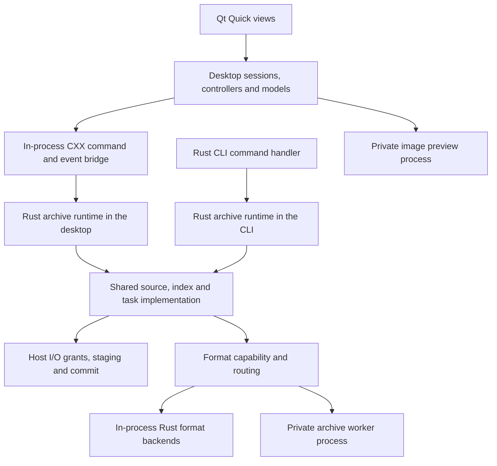
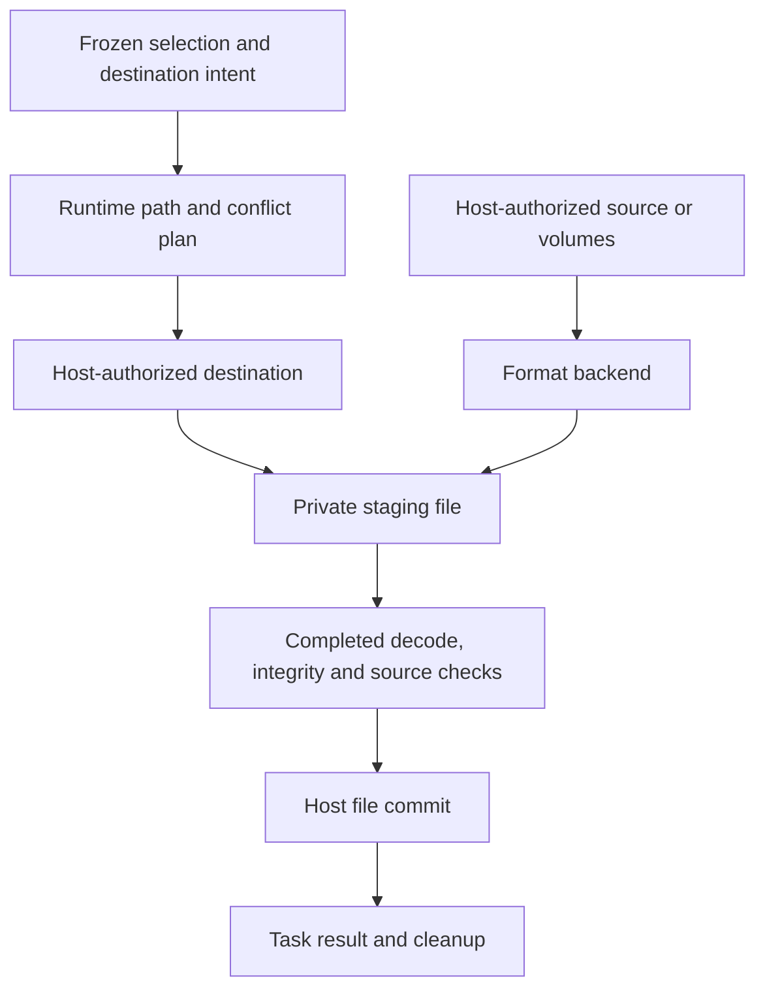

# Arquitectura del sistema XDZip

[English](../../design/system-architecture.md) | [简体中文](../../zh-CN/design/system-architecture.md) | [繁體中文](../../zh-TW/design/system-architecture.md) | [日本語](../../ja-JP/design/system-architecture.md) | [한국어](../../ko-KR/design/system-architecture.md) | [Français](../../fr-FR/design/system-architecture.md) | [Deutsch](../../de-DE/design/system-architecture.md) | Español | [Português (Brasil)](../../pt-BR/design/system-architecture.md) | [Русский](../../ru-RU/design/system-architecture.md)

Los clientes de escritorio y de línea de comandos comparten el motor de archivos Rust. El motor convierte un origen seleccionado en una sesión indexada y una operación en una tarea limitada. Los motores de formato interpretan los datos del archivo. El host autoriza archivos, controla la ubicación de salida y publica los resultados verificados.

## Vista general

Los dos bloques del motor representan instancias separadas de la misma implementación. Escritorio y CLI poseen cada uno su propio estado de archivo y sus tareas. El IPC local de escritorio reenvía las solicitudes de activación e integración a la instancia gráfica principal. Los comandos de archivo pasan por el motor dentro del proceso. [Sesiones de aplicación](../engineering/application-sessions.md), [contrato CLI](../engineering/command-line.md).

## Responsabilidades de módulos y dirección de llamadas

| Módulo | Responsabilidades y llamadas |
| --- | --- |
| Entrada de escritorio y Qt Quick | `xdzip-browser`, compilado como ejecutable de escritorio `xdzip`, comienza en `browser_main.cpp` y carga `Browser.qml`. `SessionPage.qml` y sus vistas presentan listas, selección, diálogos y estado de tareas. Envían la intención del usuario a los controladores C++. [Entrada de escritorio](https://github.com/xiaodaozhi/xdzip/blob/main/apps/desktop/browser_main.cpp), [diseño QML](qt-quick-ui.md). |
| Adaptadores C++ de escritorio | `ApplicationSessions` coordina pestañas, ventanas y la entrada compartida de tareas. Cada `BrowserController` posee el modelo de lista y el estado de solicitudes de su sesión, convierte intenciones de interfaz en comandos tipados y devuelve progreso, errores y solicitudes a la interfaz. `RuntimeConnection` posee los handles del puente y la entrega de eventos. Ajustes, bandeja, asociaciones y arrastre o integración nativa están en adaptadores de escritorio. [Coordinador de sesiones](https://github.com/xiaodaozhi/xdzip/blob/main/apps/desktop/ApplicationSessions.cpp), [controlador](https://github.com/xiaodaozhi/xdzip/blob/main/apps/desktop/BrowserController.cpp). |
| `xdzip-qt-bridge` | La frontera CXX enlazada convierte comandos C++, filas, instantáneas de tareas y errores hacia y desde tipos Rust. Envuelve un `Client` y un `Receiver` del motor como handles de comando y evento con propiedad separada. [Fuente del puente](https://github.com/xiaodaozhi/xdzip/blob/main/crates/xdzip-qt-bridge/src/lib.rs), [contrato del puente](qt-rust-bridge.md). |
| `xdzip-cli` | Analiza argumentos, gestiona preguntas y cancelación del terminal, invoca `xdzip-runtime` directamente y convierte eventos en texto o JSON y códigos de salida. Los comandos de archivo usan las mismas reglas de origen y tarea que el escritorio. Los comandos de instalación y actualización tienen entradas propias. [Adaptador del motor CLI](https://github.com/xiaodaozhi/xdzip/blob/main/crates/xdzip-cli/src/runtime.rs), [integración CLI](../integration/README.md). |
| `xdzip-runtime` | Posee el `Archive` actual de cada instancia del servicio. `source` resuelve volúmenes y sigue versiones de origen. `formats` detecta y distribuye formatos. `index`, `navigation`, `query`, `listing` y `disk_index` construyen y consultan metadatos. El servicio valida comandos y encola tareas de `extraction`, `creation`, `updating`, `checking` y `exporting`. `preview` gestiona lecturas limitadas para la vista de propiedades. [Módulos del motor](https://github.com/xiaodaozhi/xdzip/blob/main/crates/xdzip-runtime/src/lib.rs), [motor del producto](../engineering/product-runtime.md). |
| `xdzip-domain`, `xdzip-codec-api` y `xdzip-extract-plan` | El dominio define identidades, metadatos e invariantes de rutas. La API de códec define capacidades y contratos como `ReadSource`, `PayloadCodec`, `DecodedSink`, `EncodeInput` y `EncodeOutput`. El planificador de extracción obtiene un informe de metadatos y selección. La autorización de destino permanece en el host. [Dominio y datos](domain-data.md), [interfaz de códec](https://github.com/xiaodaozhi/xdzip/blob/main/crates/xdzip-codec-api/src/lib.rs), [comprobación previa de extracción](../engineering/extraction-preflight.md). |
| `xdzip-codec-*`, `xdzip-compression` y `xdzip-crypto` | Los crates de códec implementan el encuadre de contenedores, análisis de metadatos, lectura de datos y operaciones de escritura disponibles por formato. Los crates de compresión y criptografía aportan algoritmos reutilizables. Las interfaces de códec consumen flujos y receptores proporcionados por el host. El registro de capacidades describe operaciones disponibles y el enrutamiento del motor comprueba el archivo y sus entradas reales. [Enrutamiento del motor](https://github.com/xiaodaozhi/xdzip/blob/main/crates/xdzip-runtime/src/formats.rs), [registro de formatos](../engineering/format-registry.md). |
| `xdzip-io` | Abre archivos de entrada ordinarios, identifica objetos nativos, fija entradas de creación autorizadas y proporciona autorizaciones de destino, preparación y confirmación. Aplica comprobaciones de plataforma en la frontera de archivos mientras el motor decide la operación y cuándo publicar. [Autorización de entrada](https://github.com/xiaodaozhi/xdzip/blob/main/crates/xdzip-io/src/input.rs), [autorizaciones de salida y confirmación](https://github.com/xiaodaozhi/xdzip/blob/main/crates/xdzip-io/src/target.rs), [seguridad de archivos](file-security.md). |
| Actualización y herramientas de desarrollo | `UpdateController` y `xdzip-update` gestionan selección, verificación y transferencia de actualizaciones. Las versiones instaladas usan rutas de instalación específicas de plataforma. El host SDK y las sondas de formato tienen entradas independientes. La detección de archivos del producto usa el registro integrado. [Actualizaciones](../engineering/software-update.md), [prueba SDK](../engineering/sdk-trial.md), [mapa del repositorio y módulos](../engineering/repository-layout.md). |

## Solicitudes y ciclo de vida del escritorio

1. **Entrada y enrutamiento.** El inicio normal de escritorio, las asociaciones y solicitudes del shell entran en la aplicación. `SingleInstance` elige una instancia principal para el mismo usuario y sesión de inicio. La instancia principal gestiona solicitudes reenviadas y abre o reutiliza la sesión adecuada de navegación u operación. Un comando de archivo del CLI independiente inicia su propio servicio Rust. El CLI incluido puede transferir una solicitud de actualización de escritorio a la interfaz gráfica por el canal local.
2. **Admisión de comandos.** Un controlador de navegación usa su propia `RuntimeConnection`. La interfaz envía un comando tipado y recibe el resultado de admisión y un ID de solicitud. Un reintento limitado en el bucle de eventos trata la contención temporal de admisión. La E/S del archivo se ejecuta fuera del hilo gráfico.
3. **Ejecución y entrega.** Cada servicio ejecuta un hilo Rust de comandos para el archivo actual, consultas de metadatos y preparación de tareas, y otro hilo Rust de tareas cuya cola limitada ejecuta una tarea pesada cada vez. Una regla adicional de admisión del escritorio serializa las operaciones pesadas entre controladores. En Qt, un hilo receptor vacía los eventos Rust en un buzón limitado para el hilo gráfico. El controlador compara las identidades de solicitud y sesión y comprueba generación y revisión de consulta al aplicar páginas. El CLI envía comandos y consume sus eventos en su propio proceso.
4. **Propiedad de tareas.** Aceptación y progreso están separados de la instantánea terminal. El hilo de tareas posee la entrada congelada del trabajo. Contraseñas, decisiones de conflicto y cancelación se envían a la tarea propietaria. Los controles usan las identidades de tarea y solicitud. El ID numérico de una tarea pertenece a su conexión al motor. La cancelación y el cierre no esperan espacio en la cola normal de comandos. Cerrar una pestaña descarta su presentación de navegación, pero las tareas aceptadas pueden continuar y sus resultados siguen accesibles desde la entrada compartida. La salida explícita detiene la admisión, vacía los eventos terminales y espera el cierre de los procesos de trabajo.

[Servicio de eventos del motor](https://github.com/xiaodaozhi/xdzip/blob/main/crates/xdzip-runtime/src/service.rs), [cola de tareas](https://github.com/xiaodaozhi/xdzip/blob/main/crates/xdzip-runtime/src/service/tasks.rs), [entrega de eventos Qt](https://github.com/xiaodaozhi/xdzip/blob/main/apps/desktop/RuntimeConnection.cpp), [planificación de tareas](task-scheduling.md).

## Límites de procesos y plataformas

| Límite de ejecución | Datos y responsabilidades |
| --- | --- |
| Proceso principal de escritorio | La interfaz Qt, adaptadores C++, puente CXX e hilos del motor Rust comparten espacio de direcciones. El host posee las sesiones abiertas y la autorización nativa de archivos. Los lanzamientos posteriores pueden reenviar solicitudes por IPC local de usuario y salir. |
| Proceso de comando CLI | El gestor de comandos CLI llama al mismo motor Rust como biblioteca en su proceso. El lanzamiento o transferencia de actualización del CLI empaquetado puede involucrar procesos separados. El estado del archivo y los resultados pertenecen al servicio propio del comando. |
| Proceso de formato de archivo | El motor dirige lecturas 7z, RAR, CAB e ISO/UDF a `xdzip-codec-native`. Inicia el `xdzip-native-codec` incluido y se comunica por stdin/stdout con tramas limitadas. La fina capa C++ de protocolo del proceso llama a motores Rust mediante `xdzip-codec-bridge`. El host atiende lecturas autorizadas de rangos o volúmenes y valida tramas de salida. Para escritura 7z acepta escrituras limitadas por desplazamiento en preparación privada. Las rutas del archivo y destino permanecen en el host. Un fallo o cancelación del proceso termina la operación y descarta la preparación incompleta. Este límite restringe fallos y uso de recursos. El protocolo no concede autoridad sobre el sistema de archivos y se ejecuta sin sandbox de permisos del núcleo. |
| Proceso de vista previa de imágenes | Después de que Rust lea y verifique una entrada apta, el escritorio envía bytes limitados de imagen codificada a `xdzip-image-preview`. El proceso devuelve una miniatura RGBA limitada. La solicitud no lleva ruta de archivo, contraseña ni handle de destino. El proveedor publica el resultado solo para la solicitud actual coincidente. La vista previa de texto se gestiona en el motor Rust. |
| Transferencia a la plataforma | Los adaptadores coordinan activación del gestor de archivos, apertura de una copia privada extraída en una aplicación externa e instalación de actualizaciones. Los auxiliares de actualización o Sparkle de macOS realizan su propia transferencia de instalación. Las actualizaciones gestionadas por Store siguen el canal de plataforma. El proceso de formato no gestiona estas solicitudes. |

[Protocolo del proceso de archivos](../engineering/native-codecs.md), [contrato de vista previa](../engineering/content-preview.md), [integración de plataforma](../../engineering/installers-associations.md), [transferencias de archivo](../engineering/archive-transfers.md), [transferencia de actualización](../engineering/software-update.md).

## Abrir y explorar un archivo

1. **Autorizar el origen.** `Archive::open_with_password` solicita a `Source::open` abrir un archivo ordinario mediante `xdzip-io` y resolver cualquier conjunto de volúmenes admitido. El host registra identidad, tamaño y marcas de tiempo de cada parte admitida. Los códecs reciben una entrada posicionable y, cuando corresponda, metadatos de volumen proporcionados por el host.
2. **Identificar formato y analizar.** El motor examina el contenido y valida la estructura pertinente del contenedor. Nombres y extensiones pueden orientar la detección de volúmenes o resolver determinadas ambigüedades. El motor seleccionado analiza dentro de sus límites de recursos. Un directorio protegido puede necesitar contraseña antes de completar el análisis. Un análisis fallido o incompleto no publica una sesión parcial.
3. **Crear la instantánea de sesión.** El motor mantiene los ID físicos de entrada separados de los nombres y de las carpetas de navegación sintetizadas. Así, los nombres duplicados siguen siendo direccionables de forma independiente. Un ZIP/ZIP64 ordinario de un solo archivo puede transmitir metadatos a un índice privado en disco al superar el presupuesto de memoria. Esa capacidad ampliada de navegación tiene límites distintos de los de extracción. Las sesiones con índice en disco no admiten actualmente comprobación completa ni modificación del archivo.
4. **Consultar y seleccionar.** Una solicitud de navegación aporta la sesión, directorio e intención de búsqueda y ordenación. Rust devuelve la identidad del resultado y páginas limitadas. Una continuación debe coincidir con la sesión, consulta, generación y revisión actuales. Antes de que una tarea use una selección lógica entre páginas, Rust la resuelve a entradas físicas o identidades de navegación. El CLI usa el catálogo físico y rutas de miembros o ID explícitos. La posición de fila visible y el nombre de salida son distintos del ID físico.

La instantánea describe el archivo admitido en la sesión. La identidad y los metadatos del origen se vuelven a comprobar en lecturas y escrituras pertinentes para detectar cambios. El archivo de origen aún puede modificarse simultáneamente, por lo que la detección es de mejor esfuerzo. Un cambio detectado invalida el estado de navegación afectado y bloquea la publicación desde el origen obsoleto.

[Gestión de origen y volúmenes](https://github.com/xiaodaozhi/xdzip/blob/main/crates/xdzip-runtime/src/source.rs), [consulta y selección](https://github.com/xiaodaozhi/xdzip/blob/main/crates/xdzip-runtime/src/query.rs), [índice de archivos grandes](../engineering/large-index.md).

## Lectura, comprobación y extracción de entradas

| Operación | Flujo de datos y resultado |
| --- | --- |
| Navegación o comprobación previa de extracción | Usa metadatos indexados. La comprobación resume selección, rutas y restricciones de tamaño sin abrir una autorización de salida ni demostrar que todos los datos seleccionados se pueden decodificar. |
| Vista previa | Resuelve una única entrada ordinaria apta de la sesión actual. Rust la lee y decodifica por completo mediante un receptor limitado y realiza las comprobaciones de integridad o autenticación disponibles del formato. El escritorio muestra texto aprobado o envía los bytes verificados de imagen codificada al proceso de imágenes. |
| Comprobar archivo | Congela la entrada y lee todo el archivo apto mediante un receptor de descarte limitado o un análisis específico del formato. Nunca autoriza salida. El formato determina las comprobaciones disponibles. Por ejemplo, TAR e ISO/UDF pueden establecer estructura y legibilidad sin garantía de suma de comprobación por archivo. |
| Extraer, abrir o exportar | Congela los registros seleccionados y lee desde el origen autorizado. La extracción publica en el destino elegido. Abrir un archivo utiliza una copia privada verificada y la entrega al sistema. La exportación por arrastre puede preparar primero una salida privada y luego publicarla en un destino validado. |

La extracción de archivos ordinarios ilustra la separación entre decodificación y publicación.

1. **Planificar.** El motor usa la selección congelada para validar rutas relativas portables y detectar colisiones de salida. `xdzip-io` ancla el destino a un directorio autorizado. El motor resuelve preguntar, omitir, renombrar o sobrescribir cuando procede. Un códec no puede autorizar entradas protegidas, destinos modificados ni recorrido inseguro de enlaces.
2. **Decodificar.** El motor de formato lee el origen admitido, directamente o mediante el proceso de archivo. Envía bytes a un receptor medido respaldado por una preparación privada. Los reintentos de contraseña, la expansión y el trabajo auxiliar siguen sujetos a los límites de la operación. Los bytes preparados son provisionales hasta que tengan éxito la decodificación, los controles de tamaño y las verificaciones disponibles del formato.
3. **Confirmar e informar.** Antes de publicar, el host vuelve a comprobar la identidad del origen y del destino pertinente. Confirma cada archivo apto por separado y registra los archivos y bytes realmente publicados. Un fallo o cancelación posterior puede dejar los archivos previamente confirmados. La preparación no publicada se limpia cuando es posible y el resultado terminal informa de fallos, cancelación, omisiones y avisos de limpieza.

[Ejecución de extracción](https://github.com/xiaodaozhi/xdzip/blob/main/crates/xdzip-runtime/src/extraction/execute.rs), [comprobación de archivos](../engineering/archive-checking.md), [interacciones de contraseña](../engineering/password-extraction.md), [extracción ZIP segura](../engineering/zip-safe-extraction.md).

## Crear o modificar un archivo

La creación y modificación preparan y validan el archivo como una unidad. El motor coordina el trabajo y el codificador escribe mediante una interfaz de salida propiedad del host. Solo el host puede publicar el resultado.

1. **Crear.** El motor valida formato de salida y ajustes, obtiene un destino autorizado y recorre y congela el árbol de entrada admitido. El codificador recibe metadatos y puede abrir flujos por índice de entrada. Escribe en preparación privada. Los escritores ZIP y TAR se ejecutan en el proceso, 7z usa el proceso de archivo y la creación ISO utiliza el escritor óptico Rust en el proceso, aunque la navegación ISO use el proceso auxiliar. [Tarea de creación](https://github.com/xiaodaozhi/xdzip/blob/main/crates/xdzip-runtime/src/creation.rs), [escritor ISO](../engineering/iso-creation.md).
2. **Modificar.** Para un archivo apto, el motor congela el origen y las adiciones y planifica entradas conservadas, añadidas, sustituidas o movidas. La reescritura produce un archivo nuevo en preparación. El motor vuelve a abrir el resultado y verifica las entradas y contenido esperados antes de sustituir el original mediante la autoridad de actualización del host. Entradas no admitidas, orígenes cifrados o divididos y otros casos incompatibles se rechazan según las reglas de formato y trabajo. Tras una sustitución correcta, una sesión de escritorio que siga viendo el origen actualiza su instantánea. [Tarea de actualización](https://github.com/xiaodaozhi/xdzip/blob/main/crates/xdzip-runtime/src/updating.rs), [modificación y transferencias](../engineering/archive-transfers.md).
3. **Verificar y publicar.** El host vuelve a abrir la salida de creación preparada y comprueba su estructura, entradas y contenido esperados según el formato y perfil de creación. Resuelve conflictos y vuelve a comprobar la autorización pertinente antes de confirmar. Un archivo de una sola pieza tiene un punto de confirmación. La creación dividida prepara todas las partes antes de publicar un conjunto nuevo, rechaza sobrescribir conjuntos existentes e intenta revertir si la publicación falla parcialmente. Cada parte tiene su propia etapa de publicación. El informe puede registrar problemas de limpieza o reversión. [Creación ZIP](../engineering/zip-creation.md), [contrato de confirmación de archivos](file-security.md).

**Leer un resultado.** `TaskAccepted` identifica el trabajo encolado. `Finished` termina la solicitud ordinaria. La instantánea terminal separada informa de lo verificado, publicado, omitido o inacabado. Los bytes decodificados y publicados pueden diferir. La cancelación es cooperativa y una solicitud tras la confirmación correcta del archivo completo no deshace la publicación.

[Estado y cancelación de tareas](task-scheduling.md), [diseño y referencia técnica](../reference/README.md).
