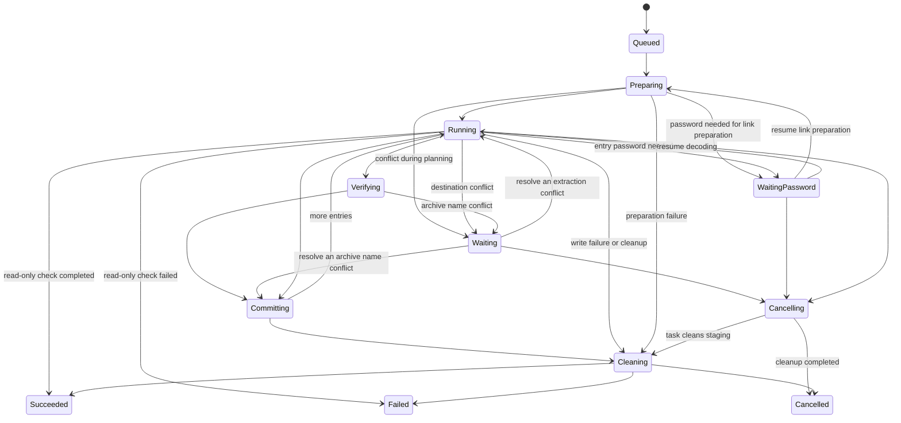

# Planificación, progreso y cancelación de tareas

[English](../../design/task-scheduling.md) | [简体中文](../../zh-CN/design/task-scheduling.md) | [繁體中文](../../zh-TW/design/task-scheduling.md) | [日本語](../../ja-JP/design/task-scheduling.md) | [한국어](../../ko-KR/design/task-scheduling.md) | [Français](../../fr-FR/design/task-scheduling.md) | [Deutsch](../../de-DE/design/task-scheduling.md) | Español | [Português (Brasil)](../../pt-BR/design/task-scheduling.md) | [Русский](../../ru-RU/design/task-scheduling.md)

XDZip usa un hilo Rust de comandos y otro de tareas por conexión del entorno de ejecución. El hilo de comandos posee el archivo actual y prepara las entradas. El hilo de tareas ejecuta trabajos aceptados mientras el primero sigue atendiendo solicitudes de metadatos. La [arquitectura del sistema](system-architecture.md) explica dónde se ejecutan y el [puente Qt/Rust](qt-rust-bridge.md) cómo llegan los resultados al cliente.

## Admisión y propiedad de tareas

| Capa | Comportamiento actual |
| --- | --- |
| Controlador de escritorio | `BrowserController::attemptSubmission` serializa operaciones pesadas entre controladores del proceso de escritorio, incluidas preparación y limpieza. Un controlador que espera admisión conserva un comando acotado y puede cancelar esa espera. La navegación de metadatos usa la vía ordinaria de comandos. |
| Hilo de comandos del entorno | Valida la solicitud y forma un trabajo. Extracción, comprobación y edición conservan la fuente y metadatos o selección pertinentes. Creación recibe opciones acotadas y examina el árbol de entrada en el hilo de tareas. Una comprobación previa de metadatos o destino no crea tarea pesada. |
| Cola de tareas del entorno | Ejecuta extracción, apertura temporal, creación, comprobaciones, ediciones y exportaciones según corresponda, un trabajo cada vez en orden de cola dentro de la conexión. Cada servicio puede mantener hasta 32 tareas, con un presupuesto agregado de 64 MiB para trabajos retenidos. Cubre entradas conservadas y espacio reservado para secretos. Decodificación, indexación, procesos y recursos de salida tienen límites separados. La saturación se comunica como `task_busy`. |
| CLI independiente | Usa las mismas reglas Rust en su propio proceso de comandos. Los procesos CLI independientes tienen colas separadas, igual que el escritorio. La autorización segura de salida y las comprobaciones de conflicto se aplican a cada proceso. |

`TaskAccepted` identifica un trabajo admitido. El `Finished` de la solicitud ordinaria cierra esa solicitud. El trabajo puede seguir produciendo instantáneas `TaskUpdate` con el ID original para correlación y el ID de tarea para control. La entrada de tareas de la aplicación conserva el controlador propietario incluso al cerrar su pestaña, para atribuir avisos y resultados a la conexión correcta. [Fuente de la cola](https://github.com/xiaodaozhi/xdzip/blob/main/crates/xdzip-runtime/src/service/tasks.rs), [Admisión y enrutamiento de escritorio](https://github.com/xiaodaozhi/xdzip/blob/main/apps/desktop/BrowserController.cpp), [Sesiones de escritorio](../engineering/application-sessions.md)

## Estados y progreso comunicado

El diagrama muestra rutas representativas. Una tarea puede omitir o repetir fases según la operación. Una comprobación de solo lectura puede terminar sin confirmación. Una tarea de creación o edición normalmente verifica el archivo preparado antes de publicarlo y la extracción puede confirmar repetidamente.

| Estado del entorno | Lo que recibe el cliente |
| --- | --- |
| `queued`, `preparing` | Un trabajo está en cola o prepara fuentes autorizadas, acceso al destino y estado de formato. El total puede ser todavía desconocido. |
| `running`, `verifying` | Se lee, codifica, decodifica o comprueba contenido. `verifying` también describe la relectura del archivo preparado. La verificación no aumenta los recuentos confirmados. |
| `waiting`, `waiting_password` | La tarea espera la respuesta actual de conflicto o contraseña. |
| `committing` | La tarea obtuvo permiso para publicar un archivo, archivo comprimido o conjunto de volúmenes. |
| `cancelling`, `cleaning` | Se solicitó cancelación o se cierran y recuperan objetos privados. Una instantánea puede omitir un estado transitorio porque el progreso se agrupa. |
| `succeeded`, `failed`, `cancelled` | La ejecución ordinaria ha terminado. La instantánea final lleva el resultado real, incluidas confirmaciones anteriores y advertencias de limpieza. |

`total_known` distingue un total desconocido de cero. La instantánea separa bytes leídos, decodificados, escritos, verificados y confirmados. El trabajo en bloques sólidos o la decodificación repetida pueden aumentar el trabajo sin publicar más archivos. La creación cuenta archivos y bytes de entrada como confirmados solo tras publicar el archivo comprimido. Su `written_bytes` mide escrituras de salida, que pueden incluir reescrituras de cabecera. La cola limita las actualizaciones ordinarias `running`, `verifying` y `committing` a una por 100 ms y conserva solo la última instantánea pendiente por tarea. Avisos, cancelación, limpieza y resultados terminales no están sujetos a esa limitación. Los detalles de resultado se limitan a 128 registros, con un recuento de omitidos. [Códigos y campos de instantánea](https://github.com/xiaodaozhi/xdzip/blob/main/crates/xdzip-runtime/src/extraction/mod.rs)

## Espera de una decisión

- Un conflicto de nombre puede esperar una decisión explícita cuando la política es preguntar. Una solicitud de contraseña usa un espacio de respuesta separado y de un solo uso. ID de tarea, ID y tipo de aviso deben coincidir con la espera actual. Se rechazan respuestas a avisos antiguos o ya respondidos.
- La espera conserva el estado acotado del trabajo y su espacio de cola. La tarea espera en una variable de condición que libera el mutex de respuesta mientras espera. Una decisión o cancelación la despierta sin depender del espacio de la cola ordinaria. El trabajo en espera sigue ocupando el hilo de tareas; el hilo de comandos separado puede seguir atendiendo la navegación.
- La vía de contraseña usa secretos locales a la tarea. Los fallos de contraseña reintentables admitidos se limitan por entrada y el trabajo ya realizado cuenta en los presupuestos. Los fallos explícitos de integridad detienen la operación. Volumen ausente, cuota estricta agotada o fuente cambiada se notifican por la vía de error correspondiente. Esperar entrada es distinto de una pausa controlada por el usuario. [Interacción de contraseña](../engineering/password-extraction.md), [Reglas de recursos y archivos](file-security.md)

## Cancelación y límite de confirmación

`cancel` solicita cancelar una petición ordinaria. Una vez existe una tarea, `cancel_task` se dirige a la tarea misma. Estos controles acusan la solicitud de parada. El llamante conoce el resultado por la finalización de la solicitud correspondiente o la instantánea terminal. La cancelación cooperativa no tiene plazo fijo de finalización, especialmente si una llamada del sistema host está bloqueada. El proceso de archivos tiene supervisión separada. [Controles del puente](qt-rust-bridge.md), [Supervisión del proceso de archivos](../engineering/native-codecs.md)

| Momento de la cancelación | Efecto |
| --- | --- |
| Antes de que `begin_commit()` gane la barrera | La publicación actual no empieza. La tarea descarta o limpia la preparación no publicada y conserva recibos anteriores. |
| Durante una publicación de extracción o promesa de archivo | La llamada de publicación puede terminar. Si se publicó el archivo, la tarea lo registra. La cancelación puede detener el trabajo posterior y la instantánea terminal puede ser `cancelled` con recuentos confirmados distintos de cero. |
| Durante la publicación final del archivo comprimido | Creación y modificación conservan el resultado correcto una vez publicado el archivo único verificado o el conjunto completo de volúmenes. En creación dividida, la rutina de confirmación puede tener que revertir su propio conjunto parcialmente publicado. Un fallo de reversión puede establecer `outcome_uncertain`. |
| Después de fijar un resultado final | Una cancelación tardía no puede convertir una confirmación correcta en resultado cancelado. |

La barrera controla cuándo la cancelación puede impedir la publicación. La autorización de salida y validación de preparación siguen siendo necesarias. Una escritura autorizada puede fallar y devolver su error real del sistema de archivos. [Barrera de cancelación](https://github.com/xiaodaozhi/xdzip/blob/main/crates/xdzip-runtime/src/extraction/control.rs), [Publicación de archivos](file-security.md)

## Fallo, cierre de pestaña y salida

Omitir se aplica a decisiones de conflicto compatibles. Un error de decodificación, recursos, fuente o seguridad del destino puede detener el trabajo. Los archivos ya publicados permanecen registrados y un error de limpieza puede acompañar una publicación correcta. Un fallo inesperado del proceso o un panic de tarea con desenrollado de pila puede producir un resultado fallido o incierto. La vía de panic comunica `task_abandoned` y pone en fallo el entorno afectado. La ausencia de respuesta terminal tras la salida del proceso no demuestra qué llegó al disco.

Cerrar una ventana de progreso o pestaña de archivo es una acción de presentación. Los trabajos aceptados y sus resultados siguen disponibles en la entrada de tareas de la aplicación. Cerrar un aviso activo de contraseña puede cancelar su tarea. La salida explícita gestiona el trabajo activo, detiene la admisión al iniciar el cierre, despierta las esperas y sigue vaciando eventos. El receptor espera a los hilos de trabajo Rust antes de producir `ShutdownReady`. Qt termina de vaciar y espera al receptor sin bloquear el hilo de interfaz. También puede ser necesario que finalice una transferencia nativa externa. [Ciclo de vida del entorno](../engineering/product-runtime.md), [Transferencias de archivos comprimidos](../engineering/archive-transfers.md)
