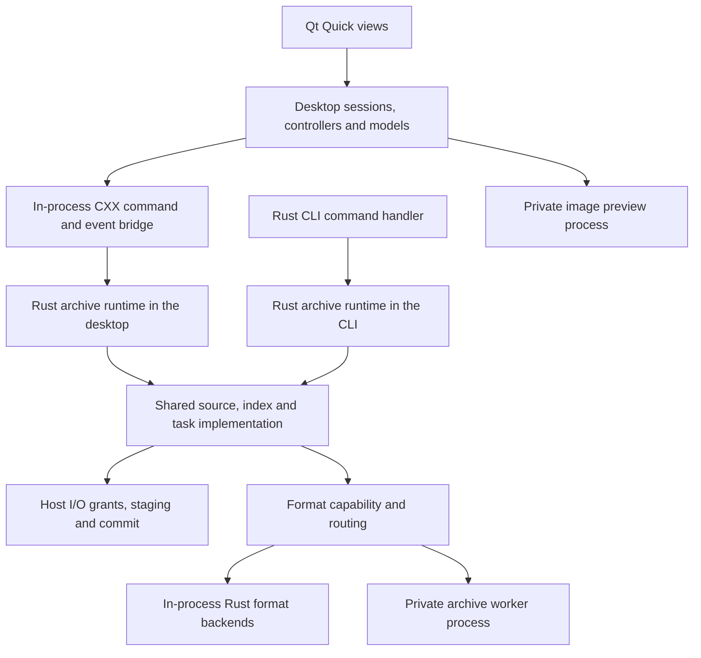
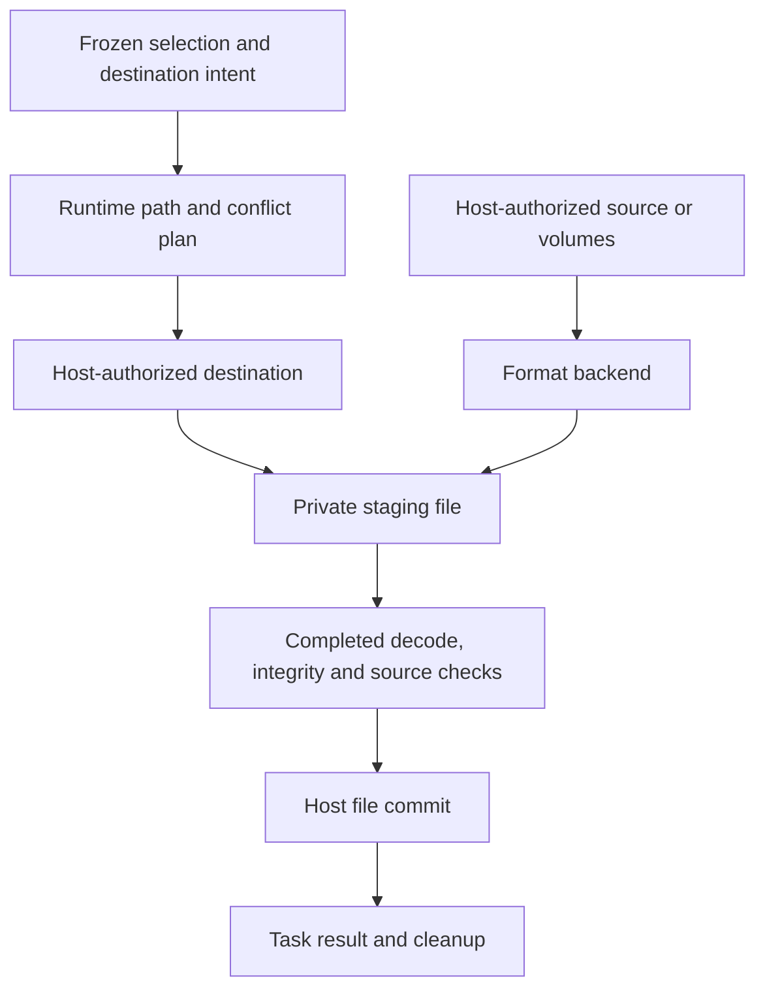

# Architecture système de XDZip

[English](../../design/system-architecture.md) | [简体中文](../../zh-CN/design/system-architecture.md) | [繁體中文](../../zh-TW/design/system-architecture.md) | [日本語](../../ja-JP/design/system-architecture.md) | [한국어](../../ko-KR/design/system-architecture.md) | Français | [Deutsch](../../de-DE/design/system-architecture.md) | [Español](../../es-ES/design/system-architecture.md) | [Português (Brasil)](../../pt-BR/design/system-architecture.md) | [Русский](../../ru-RU/design/system-architecture.md)

Les clients de bureau et en ligne de commande partagent le moteur d’archives Rust. Le moteur transforme une source sélectionnée en session indexée et une opération en tâche soumise à des limites. Les moteurs de format interprètent les données d’archive. L’hôte autorise les fichiers, contrôle le placement de sortie et publie les résultats vérifiés.

## Vue d’ensemble

Les deux blocs de moteur représentent des instances distinctes de la même implémentation. Le bureau et le CLI possèdent chacun leur état d’archive et leurs tâches. L’IPC local du bureau transmet les demandes d’activation et d’intégration à l’instance graphique principale. Les commandes d’archive passent par le moteur dans le processus. [Sessions d’application](../engineering/application-sessions.md), [contrat CLI](../engineering/command-line.md).

## Responsabilités des modules et direction des appels

| Module | Responsabilités et appels |
| --- | --- |
| Entrée de bureau et Qt Quick | `xdzip-browser`, compilé comme exécutable de bureau `xdzip`, démarre dans `browser_main.cpp` et charge `Browser.qml`. `SessionPage.qml` et ses vues présentent listes, sélection, dialogues et état des tâches. Elles transmettent l’intention de l’utilisateur aux contrôleurs C++. [Entrée de bureau](https://github.com/xiaodaozhi/xdzip/blob/main/apps/desktop/browser_main.cpp), [conception QML](qt-quick-ui.md). |
| Adaptateurs C++ du bureau | `ApplicationSessions` coordonne les onglets, fenêtres et le point d’accès partagé aux tâches. Chaque `BrowserController` possède le modèle de liste et l’état des demandes de sa session, traduit les intentions de l’interface en commandes typées et lui transmet progression, erreurs et demandes. `RuntimeConnection` possède les handles du pont et la livraison des événements. Réglages, zone de notification, associations et glisser-déposer ou intégration native résident dans les adaptateurs de bureau. [Coordinateur de sessions](https://github.com/xiaodaozhi/xdzip/blob/main/apps/desktop/ApplicationSessions.cpp), [contrôleur](https://github.com/xiaodaozhi/xdzip/blob/main/apps/desktop/BrowserController.cpp). |
| `xdzip-qt-bridge` | La frontière CXX liée convertit commandes C++, lignes, instantanés de tâches et erreurs vers et depuis les types Rust. Elle enveloppe un `Client` et un `Receiver` du moteur sous forme de handles de commande et d’événement possédés séparément. [Source du pont](https://github.com/xiaodaozhi/xdzip/blob/main/crates/xdzip-qt-bridge/src/lib.rs), [contrat du pont](qt-rust-bridge.md). |
| `xdzip-cli` | Analyse les arguments, gère les questions et annulations du terminal, appelle directement `xdzip-runtime` et convertit les événements en texte ou JSON et en codes de sortie. Les commandes d’archive suivent les mêmes règles de source et de tâche que le bureau. Les commandes d’installation et de mise à jour ont leurs propres entrées. [Adaptateur du moteur CLI](https://github.com/xiaodaozhi/xdzip/blob/main/crates/xdzip-cli/src/runtime.rs), [intégration CLI](../integration/README.md). |
| `xdzip-runtime` | Possède l’`Archive` courante de chaque instance du service. `source` résout les volumes et suit les versions des sources. `formats` détecte et dirige les formats. `index`, `navigation`, `query`, `listing` et `disk_index` construisent et interrogent les métadonnées. Le service valide les commandes et met en file les tâches d’`extraction`, `creation`, `updating`, `checking` et `exporting`. `preview` gère les lectures limitées de la vue des propriétés. [Modules du moteur](https://github.com/xiaodaozhi/xdzip/blob/main/crates/xdzip-runtime/src/lib.rs), [moteur du produit](../engineering/product-runtime.md). |
| `xdzip-domain`, `xdzip-codec-api` et `xdzip-extract-plan` | Le domaine définit les identités, métadonnées et invariants de chemin. L’API codec définit les capacités et contrats tels que `ReadSource`, `PayloadCodec`, `DecodedSink`, `EncodeInput` et `EncodeOutput`. Le planificateur d’extraction produit un rapport à partir des métadonnées et de la sélection. L’autorisation de destination reste à l’hôte. [Domaine et données](domain-data.md), [interface codec](https://github.com/xiaodaozhi/xdzip/blob/main/crates/xdzip-codec-api/src/lib.rs), [vérification préalable de l’extraction](../engineering/extraction-preflight.md). |
| `xdzip-codec-*`, `xdzip-compression` et `xdzip-crypto` | Les crates codec implémentent le cadrage des conteneurs, l’analyse des métadonnées, la lecture des données et les opérations d’écriture disponibles pour chaque format. Les crates de compression et cryptographie fournissent des algorithmes réutilisables. Les interfaces codec consomment les flux et récepteurs fournis par l’hôte. Le registre décrit les opérations disponibles, tandis que le routage du moteur vérifie l’archive et ses entrées réelles. [Routage du moteur](https://github.com/xiaodaozhi/xdzip/blob/main/crates/xdzip-runtime/src/formats.rs), [registre des formats](../engineering/format-registry.md). |
| `xdzip-io` | Ouvre les fichiers d’entrée ordinaires, identifie les objets de fichier natifs, fige les entrées de création autorisées et fournit les autorisations de destination, la préparation et la validation finale. Il applique les contrôles de plateforme à la frontière des fichiers ; le moteur décide de l’opération et du moment de publication. [Autorisation d’entrée](https://github.com/xiaodaozhi/xdzip/blob/main/crates/xdzip-io/src/input.rs), [autorisations de sortie et validation](https://github.com/xiaodaozhi/xdzip/blob/main/crates/xdzip-io/src/target.rs), [sécurité des fichiers](file-security.md). |
| Mise à jour et outils de développement | `UpdateController` et `xdzip-update` gèrent sélection, vérification et transmission des mises à jour. Les versions installées utilisent des chemins d’installation propres à chaque plateforme. L’hôte SDK et les sondes de format ont des entrées indépendantes. La détection d’archives du produit utilise le registre intégré. [Mises à jour](../engineering/software-update.md), [essai SDK](../engineering/sdk-trial.md), [carte du dépôt et des modules](../engineering/repository-layout.md). |

## Demandes et cycle de vie du bureau

1. **Entrée et routage.** Le lancement normal du bureau, les associations et les demandes du shell arrivent dans l’application. `SingleInstance` élit une instance principale pour le même utilisateur et la même session de connexion. Elle traite les demandes transmises et ouvre ou réutilise la session de navigation ou d’opération appropriée. Une commande d’archive du CLI autonome démarre son propre service Rust. Le CLI inclus peut transmettre une demande de mise à jour du bureau à l’interface graphique par le canal local.
2. **Admission des commandes.** Un contrôleur de navigation utilise sa propre `RuntimeConnection`. L’interface soumet une commande typée et reçoit un résultat d’admission et un identifiant de demande. Une nouvelle tentative limitée sur la boucle d’événements traite la contention temporaire à l’admission. Les E/S d’archive s’exécutent hors du thread graphique.
3. **Exécution et livraison.** Chaque service exécute un thread de commandes Rust pour l’archive courante, les demandes de métadonnées et la préparation des tâches, et un thread de tâches Rust distinct dont la file limitée exécute une tâche lourde à la fois. Une règle d’admission supplémentaire du bureau sérialise les opérations lourdes entre contrôleurs. Côté Qt, un thread récepteur draine les événements Rust vers une boîte aux lettres limitée destinée au thread graphique. Le contrôleur associe identités de demande et de session et vérifie génération et révision de requête lors de l’application des pages. Le CLI soumet les commandes et consomme leurs événements dans son propre processus.
4. **Propriété des tâches.** L’acceptation et la progression sont distinctes de l’instantané terminal. Le thread de tâche possède l’entrée figée du travail. Mots de passe, décisions de conflit et annulation sont envoyés à la tâche propriétaire. Les contrôles utilisent les identités de tâche et de demande. L’identifiant numérique appartient à sa connexion au moteur. Annulation et arrêt n’attendent pas de place dans la file normale des commandes. Fermer un onglet supprime sa présentation de navigation, mais les tâches acceptées peuvent continuer et leurs résultats restent accessibles depuis l’entrée partagée. Une sortie explicite arrête l’admission, draine les événements terminaux et attend l’arrêt des workers.

[Service d’événements du moteur](https://github.com/xiaodaozhi/xdzip/blob/main/crates/xdzip-runtime/src/service.rs), [file de tâches](https://github.com/xiaodaozhi/xdzip/blob/main/crates/xdzip-runtime/src/service/tasks.rs), [livraison des événements Qt](https://github.com/xiaodaozhi/xdzip/blob/main/apps/desktop/RuntimeConnection.cpp), [ordonnancement des tâches](task-scheduling.md).

## Frontières des processus et plateformes

| Frontière d’exécution | Données et responsabilités |
| --- | --- |
| Processus de bureau principal | Interface Qt, adaptateurs C++, pont CXX et threads du moteur Rust partagent un espace d’adressage. L’hôte possède les sessions d’archive ouvertes et l’autorisation native des fichiers. Des lancements ultérieurs peuvent transmettre des demandes par IPC local limité à l’utilisateur, puis se terminer. |
| Processus de commande CLI | Le gestionnaire de commandes CLI appelle le même moteur Rust comme bibliothèque dans son processus. Le lancement ou la transmission de mise à jour du CLI empaqueté peut impliquer d’autres processus. L’état d’archive et les résultats de tâche appartiennent au service de la commande. |
| Worker de format d’archive | Le moteur dirige les lectures 7z, RAR, CAB et ISO/UDF vers `xdzip-codec-native`. Il lance `xdzip-native-codec` inclus et communique par stdin/stdout avec un cadrage limité. La fine couche de protocole C++ du worker appelle les moteurs Rust par `xdzip-codec-bridge`. L’hôte fournit les lectures de plages ou volumes autorisées et valide les trames de sortie. Pour l’écriture 7z, il accepte des écritures à position limitée dans une préparation privée. Les chemins d’archive et de destination restent dans l’hôte. Une panne ou annulation du worker met fin à l’opération et la préparation incomplète est abandonnée. Cette frontière limite les pannes et l’usage des ressources. Son protocole ne confère aucune autorité sur le système de fichiers et le processus s’exécute sans sandbox de permissions du noyau. |
| Worker de prévisualisation d’image | Après lecture et vérification par Rust d’une entrée admissible, le bureau envoie des octets d’image encodés et limités à `xdzip-image-preview`. Le worker renvoie une miniature RGBA limitée. La demande ne contient ni chemin d’archive, ni mot de passe, ni handle de destination. Le fournisseur ne publie le résultat que pour la demande courante correspondante. La prévisualisation de texte est traitée dans le moteur Rust. |
| Transmission à la plateforme | Les adaptateurs de bureau coordonnent l’activation par le gestionnaire de fichiers, l’ouverture d’une copie extraite privée dans une application externe et l’installation des mises à jour. Les assistants de mise à jour ou Sparkle macOS assurent leur propre transmission d’installation. Les mises à jour gérées par le Store suivent le canal de la plateforme. Le worker de format ne traite pas ces demandes. |

[Protocole du worker d’archive](../engineering/native-codecs.md), [contrat de prévisualisation](../engineering/content-preview.md), [intégration système](../../engineering/installers-associations.md), [transferts d’archive](../engineering/archive-transfers.md), [transmission de mise à jour](../engineering/software-update.md).

## Ouverture et navigation d’une archive

1. **Autoriser la source.** `Archive::open_with_password` demande à `Source::open` d’ouvrir un fichier ordinaire par `xdzip-io` et de résoudre tout ensemble de volumes pris en charge. L’hôte enregistre identité, taille et horodatages de chaque partie admise. Les codecs reçoivent une entrée à accès positionnable et, le cas échéant, les métadonnées de volume fournies par l’hôte.
2. **Identifier le format et analyser.** Le moteur sonde le contenu et valide la structure pertinente du conteneur. Noms et extensions peuvent guider la découverte de volumes ou résoudre certaines ambiguïtés. Le moteur sélectionné analyse dans ses limites de ressources. Un répertoire protégé peut nécessiter un mot de passe avant la fin de l’analyse. Une analyse échouée ou incomplète ne publie pas une session d’archive partielle.
3. **Construire l’instantané de session.** Le moteur sépare les identifiants physiques des entrées de leurs noms et des dossiers de navigation synthétisés. Les noms en double restent ainsi adressables indépendamment. Un ZIP/ZIP64 ordinaire en un seul fichier peut alimenter en continu un index disque privé si le budget mémoire est dépassé. Cette capacité de navigation étendue a des limites distinctes de l’extraction. Les sessions utilisant cet index ne prennent actuellement pas en charge la vérification complète ni la modification de l’archive.
4. **Interroger et sélectionner.** Une demande de navigation fournit session, répertoire et intentions de recherche et de tri. Rust renvoie l’identité du résultat et des pages limitées. Une continuation doit correspondre à la session, requête, génération et révision courantes. Avant qu’une tâche utilise une sélection logique sur plusieurs pages, Rust la résout en entrées physiques ou identités de navigation. Le CLI utilise le catalogue physique et des chemins de membres ou identifiants explicites. La position de ligne visible et le chemin de sortie sont distincts de l’identifiant physique.

L’instantané décrit l’archive admise dans la session. Identité et métadonnées de source sont revérifiées aux lectures et écritures pertinentes afin de détecter les changements. Le fichier source peut toujours être modifié simultanément : la détection reste donc au mieux des possibilités. Un changement détecté invalide l’état de navigation concerné et bloque la publication depuis la source périmée.

[Gestion des sources et volumes](https://github.com/xiaodaozhi/xdzip/blob/main/crates/xdzip-runtime/src/source.rs), [requêtes et sélection](https://github.com/xiaodaozhi/xdzip/blob/main/crates/xdzip-runtime/src/query.rs), [index des grandes archives](../engineering/large-index.md).

## Lecture, vérification et extraction des entrées

| Opération | Flux et résultat |
| --- | --- |
| Navigation ou contrôle préalable d’extraction | Utilise les métadonnées indexées. Le contrôle résume sélection, chemins et contraintes de taille sans ouvrir d’autorisation de sortie ni prouver que toutes les données sélectionnées sont décodables. |
| Prévisualisation | Résout une seule entrée ordinaire admissible de la session courante. Rust la lit et la décode entièrement dans un récepteur limité et effectue les contrôles d’intégrité ou d’authentification disponibles du format. Le bureau affiche le texte approuvé ou transmet les octets d’image encodés vérifiés au worker d’image. |
| Tester l’archive | Fige l’entrée et lit toute l’archive admissible dans un récepteur limité qui élimine les données ou au moyen d’une analyse propre au format. N’autorise jamais de sortie. Le format détermine les contrôles disponibles. Par exemple, TAR et ISO/UDF peuvent établir structure et lisibilité sans garantie de somme de contrôle par fichier. |
| Extraire, ouvrir ou exporter | Fige les enregistrements sélectionnés et lit la source autorisée. L’extraction publie dans la destination choisie. L’ouverture d’un fichier utilise une copie privée vérifiée remise au système. L’export par glisser-déposer peut d’abord préparer une sortie privée, puis la publier dans une cible validée. |

L’extraction de fichiers ordinaires illustre la séparation entre décodage et publication.

1. **Planifier.** Le moteur utilise la sélection figée pour valider les chemins relatifs portables et détecter les collisions de sortie. `xdzip-io` ancre la destination à un répertoire autorisé. Le moteur applique demander, ignorer, renommer ou écraser lorsque permis. Un codec ne peut pas autoriser des entrées protégées, des cibles modifiées ou un parcours de liens dangereux.
2. **Décoder.** Le moteur de format lit la source admise, directement ou par le worker d’archive. Il envoie les octets à un récepteur mesuré adossé à une préparation privée. Nouvelles tentatives de mot de passe, expansion et travail auxiliaire restent soumis aux limites de l’opération. Les octets préparés sont provisoires jusqu’à la réussite du décodage, des contrôles de taille et des vérifications disponibles du format.
3. **Valider et rapporter.** Avant publication, l’hôte revérifie l’identité de la source et de la destination concernée. Il valide séparément chaque fichier admissible et enregistre les fichiers et octets effectivement publiés. Une erreur ou annulation ultérieure peut laisser en place les fichiers déjà validés. La préparation non publiée est nettoyée si possible et le résultat terminal rapporte échec, annulation, éléments ignorés et avertissements de nettoyage.

[Exécution de l’extraction](https://github.com/xiaodaozhi/xdzip/blob/main/crates/xdzip-runtime/src/extraction/execute.rs), [vérification d’archive](../engineering/archive-checking.md), [interactions de mot de passe](../engineering/password-extraction.md), [extraction ZIP sûre](../engineering/zip-safe-extraction.md).

## Création ou modification d’une archive

La création et la modification préparent et valident une archive comme un tout. Le moteur coordonne le travail et l’encodeur de format écrit par une interface de sortie appartenant à l’hôte. Seul l’hôte peut publier le résultat.

1. **Créer.** Le moteur valide le format de sortie et les réglages, obtient une destination autorisée, parcourt et fige l’arborescence d’entrée admise. L’encodeur reçoit les métadonnées et peut ouvrir des flux par indice d’entrée. Il écrit dans une préparation privée. Les encodeurs ZIP et TAR s’exécutent dans le processus, 7z utilise le worker d’archive et la création ISO utilise l’encodeur optique Rust dans le processus, même si la navigation ISO utilise le worker. [Tâche de création](https://github.com/xiaodaozhi/xdzip/blob/main/crates/xdzip-runtime/src/creation.rs), [encodeur ISO](../engineering/iso-creation.md).
2. **Modifier.** Pour une archive admissible, le moteur fige source et ajouts et planifie les entrées conservées, ajoutées, remplacées ou déplacées. La réécriture produit une nouvelle archive en préparation. Le moteur rouvre le résultat et vérifie les entrées et contenus attendus avant de remplacer l’original sous l’autorité de mise à jour de l’hôte. Les entrées non prises en charge, sources chiffrées ou divisées et autres cas incompatibles sont refusés selon les règles du format et du travail. Après un remplacement réussi, une session de bureau qui consulte encore la source actualise son instantané. [Tâche de mise à jour d’archive](https://github.com/xiaodaozhi/xdzip/blob/main/crates/xdzip-runtime/src/updating.rs), [modification et transferts](../engineering/archive-transfers.md).
3. **Vérifier et publier.** L’hôte rouvre la sortie de création préparée et vérifie sa structure, ses entrées et son contenu attendus selon le format et le profil de création. Il résout les conflits de sortie et revérifie l’autorisation pertinente avant validation. Une archive en un fichier possède un point de validation. Une création divisée prépare toutes les parties avant de publier un nouvel ensemble, refuse d’écraser des ensembles existants et tente un retour arrière si la publication échoue en cours de route. Chaque partie a sa propre étape de publication. Le rapport peut indiquer des problèmes de nettoyage ou de retour arrière. [Création ZIP](../engineering/zip-creation.md), [contrat de validation des fichiers](file-security.md).

**Lire un résultat.** `TaskAccepted` identifie le travail mis en file. `Finished` termine la demande ordinaire. L’instantané terminal distinct indique ce qui a été vérifié, publié, ignoré ou laissé inachevé. Octets décodés et publiés peuvent différer. L’annulation est coopérative et une demande après une validation réussie de l’archive entière ne révoque pas la publication.

[État et annulation des tâches](task-scheduling.md), [conception et référence technique](../reference/README.md).
