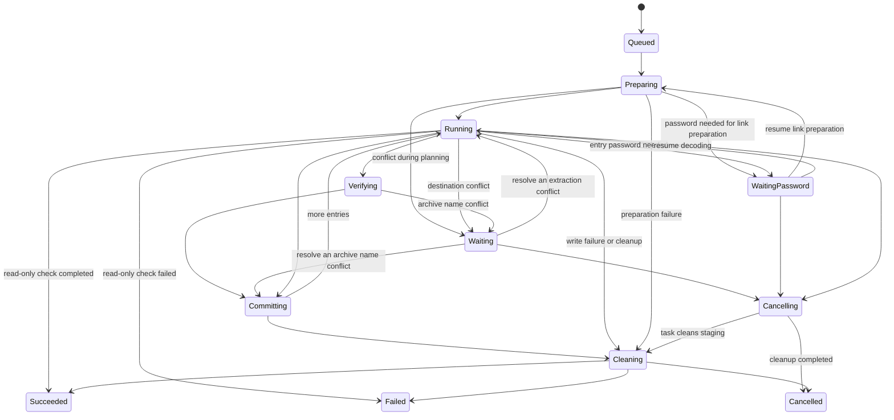

# Ordonnancement, progression et annulation des tâches

[English](../../design/task-scheduling.md) | [简体中文](../../zh-CN/design/task-scheduling.md) | [繁體中文](../../zh-TW/design/task-scheduling.md) | [日本語](../../ja-JP/design/task-scheduling.md) | [한국어](../../ko-KR/design/task-scheduling.md) | Français | [Deutsch](../../de-DE/design/task-scheduling.md) | [Español](../../es-ES/design/task-scheduling.md) | [Português (Brasil)](../../pt-BR/design/task-scheduling.md) | [Русский](../../ru-RU/design/task-scheduling.md)

XDZip utilise un thread de commandes Rust et un thread de tâches par connexion runtime. Le thread de commandes possède l’archive courante et prépare les entrées des tâches. Le thread de tâches exécute les travaux acceptés tandis que le premier peut encore servir les requêtes de métadonnées. L’[architecture du système](system-architecture.md) situe ces threads et le [pont Qt/Rust](qt-rust-bridge.md) décrit la livraison des résultats au client.

## Admission et propriété des tâches

| Couche | Comportement actuel |
| --- | --- |
| Contrôleur de bureau | `BrowserController::attemptSubmission` sérialise les opérations lourdes entre contrôleurs du processus de bureau, préparation et nettoyage compris. Un contrôleur attendant l’admission conserve une commande bornée et peut annuler cette attente. La navigation des métadonnées utilise le chemin ordinaire des commandes. |
| Thread de commandes runtime | Valide la requête et forme un travail. Extraction, vérification et modification conservent source et métadonnées ou sélection pertinentes. La création reçoit des options bornées et scanne l’arbre d’entrée sur le thread de tâches. Une vérification préalable des métadonnées ou de destination ne crée pas de tâche lourde. |
| File de tâches runtime | Exécute extraction, ouverture temporaire, création, vérifications, modifications et exports selon le cas, une tâche à la fois dans l’ordre de la file de la connexion. Chaque service peut suivre au plus 32 tâches avec un budget cumulé de 64 MiB pour les travaux conservés. Ce budget couvre les entrées conservées et l’espace réservé aux secrets. Décodage, indexation, processus et ressources de sortie ont des limites séparées. La saturation est signalée par `task_busy`. |
| CLI autonome | Utilise les mêmes règles Rust dans son propre processus de commande. Les processus CLI indépendants ont des files séparées, comme le bureau. L’autorisation sûre de sortie et les contrôles de conflit restent applicables à chaque processus. |

`TaskAccepted` identifie un travail admis. Le `Finished` de la requête ordinaire ferme cette requête. Le travail peut continuer à produire des instantanés `TaskUpdate` avec l’ID de requête initial pour corrélation et l’ID de tâche pour contrôle. L’entrée de tâche applicative conserve le contrôleur propriétaire même après fermeture de son onglet afin d’attribuer correctement invites et résultats à la connexion. [Source de la file](https://github.com/xiaodaozhi/xdzip/blob/main/crates/xdzip-runtime/src/service/tasks.rs), [Admission et routage du bureau](https://github.com/xiaodaozhi/xdzip/blob/main/apps/desktop/BrowserController.cpp), [Sessions de bureau](../engineering/application-sessions.md)

## États et progression rapportée

Le diagramme montre des parcours représentatifs. Une tâche peut sauter ou répéter une phase selon l’opération. Une vérification en lecture seule peut terminer sans validation. Une tâche de création ou modification vérifie normalement l’archive préparée avant publication et une extraction peut valider plusieurs fois.

| État runtime | Ce que reçoit le client |
| --- | --- |
| `queued`, `preparing` | Un travail est en file ou prépare sources autorisées, accès à destination et état de format. Le total peut être encore inconnu. |
| `running`, `verifying` | Le contenu est lu, encodé, décodé ou vérifié. `verifying` décrit aussi la relecture de l’archive préparée. La vérification n’augmente pas les comptes validés. |
| `waiting`, `waiting_password` | La tâche attend sa réponse courante de conflit ou de mot de passe. |
| `committing` | La tâche a obtenu l’autorisation de publier un fichier, une archive ou un ensemble de volumes. |
| `cancelling`, `cleaning` | Une annulation a été demandée ou des objets privés sont fermés et récupérés. Un instantané peut sauter un état transitoire car la progression est regroupée. |
| `succeeded`, `failed`, `cancelled` | L’exécution ordinaire est terminée. L’instantané final porte le résultat réel, avec validations antérieures et avertissements de nettoyage. |

`total_known` distingue un total inconnu de zéro. L’instantané sépare octets lus, décodés, écrits, vérifiés et validés. Le travail d’un bloc solide ou un décodage répété peut augmenter le travail sans publier de fichiers supplémentaires. La création ne compte les fichiers et octets d’entrée comme validés qu’après publication de l’archive. Son `written_bytes` mesure les écritures de sortie, qui peuvent inclure des réécritures d’en-tête. La file limite les mises à jour ordinaires `running`, `verifying` et `committing` à une par 100 ms et ne conserve que le dernier instantané en attente par tâche. Invites, annulation, nettoyage et résultats terminaux échappent à cette limitation. Les détails de résultat sont bornés à 128 enregistrements avec un nombre d’omissions. [Codes d’état et champs d’instantané](https://github.com/xiaodaozhi/xdzip/blob/main/crates/xdzip-runtime/src/extraction/mod.rs)

## Attente d’une décision

- Un conflit de nom peut attendre une décision explicite sous la politique demander. Une demande de mot de passe utilise un emplacement de réponse distinct à usage unique. ID de tâche, ID d’invite et type d’invite doivent correspondre à l’attente courante. Les réponses à une invite ancienne ou déjà traitée sont refusées.
- L’attente conserve l’état borné du travail et sa place dans la file. La tâche attend sur une variable de condition qui libère le mutex de réponse pendant l’attente. Décision ou annulation la réveille sans dépendre de l’espace de la file ordinaire. Le travail en attente occupe toujours le thread de tâches ; le thread de commandes séparé peut continuer la navigation.
- Le chemin de mot de passe utilise des secrets locaux à la tâche. Les échecs de mot de passe pouvant être retentés sont limités par entrée et le travail déjà effectué compte dans les budgets. Les échecs d’intégrité explicites arrêtent l’opération. Volume manquant, quota dur épuisé ou source modifiée sont signalés par leur voie d’erreur appropriée. L’attente d’entrée est distincte d’une pause contrôlée par l’utilisateur. [Interaction de mot de passe](../engineering/password-extraction.md), [Règles de ressources et fichiers](file-security.md)

## Annulation et frontière de validation

`cancel` demande l’annulation d’une requête ordinaire. Une fois la tâche créée, `cancel_task` s’adresse à la tâche elle-même. Ces contrôles accusent réception d’une demande d’arrêt. L’appelant apprend le résultat par la fin de requête correspondante ou l’instantané terminal. L’annulation coopérative n’a pas de délai fixe de fin, notamment lorsqu’un appel système hôte est bloqué. Le processus d’archive possède une supervision distincte. [Contrôles du pont](qt-rust-bridge.md), [Supervision du processus d’archive](../engineering/native-codecs.md)

| Moment de l’annulation | Effet |
| --- | --- |
| Avant que `begin_commit()` ne gagne la barrière | La publication courante ne commence pas. La tâche abandonne ou nettoie la préparation non publiée et conserve les reçus précédents. |
| Pendant une publication d’extraction ou de promesse de fichier | L’appel de publication peut finir. Si le fichier est publié, la tâche l’enregistre. L’annulation peut arrêter la suite et l’instantané terminal être `cancelled` avec des comptes validés non nuls. |
| Pendant la publication finale de l’archive | Création et modification préservent le succès une fois l’archive unique vérifiée ou l’ensemble complet des volumes publié. Pour une création fractionnée, la routine de validation peut devoir annuler son ensemble partiellement publié. Un échec de retour arrière peut définir `outcome_uncertain`. |
| Après fixation du résultat final | Une annulation tardive ne peut pas transformer une validation réussie en résultat annulé. |

La barrière détermine quand l’annulation peut empêcher la publication. L’autorisation de sortie et la validation de la préparation restent nécessaires. Une écriture autorisée peut échouer et renvoie son erreur réelle du système de fichiers. [Barrière d’annulation](https://github.com/xiaodaozhi/xdzip/blob/main/crates/xdzip-runtime/src/extraction/control.rs), [Publication de fichiers](file-security.md)

## Échec, fermeture d’onglet et sortie

Ignorer s’applique aux décisions de conflit prises en charge. Une erreur de décodage, ressource, source ou sécurité de destination peut arrêter le travail. Les fichiers déjà publiés restent enregistrés et une erreur de nettoyage peut accompagner une publication réussie. Une défaillance inattendue du processus ou un panic déroulable de tâche peut produire un résultat en échec ou incertain. Le chemin panic signale `task_abandoned` et met en défaut le runtime concerné. L’absence de réponse terminale après la sortie du processus ne prouve pas ce qui a atteint le disque.

Fermer une fenêtre de progression ou un onglet d’archive est une action de présentation. Les travaux acceptés et leurs résultats restent disponibles dans l’entrée applicative des tâches. Fermer une invite de mot de passe active peut annuler sa tâche. Une sortie explicite traite les travaux actifs, arrête les admissions au début de l’arrêt, réveille les attentes et continue de vider les événements. Le récepteur attend les workers Rust avant de produire `ShutdownReady`. Qt termine le vidage et attend la fin du récepteur sans attente bloquante sur le thread d’interface. Un transfert natif externe peut aussi devoir se terminer. [Cycle de vie runtime](../engineering/product-runtime.md), [Transferts d’archives](../../engineering/archive-transfers.md)
