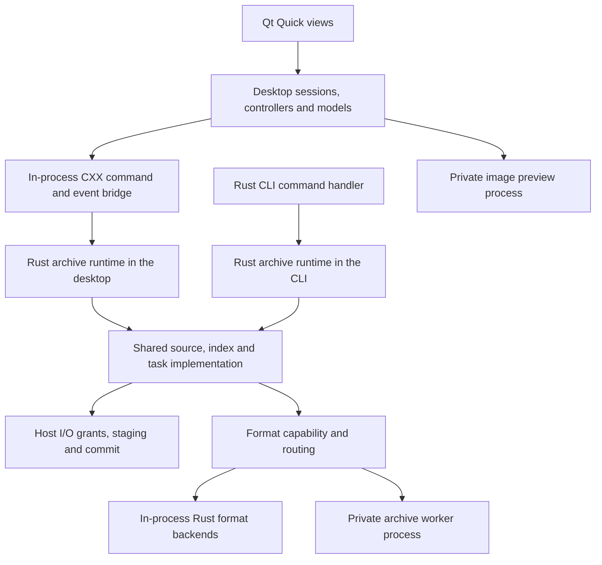
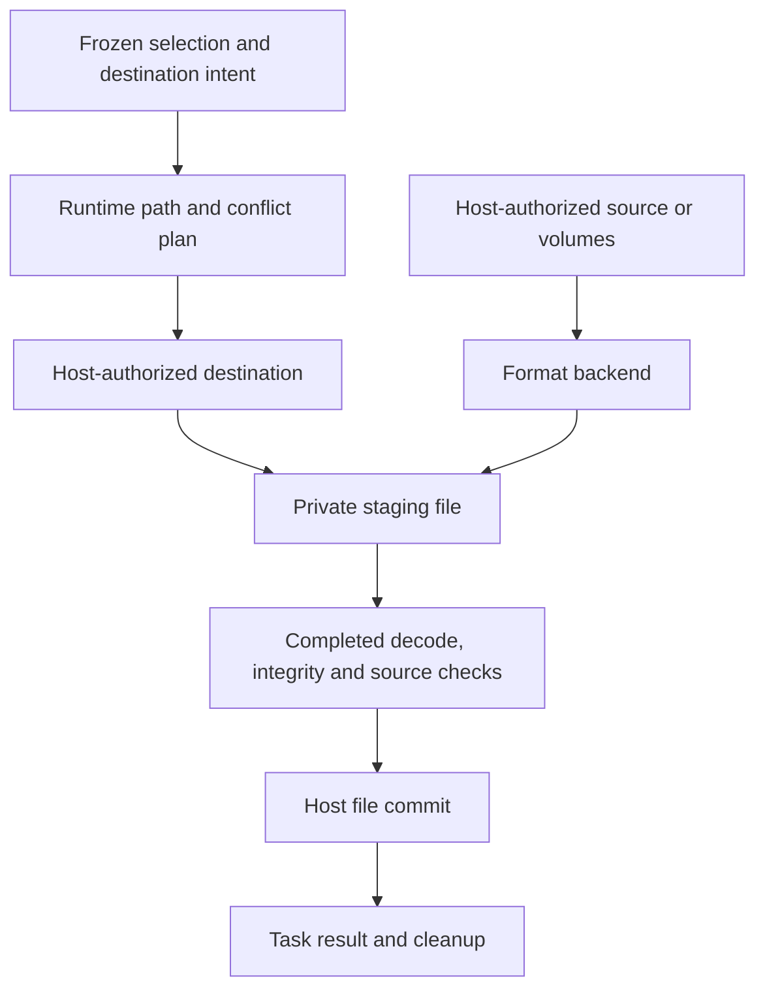

# XDZip システムアーキテクチャ

[English](../../design/system-architecture.md) | [简体中文](../../zh-CN/design/system-architecture.md) | [繁體中文](../../zh-TW/design/system-architecture.md) | 日本語 | [한국어](../../ko-KR/design/system-architecture.md) | [Français](../../fr-FR/design/system-architecture.md) | [Deutsch](../../de-DE/design/system-architecture.md) | [Español](../../es-ES/design/system-architecture.md) | [Português (Brasil)](../../pt-BR/design/system-architecture.md) | [Русский](../../ru-RU/design/system-architecture.md)

デスクトップとコマンドラインのクライアントは Rust アーカイブランタイムを共有します。ランタイムは選択されたソースをインデックス付きセッションに、操作を制限付きタスクに変換します。形式バックエンドはアーカイブデータを解釈します。ホストはファイルを認可し、出力先を制御して検証済みの結果を公開します。

## アーキテクチャの概要

2 つのランタイム枠は同じ実装の別インスタンスです。デスクトップと CLI はそれぞれのアーカイブ状態とタスクを所有します。デスクトップのローカル IPC は、デスクトップのアクティブ化と統合の要求を主 GUI インスタンスに転送します。アーカイブコマンドはプロセス内ランタイムを通ります。[アプリケーションセッション](../../engineering/application-sessions.md)、[CLI 契約](../engineering/command-line.md)。

## モジュールの責任と呼び出し方向

| モジュール | 所有するものと呼び出し |
| --- | --- |
| デスクトップ入口と Qt Quick | デスクトップ実行ファイル `xdzip` としてビルドする `xdzip-browser` は `browser_main.cpp` で開始し、`Browser.qml` を読み込みます。`SessionPage.qml` と各ビューは一覧、選択、ダイアログ、タスク状態を表示し、ユーザーの意図を C++ コントローラーへ送ります。[デスクトップ入口](https://github.com/xiaodaozhi/xdzip/blob/main/apps/desktop/browser_main.cpp)、[QML 設計](qt-quick-ui.md)。 |
| デスクトップ C++ アダプター | `ApplicationSessions` はタブ、ウィンドウ、共有タスク入口を調整します。`BrowserController` は自分のセッションの一覧モデルと要求状態を所有し、UI の意図を型付きコマンドに変換し、進捗、エラー、問い合わせを UI へ返します。`RuntimeConnection` はブリッジハンドルとイベント配信を所有します。設定、トレイ、ファイル関連付け、ネイティブドラッグやシェル統合はデスクトップアダプターに置きます。[セッション調整](https://github.com/xiaodaozhi/xdzip/blob/main/apps/desktop/ApplicationSessions.cpp)、[コントローラー](https://github.com/xiaodaozhi/xdzip/blob/main/apps/desktop/BrowserController.cpp)。 |
| `xdzip-qt-bridge` | リンクされた CXX 境界は C++ コマンド、行、タスクスナップショット、エラーを Rust 型との間で変換します。ランタイムの `Client` と `Receiver` を、別々に所有されるコマンドおよびイベントハンドルとして包みます。[ブリッジソース](https://github.com/xiaodaozhi/xdzip/blob/main/crates/xdzip-qt-bridge/src/lib.rs)、[ブリッジ契約](qt-rust-bridge.md)。 |
| `xdzip-cli` | 引数を解析し、端末の問い合わせとキャンセルを処理し、`xdzip-runtime` を直接呼び出し、イベントをテキストまたは JSON と終了コードに対応付けます。アーカイブコマンドはデスクトップと同じソース・タスク規則を使用します。インストールと更新のコマンドには独自の入口があります。[CLI ランタイムアダプター](https://github.com/xiaodaozhi/xdzip/blob/main/crates/xdzip-cli/src/runtime.rs)、[CLI 統合](../integration/README.md)。 |
| `xdzip-runtime` | 各サービスインスタンスの現在の `Archive` を所有します。`source` はボリュームを解決しソースの版を追跡します。`formats` は形式を検出し振り分けます。`index`、`navigation`、`query`、`listing`、`disk_index` はメタデータを構築・検索します。サービスはコマンドを検証し、`extraction`、`creation`、`updating`、`checking`、`exporting` のタスクをキューに入れます。`preview` はプロパティビュー向けの制限付き読み取りを扱います。[ランタイムモジュール](https://github.com/xiaodaozhi/xdzip/blob/main/crates/xdzip-runtime/src/lib.rs)、[製品ランタイム](../engineering/product-runtime.md)。 |
| `xdzip-domain`、`xdzip-codec-api`、`xdzip-extract-plan` | ドメインは識別情報、メタデータ、パスの不変条件を定義します。コーデック API は `ReadSource`、`PayloadCodec`、`DecodedSink`、`EncodeInput`、`EncodeOutput` などの形式能力と契約を定義します。展開プランナーはメタデータと選択からレポートを導出します。出力先の認可はホストに残ります。[ドメインとデータ](domain-data.md)、[コーデックインターフェース](https://github.com/xiaodaozhi/xdzip/blob/main/crates/xdzip-codec-api/src/lib.rs)、[展開前検査](../engineering/extraction-preflight.md)。 |
| `xdzip-codec-*`、`xdzip-compression`、`xdzip-crypto` | コーデック crate はコンテナのフレーミング、メタデータ走査、ペイロード読み取り、形式ごとに利用可能な書き込み操作を実装します。圧縮と暗号の crate は再利用可能なアルゴリズムを提供します。コーデックインターフェースはホストが提供するストリームとシンクを消費します。能力レジストリは利用可能な操作を記述し、ランタイムルーティングは実際のアーカイブとエントリを確認します。[ランタイムルーティング](https://github.com/xiaodaozhi/xdzip/blob/main/crates/xdzip-runtime/src/formats.rs)、[形式レジストリ](../engineering/format-registry.md)。 |
| `xdzip-io` | 通常の入力ファイルを開き、ネイティブファイルオブジェクトを識別し、認可された作成入力を固定し、出力先の権限、準備、確定を提供します。ファイル境界のプラットフォーム検査を実装し、ランタイムが実行する操作と公開時点を決定します。[入力認可](https://github.com/xiaodaozhi/xdzip/blob/main/crates/xdzip-io/src/input.rs)、[出力権限と確定](https://github.com/xiaodaozhi/xdzip/blob/main/crates/xdzip-io/src/target.rs)、[ファイル安全性](file-security.md)。 |
| 更新と開発ツール | `UpdateController` と `xdzip-update` は更新の選択、検証、引き渡しを扱います。インストール版はプラットフォーム固有のインストールパスを使用します。SDK ホストと形式プローブには独立した入口があります。製品のアーカイブ検出は組み込みレジストリを使用します。[ソフトウェア更新](../../engineering/software-update.md)、[SDK 試用](../engineering/sdk-trial.md)、[リポジトリとモジュールの地図](../engineering/repository-layout.md)。 |

## デスクトップ要求とライフサイクル

1. **入口とルーティング。** 通常のデスクトップ起動、ファイル関連付け、シェル要求はデスクトップアプリに入ります。`SingleInstance` は同じユーザーとログインセッションの主インスタンスを選出します。主インスタンスは転送要求を処理し、適切な閲覧または操作セッションを開くか再利用します。独立 CLI のアーカイブコマンドは独自の Rust サービスを開始します。同梱 CLI はデスクトップ更新要求をローカルチャネルで GUI に引き渡せます。
2. **コマンド受け入れ。** 閲覧コントローラーは独自の `RuntimeConnection` を使用します。GUI は型付きコマンドを送信し、受け入れ結果と要求 ID を受け取ります。一時的な受け入れ競合はイベントループ上の制限付き再試行で処理します。アーカイブ I/O は GUI スレッド外で実行します。
3. **実行と配信。** 各サービスは現在のアーカイブ、メタデータ要求、タスク準備用の Rust コマンドスレッドと、制限付きキューで一度に重いタスクを 1 つ実行する別の Rust タスクスレッドを持ちます。追加のデスクトップ受け入れ規則がコントローラー間の重い操作を直列化します。Qt 側では受信スレッドが Rust イベントを GUI スレッド向けの制限付きメールボックスに取り込みます。コントローラーは要求とセッションの識別情報を照合し、ページ適用時にクエリの世代とリビジョンを検査します。CLI は独自プロセス内でコマンドを送信し、イベントを消費します。
4. **タスクの所有。** 受け入れと進捗は終端タスクスナップショットとは別です。タスクスレッドが固定されたジョブ入力を所有します。パスワード、競合判断、キャンセルは所有タスクに送ります。タスクの操作にはタスクと問い合わせの識別情報を使用します。タスクの数値 ID はそのランタイム接続に属します。キャンセルとシャットダウンは通常のコマンドキューの空きを待ちません。タブを閉じると閲覧表示は破棄されますが、受け入れ済みタスクは継続でき、結果は共有タスク入口から参照できます。アプリの明示的終了は受け入れを停止し、終端イベントを処理してワーカーの終了を待ちます。

[ランタイムイベントサービス](https://github.com/xiaodaozhi/xdzip/blob/main/crates/xdzip-runtime/src/service.rs)、[タスクキュー](https://github.com/xiaodaozhi/xdzip/blob/main/crates/xdzip-runtime/src/service/tasks.rs)、[Qt イベント配信](https://github.com/xiaodaozhi/xdzip/blob/main/apps/desktop/RuntimeConnection.cpp)、[タスクスケジューリング](task-scheduling.md)。

## プロセスとプラットフォームの境界

| 実行境界 | データと責任 |
| --- | --- |
| 主デスクトッププロセス | Qt GUI、C++ アダプター、CXX ブリッジ、Rust ランタイムスレッドが同一アドレス空間を共有します。ホストは開いているアーカイブセッションとネイティブファイル認可を所有します。後続のデスクトップ起動はユーザー単位のローカル IPC で要求を転送して終了できます。 |
| CLI コマンドプロセス | CLI コマンドハンドラーは同じ Rust ランタイムを自プロセス内のライブラリとして呼び出します。パッケージ CLI の起動または更新引き渡しには別プロセスが関わる場合があります。アーカイブ状態とタスク結果はそのコマンド独自のサービスに属します。 |
| アーカイブ形式ワーカー | ランタイムは 7z、RAR、CAB、ISO/UDF の読み取りを `xdzip-codec-native` にルーティングします。同梱の `xdzip-native-codec` を起動し、制限付きフレームの stdin/stdout で通信します。ワーカーの薄い C++ プロトコル層は `xdzip-codec-bridge` を介して Rust バックエンドを呼び出します。ホストは認可された範囲またはボリュームの読み取りを提供し、出力フレームを検証します。7z 書き込みではプライベートな準備領域への制限付きオフセット書き込みを受け付けます。アーカイブと出力先のパスはホストに残ります。ワーカーの失敗やキャンセルは操作を終了し、未完了の準備を破棄します。このプロセス境界は障害とリソース使用を制限します。プロトコルはファイルシステム権限を与えず、カーネル権限サンドボックスなしで実行します。 |
| 画像プレビューワーカー | Rust が適格なアーカイブエントリを読み取り検証した後、デスクトップは制限付きの符号化画像バイトを `xdzip-image-preview` に送ります。ワーカーは制限付き RGBA サムネイルを返します。要求にはアーカイブパス、パスワード、出力先ハンドルを含めません。プレビュープロバイダーは一致する現在の要求にのみ結果を公開します。テキストプレビューは Rust ランタイムで扱います。 |
| プラットフォーム引き渡し | デスクトップアダプターはファイルマネージャーからの起動、プライベートに展開したコピーの外部アプリでのオープン、更新のインストールを調整します。更新ヘルパーまたは macOS Sparkle は独自のインストール引き渡しを行います。Store 管理の更新はプラットフォームのチャネルに従います。形式ワーカーはこれらの要求を扱いません。 |

[アーカイブワーカープロトコル](../engineering/native-codecs.md)、[画像プレビュー契約](../engineering/content-preview.md)、[プラットフォーム統合](../../engineering/installers-associations.md)、[アーカイブ転送](../../engineering/archive-transfers.md)、[更新引き渡し](../../engineering/software-update.md)。

## アーカイブのオープンと閲覧

1. **ソースを認可する。** `Archive::open_with_password` は `Source::open` に `xdzip-io` を通じた通常ファイルのオープンと、サポートする分割ボリューム集合の解決を依頼します。ホストは受け入れた各部分の識別情報、サイズ、タイムスタンプを記録します。コーデックはシーク可能な入力と、該当する場合はホスト提供のボリュームメタデータを受け取ります。
2. **形式を識別して走査する。** ランタイムは内容を調べ、関連するコンテナ構造を検証します。名前や拡張子はボリューム検出や特定の曖昧さの解決に役立つ場合があります。選択されたバックエンドはリソース上限内で走査します。パスワード保護されたディレクトリでは走査完了前にパスワードが必要になることがあります。失敗または未完了の走査から部分的なアーカイブセッションを公開しません。
3. **セッションスナップショットを構築する。** ランタイムは物理エントリ ID を名前および合成されたナビゲーションフォルダーと分離します。重複名もそれぞれ独立して指定できます。通常の単一ファイル ZIP/ZIP64 はメモリ予算を超えた場合、メタデータをプライベートなディスクインデックスへストリーミングできます。この拡張された閲覧能力には展開とは別の上限があります。ディスクインデックスを使うセッションは現在、アーカイブ全体の検査や変更をサポートしません。
4. **検索して選択する。** デスクトップの閲覧要求はセッション、ディレクトリ、検索とソートの意図を指定します。Rust は結果の識別情報と制限付きページを返します。継続要求は現在のセッション、クエリ、世代、リビジョンに一致する必要があります。タスクがページをまたぐ論理選択を使う前に、Rust はそれを物理エントリまたはナビゲーション識別情報に解決します。CLI は物理カタログと明示的なメンバーパスまたはエントリ ID を使用します。表示行の位置と出力パス名は物理エントリ ID とは別です。

スナップショットはセッションに受け入れられたアーカイブを表します。変更を検出するため、関連する読み書き時にソースの識別情報とメタデータを再確認します。ソースファイルは同時に変更され得るため、検出はベストエフォートです。変更を検出すると影響を受ける閲覧状態を無効にし、古いソースからの公開を阻止します。

[ソースとボリュームの処理](https://github.com/xiaodaozhi/xdzip/blob/main/crates/xdzip-runtime/src/source.rs)、[検索と選択](https://github.com/xiaodaozhi/xdzip/blob/main/crates/xdzip-runtime/src/query.rs)、[大規模アーカイブインデックス](../engineering/large-index.md)。

## エントリの読み取り、検査、展開

| 操作 | データフローと結果 |
| --- | --- |
| 閲覧または展開前検査 | インデックス済みメタデータを使用します。事前検査は選択、パス、サイズ制約を要約しますが、出力権限を開かず、選択データすべてがデコード可能であることも証明しません。 |
| プレビュー | 現在のセッションから適格な通常エントリ 1 件を解決します。Rust は制限付きシンクを通じて全体を読み取りデコードし、形式で利用可能な完全性または認証の検査を実行します。デスクトップは承認されたテキストを表示するか、検証済みの符号化画像バイトを画像ワーカーに送ります。 |
| アーカイブをテスト | 入力を固定し、制限付き破棄シンクまたは形式固有の走査で適格なアーカイブ全体を読み取ります。出力を認可することはありません。利用可能な検査は形式によって決まります。例えば TAR と ISO/UDF はファイルごとのチェックサム保証なしに構造と読み取り可能性を確認できます。 |
| 展開、オープン、エクスポート | 選択レコードを固定し、認可されたソースから読み取ります。展開は選択した出力先に公開します。ファイルのオープンには検証済みのプライベートコピーを使用してシステムに渡します。ドラッグエクスポートは先にプライベートな出力を準備し、その後検証したターゲットに公開できます。 |

通常ファイルの展開パスは、デコードと公開の分離を示します。

1. **計画。** ランタイムは固定された選択で移植可能な相対パスを検証し、出力の衝突を検出します。`xdzip-io` は出力先を認可されたディレクトリに固定します。ランタイムは問い合わせ、スキップ、名前変更、適格な上書きを解決します。コーデックは保護された入力、変更されたターゲット、危険なリンク通過を認可できません。
2. **デコード。** バックエンドは受け入れたソースを直接またはアーカイブワーカー経由で読み、プライベートな準備領域を背後に持つ計量シンクへバイトを送ります。パスワード再試行、展開、補助作業は操作の上限に従います。準備領域に送られたバイトは、デコード、サイズ検査、利用可能な形式検証が成功するまで暫定です。
3. **確定と報告。** 公開前にホストはソースと関連する出力先の識別情報を再確認します。各適格ファイルを個別に確定し、実際に公開されたファイルとバイトを記録します。後の失敗やキャンセルで、先に確定したファイルが残ることがあります。未公開の準備領域は可能な限りクリーンアップし、終端結果は失敗、キャンセル、スキップ、クリーンアップ警告を報告します。

[展開実行](https://github.com/xiaodaozhi/xdzip/blob/main/crates/xdzip-runtime/src/extraction/execute.rs)、[アーカイブ検査](../engineering/archive-checking.md)、[パスワード操作](../engineering/password-extraction.md)、[ZIP の安全な展開](../../engineering/zip-safe-extraction.md)。

## アーカイブの作成または変更

作成とアーカイブ変更は、アーカイブを単位として準備・検証します。ランタイムはジョブを調整し、形式エンコーダーはホストが所有する出力インターフェースを通じて書き込みます。結果を公開できるのはホストだけです。

1. **作成。** ランタイムは出力形式と設定を検証し、認可された出力先を取得し、受け入れた入力ツリーを走査して固定します。エンコーダーはメタデータを受け取り、入力インデックスでストリームを開けます。プライベートな準備領域に書き込みます。ZIP と TAR ライターはプロセス内で実行し、7z はアーカイブワーカーを使います。ISO の閲覧にはワーカーを使いますが、ISO 作成はプロセス内 Rust 光学ライターを使います。[作成タスク](https://github.com/xiaodaozhi/xdzip/blob/main/crates/xdzip-runtime/src/creation.rs)、[ISO ライター](../engineering/iso-creation.md)。
2. **変更。** 適格なアーカイブでは、ランタイムはソースと追加内容を固定し、保持、追加、置換、移動するエントリの計画を作ります。書き直しは準備領域に新しいアーカイブを生成します。ランタイムは結果を再オープンして期待するエントリと内容を検証した後、ホストのアーカイブ更新権限で元を置換します。非対応エントリ、暗号化または分割されたソース、その他の互換性のないケースは形式とジョブの規則に従って拒否します。置換成功後もソースを表示しているデスクトップセッションはスナップショットを更新します。[アーカイブ更新タスク](https://github.com/xiaodaozhi/xdzip/blob/main/crates/xdzip-runtime/src/updating.rs)、[アーカイブ変更と転送](../../engineering/archive-transfers.md)。
3. **検証して公開。** ホストは準備された作成出力を再オープンし、形式と作成プロファイルに従って構造、期待エントリ、内容を検査します。出力競合を解決し、確定前に関連する権限を再確認します。単一ファイルアーカイブには 1 つの確定点があります。分割作成では新しい集合を公開する前に全部分を準備し、既存集合の上書きを拒否し、途中で公開に失敗した場合はロールバックを試みます。各部分に独自の公開ステップがあります。タスクレポートはクリーンアップやロールバックの問題を記録できます。[ZIP 作成](../../engineering/zip-creation.md)、[ファイル確定契約](file-security.md)。

**結果の読み方。** `TaskAccepted` はキューに入ったジョブを識別します。`Finished` は通常の要求を終了します。別の終端タスクスナップショットは何が検証、公開、スキップ、未完了だったかを報告します。デコード済みバイトと公開済みバイトは異なる場合があります。キャンセルは協調的であり、アーカイブ全体の確定成功後の要求は公開を取り消しません。

[タスク状態とキャンセル](task-scheduling.md)、[製品設計と技術リファレンス](../reference/README.md)。
