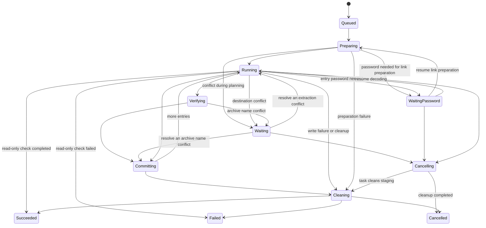

# タスクのスケジューリング、進捗、キャンセル

[English](../../design/task-scheduling.md) | [简体中文](../../zh-CN/design/task-scheduling.md) | [繁體中文](../../zh-TW/design/task-scheduling.md) | 日本語 | [한국어](../../ko-KR/design/task-scheduling.md) | [Français](../../fr-FR/design/task-scheduling.md) | [Deutsch](../../de-DE/design/task-scheduling.md) | [Español](../../es-ES/design/task-scheduling.md) | [Português (Brasil)](../../pt-BR/design/task-scheduling.md) | [Русский](../../ru-RU/design/task-scheduling.md)

XDZip はランタイム接続ごとに Rust のコマンドスレッドとタスクスレッドを一つずつ使います。コマンドスレッドは現在のアーカイブを所有してタスク入力を準備します。タスクスレッドが受理されたジョブを実行する間も、コマンドスレッドはメタデータ要求を処理できます。スレッドの実行場所は[システムアーキテクチャー](system-architecture.md)、結果のクライアントへの到達方法は [Qt/Rust ブリッジ](qt-rust-bridge.md)を参照してください。

## 受け入れとタスクの所有権

| 層 | 現在の動作 |
| --- | --- |
| デスクトップコントローラー | `BrowserController::attemptSubmission` は準備とクリーンアップを含む重い操作をデスクトッププロセス内のコントローラー間で直列化します。受け入れ待ちのコントローラーは上限付きコマンドを保持し、待機をキャンセルできます。メタデータ閲覧は通常のコマンド経路を使います。 |
| ランタイムのコマンドスレッド | 要求を検証してジョブを作ります。展開、検査、編集は必要なソースとメタデータまたは選択を保持します。作成は上限付きオプションを受け取り、タスクスレッド上で入力ツリーを走査します。メタデータの事前確認や出力先検査は重いタスクを作りません。 |
| ランタイムのタスクキュー | 展開、一時オープン、作成、検査、編集、エクスポートを必要に応じ、接続内でキュー順に一度に一ジョブ実行します。サービスごとに最大 32 タスクを追跡し、保持ジョブの合計予算は 64 MiB です。この予算は保持入力と予約された秘密情報領域を含みます。実際のデコード、インデックス、ワーカー、出力リソースは別の上限があります。飽和は `task_busy` と報告します。 |
| 独立した CLI | 自分のコマンドプロセス内で同じ Rust スケジューリング規則を使います。複数の独立 CLI プロセスとデスクトップはそれぞれ別のキューを持ちます。安全な出力認可と競合検査は各プロセスに適用されます。 |

`TaskAccepted` は受理済みジョブを識別します。通常要求の `Finished` はその要求を終了します。ジョブは関連付け用の元要求 ID と制御用タスク ID を使い、`TaskUpdate` スナップショットを引き続き生成できます。アプリのタスク項目はタブを閉じても所有コントローラーを保持し、プロンプトと結果を正しい接続に結び付けます。[タスクキューのソース](https://github.com/xiaodaozhi/xdzip/blob/main/crates/xdzip-runtime/src/service/tasks.rs)、[デスクトップの受け入れとタスク振り分け](https://github.com/xiaodaozhi/xdzip/blob/main/apps/desktop/BrowserController.cpp)、[デスクトップセッション](../engineering/application-sessions.md)

## 状態と報告される進捗

図は代表的な経路を示します。タスクは操作に応じてフェーズを省略または繰り返せます。読み取り専用検査は確定なしに終了できます。作成や編集は通常、公開前にステージングされたアーカイブを検証し、展開では繰り返し確定できます。

| ランタイム状態 | クライアントが受け取るもの |
| --- | --- |
| `queued`, `preparing` | ジョブがキュー待ち、または認可済みソース、出力先アクセス、形式状態を準備中です。合計はまだ不明な場合があります。 |
| `running`, `verifying` | 内容の読み取り、エンコード、デコード、検査中です。`verifying` にはステージング済みアーカイブ出力の再読み取りも含みます。検証は確定数を増やしません。 |
| `waiting`, `waiting_password` | 現在の競合またはパスワードへの応答を待っています。 |
| `committing` | ファイル、アーカイブ、ボリューム集合を公開する許可を得ています。 |
| `cancelling`, `cleaning` | キャンセルが要求されたか、プライベートオブジェクトを閉じて回収中です。進捗はまとめられるため一時状態がスナップショットから省略される場合があります。 |
| `succeeded`, `failed`, `cancelled` | 通常の実行経路が終了しました。最終スナップショットは以前の確定やクリーンアップ警告を含む実際の結果を持ちます。 |

`total_known` は不明な合計とゼロを区別します。スナップショットは読み取り、デコード、書き込み、検証、確定済みバイトを分けます。ソリッドブロックの作業や再デコードは追加ファイルを公開せず作業量を増やすことがあります。作成はアーカイブ公開後にのみ入力ファイルと入力バイトを確定済みとして数えます。`written_bytes` はヘッダー再書き込みを含み得る出力書き込み量です。キューは通常の `running`、`verifying`、`committing` 更新を 100 ms ごとに一回に制限し、タスクごとの最新の保留スナップショットだけを保持します。プロンプト、キャンセル、クリーンアップ、終端結果はこの制限を通りません。結果詳細は最大 128 レコードで、省略数を伴います。[状態コードとスナップショット欄](https://github.com/xiaodaozhi/xdzip/blob/main/crates/xdzip-runtime/src/extraction/mod.rs)

## 判断待ち

- 確認方針では名前の競合が明示的な判断を待つことがあります。パスワード要求は独立した一回限りの応答枠を使います。タスク ID、プロンプト ID、種類は現在の待機に一致する必要があります。古い、または回答済みのプロンプトへの応答は拒否します。
- 待機中はジョブの上限付き状態とキュー枠を保持します。タスクは応答 mutex を解放する条件変数で待ち、判断またはキャンセルにより通常コマンドキューの空きに依存せず起こされます。待機ジョブはタスクワーカーを占有し続けますが、別のコマンドスレッドは閲覧コマンドを処理できます。
- パスワード経路はタスク内の秘密情報を使います。対応する再試行可能なパスワード失敗は項目ごとに制限され、すでに行った作業もタスク予算に計上されます。明示的な整合性エラーは操作を停止します。欠落ボリューム、厳格な上限の枯渇、ソース変更はそれぞれのエラー経路で報告します。入力待ちはユーザーが制御する一時停止とは別です。[パスワード操作](../engineering/password-extraction.md)、[リソースとファイルの規則](file-security.md)

## キャンセルと確定境界

`cancel` は通常要求のキャンセルを要求します。タスクが存在した後は `cancel_task` がタスク自体を対象にします。これらの制御が確認するのは停止要求です。呼び出し側は対応する要求の完了またはタスクの終端スナップショットから結果を知ります。協調キャンセルに固定の完了期限はなく、特にホストのシステムコールがブロックされている場合は保証できません。アーカイブワーカーには別のプロセス監督があります。[ブリッジ制御メソッド](qt-rust-bridge.md)、[アーカイブワーカーの監督](../engineering/native-codecs.md)

| キャンセル到着時 | 影響 |
| --- | --- |
| `begin_commit()` がゲートを獲得する前 | 現在の公開は始まりません。タスクは未公開のステージングを破棄または清掃し、以前の受領記録を保持します。 |
| 一つの展開またはファイルプロミスの公開中 | 公開呼び出しは完了することがあります。ファイルが公開された場合、タスクはそれを記録します。キャンセルは後続作業を止めることがあり、終端スナップショットがゼロでない確定数を持つ `cancelled` になる場合があります。 |
| 最終アーカイブの公開中 | 作成と変更は、検証済みの単一アーカイブまたは完全なボリューム集合が公開されれば成功結果を保持します。分割作成では確定処理が部分公開した集合を自らロールバックしなければならない場合があります。ロールバック失敗は `outcome_uncertain` を設定することがあります。 |
| 最終結果の確定後 | 遅れて届いたキャンセルは成功した確定をキャンセル結果に変えられません。 |

ゲートはタスクキャンセルが公開を防げる時点を制御します。出力認可とステージング検証は引き続き必要です。認可された書き込みも失敗し、実際のファイルシステムエラーを返すことがあります。[キャンセルゲート](https://github.com/xiaodaozhi/xdzip/blob/main/crates/xdzip-runtime/src/extraction/control.rs)、[ファイル公開](file-security.md)

## 失敗、タブを閉じる操作、アプリの終了

スキップは対応する競合判断に適用されます。デコード、リソース、ソース、出力先の安全性のエラーはジョブを停止し得ます。公開済みファイルは記録に残り、成功した公開にステージングのクリーンアップエラーが伴う場合があります。予期しないワーカー障害や巻き戻し可能なタスク panic は失敗または不確実な結果を生むことがあります。panic 経路は `task_abandoned` を報告し、該当ランタイムを障害状態にします。プロセス終了後に終端応答がないことは、何がディスクに書かれたかを証明しません。

進捗ウィンドウやアーカイブタブを閉じるのは表示上の操作です。受理されたジョブと結果はアプリのタスク項目から引き続き利用できます。アクティブなパスワードプロンプトを閉じると、そのタスクがキャンセルされる場合があります。明示的な終了は実行中の作業を処理し、シャットダウン開始時に受け入れを止め、待機を起こしてイベントを取り出し続けます。受信側は Rust ワーカーを待ってから `ShutdownReady` を生成します。Qt はイベントを取り出し終え、GUI スレッドをブロックする待機なしに受信側の終了を待ちます。外部ネイティブ転送の完了も必要な場合があります。[ランタイムのライフサイクル](../engineering/product-runtime.md)、[アーカイブ転送](../../engineering/archive-transfers.md)
