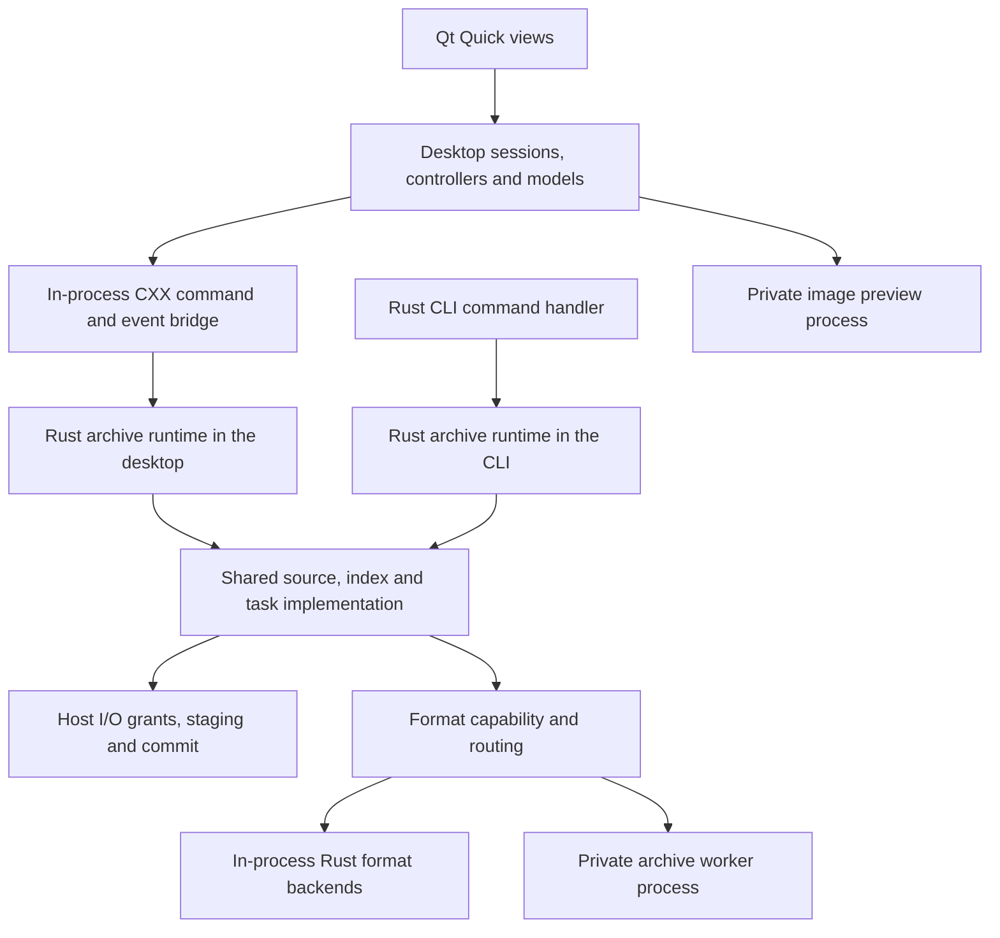
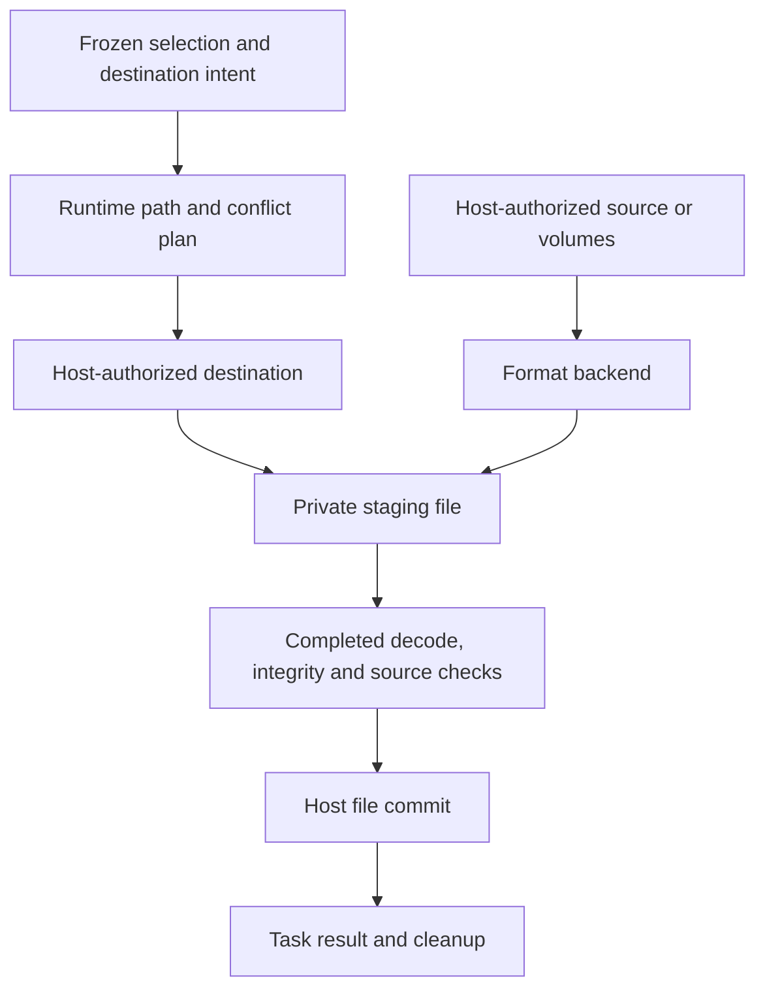

# XDZip 시스템 아키텍처

[English](../../design/system-architecture.md) | [简体中文](../../zh-CN/design/system-architecture.md) | [繁體中文](../../zh-TW/design/system-architecture.md) | [日本語](../../ja-JP/design/system-architecture.md) | 한국어 | [Français](../../fr-FR/design/system-architecture.md) | [Deutsch](../../de-DE/design/system-architecture.md) | [Español](../../es-ES/design/system-architecture.md) | [Português (Brasil)](../../pt-BR/design/system-architecture.md) | [Русский](../../ru-RU/design/system-architecture.md)

데스크톱과 명령줄 클라이언트는 Rust 아카이브 런타임을 공유합니다. 런타임은 선택한 소스를 인덱싱된 세션으로, 작업을 제한된 태스크로 바꿉니다. 형식 백엔드는 아카이브 데이터를 해석합니다. 호스트는 파일을 승인하고 출력 위치를 제어하며 검증된 결과를 게시합니다.

## 아키텍처 개요

두 런타임 상자는 같은 구현의 별도 인스턴스를 나타냅니다. 데스크톱과 CLI는 각각 자체 아카이브 상태와 작업을 소유합니다. 데스크톱 로컬 IPC는 데스크톱 활성화와 통합 요청을 기본 GUI 인스턴스에 전달합니다. 아카이브 명령은 프로세스 내부 런타임을 통과합니다. [애플리케이션 세션](../engineering/application-sessions.md), [CLI 계약](../engineering/command-line.md).

## 모듈 책임과 호출 방향

| 모듈 | 소유 항목과 호출 |
| --- | --- |
| 데스크톱 진입점과 Qt Quick | 데스크톱 실행 파일 `xdzip`으로 빌드되는 `xdzip-browser`는 `browser_main.cpp`에서 시작하여 `Browser.qml`을 로드합니다. `SessionPage.qml`과 뷰는 목록, 선택, 대화 상자와 작업 상태를 표시합니다. 사용자 의도를 C++ 컨트롤러에 보냅니다. [데스크톱 진입점](https://github.com/xiaodaozhi/xdzip/blob/main/apps/desktop/browser_main.cpp), [QML 설계](qt-quick-ui.md). |
| 데스크톱 C++ 어댑터 | `ApplicationSessions`는 탭, 창과 공유 작업 진입점을 조정합니다. 각 `BrowserController`는 자기 세션의 목록 모델과 요청 상태를 소유하고 UI 의도를 형식화된 명령으로 바꾸며 진행, 오류와 질문을 UI로 돌려보냅니다. `RuntimeConnection`은 브리지 핸들과 이벤트 전달을 소유합니다. 설정, 트레이, 파일 연결과 네이티브 드래그 또는 셸 통합은 데스크톱 어댑터에 있습니다. [세션 조정자](https://github.com/xiaodaozhi/xdzip/blob/main/apps/desktop/ApplicationSessions.cpp), [컨트롤러](https://github.com/xiaodaozhi/xdzip/blob/main/apps/desktop/BrowserController.cpp). |
| `xdzip-qt-bridge` | 링크된 CXX 경계는 C++ 명령, 행, 작업 스냅샷과 오류를 Rust 타입과 상호 변환합니다. 런타임 `Client`와 `Receiver`를 각각 소유되는 명령 및 이벤트 핸들로 감쌉니다. [브리지 소스](https://github.com/xiaodaozhi/xdzip/blob/main/crates/xdzip-qt-bridge/src/lib.rs), [브리지 계약](qt-rust-bridge.md). |
| `xdzip-cli` | 인수를 파싱하고 터미널 질문과 취소를 처리하며 `xdzip-runtime`을 직접 호출하고 이벤트를 텍스트 또는 JSON과 종료 코드에 매핑합니다. 아카이브 명령은 데스크톱과 같은 소스 및 작업 규칙을 사용합니다. 설치와 업데이트 명령에는 별도의 진입 경로가 있습니다. [CLI 런타임 어댑터](https://github.com/xiaodaozhi/xdzip/blob/main/crates/xdzip-cli/src/runtime.rs), [CLI 통합](../integration/README.md). |
| `xdzip-runtime` | 각 서비스 인스턴스의 현재 `Archive`를 소유합니다. `source`는 볼륨을 해결하고 소스 버전을 추적합니다. `formats`는 형식을 탐지하고 분기합니다. `index`, `navigation`, `query`, `listing`, `disk_index`는 메타데이터를 구축하고 조회합니다. 서비스는 명령을 검증하고 `extraction`, `creation`, `updating`, `checking`, `exporting` 작업을 큐에 넣습니다. `preview`는 속성 뷰의 제한된 읽기를 처리합니다. [런타임 모듈](https://github.com/xiaodaozhi/xdzip/blob/main/crates/xdzip-runtime/src/lib.rs), [제품 런타임](../engineering/product-runtime.md). |
| `xdzip-domain`, `xdzip-codec-api`, `xdzip-extract-plan` | 도메인은 식별 정보, 메타데이터와 경로 불변 조건을 정의합니다. 코덱 API는 `ReadSource`, `PayloadCodec`, `DecodedSink`, `EncodeInput`, `EncodeOutput`과 같은 형식 기능과 계약을 정의합니다. 추출 계획기는 메타데이터와 선택에서 보고서를 도출합니다. 대상 승인은 호스트에 남습니다. [도메인과 데이터](domain-data.md), [코덱 인터페이스](https://github.com/xiaodaozhi/xdzip/blob/main/crates/xdzip-codec-api/src/lib.rs), [추출 사전 검사](../engineering/extraction-preflight.md). |
| `xdzip-codec-*`, `xdzip-compression`, `xdzip-crypto` | 코덱 crate는 컨테이너 프레이밍, 메타데이터 검사, 페이로드 읽기와 형식별 쓰기 기능을 구현합니다. 압축과 암호화 crate는 재사용 가능한 알고리즘을 제공합니다. 코덱 인터페이스는 호스트가 제공하는 스트림과 싱크를 사용합니다. 기능 레지스트리는 가능한 작업을 설명하고 런타임 라우팅은 실제 아카이브와 항목을 검사합니다. [런타임 라우팅](https://github.com/xiaodaozhi/xdzip/blob/main/crates/xdzip-runtime/src/formats.rs), [형식 레지스트리](../engineering/format-registry.md). |
| `xdzip-io` | 일반 입력 파일을 열고 네이티브 파일 객체를 식별하며 승인된 생성 입력을 고정하고 대상 권한, 준비와 확정을 제공합니다. 파일 경계에서 플랫폼 검사를 구현하고 런타임이 수행할 작업과 게시 시점을 결정합니다. [입력 승인](https://github.com/xiaodaozhi/xdzip/blob/main/crates/xdzip-io/src/input.rs), [출력 권한과 확정](https://github.com/xiaodaozhi/xdzip/blob/main/crates/xdzip-io/src/target.rs), [파일 안전](file-security.md). |
| 업데이트와 개발 도구 | `UpdateController`와 `xdzip-update`가 업데이트 선택, 검증과 전달을 처리합니다. 설치된 빌드는 플랫폼별 설치 경로를 사용합니다. SDK 호스트와 형식 프로브에는 독립 진입점이 있습니다. 제품 아카이브 검색은 내장 레지스트리를 사용합니다. [소프트웨어 업데이트](../../engineering/software-update.md), [SDK 시험](../engineering/sdk-trial.md), [저장소와 모듈 지도](../engineering/repository-layout.md). |

## 데스크톱 요청과 수명 주기

1. **진입과 라우팅.** 일반 데스크톱 실행, 파일 연결과 셸 요청은 데스크톱 앱으로 들어옵니다. `SingleInstance`는 같은 사용자와 로그인 세션에서 기본 인스턴스를 선출합니다. 기본 인스턴스는 전달된 요청을 처리하고 적절한 탐색 또는 작업 세션을 열거나 재사용합니다. 독립 CLI 아카이브 명령은 자체 Rust 서비스를 시작합니다. 동봉된 CLI는 로컬 채널로 데스크톱 업데이트 요청을 GUI에 전달할 수 있습니다.
2. **명령 접수.** 탐색 컨트롤러는 자체 `RuntimeConnection`을 사용합니다. GUI는 형식화된 명령을 제출하고 접수 결과와 요청 ID를 받습니다. 이벤트 루프의 제한된 재시도가 일시적인 접수 경쟁을 처리합니다. 아카이브 I/O는 GUI 스레드 밖에서 실행됩니다.
3. **실행과 전달.** 각 서비스는 현재 아카이브, 메타데이터 요청과 작업 준비를 담당하는 Rust 명령 스레드와, 제한된 큐에서 무거운 작업을 한 번에 하나씩 실행하는 별도의 Rust 작업 스레드를 가집니다. 추가 데스크톱 접수 규칙이 컨트롤러 간 무거운 작업을 직렬화합니다. Qt 측 수신 스레드는 Rust 이벤트를 GUI 스레드용 제한된 메일박스로 옮깁니다. 컨트롤러는 요청과 세션 식별 정보를 맞추고 페이지를 적용할 때 쿼리 세대와 리비전을 확인합니다. CLI는 자기 프로세스 안에서 명령을 제출하고 이벤트를 소비합니다.
4. **작업 소유.** 수락과 진행은 종료 작업 스냅샷과 별도입니다. 작업 스레드가 고정된 작업 입력을 소유합니다. 암호, 충돌 결정과 취소는 소유 작업에 보냅니다. 작업 컨트롤은 작업과 질문 식별 정보를 사용합니다. 작업의 숫자 ID는 해당 런타임 연결에 속합니다. 취소와 종료는 일반 명령 큐 공간을 기다리지 않습니다. 탭을 닫으면 탐색 표시는 버리지만 수락된 작업은 계속될 수 있고 결과는 공유 작업 진입점에서 사용할 수 있습니다. 명시적인 앱 종료는 접수를 중지하고 종료 이벤트를 처리하며 작업 프로세스 종료를 기다립니다.

[런타임 이벤트 서비스](https://github.com/xiaodaozhi/xdzip/blob/main/crates/xdzip-runtime/src/service.rs), [작업 큐](https://github.com/xiaodaozhi/xdzip/blob/main/crates/xdzip-runtime/src/service/tasks.rs), [Qt 이벤트 전달](https://github.com/xiaodaozhi/xdzip/blob/main/apps/desktop/RuntimeConnection.cpp), [작업 스케줄링](task-scheduling.md).

## 프로세스와 플랫폼 경계

| 실행 경계 | 데이터와 책임 |
| --- | --- |
| 기본 데스크톱 프로세스 | Qt GUI, C++ 어댑터, CXX 브리지와 Rust 런타임 스레드는 주소 공간을 공유합니다. 호스트는 열린 아카이브 세션과 네이티브 파일 승인을 소유합니다. 이후 데스크톱 실행은 사용자 범위 로컬 IPC로 요청을 전달하고 종료할 수 있습니다. |
| CLI 명령 프로세스 | CLI 명령 핸들러는 같은 Rust 런타임을 자기 프로세스의 라이브러리로 호출합니다. 패키지 CLI 실행이나 업데이트 전달에는 별도 프로세스가 관여할 수 있습니다. 아카이브 상태와 작업 결과는 명령 자체 서비스에 속합니다. |
| 아카이브 형식 작업 프로세스 | 런타임은 7z, RAR, CAB, ISO/UDF 읽기를 `xdzip-codec-native`로 라우팅합니다. 동봉된 `xdzip-native-codec`를 실행하고 제한된 프레임의 stdin/stdout으로 통신합니다. 작업 프로세스의 얇은 C++ 프로토콜 계층은 `xdzip-codec-bridge`를 통해 Rust 백엔드를 호출합니다. 호스트는 승인된 범위 또는 볼륨 읽기를 제공하고 출력 프레임을 검증합니다. 7z 쓰기에는 비공개 준비 영역에 대한 제한된 오프셋 쓰기를 허용합니다. 아카이브와 대상 경로는 호스트에 남습니다. 작업 프로세스 실패나 취소 시 작업을 종료하고 미완료 준비 영역을 버립니다. 이 프로세스 경계는 장애와 리소스 사용을 제한합니다. 프로토콜은 파일 시스템 권한을 부여하지 않으며 커널 권한 샌드박스 없이 실행됩니다. |
| 이미지 미리 보기 작업 프로세스 | Rust가 적격 아카이브 항목을 읽고 검증한 후 데스크톱이 제한된 인코딩 이미지 바이트를 `xdzip-image-preview`에 보냅니다. 작업 프로세스는 제한된 RGBA 썸네일을 반환합니다. 요청에는 아카이브 경로, 암호 또는 대상 핸들이 없습니다. 미리 보기 제공자는 일치하는 현재 요청에만 결과를 게시합니다. 텍스트 미리 보기는 Rust 런타임에서 처리합니다. |
| 플랫폼 전달 | 데스크톱 어댑터는 파일 관리자 활성화, 비공개 추출 복사본의 외부 앱 열기와 업데이트 설치를 조정합니다. 업데이트 도우미 또는 macOS Sparkle은 자체 설치 전달을 수행합니다. Store 관리 업데이트는 플랫폼 채널을 따릅니다. 형식 작업 프로세스는 이 요청을 처리하지 않습니다. |

[아카이브 작업 프로토콜](../engineering/native-codecs.md), [이미지 미리 보기 계약](../engineering/content-preview.md), [플랫폼 통합](../../engineering/installers-associations.md), [아카이브 전송](../../engineering/archive-transfers.md), [업데이트 전달](../../engineering/software-update.md).

## 아카이브 열기와 탐색

1. **소스 승인.** `Archive::open_with_password`는 `Source::open`에 `xdzip-io`를 통해 일반 파일을 열고 지원되는 분할 볼륨 집합을 해결하도록 요청합니다. 호스트는 허용된 각 부분의 식별 정보, 크기와 타임스탬프를 기록합니다. 코덱은 탐색 가능한 입력과 해당하는 경우 호스트가 제공한 볼륨 메타데이터를 받습니다.
2. **형식 식별과 검사.** 런타임은 내용을 조사하고 관련 컨테이너 구조를 검증합니다. 이름과 확장자는 볼륨 검색을 안내하거나 특정 모호성을 해결할 수 있습니다. 선택한 백엔드는 리소스 제한 내에서 검사합니다. 암호로 보호된 디렉터리는 검사가 끝나기 전에 암호가 필요할 수 있습니다. 실패하거나 불완전한 검사는 부분 아카이브 세션을 게시하지 않습니다.
3. **세션 스냅샷 구축.** 런타임은 물리 항목 ID를 이름과 합성된 탐색 폴더와 분리합니다. 따라서 중복 이름도 독립적으로 지정할 수 있습니다. 일반 단일 파일 ZIP/ZIP64는 메모리 예산을 초과하면 메타데이터를 비공개 디스크 인덱스로 스트리밍할 수 있습니다. 이 확장된 탐색 용량은 추출과 별도의 제한을 가집니다. 디스크 인덱스를 사용하는 세션은 현재 전체 아카이브 검사나 수정을 지원하지 않습니다.
4. **조회와 선택.** 데스크톱 탐색 요청은 세션, 디렉터리, 검색과 정렬 의도를 제공합니다. Rust는 결과 식별 정보와 제한된 페이지를 반환합니다. 이어 읽기 요청은 현재 세션, 쿼리, 세대와 리비전과 일치해야 합니다. 작업이 페이지 간 논리 선택을 사용하기 전에 Rust는 이를 물리 항목 또는 탐색 식별 정보로 해결합니다. CLI는 물리 카탈로그와 명시적인 멤버 경로 또는 항목 ID를 사용합니다. 표시 행 위치와 출력 경로 이름은 물리 항목 ID와 별개입니다.

스냅샷은 세션에 허용된 아카이브를 설명합니다. 변경을 감지하기 위해 관련 읽기와 쓰기에서 소스 식별 정보와 메타데이터를 다시 검사합니다. 소스 파일은 여전히 동시에 변경될 수 있으므로 최선의 노력에 따른 감지입니다. 변경을 감지하면 영향을 받은 탐색 상태를 무효화하고 오래된 소스의 게시를 차단합니다.

[소스와 볼륨 처리](https://github.com/xiaodaozhi/xdzip/blob/main/crates/xdzip-runtime/src/source.rs), [조회와 선택](https://github.com/xiaodaozhi/xdzip/blob/main/crates/xdzip-runtime/src/query.rs), [대형 아카이브 인덱스](../engineering/large-index.md).

## 항목 읽기, 검사와 추출

| 작업 | 데이터 흐름과 결과 |
| --- | --- |
| 탐색 또는 추출 사전 검사 | 인덱싱된 메타데이터를 사용합니다. 사전 검사는 선택, 경로와 크기 제약을 요약하지만 출력 권한을 열거나 선택한 모든 데이터를 디코딩할 수 있음을 증명하지 않습니다. |
| 미리 보기 | 현재 세션의 적격 일반 항목 하나를 해결합니다. Rust는 제한된 싱크를 통해 항목을 완전히 읽고 디코딩하며 형식에서 제공하는 무결성 또는 인증 검사를 수행합니다. 데스크톱은 승인된 텍스트를 표시하거나 검증된 인코딩 이미지 바이트를 이미지 작업 프로세스에 보냅니다. |
| 아카이브 검사 | 입력을 고정하고 제한된 폐기 싱크 또는 형식별 검사를 통해 적격 아카이브 전체를 읽습니다. 출력을 승인하지 않습니다. 사용 가능한 검사는 형식에 따라 다릅니다. 예를 들어 TAR과 ISO/UDF는 파일별 체크섬 보장 없이 구조와 읽기 가능성을 확인할 수 있습니다. |
| 추출, 열기 또는 내보내기 | 선택한 레코드를 고정하고 승인된 소스에서 읽습니다. 추출은 선택한 대상에 게시합니다. 파일 열기는 비공개 검증 복사본을 사용하여 시스템에 전달합니다. 드래그 내보내기는 먼저 비공개 출력을 준비한 뒤 검증된 대상에 게시할 수 있습니다. |

일반 파일 추출 경로는 디코딩과 게시의 분리를 보여 줍니다.

1. **계획.** 런타임은 고정된 선택으로 이식 가능한 상대 경로를 검증하고 출력 충돌을 감지합니다. `xdzip-io`는 대상을 승인된 디렉터리에 고정합니다. 런타임은 묻기, 건너뛰기, 이름 변경 또는 적격 덮어쓰기를 해결합니다. 코덱은 보호된 입력, 바뀐 대상 또는 안전하지 않은 링크 통과를 승인할 수 없습니다.
2. **디코딩.** 백엔드는 직접 또는 아카이브 작업 프로세스를 통해 허용된 소스를 읽습니다. 바이트를 비공개 준비 영역에 연결된 계량 싱크로 보냅니다. 암호 재시도, 확장과 보조 작업은 작업 제한에 따릅니다. 준비 영역에 보낸 바이트는 디코딩, 크기 검사와 사용 가능한 형식 검증이 성공할 때까지 잠정적입니다.
3. **확정과 보고.** 게시 전에 호스트는 소스와 관련 대상 식별 정보를 다시 확인합니다. 각 적격 파일을 따로 확정하고 실제 게시된 파일과 바이트를 기록합니다. 나중의 실패나 취소로 이미 확정한 파일이 남을 수 있습니다. 게시하지 않은 준비 영역은 가능한 한 정리하며 종료 결과는 실패, 취소, 건너뛰기와 정리 경고를 보고합니다.

[추출 실행](https://github.com/xiaodaozhi/xdzip/blob/main/crates/xdzip-runtime/src/extraction/execute.rs), [아카이브 검사](../engineering/archive-checking.md), [암호 상호 작용](../engineering/password-extraction.md), [ZIP 안전 추출](../engineering/zip-safe-extraction.md).

## 아카이브 생성 또는 수정

생성과 아카이브 수정은 아카이브를 하나의 단위로 준비하고 검증합니다. 런타임은 작업을 조정하고 형식 인코더는 호스트 소유 출력 인터페이스로 씁니다. 결과를 게시할 수 있는 것은 호스트뿐입니다.

1. **생성.** 런타임은 출력 형식과 설정을 검증하고 승인된 대상을 얻은 뒤 허용된 입력 트리를 순회하며 고정합니다. 인코더는 메타데이터를 받고 입력 인덱스로 스트림을 열 수 있습니다. 비공개 준비 영역에 씁니다. ZIP과 TAR 작성기는 프로세스 내부에서 실행하고 7z는 아카이브 작업 프로세스를 사용합니다. ISO 탐색은 작업 프로세스를 사용하지만 ISO 생성은 프로세스 내부 Rust 광학 작성기를 사용합니다. [생성 작업](https://github.com/xiaodaozhi/xdzip/blob/main/crates/xdzip-runtime/src/creation.rs), [ISO 작성기](../engineering/iso-creation.md).
2. **수정.** 적격 아카이브에서 런타임은 소스와 추가 항목을 고정하고 유지, 추가, 교체 또는 이동할 항목의 계획을 만듭니다. 재작성은 준비 영역에 새 아카이브를 생성합니다. 런타임은 결과를 다시 열어 예상 항목과 내용을 검증한 뒤 호스트의 아카이브 업데이트 권한으로 원본을 교체합니다. 지원하지 않는 항목, 암호화되거나 분할된 소스와 다른 비호환 사례는 형식과 작업 규칙에 따라 거부합니다. 교체 성공 후 소스를 계속 보고 있는 데스크톱 세션은 스냅샷을 새로 고칩니다. [아카이브 업데이트 작업](https://github.com/xiaodaozhi/xdzip/blob/main/crates/xdzip-runtime/src/updating.rs), [아카이브 수정과 전송](../../engineering/archive-transfers.md).
3. **검증과 게시.** 호스트는 준비된 생성 출력을 다시 열고 형식과 생성 프로필에 따라 구조, 예상 항목과 내용을 검사합니다. 출력 충돌을 해결하고 확정 전에 관련 권한을 다시 확인합니다. 단일 파일 아카이브에는 확정 지점 하나가 있습니다. 분할 생성은 새 집합을 게시하기 전에 모든 부분을 준비하고 기존 집합의 덮어쓰기를 거부하며 중간에 게시가 실패하면 롤백을 시도합니다. 각 부분에는 자체 게시 단계가 있습니다. 작업 보고서는 정리나 롤백 문제를 기록할 수 있습니다. [ZIP 생성](../engineering/zip-creation.md), [파일 확정 계약](file-security.md).

**결과 읽기.** `TaskAccepted`는 큐에 들어간 작업을 식별합니다. `Finished`는 일반 요청을 종료합니다. 별도의 종료 작업 스냅샷은 검증, 게시, 건너뛰기 또는 미완료된 내용을 보고합니다. 디코딩한 바이트와 게시한 바이트는 다를 수 있습니다. 취소는 협력적으로 수행되며 전체 아카이브 확정 성공 후의 요청은 게시를 되돌리지 않습니다.

[작업 상태와 취소](task-scheduling.md), [제품 설계와 기술 참조](../reference/README.md).
