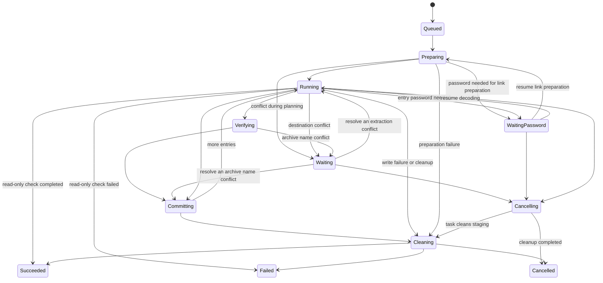

# 작업 스케줄링, 진행과 취소

[English](../../design/task-scheduling.md) | [简体中文](../../zh-CN/design/task-scheduling.md) | [繁體中文（台灣）](../../zh-TW/design/task-scheduling.md) | [日本語](../../ja-JP/design/task-scheduling.md) | 한국어 | [Français](../../fr-FR/design/task-scheduling.md) | [Deutsch](../../de-DE/design/task-scheduling.md) | [Español](../../es-ES/design/task-scheduling.md) | [Português (Brasil)](../../pt-BR/design/task-scheduling.md) | [Русский](../../ru-RU/design/task-scheduling.md)

XDZip은 런타임 연결마다 Rust 명령 스레드 하나와 작업 스레드 하나를 사용합니다. 명령 스레드는 현재 압축 파일을 소유하고 작업 입력을 준비합니다. 작업 스레드가 승인된 작업을 실행하는 동안 명령 스레드는 메타데이터 요청을 계속 처리할 수 있습니다. [시스템 아키텍처](system-architecture.md)는 스레드 실행 위치를, [Qt/Rust 브리지](qt-rust-bridge.md)는 결과가 클라이언트에 도달하는 방법을 설명합니다.

## 승인과 작업 소유권

| 계층 | 현재 동작 |
| --- | --- |
| 데스크톱 컨트롤러 | `BrowserController::attemptSubmission`은 준비와 정리를 포함한 무거운 작업을 데스크톱 프로세스의 컨트롤러 사이에서 직렬화합니다. 승인을 기다리는 컨트롤러는 제한된 명령을 보유하며 기다림을 취소할 수 있습니다. 메타데이터 탐색은 일반 명령 경로를 사용합니다. |
| 런타임 명령 스레드 | 요청을 검증하고 작업을 만듭니다. 추출, 검사와 편집은 관련 원본 및 메타데이터 또는 선택을 보유합니다. 생성은 제한된 옵션을 받아 작업 스레드에서 입력 트리를 스캔합니다. 메타데이터 사전 검사나 대상 검사는 무거운 작업을 만들지 않습니다. |
| 런타임 작업 큐 | 추출, 임시 열기, 생성, 검사, 편집과 내보내기를 필요에 따라 연결 내 큐 순서대로 한 번에 한 작업씩 실행합니다. 서비스마다 최대 32개 작업을 추적하며 보유 작업의 총 예산은 64 MiB입니다. 이 예산은 보유 입력과 예약된 비밀 정보 공간을 포함합니다. 실제 디코딩, 인덱싱, 작업 프로세스와 출력 자원에는 별도 제한이 있습니다. 포화 상태는 `task_busy`로 보고합니다. |
| 독립 CLI | 자체 명령 프로세스에서 같은 Rust 스케줄링 규칙을 사용합니다. 독립 CLI 프로세스마다 별도 큐가 있고 데스크톱도 마찬가지입니다. 안전한 출력 권한과 충돌 검사는 각 프로세스에 적용됩니다. |

`TaskAccepted`는 승인된 작업을 식별합니다. 일반 요청의 `Finished`는 그 요청을 닫습니다. 작업은 상관관계에 원래 요청 ID를, 제어에 작업 ID를 사용해 `TaskUpdate` 스냅샷을 계속 생성할 수 있습니다. 앱 작업 항목은 탭을 닫아도 소유 컨트롤러를 보유해 프롬프트와 결과를 올바른 연결에 귀속합니다. [작업 큐 소스](https://github.com/xiaodaozhi/xdzip/blob/main/crates/xdzip-runtime/src/service/tasks.rs), [데스크톱 승인과 작업 라우팅](https://github.com/xiaodaozhi/xdzip/blob/main/apps/desktop/BrowserController.cpp), [데스크톱 세션](../engineering/application-sessions.md)

## 상태와 보고되는 진행

다이어그램은 대표 경로를 보여 줍니다. 작업은 동작에 따라 단계를 건너뛰거나 반복할 수 있습니다. 읽기 전용 검사는 확정 없이 끝날 수 있습니다. 생성이나 편집은 보통 게시 전에 준비된 압축 파일을 검증하며 추출은 여러 번 확정할 수 있습니다.

| 런타임 상태 | 클라이언트가 받는 내용 |
| --- | --- |
| `queued`, `preparing` | 작업이 큐에 있거나 승인된 원본, 대상 접근과 형식 상태를 준비합니다. 전체 양은 아직 알 수 없을 수 있습니다. |
| `running`, `verifying` | 콘텐츠를 읽거나 인코딩, 디코딩 또는 검사 중입니다. `verifying`에는 준비된 압축 파일 출력의 재읽기도 포함됩니다. 검증은 확정 수를 늘리지 않습니다. |
| `waiting`, `waiting_password` | 현재 충돌 또는 암호 응답을 기다립니다. |
| `committing` | 파일, 압축 파일 또는 볼륨 집합을 게시할 권한을 얻었습니다. |
| `cancelling`, `cleaning` | 취소가 요청되었거나 개인 객체를 닫고 회수 중입니다. 진행이 합쳐지므로 스냅샷에서 일시적 상태가 빠질 수 있습니다. |
| `succeeded`, `failed`, `cancelled` | 일반 실행 경로가 끝났습니다. 최종 스냅샷에는 이전 확정과 정리 경고를 포함한 실제 결과가 담깁니다. |

`total_known`은 알 수 없는 전체 양과 0을 구분합니다. 스냅샷은 읽은, 디코딩한, 쓴, 검증한, 확정한 바이트를 분리합니다. 솔리드 블록 작업이나 반복 디코딩은 추가 파일을 게시하지 않고 작업량을 늘릴 수 있습니다. 생성은 압축 파일 게시 후에만 입력 파일과 바이트를 확정된 것으로 셉니다. `written_bytes`는 헤더 재쓰기를 포함할 수 있는 출력 쓰기를 측정합니다. 큐는 일반 `running`, `verifying`, `committing` 업데이트를 100 ms당 하나로 제한하고 작업별 최신 대기 스냅샷만 보유합니다. 프롬프트, 취소, 정리와 종료 결과는 이 제한을 우회합니다. 결과 세부 정보는 최대 128개 레코드이며 생략 수를 포함합니다. [상태 코드와 스냅샷 필드](https://github.com/xiaodaozhi/xdzip/blob/main/crates/xdzip-runtime/src/extraction/mod.rs)

## 결정 대기

- 확인 정책에서는 이름 충돌 시 명시적 결정을 기다릴 수 있습니다. 암호 요청은 별도의 일회용 응답 슬롯을 사용합니다. 작업 ID, 프롬프트 ID와 유형은 현재 대기와 일치해야 합니다. 오래되었거나 이미 응답한 프롬프트에 대한 응답은 거부합니다.
- 대기 중에는 작업의 제한된 상태와 큐 슬롯을 보유합니다. 작업은 대기 중 응답 mutex를 해제하는 조건 변수에서 기다립니다. 결정 또는 취소는 일반 명령 큐 공간과 무관하게 작업을 깨웁니다. 대기 작업은 작업 스레드를 계속 차지하며 별도 명령 스레드는 탐색 명령을 계속 처리할 수 있습니다.
- 암호 경로는 작업 로컬 비밀을 사용합니다. 지원되는 재시도 가능한 암호 실패는 항목별로 제한되며 이미 수행한 작업은 예산에 포함됩니다. 명시적 무결성 실패는 동작을 중지합니다. 누락 볼륨, 소진된 엄격한 할당량이나 변경된 원본은 해당 오류 경로로 보고합니다. 입력 대기는 사용자 제어 일시 정지와 다릅니다. [암호 상호작용](../engineering/password-extraction.md), [자원 및 파일 규칙](file-security.md)

## 취소와 확정 경계

`cancel`은 일반 요청의 취소를 요청합니다. 작업이 생성된 뒤에는 `cancel_task`가 작업 자체를 대상으로 합니다. 이 제어는 중지 요청을 확인하는 것입니다. 호출자는 해당 요청의 완료 또는 작업 종료 스냅샷에서 결과를 확인합니다. 협력적 취소에는 고정된 완료 기한이 없으며 특히 호스트 시스템 호출이 차단된 경우 그렇습니다. 압축 파일 작업 프로세스에는 별도 프로세스 감독이 있습니다. [브리지 제어 메서드](qt-rust-bridge.md), [압축 파일 작업 프로세스 감독](../engineering/native-codecs.md)

| 취소 도착 시점 | 영향 |
| --- | --- |
| `begin_commit()`이 게이트를 얻기 전 | 현재 게시가 시작되지 않습니다. 작업은 게시되지 않은 준비 영역을 버리거나 정리하고 이전 확인 기록을 유지합니다. |
| 한 추출 또는 파일 약속 게시 중 | 게시 호출이 완료될 수 있습니다. 파일이 게시되면 작업이 이를 기록합니다. 취소는 후속 작업을 중지할 수 있으며 종료 스냅샷은 영이 아닌 확정 수를 가진 `cancelled`일 수 있습니다. |
| 최종 압축 파일 게시 중 | 검증된 단일 압축 파일 또는 전체 볼륨 집합이 게시되면 생성과 수정은 성공 결과를 유지합니다. 분할 생성 시 확정 루틴은 부분 게시된 자신의 집합을 롤백해야 할 수 있습니다. 롤백 실패는 `outcome_uncertain`을 설정할 수 있습니다. |
| 최종 결과가 확정된 뒤 | 늦은 취소는 성공한 확정을 취소 결과로 바꿀 수 없습니다. |

게이트는 작업 취소가 게시를 막을 수 있는 시점을 제어합니다. 출력 권한과 준비 영역 검증은 여전히 필요합니다. 허가된 쓰기도 실패해 실제 파일 시스템 오류를 반환할 수 있습니다. [취소 게이트](https://github.com/xiaodaozhi/xdzip/blob/main/crates/xdzip-runtime/src/extraction/control.rs), [파일 게시](file-security.md)

## 실패, 탭 닫기와 앱 종료

건너뛰기는 지원되는 충돌 결정에 적용됩니다. 디코딩, 자원, 원본 또는 대상 안전 오류로 작업이 중지될 수 있습니다. 이미 게시된 파일은 기록에 남고 준비 영역 정리 오류가 성공적인 게시와 함께 나타날 수 있습니다. 예상치 못한 작업 프로세스 실패나 스택 해제가 가능한 작업 panic은 실패 또는 불확실한 결과를 낼 수 있습니다. panic 경로는 `task_abandoned`를 보고하고 해당 런타임을 오류 상태로 만듭니다. 프로세스 종료 후 종료 응답이 없다는 사실은 디스크에 무엇이 기록되었는지 입증하지 않습니다.

진행 창이나 압축 파일 탭 닫기는 표시 동작입니다. 승인된 작업과 결과는 앱 작업 항목에서 계속 사용할 수 있습니다. 활성 암호 프롬프트를 닫으면 해당 작업이 취소될 수 있습니다. 명시적 종료는 활성 작업을 처리하고 종료 시작 시 승인을 멈추며 대기자를 깨우고 이벤트를 계속 비웁니다. 수신자는 Rust 작업 스레드를 기다린 뒤 `ShutdownReady`를 생성합니다. Qt는 이벤트를 모두 처리하고 GUI 스레드에서 차단되는 대기 없이 수신자 종료를 기다립니다. 외부 네이티브 전송도 끝나야 할 수 있습니다. [런타임 수명 주기](../engineering/product-runtime.md), [압축 파일 전송](../engineering/archive-transfers.md)
