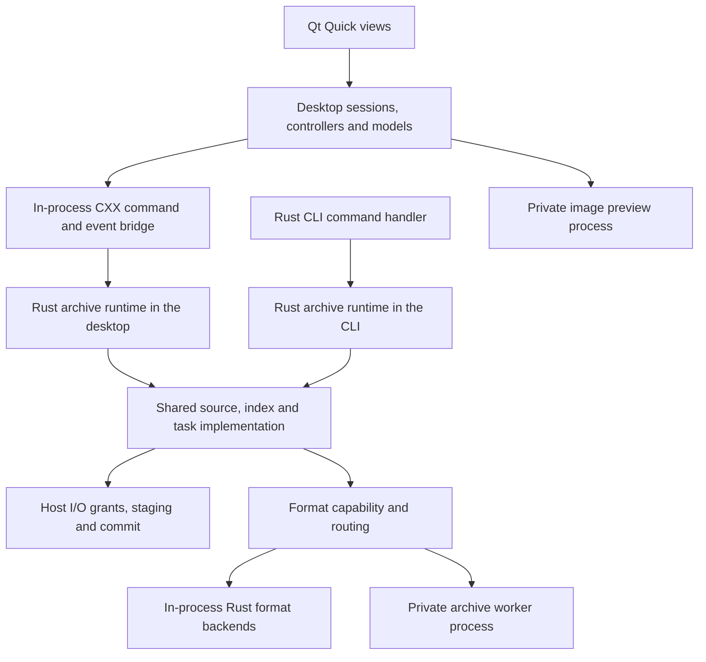
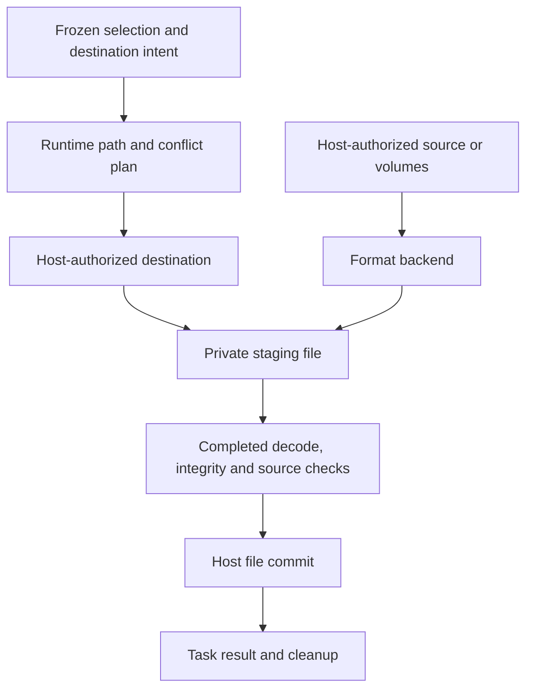

# Arquitetura do sistema XDZip

[English](../../design/system-architecture.md) | [简体中文](../../zh-CN/design/system-architecture.md) | [繁體中文](../../zh-TW/design/system-architecture.md) | [日本語](../../ja-JP/design/system-architecture.md) | [한국어](../../ko-KR/design/system-architecture.md) | [Français](../../fr-FR/design/system-architecture.md) | [Deutsch](../../de-DE/design/system-architecture.md) | [Español](../../es-ES/design/system-architecture.md) | Português (Brasil) | [Русский](../../ru-RU/design/system-architecture.md)

Os clientes de desktop e de linha de comando compartilham o runtime de arquivos compactados em Rust. O runtime transforma uma origem selecionada em sessão indexada e uma operação em tarefa limitada. Os backends de formato interpretam os dados do arquivo. O host autoriza arquivos, controla o local de saída e publica resultados verificados.

## Visão geral

As duas caixas de runtime representam instâncias separadas da mesma implementação. Desktop e CLI possuem, cada um, seu estado de arquivo e suas tarefas. O IPC local do desktop encaminha solicitações de ativação e integração à instância gráfica principal. Comandos de arquivo passam pelo runtime dentro do processo. [Sessões da aplicação](../engineering/application-sessions.md), [contrato do CLI](../engineering/command-line.md).

## Responsabilidades dos módulos e direção das chamadas

| Módulo | Responsabilidades e chamadas |
| --- | --- |
| Entrada desktop e Qt Quick | `xdzip-browser`, compilado como executável desktop `xdzip`, inicia em `browser_main.cpp` e carrega `Browser.qml`. `SessionPage.qml` e suas visualizações apresentam listas, seleção, diálogos e estado das tarefas. Elas enviam a intenção do usuário aos controladores C++. [Entrada desktop](https://github.com/xiaodaozhi/xdzip/blob/main/apps/desktop/browser_main.cpp), [projeto QML](qt-quick-ui.md). |
| Adaptadores C++ de desktop | `ApplicationSessions` coordena abas, janelas e a entrada compartilhada de tarefas. Cada `BrowserController` possui o modelo de lista e o estado das solicitações de sua sessão, traduz intenções da interface em comandos tipados e encaminha progresso, erros e solicitações de volta à interface. `RuntimeConnection` possui os handles da ponte e a entrega de eventos. Configurações, bandeja, associações e arrastar ou integração nativa ficam nos adaptadores de desktop. [Coordenador de sessões](https://github.com/xiaodaozhi/xdzip/blob/main/apps/desktop/ApplicationSessions.cpp), [controlador](https://github.com/xiaodaozhi/xdzip/blob/main/apps/desktop/BrowserController.cpp). |
| `xdzip-qt-bridge` | A fronteira CXX vinculada converte comandos C++, linhas, instantâneos de tarefas e erros de e para tipos Rust. Ela encapsula um `Client` e um `Receiver` do runtime como handles de comando e evento com propriedade separada. [Fonte da ponte](https://github.com/xiaodaozhi/xdzip/blob/main/crates/xdzip-qt-bridge/src/lib.rs), [contrato da ponte](qt-rust-bridge.md). |
| `xdzip-cli` | Analisa argumentos, gerencia perguntas e cancelamento do terminal, chama `xdzip-runtime` diretamente e converte eventos em texto ou JSON e códigos de saída. Comandos de arquivo usam as mesmas regras de origem e tarefa do desktop. Comandos de instalação e atualização têm entradas próprias. [Adaptador do runtime CLI](https://github.com/xiaodaozhi/xdzip/blob/main/crates/xdzip-cli/src/runtime.rs), [integração CLI](../integration/README.md). |
| `xdzip-runtime` | Possui o `Archive` atual de cada instância de serviço. `source` resolve volumes e acompanha versões de origem. `formats` detecta e encaminha formatos. `index`, `navigation`, `query`, `listing` e `disk_index` constroem e consultam metadados. O serviço valida comandos e enfileira tarefas de `extraction`, `creation`, `updating`, `checking` e `exporting`. `preview` trata leituras limitadas para a visualização de propriedades. [Módulos do runtime](https://github.com/xiaodaozhi/xdzip/blob/main/crates/xdzip-runtime/src/lib.rs), [runtime do produto](../engineering/product-runtime.md). |
| `xdzip-domain`, `xdzip-codec-api` e `xdzip-extract-plan` | O domínio define identidades, metadados e invariantes de caminho. A API de codec define capacidades e contratos como `ReadSource`, `PayloadCodec`, `DecodedSink`, `EncodeInput` e `EncodeOutput`. O planejador de extração deriva um relatório dos metadados e da seleção. A autorização do destino permanece com o host. [Domínio e dados](domain-data.md), [interface de codec](https://github.com/xiaodaozhi/xdzip/blob/main/crates/xdzip-codec-api/src/lib.rs), [verificação prévia de extração](../engineering/extraction-preflight.md). |
| `xdzip-codec-*`, `xdzip-compression` e `xdzip-crypto` | Os crates de codec implementam enquadramento de contêineres, varredura de metadados, leitura de dados e operações de escrita disponíveis em cada formato. Os crates de compressão e criptografia fornecem algoritmos reutilizáveis. Interfaces de codec consomem fluxos e receptores fornecidos pelo host. O registro de capacidades descreve operações disponíveis, enquanto o encaminhamento do runtime verifica o arquivo e suas entradas reais. [Encaminhamento do runtime](https://github.com/xiaodaozhi/xdzip/blob/main/crates/xdzip-runtime/src/formats.rs), [registro de formatos](../engineering/format-registry.md). |
| `xdzip-io` | Abre arquivos comuns de entrada, identifica objetos nativos de arquivo, fixa entradas de criação autorizadas e fornece concessões de destino, preparação e confirmação. Implementa verificações de plataforma na fronteira de arquivos, enquanto o runtime decide a operação e quando publicar. [Autorização de entrada](https://github.com/xiaodaozhi/xdzip/blob/main/crates/xdzip-io/src/input.rs), [concessões de saída e confirmação](https://github.com/xiaodaozhi/xdzip/blob/main/crates/xdzip-io/src/target.rs), [segurança de arquivos](file-security.md). |
| Atualização e ferramentas de desenvolvimento | `UpdateController` e `xdzip-update` tratam seleção, verificação e transferência de atualizações. Compilações instaladas usam caminhos de instalação específicos da plataforma. O host SDK e as sondas de formato têm entradas independentes. A descoberta de arquivos do produto usa o registro integrado. [Atualizações](../engineering/software-update.md), [teste do SDK](../engineering/sdk-trial.md), [mapa do repositório e módulos](../engineering/repository-layout.md). |

## Solicitações e ciclo de vida do desktop

1. **Entrada e encaminhamento.** O início normal do desktop, associações de arquivo e solicitações do shell entram na aplicação. `SingleInstance` elege uma instância principal para o mesmo usuário e sessão de login. A instância principal trata solicitações encaminhadas e abre ou reutiliza a sessão apropriada de navegação ou operação. Um comando de arquivo do CLI independente inicia seu próprio serviço Rust. O CLI incluído pode transferir uma solicitação de atualização do desktop à interface gráfica pelo canal local.
2. **Admissão de comandos.** Um controlador de navegação usa sua própria `RuntimeConnection`. A interface envia um comando tipado e recebe o resultado de admissão e um ID de solicitação. Uma tentativa limitada na fila de eventos trata contenção temporária na admissão. A E/S do arquivo ocorre fora da thread gráfica.
3. **Execução e entrega.** Cada serviço executa uma thread Rust de comandos para o arquivo atual, consultas de metadados e preparação de tarefas, e uma thread Rust de tarefas separada cuja fila limitada executa uma tarefa pesada por vez. Uma regra adicional de admissão do desktop serializa operações pesadas entre controladores. No Qt, uma thread receptora drena eventos Rust para uma caixa de mensagens limitada da thread gráfica. O controlador confere identidades da solicitação e sessão e verifica geração e revisão da consulta ao aplicar páginas. O CLI envia comandos e consome seus eventos no próprio processo.
4. **Propriedade das tarefas.** Aceitação e progresso são separados do instantâneo terminal da tarefa. A thread de tarefa possui a entrada fixada do trabalho. Senhas, decisões de conflito e cancelamento são enviados à tarefa proprietária. Os controles usam identidades da tarefa e da solicitação. O ID numérico pertence à conexão de runtime da tarefa. Cancelamento e encerramento não aguardam espaço na fila normal de comandos. Fechar uma aba descarta sua apresentação de navegação, mas tarefas aceitas podem continuar e os resultados permanecem acessíveis pela entrada compartilhada. A saída explícita da aplicação interrompe a admissão, drena eventos terminais e espera o encerramento dos workers.

[Serviço de eventos do runtime](https://github.com/xiaodaozhi/xdzip/blob/main/crates/xdzip-runtime/src/service.rs), [fila de tarefas](https://github.com/xiaodaozhi/xdzip/blob/main/crates/xdzip-runtime/src/service/tasks.rs), [entrega de eventos Qt](https://github.com/xiaodaozhi/xdzip/blob/main/apps/desktop/RuntimeConnection.cpp), [agendamento de tarefas](task-scheduling.md).

## Fronteiras de processos e plataformas

| Fronteira de execução | Dados e responsabilidades |
| --- | --- |
| Processo principal do desktop | Interface Qt, adaptadores C++, ponte CXX e threads do runtime Rust compartilham o espaço de endereçamento. O host possui as sessões abertas e a autorização nativa de arquivos. Inicializações posteriores podem encaminhar solicitações por IPC local do usuário e sair. |
| Processo de comando CLI | O manipulador de comandos CLI chama o mesmo runtime Rust como biblioteca em seu processo. A inicialização ou transferência de atualização do CLI empacotado pode envolver processos separados. O estado do arquivo e os resultados pertencem ao serviço do próprio comando. |
| Processo de formato de arquivo | O runtime encaminha leituras 7z, RAR, CAB e ISO/UDF para `xdzip-codec-native`. Ele inicia o `xdzip-native-codec` incluído e se comunica por stdin/stdout com quadros limitados. A fina camada C++ de protocolo do worker chama backends Rust por `xdzip-codec-bridge`. O host atende leituras autorizadas de intervalos ou volumes e valida quadros de saída. Para escrita 7z aceita escritas limitadas por deslocamento em preparação privada. Caminhos do arquivo e do destino permanecem no host. Falha ou cancelamento do worker encerra a operação e descarta a preparação incompleta. Essa fronteira limita falhas e uso de recursos. O protocolo não concede autoridade sobre o sistema de arquivos e o processo executa sem sandbox de permissões do kernel. |
| Processo de pré-visualização de imagens | Após o Rust ler e verificar uma entrada elegível, o desktop envia bytes limitados de imagem codificada ao `xdzip-image-preview`. O processo retorna uma miniatura RGBA limitada. A solicitação não contém caminho do arquivo, senha ou handle de destino. O provedor publica o resultado apenas para a solicitação atual correspondente. A pré-visualização de texto é tratada no runtime Rust. |
| Transferência à plataforma | Adaptadores de desktop coordenam ativação pelo gerenciador de arquivos, abertura de cópia extraída privada em aplicação externa e instalação de atualização. Auxiliares de atualização ou Sparkle no macOS executam sua própria transferência de instalação. Atualizações gerenciadas pela Store seguem o canal da plataforma. O worker de formato não trata essas solicitações. |

[Protocolo do worker de arquivo](../engineering/native-codecs.md), [contrato de pré-visualização](../engineering/content-preview.md), [integração de plataforma](../engineering/installers-associations.md), [transferências de arquivo](../engineering/archive-transfers.md), [transferência de atualização](../engineering/software-update.md).

## Abrir e navegar em um arquivo

1. **Autorizar a origem.** `Archive::open_with_password` pede a `Source::open` que abra um arquivo comum por `xdzip-io` e resolva qualquer conjunto de volumes dividido suportado. O host registra identidade, tamanho e marcas de tempo de cada parte admitida. Os codecs recebem uma entrada posicionável e, quando aplicável, metadados de volume fornecidos pelo host.
2. **Identificar o formato e examinar.** O runtime investiga o conteúdo e valida a estrutura pertinente do contêiner. Nomes e extensões podem orientar a descoberta de volumes ou resolver ambiguidades específicas. O backend selecionado examina dentro de seus limites de recursos. Um diretório protegido pode exigir senha antes da conclusão da varredura. Uma varredura falha ou incompleta não publica uma sessão parcial.
3. **Construir o instantâneo de sessão.** O runtime mantém os IDs físicos de entradas separados de nomes e pastas de navegação sintetizadas. Nomes duplicados continuam endereçáveis independentemente. Um ZIP/ZIP64 comum de arquivo único pode transmitir metadados para um índice privado em disco quando o orçamento de memória é excedido. Essa capacidade de navegação ampliada tem limites distintos da extração. Sessões com índice em disco não suportam atualmente teste completo ou modificação do arquivo.
4. **Consultar e selecionar.** Uma solicitação de navegação fornece sessão, diretório e intenção de pesquisa e ordenação. Rust retorna a identidade do resultado e páginas limitadas. Uma continuação deve corresponder à sessão, consulta, geração e revisão atuais. Antes de uma tarefa usar seleção lógica entre páginas, Rust a resolve em entradas físicas ou identidades de navegação. O CLI usa o catálogo físico e caminhos de membros ou IDs explícitos. A posição da linha visível e o caminho de saída são distintos do ID físico da entrada.

O instantâneo descreve o arquivo admitido na sessão. Identidade e metadados da origem são novamente verificados nas leituras e escritas pertinentes para detectar alterações. O arquivo de origem ainda pode ser modificado simultaneamente, então a detecção é de melhor esforço. Uma alteração detectada invalida o estado de navegação afetado e bloqueia publicação da origem desatualizada.

[Tratamento de origens e volumes](https://github.com/xiaodaozhi/xdzip/blob/main/crates/xdzip-runtime/src/source.rs), [consulta e seleção](https://github.com/xiaodaozhi/xdzip/blob/main/crates/xdzip-runtime/src/query.rs), [índice de arquivos grandes](../engineering/large-index.md).

## Leitura, verificação e extração de entradas

| Operação | Fluxo de dados e resultado |
| --- | --- |
| Navegação ou verificação prévia de extração | Usa metadados indexados. A verificação resume seleção, caminhos e restrições de tamanho sem abrir uma concessão de saída ou provar que todos os dados selecionados podem ser decodificados. |
| Pré-visualização | Resolve uma única entrada comum elegível da sessão atual. Rust a lê e decodifica completamente por um receptor limitado e executa as verificações de integridade ou autenticação disponíveis no formato. O desktop exibe texto aprovado ou envia bytes verificados de imagem codificada ao processo de imagem. |
| Testar arquivo | Fixa a entrada e lê todo o arquivo elegível por um receptor de descarte limitado ou por varredura específica do formato. Nunca autoriza saída. O formato determina as verificações disponíveis. Por exemplo, TAR e ISO/UDF podem estabelecer estrutura e legibilidade sem garantia de soma de verificação por arquivo. |
| Extrair, abrir ou exportar | Fixa os registros selecionados e lê da origem autorizada. A extração publica no destino escolhido. Abrir um arquivo usa uma cópia privada verificada e a entrega ao sistema. A exportação por arraste pode preparar primeiro uma saída privada e depois publicá-la em um destino validado. |

A extração de arquivos comuns ilustra a separação entre decodificação e publicação.

1. **Planejar.** O runtime usa a seleção fixada para validar caminhos relativos portáveis e detectar colisões de saída. `xdzip-io` ancora o destino em um diretório autorizado. O runtime resolve perguntar, ignorar, renomear ou sobrescrever quando elegível. Um codec não pode autorizar entradas protegidas, destinos alterados ou travessia insegura de links.
2. **Decodificar.** O backend lê a origem admitida, diretamente ou pelo worker de arquivo. Envia bytes a um receptor medido apoiado por preparação privada. Novas tentativas de senha, expansão e trabalho auxiliar continuam sujeitos aos limites da operação. Bytes enviados à preparação são provisórios até que decodificação, verificações de tamanho e validação disponível do formato tenham sucesso.
3. **Confirmar e relatar.** Antes da publicação, o host verifica novamente a identidade da origem e do destino pertinente. Confirma cada arquivo elegível separadamente e registra arquivos e bytes efetivamente publicados. Falha ou cancelamento posterior pode deixar arquivos já confirmados. A preparação não publicada é limpa quando possível, e o resultado terminal relata falha, cancelamento, itens ignorados e avisos de limpeza.

[Execução da extração](https://github.com/xiaodaozhi/xdzip/blob/main/crates/xdzip-runtime/src/extraction/execute.rs), [verificação de arquivos](../engineering/archive-checking.md), [interações de senha](../engineering/password-extraction.md), [extração ZIP segura](../engineering/zip-safe-extraction.md).

## Criar ou modificar um arquivo

Criação e modificação preparam e validam o arquivo como uma unidade. O runtime coordena o trabalho e o codificador escreve por uma interface de saída pertencente ao host. Somente o host pode publicar o resultado.

1. **Criar.** O runtime valida formato de saída e configurações, obtém um destino autorizado e percorre e fixa a árvore de entradas admitida. O codificador recebe metadados e pode abrir fluxos pelo índice da entrada. Ele escreve em uma preparação privada. Os gravadores ZIP e TAR executam no processo, 7z usa o worker de arquivo e a criação ISO usa o gravador óptico Rust no processo, embora a navegação ISO use o worker. [Tarefa de criação](https://github.com/xiaodaozhi/xdzip/blob/main/crates/xdzip-runtime/src/creation.rs), [gravador ISO](../engineering/iso-creation.md).
2. **Modificar.** Para um arquivo elegível, o runtime fixa a origem e as adições e planeja entradas mantidas, adicionadas, substituídas ou movidas. A reescrita produz um novo arquivo na preparação. O runtime reabre o resultado e verifica as entradas e conteúdo esperados antes de substituir o original pela autoridade de atualização do host. Entradas não suportadas, origens criptografadas ou divididas e outros casos incompatíveis são rejeitados conforme as regras do formato e trabalho. Após substituição bem-sucedida, uma sessão desktop que ainda vê a origem atualiza seu instantâneo. [Tarefa de atualização de arquivo](https://github.com/xiaodaozhi/xdzip/blob/main/crates/xdzip-runtime/src/updating.rs), [modificação e transferências](../engineering/archive-transfers.md).
3. **Verificar e publicar.** O host reabre a saída de criação preparada e verifica estrutura, entradas e conteúdo esperados conforme o formato e perfil de criação. Resolve conflitos de saída e verifica novamente a autoridade pertinente antes da confirmação. Um arquivo de peça única tem um ponto de confirmação. A criação dividida prepara todas as partes antes de publicar um novo conjunto, rejeita sobrescrever conjuntos existentes e tenta reverter se a publicação falhar parcialmente. Cada parte tem sua própria etapa de publicação. O relatório pode registrar problemas de limpeza ou reversão. [Criação ZIP](../engineering/zip-creation.md), [contrato de confirmação de arquivos](file-security.md).

**Ler um resultado.** `TaskAccepted` identifica o trabalho enfileirado. `Finished` encerra a solicitação comum. O instantâneo terminal separado informa o que foi verificado, publicado, ignorado ou deixado incompleto. Bytes decodificados e publicados podem ser diferentes. O cancelamento é cooperativo e uma solicitação após a confirmação bem-sucedida do arquivo inteiro não desfaz a publicação.

[Estado e cancelamento de tarefas](task-scheduling.md), [projeto e referência técnica](../reference/README.md).
