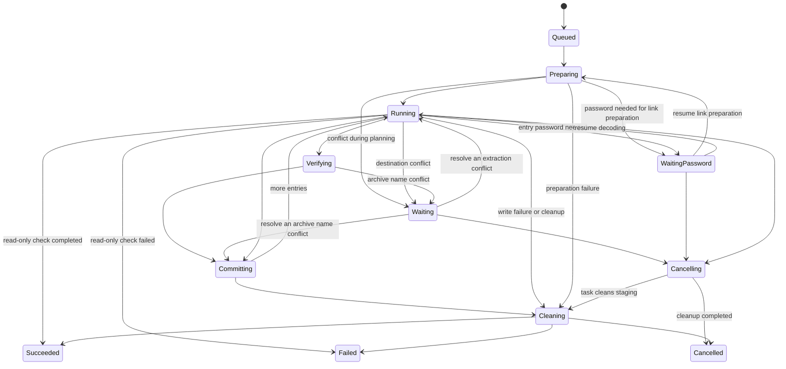

# Agendamento, progresso e cancelamento de tarefas

[English](../../design/task-scheduling.md) | [简体中文](../../zh-CN/design/task-scheduling.md) | [繁體中文](../../zh-TW/design/task-scheduling.md) | [日本語](../../ja-JP/design/task-scheduling.md) | [한국어](../../ko-KR/design/task-scheduling.md) | [Français](../../fr-FR/design/task-scheduling.md) | [Deutsch](../../de-DE/design/task-scheduling.md) | [Español](../../es-ES/design/task-scheduling.md) | Português (Brasil) | [Русский](../../ru-RU/design/task-scheduling.md)

XDZip usa uma thread Rust de comandos e uma de tarefas por conexão de runtime. A thread de comandos possui o arquivo compactado atual e prepara entradas de tarefas. A thread de tarefas executa trabalhos aceitos enquanto a de comandos continua atendendo solicitações de metadados. A [arquitetura do sistema](system-architecture.md) explica onde as threads são executadas e a [ponte Qt/Rust](qt-rust-bridge.md) como os resultados chegam ao cliente.

## Admissão e propriedade das tarefas

| Camada | Comportamento atual |
| --- | --- |
| Controlador de desktop | `BrowserController::attemptSubmission` serializa operações pesadas entre controladores no processo de desktop, incluindo preparação e limpeza. Um controlador aguardando admissão mantém comando limitado e pode cancelar a espera. A navegação de metadados usa o caminho comum de comandos. |
| Thread de comandos do runtime | Valida a solicitação e forma um trabalho. Extração, verificação e edição mantêm a fonte e metadados ou seleção pertinentes. Criação recebe opções limitadas e varre a árvore de entrada na thread de tarefas. Pré-verificação de metadados ou destino não cria tarefa pesada. |
| Fila de tarefas do runtime | Executa extração, abertura temporária, criação, verificações, edições e exportações conforme necessário, um trabalho por vez em ordem de fila na conexão. Cada serviço pode manter até 32 tarefas, com orçamento agregado de 64 MiB para trabalhos retidos. O orçamento cobre entradas retidas e espaço reservado para segredos. Decodificação, indexação, processos e recursos de saída têm limites separados. Saturação é informada como `task_busy`. |
| CLI independente | Usa as mesmas regras Rust em seu próprio processo de comandos. Processos CLI independentes têm filas separadas, assim como o desktop. Autorização segura de saída e verificações de conflito continuam valendo para cada processo. |

`TaskAccepted` identifica um trabalho admitido. O `Finished` da solicitação comum encerra essa solicitação. O trabalho pode continuar produzindo instantâneos `TaskUpdate` com o ID original para correlação e o ID da tarefa para controle. A entrada de tarefa da aplicação mantém o controlador responsável mesmo após fechar a aba, para atribuir solicitações de resposta e resultados à conexão correta. [Fonte da fila](https://github.com/xiaodaozhi/xdzip/blob/main/crates/xdzip-runtime/src/service/tasks.rs), [Admissão e roteamento no desktop](https://github.com/xiaodaozhi/xdzip/blob/main/apps/desktop/BrowserController.cpp), [Sessões de desktop](../../engineering/application-sessions.md)

## Estados e progresso informado

O diagrama mostra caminhos representativos. Uma tarefa pode pular ou repetir fases conforme a operação. Uma verificação somente para leitura pode terminar sem confirmação. Uma tarefa de criação ou edição normalmente verifica o arquivo preparado antes da publicação; a extração pode confirmar repetidamente.

| Estado do runtime | O que o cliente recebe |
| --- | --- |
| `queued`, `preparing` | Um trabalho está na fila ou prepara fontes autorizadas, acesso ao destino e estado de formato. O total ainda pode ser desconhecido. |
| `running`, `verifying` | Conteúdo está sendo lido, codificado, decodificado ou verificado. `verifying` também descreve releitura do arquivo preparado. A verificação não aumenta contagens confirmadas. |
| `waiting`, `waiting_password` | A tarefa aguarda sua resposta atual de conflito ou senha. |
| `committing` | A tarefa obteve permissão para publicar arquivo, arquivo compactado ou conjunto de volumes. |
| `cancelling`, `cleaning` | O cancelamento foi solicitado ou objetos privados estão sendo fechados e liberados. Um instantâneo pode pular estado transitório porque o progresso é agrupado. |
| `succeeded`, `failed`, `cancelled` | A execução comum terminou. O instantâneo final contém o resultado real, incluindo confirmações anteriores e avisos de limpeza. |

`total_known` distingue total desconhecido de zero. O instantâneo separa bytes lidos, decodificados, gravados, verificados e confirmados. Trabalho em bloco sólido ou decodificação repetida pode aumentar o trabalho sem publicar mais arquivos. A criação conta arquivos e bytes de entrada como confirmados apenas após publicar o arquivo compactado. Seu `written_bytes` mede escritas de saída, que podem incluir regravações de cabeçalho. A fila limita atualizações comuns `running`, `verifying` e `committing` a uma por 100 ms e mantém apenas o último instantâneo pendente por tarefa. Solicitações de resposta, cancelamento, limpeza e resultados terminais não sofrem essa limitação. Detalhes de resultado são limitados a 128 registros, com uma contagem de omitidos. [Códigos de estado e campos do instantâneo](https://github.com/xiaodaozhi/xdzip/blob/main/crates/xdzip-runtime/src/extraction/mod.rs)

## Espera por uma decisão

- Um conflito de nome pode esperar decisão explícita quando a política é perguntar. Solicitação de senha usa espaço de resposta separado e de uso único. ID da tarefa, ID e tipo de solicitação devem corresponder à espera atual. Respostas a solicitações antigas ou já respondidas são rejeitadas.
- A espera mantém o estado limitado do trabalho e seu espaço na fila. A tarefa aguarda em variável de condição que libera o mutex de resposta durante a espera. Decisão ou cancelamento a desperta sem depender de espaço na fila comum. O trabalho aguardando ainda ocupa a thread de tarefas; a thread de comandos separada pode continuar atendendo à navegação.
- O caminho de senha usa segredos locais à tarefa. Falhas de senha que podem ser tentadas novamente são limitadas por entrada e o trabalho já realizado conta nos orçamentos. Falhas explícitas de integridade interrompem a operação. Volume ausente, cota rígida esgotada ou fonte alterada são informados pelo caminho de erro apropriado. Esperar entrada é diferente de uma pausa controlada pelo usuário. [Interação de senha](../engineering/password-extraction.md), [Regras de recursos e arquivos](file-security.md)

## Cancelamento e limite de confirmação

`cancel` solicita cancelamento de uma solicitação comum. Quando existe uma tarefa, `cancel_task` atua na própria tarefa. Esses controles confirmam o recebimento do pedido de parada. O chamador descobre o resultado pela conclusão da solicitação correspondente ou pelo instantâneo terminal. Cancelamento cooperativo não tem prazo fixo de conclusão, especialmente quando uma chamada de sistema do host está bloqueada. O processo de arquivo compactado tem supervisão separada. [Controles da ponte](qt-rust-bridge.md), [Supervisão do processo de arquivo](../engineering/native-codecs.md)

| Quando chega o cancelamento | Efeito |
| --- | --- |
| Antes de `begin_commit()` vencer a barreira | A publicação atual não começa. A tarefa descarta ou limpa a preparação não publicada e mantém recibos anteriores. |
| Durante a publicação de uma extração ou promessa de arquivo | A chamada de publicação pode terminar. Se o arquivo foi publicado, a tarefa o registra. O cancelamento pode interromper trabalho posterior e o instantâneo terminal pode ser `cancelled` com contagens confirmadas diferentes de zero. |
| Durante a publicação final do arquivo compactado | Criação e modificação preservam o resultado bem-sucedido após a publicação do arquivo único verificado ou do conjunto completo de volumes. Na criação dividida, a rotina de confirmação pode precisar reverter seu próprio conjunto parcialmente publicado. Falha na reversão pode definir `outcome_uncertain`. |
| Após fixar o resultado final | Cancelamento tardio não pode transformar uma confirmação bem-sucedida em resultado cancelado. |

A barreira controla quando o cancelamento da tarefa pode impedir a publicação. Autorização de saída e validação da preparação continuam necessárias. Uma gravação autorizada pode falhar e retornar seu erro real do sistema de arquivos. [Barreira de cancelamento](https://github.com/xiaodaozhi/xdzip/blob/main/crates/xdzip-runtime/src/extraction/control.rs), [Publicação de arquivos](file-security.md)

## Falha, fechamento de aba e saída

Ignorar aplica-se a decisões de conflito suportadas. Um erro de decodificação, recursos, fonte ou segurança de destino pode parar o trabalho. Arquivos já publicados permanecem registrados e erro de limpeza pode acompanhar publicação bem-sucedida. Falha inesperada do processo ou panic de tarefa que permite desenrolar a pilha pode produzir resultado de falha ou incerto. O caminho de panic informa `task_abandoned` e coloca o runtime afetado em falha. Ausência de resposta terminal após saída do processo não estabelece o que chegou ao disco.

Fechar janela de progresso ou aba do arquivo é ação de apresentação. Trabalhos aceitos e resultados continuam disponíveis pela entrada de tarefas da aplicação. Fechar uma solicitação ativa de senha pode cancelar sua tarefa. Saída explícita trata o trabalho ativo, interrompe admissão quando começa o encerramento, desperta esperas e continua retirando eventos. O receptor espera as threads Rust antes de produzir `ShutdownReady`. Qt termina de retirar eventos e espera o receptor terminar sem bloqueio de espera na thread da interface. Uma transferência nativa externa também pode precisar terminar. [Ciclo de vida do runtime](../engineering/product-runtime.md), [Transferências de arquivos compactados](../../engineering/archive-transfers.md)
