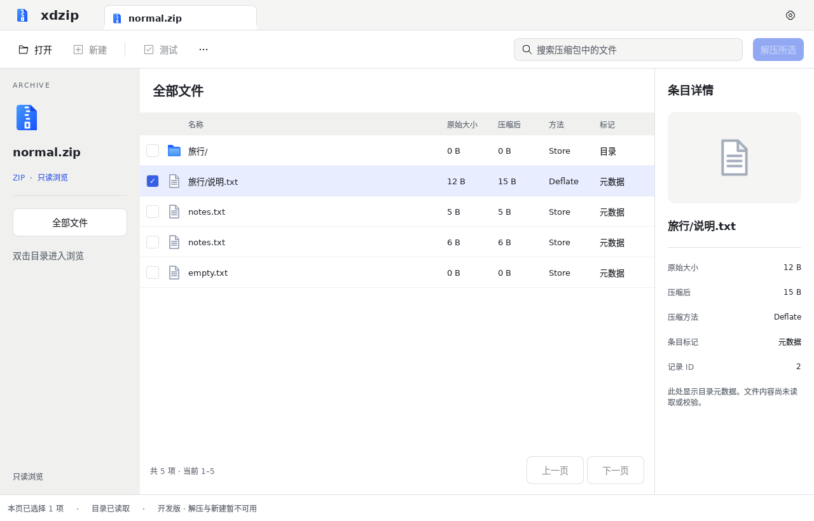
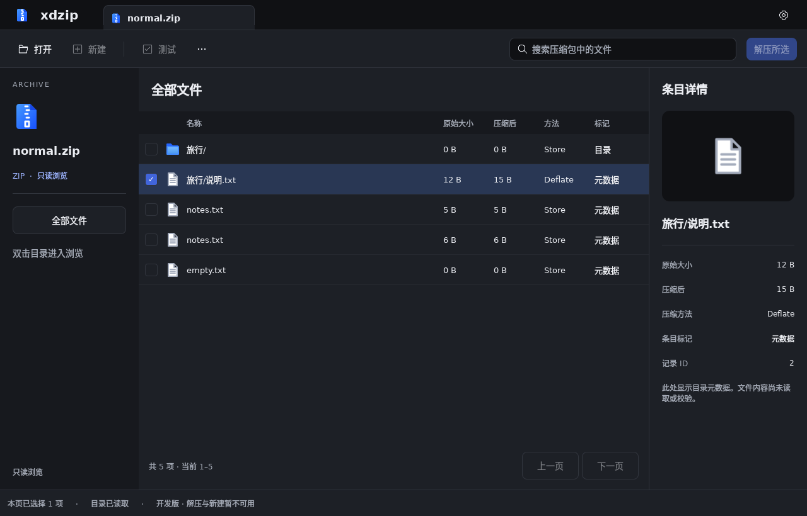

# 主窗口顶部结构修正

基线：`design/hifi/v1/screens/main-light.png` 的品牌/标签上行与独立工具栏下行；逻辑尺寸采用 `docs/visual/tokens.json`。生成式图片不是逐像素布局规范。

后续工具栏按钮比例与禁用样式修正见[工具栏复核](toolbar-review.md)；本页保留历史截图和参数。

## 已实现

- `ArchiveTabs`：48 px 常规高度，品牌、当前真实归档名称、外观菜单。单会话阶段只显示当前标签；不伪造第二个归档、关闭标签或新增会话操作。
- `ArchiveToolbar`：左侧打开、新建、测试及更多菜单；右侧搜索与解压主操作。图标采用既有 v1 素材，18 px 容器，按主题切换。
- 普通工具按钮与搜索框均为 36 px；工具栏上下各 12 px。大字号时按最高控件统一行高，避免字体撑出按钮或控件中心错位。
- 正文及搜索使用 14 px 并随字号倍率缩放；品牌使用面板标题字号。初始窗口改为 1280 × 820。
- 搜索回车提交，Esc 清空并恢复无文本过滤；打开操作仍进入真实选择归档流程。元数据预检位于“更多”菜单。
- macOS Cocoa 适配使用 `NSWindowStyleMaskFullSizeContentView`、透明原生标题栏和隐藏系统标题。标题区域预留 96 px 原生按钮空间，保留 AppKit 原生按钮、缩放、全屏与窗口管理。仅主浏览窗口应用该适配，独立操作窗口维持原生标题栏。
- Windows/Linux 保留系统窗口装饰；内容区共用标签栏与工具栏。未使用 Qt 6.9 才新增的扩展客户区 API。

## 实际渲染

下面是 Qt 6.8.2 在 Linux、offscreen/software、DPR 1 下的未编辑截图。系统窗口边框与 macOS 交通灯不在这些截图中。

## 验证和边界

本地 CTest 六组通过。新增顶部组件检查涵盖正常及 200% 字号的控件中心对齐、内容容纳、空间不重叠，以及真实打开信号、搜索提交和 Esc 恢复。全量截图采集与差异报告生成正常；原有审计证据保留在 `visual-audit/`，不覆盖历史截图。

macOS 开发 app 的 Cocoa 启停 smoke 检查新增“标题栏适配确实启用”断言。原生按钮的外观、最新 macOS Retina 渲染、全屏切换后布局和原生窗口拖动仍需目标设备验证；offscreen 截图不能替代这些证据。

这一改动修正顶部结构，不代表完整高保真验收通过。多归档标签切换与关闭需要会话管理；新建、CRC 测试和实际解压仍未实现，入口保持禁用，解压范围下拉尚未接入。目录树、详情面板尺寸、列表及 200% 字号下其他区域的既有差异仍见[严格复核报告](visual-audit-review.md)。未绘制假的原生交通灯，也不使用假进度或假成功状态。
