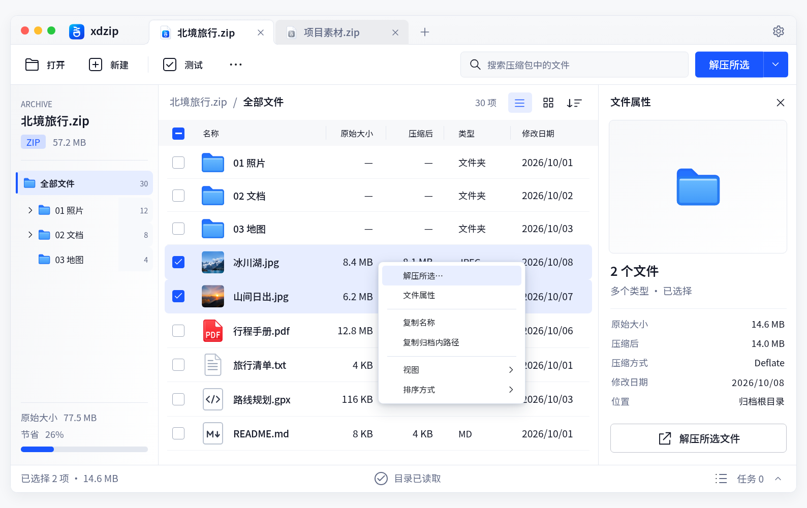
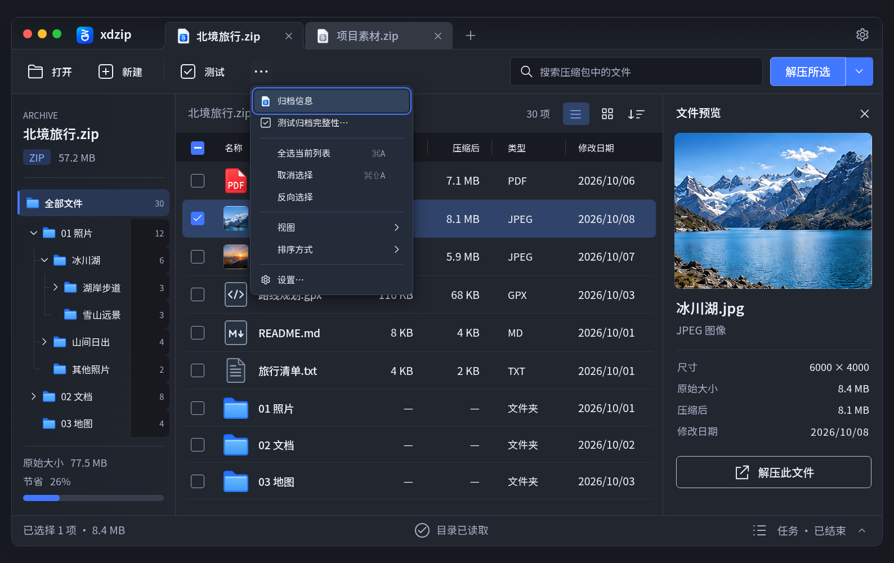
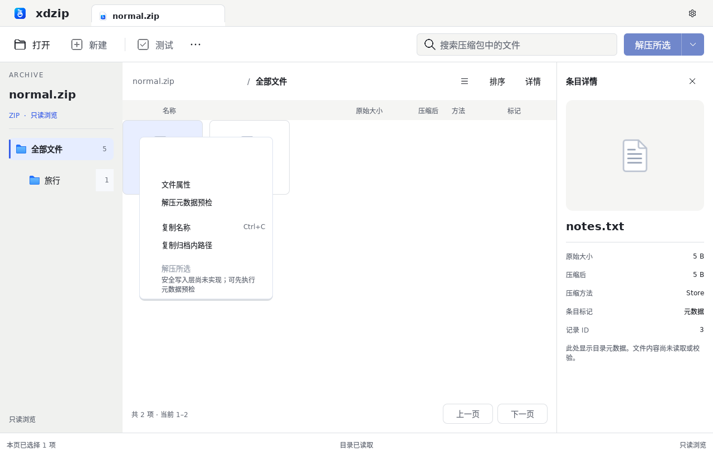

# 主窗口组件与交互复核

复核日期：2026-10-13。交付包含[功能与组件清单](../ux/main-window-components.md)、[共享控件参数](../visual/controls.json)、[可操作组件页](../../design/html/components.html)和主窗口实际消费者。新增菜单不是独立画一张样式图：组件页和主窗口调用同一份菜单、图标、定位和输入实现。

## 功能覆盖

| 区域 | HTML 设计交付 | Qt 真实只读浏览 |
| --- | --- | --- |
| 标签 | 两个不同示例归档；切换、关闭、关闭其他 / 右侧、恢复；路径 / 查询 / 排序 / 选择 / 树展开隔离 | 一个真实会话；标签菜单沿用独立窗口约束，多会话运行时尚未接入 |
| 工具栏 | 打开两个示例、新建流程、演示完整性任务、更多、解压范围 | 系统打开、元数据预检、选择 / 详情 / 主题；新建、写入、CRC 禁用并说明原因 |
| 搜索 | 当前目录与后代、输入法组合、清除按钮、Esc、快捷键 | 受限后台查询，Enter 提交、清除与 Esc、会话变化清空，不在组合输入中自行提交 |
| 目录树 | 递归示例、真实子目录箭头、连接线、固定数字、独立焦点、隐藏当前圆点、目录菜单 | 完整真实索引派生相同核心控件；收起祖先不提交查询，物理总数不随搜索变化 |
| 路径 / 视图 | 分级面包屑、列表 / 网格、所有显示字段排序、归档顺序 | 可返回祖先的共享面包屑；深层中段菜单；列表 / 网格共用受限模型；后台全结果排序 |
| 选择 | 单选、Ctrl/⌘ 多选、Shift 范围、全选 / 清除 / 反选、方向键与 Space | 稳定 ID 锚点、范围、上下文选择、当前最多 128 项全选 / 清除；查询或翻页后重置 |
| 右键 | 文件 / 目录、空白、表头、标签；Shift+F10 / 菜单键、触屏长按 | 条目、目录、空白、表头；菜单键 / Shift+F10；按真实能力启用 |
| 复制 | 剪贴板可用时实际复制；受限时提供已选择的文本 | 实际系统剪贴板；名称去除目录尾分隔符，路径保留展示形式 |
| 预览 / 任务 | 示例照片与属性、详情开关；任务隐藏、再打开、显式取消 | 实际条目属性与元数据预检窗口；图像解码、真实压缩 / 解压 / CRC 不在当前能力内 |

两种消费者都使用共享素材。菜单包含图标 / 勾选槽、名称、快捷键、子菜单箭头、分隔线和禁用原因；按钮具备悬停、按下、焦点、禁用状态。HTML 的示例进度不能当作真实归档处理结果，Qt 的只读动作也不能冒充写入。

## 实际验证

- `check-html-controls.py`：22 组离线实际输入检查通过。涵盖菜单首尾定位、子菜单往返、选择保持与替换、复制回退、范围选择、视图与排序、会话隔离、树收起与面包屑、输入法、任务取消、提示、Tab、触屏长按、三平台装饰和浅深主题；320 / 390 宽度没有水平溢出，菜单在视口边缘翻向。
- Qt 6.8.2 / Linux x86_64 / software / offscreen：五组 CTest 通过。新增共享菜单用例覆盖键盘、禁用项、子菜单返回、1× / 2× 字号和浅深色；真实 ZIP 用例覆盖上下文选择、范围锚点、复制目录名称、当前目录全量、菜单查询失效、实际网格和祖先收起圆点。
- 初始 HTML 延续顶部与内容区域锚点检查。目录树 B 是明确的组件设计修订：40 行高、20 文件夹槽、18 箭头槽与 16 缩进从逻辑坐标映射；原主稿比较与旧目标保留，未通过修改原图或放宽误差隐藏变化。
- 菜单参数检查同时验证 CSS RGBA 到 QColor ARGB 的透明度转换；共享提示保持原始纯文本，菜单聚焦时隐藏。
- 原有十幅页面、45 张参考切片和三张照片共 58 个文件保持原始 SHA-256。新控件不重新绘制这些已确认图片。

行为报告和实际图片存放在[证据目录](main-window-components/)。完整离线文件为 `dist/xdzip-hifi-design.html` 与 `dist/xdzip-components.html`；组件页使用 1:1 逻辑像素，主窗口当前通过已声明的 1024 / 1548 转换显示；菜单保持正常逻辑尺寸，侧栏约 193.16，Qt 取整为 193。当前尺寸和比例以[正常密度验收](ui-density/README.md)为准；本页保留组件行为的覆盖记录。

## 证据边界

浏览器装饰检查没有证明 Cocoa / Windows 原生窗口、GPU、IME 或读屏在目标设备上通过。Qt 本地证据是 Linux 离屏运行；各原生主机的同提交检查由 CI 单独记录。完整辅助功能、运行中跟随系统主题、拖放、多任务调度、正式多归档运行时和资源受限预览仍按后续工作包推进。

目录树的专用边界信息 / 警告 / 读取图标和骨架仍是已准备的设计资源，不能把资源登记当作实际消费者。原主稿与当前目录树修订的差异保持可见，字体轮廓差异也不以结构检查通过改写为像素一致。

2026-10-13 交互样式进一步同步到当前 Qt：树行取消计数和四边焦点描边，查看控件为固定 28 方形，任务入口先显示上展开菜单。当前规范与实际缩放证据以[HTML／Qt 同步验收](html-qt-interaction-sync.md)为准。
