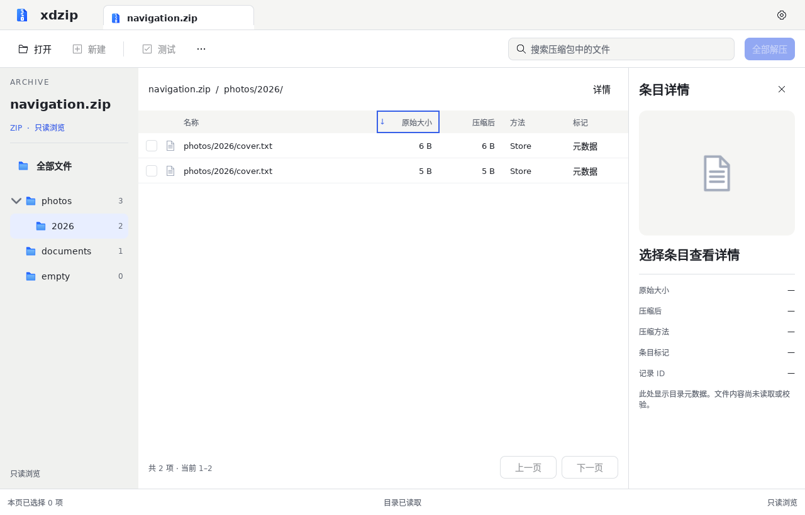

# 目录导航与全结果排序验收

在已修正的主窗口基础上补齐真实目录树和排序交互。实现继续采用 Qt Quick、薄 C++ 控制器和 Rust 快照，不新增依赖。该增量属于 WP-05/06，不表示完整 M2 已完成。

## 可使用的行为

- 侧栏显示整个归档的显式和隐式目录，支持展开、收起和进入子目录；右侧数字为该目录全部后代物理记录数，包含重复记录，不受当前搜索词影响。
- 点击名称、原始大小、压缩后、类型或修改日期列头切换升降序；键盘 Enter/Space 也可激活。排序覆盖当前目录和搜索条件的全部结果，128 条仅作为内部传输批次，界面一次提交完整结果。最新修订见[主窗口交互验收](qt-interaction-fixes.md)。
- 更多菜单的“按归档顺序排列”恢复物理顺序。目录切换、搜索、排序重新从第一页开始，并在成功替换页面时清空本页选择和详情。
- 超过目录节点、名称或层级预算时显示明确提示，保留列表浏览与搜索；不发布半棵目录树。

目录 ID、排序比较和资源预算见[实现契约](../engineering/readonly-browser.md)，事件传输见[运行时契约](../engineering/m1-runtime.md)。名称排序为区分大小写的字典序；“方法”按 ZIP 方法编号比较。当前仍仅浏览元数据，没有压缩、解压或文件内容预览。

## 实际界面

截图采自 Qt 6.8.2 的真实应用窗口，使用自建 navigation.zip。其中 photos 和 2026 都没有显式目录记录，由 Rust 完整索引生成；同名文件按大小降序排列。截图不含操作系统窗口装饰，列头蓝框表示键盘焦点。

产品源版本：`7a30dcb`（含方向键导航与焦点修正）。

[54 项量化检查](navigation-sorting/measurements.md)与[原始数据和哈希](navigation-sorting/measurements.json)保留可复核证据。

## 本地验证

环境：Debian 13 x86_64、Qt 6.8.2、offscreen/software、DPR 1。

- Rust 工作区测试、Clippy 严格检查、rustfmt、手写 C++ 格式检查和 QML 静态检查通过。
- CTest 六组通过，浏览测试套件另连续运行 10 次通过；真实浏览回归包含 QAbstractItemModelTester、树展开与点击、方向键切换目录并按 Enter 激活、键盘列头排序、跨页保持排序、超限降级和空归档重置。
- Rust 测试覆盖重复名称稳定次序、超过 JavaScript 精度的整数比较、隐式父节点、危险后代、独立节点/字节/深度限额、取消及会话失效；验证目录索引仅随 Open 发布，Browse 不重复复制。
- 视觉检查共 54 项：保留既有 46 项，并加入树行高、缩进、同层文字对齐、图标大小、图文间距、文字/图标垂直居中及计数可见性。54 项本地通过，不能解释为完整设计还原率。

截图复核发现树委托继承的单侧内边距使图文比箭头低 6 逻辑像素；现统一上下内边距为零，使用行中心对齐，并由新增检查防止回退。浅层树列宽同时收紧，避免计数落在视口外。

## 三平台验证与开发包

[Qt CI 38170595572](https://github.com/xiaodaozhi/xdzip/actions/runs/38170595572) 对 `0889323` 的三平台构建、CTest、浏览套件连续 10 次回归、视觉检查与打包全部通过。该提交包含产品代码 `7a30dcb`，其后的提交仅记录验收证据。Rust/桥接 [Foundation CI](https://github.com/xiaodaozhi/xdzip/actions/runs/38170595597) 与 [Documentation CI](https://github.com/xiaodaozhi/xdzip/actions/runs/38170595558) 同样通过。

| 实测环境（Qt 6.8.2，offscreen/software，DPR 1） | 量化通过 | 测得差异 | 待验证 |
| --- | --- | --- | --- |
| Ubuntu 24.04.5 x86_64 | 54 | 0 | 0 |
| macOS Sonoma 14.8 ARM64 | 54 | 0 | 0 |
| Windows Server 2022 x86_64 | 47 | 0 | 7 项字体解析 |

[原始三平台数值](navigation-sorting/native-ci-summary.json)逐项记录实测结果。Windows 的 7 项字体解析仍标为未验证，不计作通过。

[Apple Silicon 开发包](https://github.com/xiaodaozhi/xdzip/actions/runs/38170595572/artifacts/11713374142)包含真实浏览应用，采用 ad-hoc 签名、未公证；需要仓库访问权限，CI 产物保留 14 天。macOS Cocoa 与 Windows 部署后原生应用启停检查通过。最新 macOS / M1 的 Retina、GPU、原生标题栏、全屏与字体仍需实机验收；offscreen 截图不能替代这些证据。

## 未完成范围

归档读取仍限 10,000 条，完整查询代际和来源版本协议尚未落地；多归档标签、受限内容预览、安全解压及创建仍待后续开发。目录计数不是文件系统输出统计，元数据可浏览也不表示内容通过 CRC 或安全检查。
