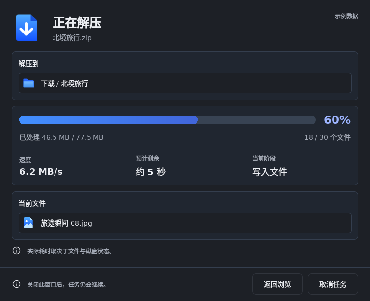

# 任务窗口视觉对照与修订

2026-10-11，基于 [03 任务进度高保真稿](../../design/hifi/screens/progress.png) 修订 Qt 开发预览。

## 实际截图

以下为 Qt 6.8.2 / Linux / software / offscreen 内容区域截图，直接保存测试输出，无合成、调色或补绘标题栏。数据来自明确标识的示例，吞吐和时间不代表实测性能。

[200% 字号上部](screenshots/task-progress-large-type.png)，[滚动到底部](screenshots/task-progress-large-type-bottom.png)。

## 本次修订

| 原有偏差 | 当前实现 |
| --- | --- |
| 路径仅为文字 | 目录、当前文件均有外层卡片、白色内层容器和交付图标 |
| 缺少统计结构 | 已处理容量、文件计数；速度、预计剩余、当前阶段三列及分隔线 |
| 灰色卡片、单色进度 | 新增任务语义色 token，淡蓝灰卡片、细边框、水平渐变进度 |
| 底栏上下分行 | 正常字号时提示与按钮同行；大字号自动分行 |
| 标题与间距比例不协调 | 调整标题、主图标、卡片内边距与区块间距，正常字号完整可见 |
| 测试文件名干扰截图 | 截图采用设计示例文件名，富文本注入字符串仍由独立测试覆盖 |

关闭与取消语义保持分离。未知总量隐藏百分比、已知总量数字与剩余时间，不显示虚构完成长度。提示行复用同一组件，并在浅色、深色、200% 字号下比较窗口坐标中的图标中心与文字起点。

## 仍有的差异与限制

- 原稿为生成式图片，字体形状、图标细节和尺寸并非可直接提取的原生控件参数；当前不声明像素级还原或数值化相似率。
- 图标使用已交付的透明重建 PNG，尤其主图标的形状、阴影与原稿仍有差异。界面文字使用系统字体。
- 任务窗口内容当前为 760×620 逻辑像素，受屏幕可用高度限制；大字号采用滚动和重排，原稿仅展示默认字号。
- 系统标题栏交给 Qt/平台绘制，截图不包含窗口装饰与阴影；macOS M1 最新系统上的交通灯、字体和窗口外观仍待实机确认。
- 示例标识有意保留；组件尚未连接真实任务和归档引擎。本次视觉改动不代表压缩/解压功能完成。

## 验证

QML 静态检查、token 生成一致性、本地 CTest 4/4 通过。组件测试增加普通底栏同行/完整可见、未知总量无填充/无总量数字、文件名纯文本显示；保留关闭不取消、重开、图标可加载、提示行对齐和大字号实际点击测试。截图由 `tst_taskwindow.qml` 保存，复现见 [组件指南](../../apps/desktop/README.md)。远端状态以 main 的 Qt components 工作流为准。

素材目录于 2026-10-12 合并；本文原稿链接指向当前位置。历史截图、测量数值及 JSON 输入记录保持原样，旧路径可通过[迁移清单](../../design/assets/migration.json)或当时 Git 提交追溯。
