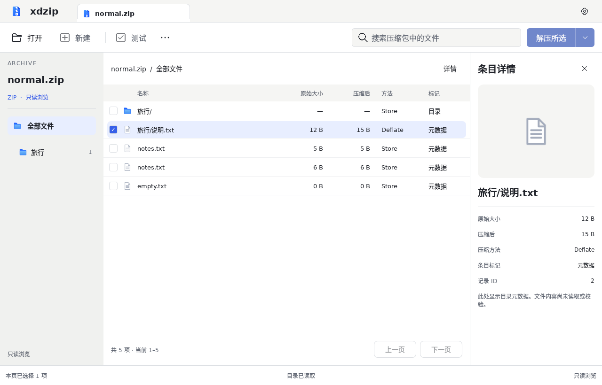

# 工具栏按钮对照修正

基线为 [v1 主窗口原稿](../../design/hifi/v1/screens/main-light.png)。本次只修正工具栏按钮的比例、样式和布局，不表示整张主界面已经还原。

## 修正内容

此前将普通控件参数套到工具栏：18 像素图标画布使可见图形与描边过小，14 字号和紧密排列削弱了原稿的按钮比例；禁用文字与背景分别降低透明度，使主按钮发白。解压按钮还缺少原稿的分隔线和下拉箭头。

现采用 24 图标画布、16 字号、40 控件高度与 6 圆角。图标仍引用既有 v1 素材，不新增另一套图标。普通操作的图文间距为 10；左侧操作成组排列，搜索与解压间距为 12。搜索与按钮共用行高，图标和文字按行中心对齐。

禁用按钮文字直接使用次要文字色，主按钮保持不透明文字和独立禁用背景；移除整组反复降透明度的处理。解压入口补回禁用的分段外观，尚无实际解压或下拉范围操作。原稿显示可用状态，因此当前禁用色不会与原稿的亮蓝完全相同。

参数依据见[视觉规范修订](../visual/README.md)。原稿为生成式图片，等比边界是近似测量；字体渲染及图标重建与原稿仍可能有细微差别。

## 实际截图

截图环境为 Linux、Qt 6.8.2、offscreen/software；macOS 原生标题栏不在本次截图验证范围内。

[深色实际窗口](toolbar-review/browser-dark.png) · [1040 宽、200% 字号实际窗口](toolbar-review/browser-large-minimum.png)

对照[修正前实际窗口](navigation-sorting/browser-light.png)，查看顶部操作行。截图来自 Qt 实际运行窗口，不含原生窗口装饰。

## 验证

本地 QML 静态检查、Theme 生成一致性与 CTest 六组通过。工具栏组件回归检查正常字号与 200% 字号下的图文居中、统一行高、主操作右边界、禁用状态，以及打开和搜索操作；1040 宽窗口不再挤出右侧操作。既有视觉回归继续通过，这些检查不等于原稿还原率。

代码 `0359852` 的 [三平台 CI](https://github.com/xiaodaozhi/xdzip/actions/runs/38196524314) 均通过（macos-14、windows-2022、ubuntu-24.04）。本页是布局修正记录；其后图标轮廓复核见[素材修正记录](asset-review.md)。
