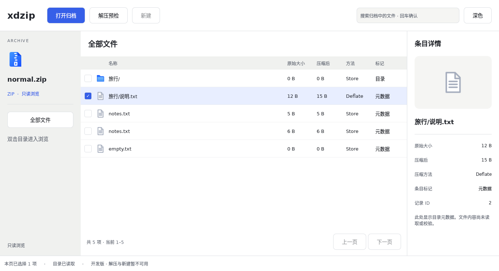
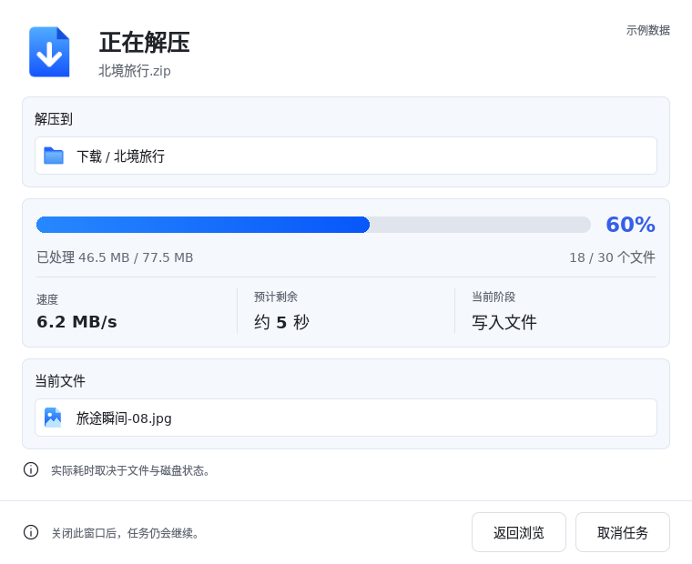
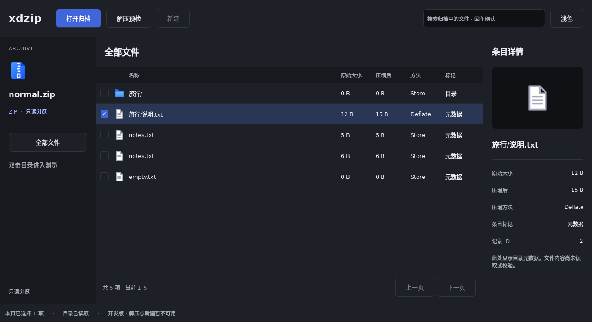
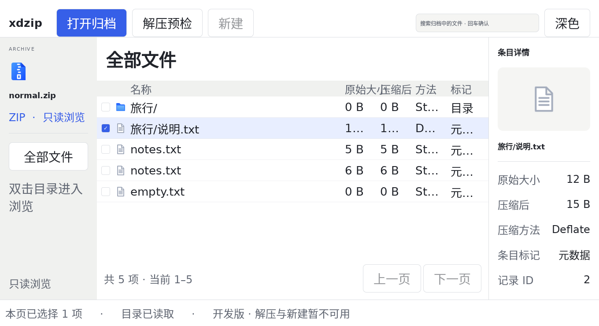

# 高保真设计与实际 Qt 实现严格复核

日期：2026-10-11。被审计产品提交：`64bf2feb4fb8b8c135c3a633da285868d5e4d438`。结论：**视觉一致性验收不通过，存在结构、尺寸、排版和主题差异。** 本轮增加采集与审计材料，没有修改产品界面，也没有将差异改成新的设计基线。

M1 的运行时、构建与生命周期通过，不代表高保真还原通过。此前测试覆盖功能、提示行和任务窗局部布局，没有覆盖主窗口尺寸规范、全部字体缩放和跨控件基线；本轮发现了这些盲区。

## 证据与判定方法

- 主窗口采用较新的 [v1 主稿](../../design/assets/v1/sources/main-light.png)，任务窗采用 [v2 进度稿](../../design/hifi/v2/screens/03-progress.png)。旧 docs/visual 图片为视觉方向参考，不能和新版混作同一个像素基线。
- 参数以 [tokens.json](../visual/tokens.json) 和 [视觉说明](../visual/README.md) 为当前实现建议。它们仍标记 proposed，部分比例与生成图不相同；本报告明确区分“相对现有参数的偏差”和“相对图片的视觉差异”，不悄悄择优判定。
- 实际应用：Linux x86_64、Qt 6.8.2、offscreen/software、DPR=1。测试读取自建 normal.zip，内容是真实 ZIP 元数据；任务窗口仍为明确标记的示例。中文走系统字体回退，QFontInfo 主字体为 DejaVu Sans，不能据此断言所有中文字形使用该字体。
- 采集每个 Qt 可视项的窗口坐标、大小、文字、实际解析字号、字重、基线、颜色与图标路径；11 组原始截图及坐标见 [证据目录](visual-audit/measurements.json)。PNG 是直接 grabWindow 输出，未合成或补绘。
- 几何对齐允许 0.5 逻辑像素误差；明确的尺寸、字号和颜色参数按值比较。原图测量边界有约 ±2 原始像素误差，不能从生成图推导精确字体字号。不计算 SSIM 或“还原率”：两边的数据、字体、窗口装饰和功能状态并不完全相同。
- [34 项量化检查](visual-audit/measurements.md)中，17 项符合、17 项存在差异。这不是 50% 的视觉还原率，且不包含下述全部结构和功能缺口。

## 1. 主窗口：尺寸与密度

单位均为 Qt 逻辑像素，非 Retina 物理像素。

| 项目 | 当前参数建议 | 实际 | 偏差 / 影响 |
| --- | --- | --- | --- |
| 初始窗口 | 1280×820 | 1360×740 | 宽 +80、高 −80；整体更扁 |
| 最小窗口 | 1040×680 | 1160×600 | 宽 +120、高 −80；不符合窄窗策略 |
| 左侧栏 | 220 | 220 | 符合 |
| 右详情栏 | 280 | 250 | −30，内容区域变窄 |
| 表格行高 | 40 | 48 | +8 / +20%，密度降低 |
| 常规按钮高 | 36 | 44 | +8 / +22.2%，不是声明 36 就等于渲染 36 |
| 搜索框高 | 36 | 42 | +6；与相邻按钮上下边缘各差 1 |
| 表格正文 | 13 | 13 | 符合 |
| 按钮正文 | 14 | 14 | 符合 |
| 详情面板标题 | 20 | 18 | −2，未复用 panelTitle token |
| 列表图标容器 | 建议 18 网格 | 24×24 | +6；透明边距意味着可见墨迹不等于容器大小 |

AppButton 使用 `max(36, contentItem.implicitHeight + 12×2)`，本机中文内容高度为 20，因此真实按钮为 44。搜索框则硬编码 42；两者中心在 y=42 对齐，但边框顶边为 20/21，底边为 64/63。若要求统一工具栏控件边界，此处不通过。

主窗口页边距多为 20，任务窗口为 24；此外存在 10、14、18、20、22 等硬编码间距，没有全面沿用 4/8/12/16/24/32 网格。不是所有非网格值都必然错误，但目前没有组件级例外规范。上一页与下一页之间使用 RowLayout 默认 5 像素间距，任务底部按钮间距为 10，工具栏为 12，交互层级相近的按钮组未统一。



[1280×820 内容布局](visual-audit/browser-1280.png) · [当前最小窗口 1160×600](visual-audit/browser-minimum.png)。另有 [强制 1040×680 探测](visual-audit/browser-request-1040.png)：offscreen 程序调用 resize 可绕过窗口管理器约束，不能据此宣称原生最小宽度已经支持 1040。此宽度下详情栏仍保留，没有实现 <1160 自动收起。

## 2. 主窗口：对齐、图标与结构

| 项目 | 结果 | 证据 / 影响 |
| --- | --- | --- |
| 名称表头与文件名起点 | 通过 | 均 x=296；表头自身 x=220 加 leftPadding=76 |
| 列表复选框、图标垂直居中 | 通过当前样本 | 第一行中心 y=214，图标 24×24 与行中心一致 |
| 大小列数字对齐 | 不符合数字列视觉方向 | 两列均左对齐；12 B 与 5 B 的右边缘相差 8，不按数字/单位右边缘对齐 |
| 同行中文字与西文基线 | 有轻微差异 | 第一行“旅行/”与“0 B”的基线分别为 219.5、218.5；来自按框居中及字体回退 |
| 类型图标 | 未还原 | 所有非目录条目均使用 file-text；已交付的 PDF、代码、Markdown 等图标未按类型使用 |
| 选中行 | 未还原 | 原图为左右留白、圆角选中底；实际单元格背景拼成贯穿表格宽度的直角色带 |
| 顶部结构 | 缺失 | 原稿的归档标签栏、工具图标、右侧解压主操作和下拉均未实现；实际突出“打开归档” |
| 目录导航 | 缺失 | 设计为目录树、计数和选中态；实际仅归档摘要与“全部文件”按钮 |
| 表格结构 | 部分实现 | 修改日期、排序、列表/网格切换、可调列宽未接入；已有列为名称、大小、压缩后、方法、标记 |
| 详情区 | 部分实现 | 属性可以替代后续图片预览，但关闭/重开、宽度拖动、单文件解压入口未实现 |

原图较新的主窗口详情区约占内容宽度 25%，当前为 250/1360≈18.4%；即使只看视觉比例也明显更窄。不过原图比例与 280/1280≈21.9% 的参数建议本身不完全相同，不能同时声称两者已逐像素满足。

这些功能缺口属于后续里程碑，不要求伪造不可用的解压行为；但它们真实影响视觉结构，必须计入“尚未达到完整设计稿”的结论。

## 3. 任务窗口：两行提示通过，三列统计仍偏移

| 项目 | 实测结果 |
| --- | --- |
| 两行提示图标容器 | 都为 x=24、20×20，中心 X=34 |
| 两行提示文字 | 都从 x=56 开始，图文间距 12 |
| 浅色、深色、200% 字号 | 两行图标中心 X 与文字起点 X 差均为 0 |
| 三列统计标题 | “速度”y=320；“预计剩余”“当前阶段”y=317，差 3 |
| 三列统计数值 | 顶边 y=343/340/340；基线 360/361/361，差 1 |
| 正常字号底部 | 提示与按钮中心同为 y=585，符合同行要求 |
| 进度 | 填充宽 365.4 / 轨道宽 609 = 60%，数值正确 |

三列 TaskMetric 的内容高度因中文/西文字体度量不同，GridLayout 默认垂直居中，使列标题随各列总高移动；现有测试未检查这组对齐。应统一列顶边并独立统一数值基线，而不是移动某个字符串几个像素。



原图内容范围约为 `(85,114)—(1361,1036)`，排除系统标题栏和外部阴影后宽 1276；按宽度等比缩到实际 760，倍率 0.5956。保持纵横比，不把设计图强行拉伸为当前窗口：

| 项目 | 设计图等宽参考估计 | 实际 | 说明 |
| --- | --- | --- | --- |
| 内容高度 | 549.2 | 620 | 实际更高约 70.8 |
| 第一张路径卡片 Y | 98.3 | 106 | 下移约 7.7 |
| 第一张路径卡片高度 | 89.3 | 100 | 高约 10.7 |
| 进度卡片高度 | 157.8 | 164 | 高约 6.2 |
| 当前文件卡片高度 | 87.0 | 100 | 高约 13.0 |
| 底部区域分隔线 Y | 493.8 | 550 | 下移约 56.2，属于累积垂直节奏差异 |

以上只是原图的近似比例测量，误差约 ±1.2 逻辑像素/边界，两个边界推导的长度误差可更大，不是新的冻结参数。卡片标题粗细、主图标折角/阴影和正文质感仍不同；图标来自透明重建候选，不能标记为原图无损还原。

## 4. 深色主题与字号放大

- 主要文字、辅助文字、主按钮的两主题 token 对比度分别达到 15.73/5.60/5.30 和 14.06/6.84/5.11，均高于 4.5；仅证明这些颜色对，不能代表所有 hover、focus、禁用和选中状态通过。
- 深色详情背景应使用 `#20232A`，实际为 `#1D2026`。Theme 生成器没有暴露 inspector 颜色，详情栏直接用了 surface。
- file-text、archive、folder、image-file 和 document-download 资源固定绑定 light PNG；仅 info 图标随深浅切换。深色截图仍出现浅色文档底，未使用已经交付的 dark 版本。
- 控件圆角 8 与参数一致，详情占位卡片为 12；任务路径/统计卡片用 8，需按卡片语义统一，不宜把 controlRadius 用到所有面板。
- 主窗口搜索依赖默认 9 pt，本环境解析为 12 px；打开按钮为显式 14 px。字号策略不统一，平台默认变化还会放大差异。



**200% 主窗口检查不通过：**

- 按钮文字按 14→28 放大，但“条目详情”和归档名仍为 18，搜索仍为 12，品牌仍为 25。
- 表头字号 12→24，但高度仍为 36，大小列宽仍为 80；“原始大小”内容宽 96，扣除左内边距后仅剩 66，越过本列，出现表头重叠。
- 数据字号 13→26，列内容宽仍为 56，12 B/Deflate 等显示省略；图标、行高没有跟随重排。
- 工具栏仍高 84，按钮增至 64，底边抵达工具栏分界；下方留白消失。



任务窗的 200% 采用单列与滚动，提示行仍对齐、底部动作可达；这项局部测试通过不能推广到整个应用。[任务窗上部](visual-audit/task-large-type.png) · [滚动后底部](visual-audit/task-large-type-bottom.png)。本次 fontScale 测试不是 macOS 系统缩放、Retina DPR=2 或系统辅助功能设置的替代测试。

## 5. 操作窗口和覆盖范围

当前 [解压预检实际窗口](visual-audit/preflight-light.png)是只读检查报告，**不是** [独立解压确认设计](../../design/assets/v1/sources/extract-macos.png)的实现。缺少目标选择、范围、冲突策略、完成后动作和提交入口，不能以“都是弹窗”作等价对照。

新建、重名冲突、部分失败、设置、成功/停止/取消结果、创建覆盖确认等 v2 状态也没有完整可操作实现，应登记为“未实现”，不是“已还原且暂时没有数据”。任务窗是示例组件，没有接入真实解压任务。

操作窗口使用独立 QQuickWindow、transientParent 和非模态 Qt.Window，未绘制仿 macOS 交通灯；这符合架构方向。实际 macOS 原生标题栏按钮间距、SF/PingFang 回退、Retina 像素、阴影、焦点及 Windows/Linux 桌面装饰，本环境不能测量，保留为未验证。CI 原生启动通过也不能替代这些视觉检查。

## 6. 修复优先级与复核退出条件

1. **P1 可读性与一致性：**修复主窗口 200% 重叠/截断及不缩放文字；把任务三列按顶边和基线对齐；统一数字列对齐。复核默认/最小窗口、两主题、正常/200% 字号。
2. **P2 尺寸系统：**统一初始/最小窗口、侧栏/详情宽度、行高、按钮/搜索高度、字体和间距 token；尺寸需要自适应时明确组件规则，不能只修改常量满足截图。
3. **P2 图标与主题：**接入深色资源、类型图标、详情背景和选中行形状，复核真实图标墨迹与点击区域。
4. **后续功能布局：**按 M2/M3 接入标签、目录树、查询/排序和真实解压流程，再验收整套主窗口与操作窗口。未实现的流程不贴假控件冒充完成。

修复后重新采集同一组 JSON/PNG，逐项关闭差异；跨平台字体度量引起的变化按实际坐标验证，不写字符串专用偏移。macOS 最新系统与 DPR=2 桌面复核仍是最终视觉验收的一部分。

## 复现

在 Qt 开发环境构建后，从 build/ui/apps/desktop 运行：

```sh
XDZIP_VISUAL_AUDIT=/absolute/path/to/xdzip/.cache/visual-audit ./xdzip-browser-tests renderRealArchive
```

仓库根目录执行 `python3 scripts/build-visual-audit.py`，输出原始坐标、截图、SHA-256 与量化检查表。采集开关默认关闭，不改变普通测试或产品行为。Linux 无显示服务时设置 QT_QPA_PLATFORM=offscreen、QT_QUICK_BACKEND=software；其他平台按实际运行环境记录，不能覆盖本报告的 Linux 证据而保留旧环境标签。

执行 `python3 scripts/export-visual-audit-html.py` 可生成 dist/xdzip-visual-audit.html，依赖 pandoc 与 lxml。所有图片内嵌，手机可离线阅读；坐标附件链接指向 GitHub，需要仓库访问权限。

本轮完整 CTest 6/6 通过，采集用例 3/3 通过；它们证明采集和功能测试可运行，**不改变视觉一致性不通过的结论**。
