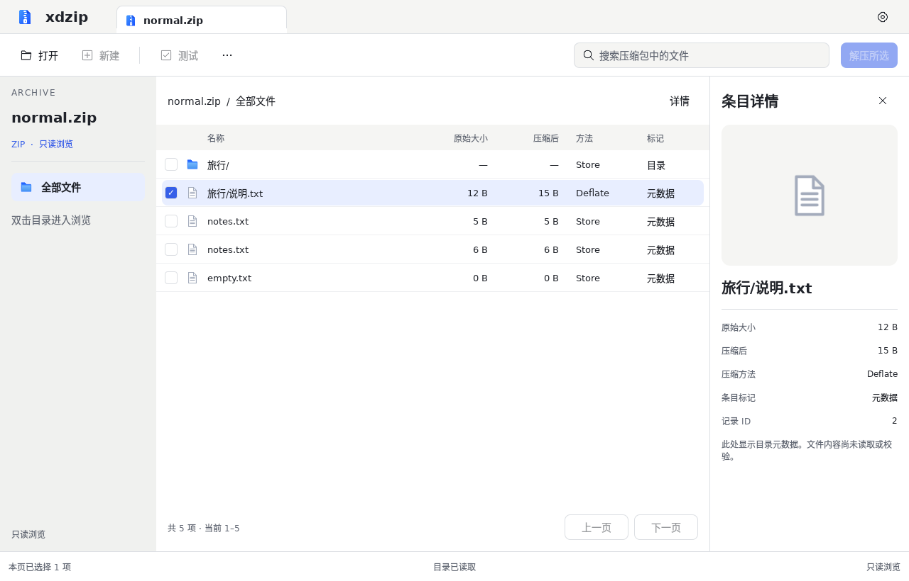
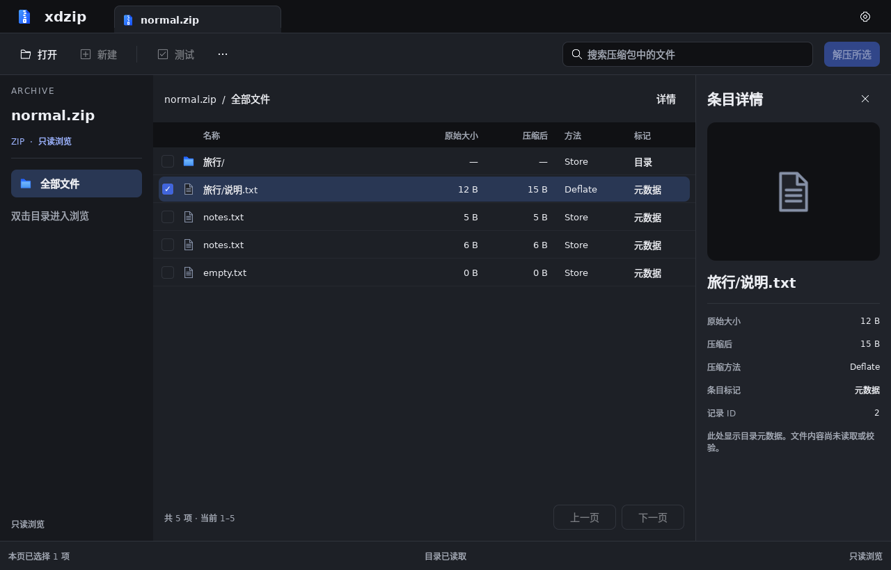
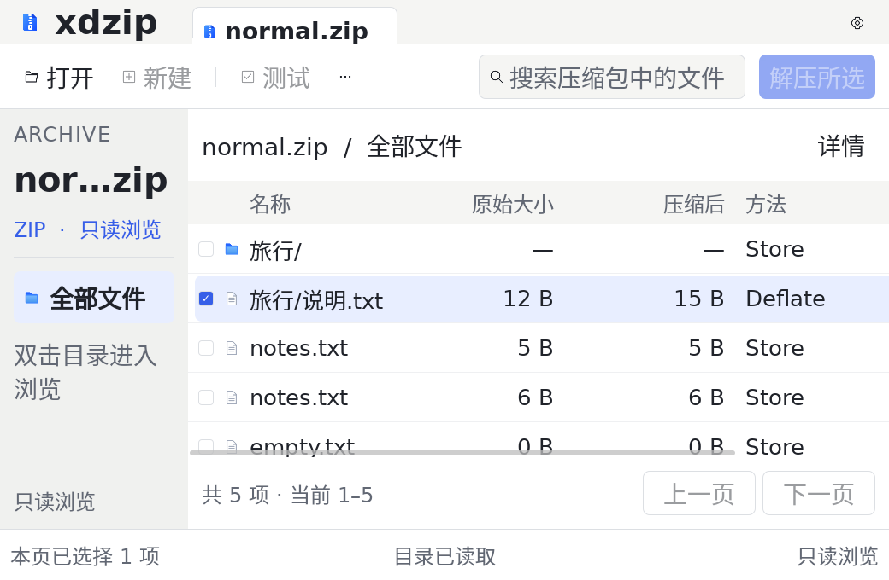
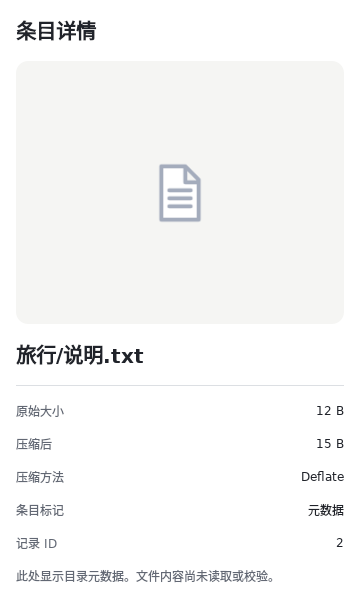
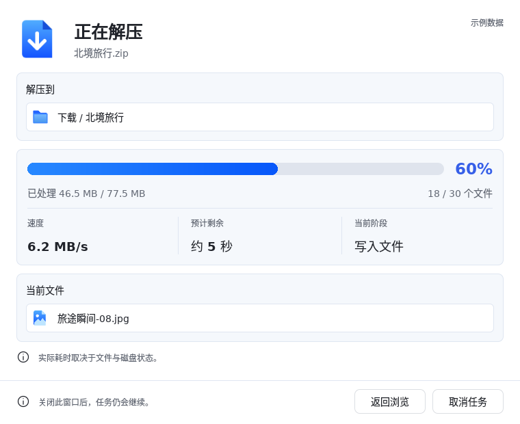

# 视觉复核与修正：布局、排版、主题

本轮对照已确认的 [v1 主窗口](../../design/assets/v1/sources/main-light.png)、[v2 任务窗口](../../design/hifi/v2/screens/03-progress.png)与[逻辑尺寸规范](../visual/tokens.json)，修正现有 Qt 界面的可量化差异。产品 UI 源版本为 `90a9b72`；采集工具补充最小窗口与 200% 字号组合。历史证据不覆盖，先前状态见[顶部修正](header-review.md)及[初次严格复核](visual-audit-review.md)。

**结论：本地 46 项量化检查通过，完整设计还原仍未完成。** 这些检查覆盖已有组件的几何、字号、对齐、主题与响应式行为，不是“视觉还原率”，也不代替尚未实现的功能页面验收。

## 修正前后

实测环境为 Linux / Qt 6.8.2 / offscreen / software / DPR 1，单位为 Qt 逻辑像素。字体使用平台字体，不承诺不同系统字形逐像素相同。

| 项目 | 修正前 | 当前 |
| --- | --- | --- |
| 最小窗口 | 1160 × 600 | 1040 × 680 |
| 列表行高 | 48 | 40；大字号随字体增高 |
| 详情栏宽度 | 250 | 280 |
| 详情标题、侧栏归档名 | 18，部分不随字号倍率变化 | 20，随倍率缩放 |
| 列表图标容器 | 24 | 18 |
| 通用按钮（含分页） | 本地 44 | 普通字号 36；大字号自动增高 |
| 数字列 | 左对齐 | 数字与对应表头右对齐，目录显示破折号 |
| 200% 表头、数字 | 列标题重叠、数值省略 | 列宽随字号增长；横向滚动访问超出视口的列 |
| 深色详情背景 | #1D2026 | #20232A，来自 Theme token |
| 文件类型图标 | 通用浅色文本图标 | 文本、代码、Markdown、PDF、图片、目录按扩展名及主题区分 |
| 选中行 | 全宽直角 | 左右内缩的连续圆角背景 |
| 面板间距 | 混用 20 / 22 | 面板内边距与主间距统一为 16 |
| 任务三列标题顶部差 | 本地 3 | 0 |
| 任务三列数值基线差 | 本地 1 | 0 |

顶部按钮和搜索框继续共用整数行高。普通工具栏 36 px 控件与 14 px 字号保持既有修正；新增检查会阻止中心对齐回退。任务提示图标中心和文字起点仍保持精确对齐。

## 布局与交互

- 侧栏移除设计中没有的大号独立归档图标，恢复“归档名称—格式—导航”层级；全部文件入口采用图标、文字和选中背景。
- 面包屑回归紧凑文字，底部状态栏拆为选择、目录状态、只读能力说明三段；不填入假的任务数或统计大小。
- 详情栏支持关闭和重新打开。宽度小于 1160 时默认收起；“详情”打开真正的非模态独立窗口，主窗口宽度不变，符合平台独立窗口规则。两处复用 `InspectorPanel` 和同一真实条目数据，关闭窗口不会清空选择。
- 独立详情窗口使用系统标题栏，Esc 可关闭；内容中隐藏重复的关闭图标。主浏览窗口关闭时同时关闭详情窗口。
- 表头与表格共用列宽，并同步横向滚动。内容宽于视口时横向滚动条常显，避免大字号下操作不可发现。
- 详情属性在大字号下转为上下排列，通过纵向滚动访问；文件名按普通文本显示，长名可换行。
- 扩展名只决定图标，不代表已经读取或验证文件内容。详情图形仍是类型占位，不使用设计稿照片冒充真实预览。

## 当前实际截图

以下均来自 Qt `grabWindow()`，没有重新绘制、拉伸或替换界面元素。截图不含操作系统窗口装饰。

### 浅色

### 深色

### 200% 字号、最小窗口

### 独立详情窗口

### 任务组件

## 验证方法与证据

[检查表](visual-refinement/measurements.md)与[原始测量及哈希](visual-refinement/measurements.json)保存实际坐标、字体解析结果、主题颜色、截图 SHA-256 和源文件哈希。源码与 PNG/JSON 分开保存，可以重新执行采集并追溯变化。

本地 CTest 六组、QML 静态检查、Theme 生成一致性与文档链接检查通过。新增交互回归覆盖详情关闭/重新打开、窄窗口独立窗口、窗口所有者、非模态属性及选择保留。截图覆盖浅色、深色、常规尺寸、最小尺寸、200% 字号和独立详情窗。

三平台 CI 使用 `--fail-on-differences` 阻止已纳入检查的量化差异回退。无法解析的字体（例如某些 Windows offscreen 字体后端返回 -1）标为“待验证”，不伪报为通过或负数字号；该限制仍需原生字体后端解决。生成式高保真稿未作为全屏像素黄金图，图片阴影、示例数据或照片也不作为自动测试预期。

## 尚存差异与边界

| 类别 | 当前差异 | 验收边界 |
| --- | --- | --- |
| 多归档会话 | 只有当前真实标签，无多标签切换/关闭 | 需要会话及各标签视图状态管理 |
| 目录树 | 仍为归档范围导航与表格目录进入 | 需要完整目录索引和树模型，不能用当前页假装完整目录树 |
| 文件预览 | 属性及类型图标，无照片/文本内容预览 | 需要受限读取、异步解码和资源预算 |
| 表格功能 | 列仍为实际提供的大小、方法、标记；无日期、全索引排序、列拖动 | 需要模型和查询能力支持，不能填充示例日期 |
| 解压、新建、CRC、任务 | 功能未实现，主入口保持禁用；任务窗仍是示例组件 | 需要后续实际任务与文件写出实现 |
| 面板调节 | 详情宽度固定 280，无拖动调宽与记忆 | 本轮实现默认尺寸、收起及独立查看 |
| 任务整体比例 | 任务窗仍为 760 × 620；与生成稿归一化比例存在差别 | 修正文字对齐，不宣称窗口整体像素一致 |
| 平台原生外观 | macOS 标题栏融合沿用已有适配 | 最新 macOS、Retina DPR 2、GPU、全屏和拖动需实机验收 |

图片与尺寸 token 有冲突时，本轮按明确的逻辑尺寸实现，图片用于结构、层级和视觉方向。未将剩余功能差异隐藏，也未把已通过的测量项目等同于完整视觉验收。
