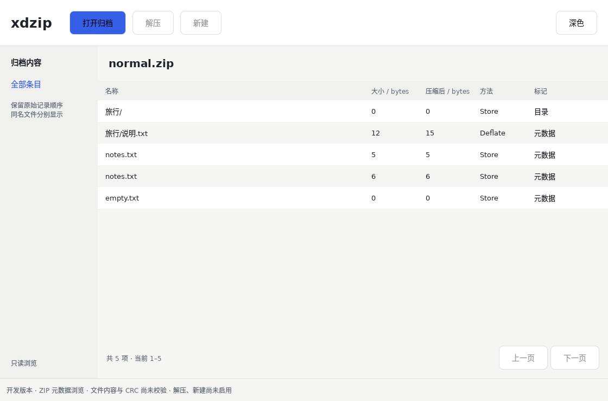

# ZIP 只读浏览验证

日期：2026-10-11。Linux x86_64、Rust 1.99.0、Qt 6.8.2、GCC 14.2，Qt offscreen 软件渲染。不是 Apple M1 实机或完整产品验收。

这是实际 Qt 窗口读取仓库自建 normal.zip 后的截图，两个 notes.txt 是不同物理记录；不是生成式设计图或静态示例列表。系统标题栏不包含在离屏内容截图中。

## 已验证

- cargo test --workspace --locked：16 个单元测试和 1 个编译失败文档测试通过。
- cargo clippy --workspace --all-targets --locked -- -D warnings、Rust/C++ 格式和 QML 静态检查通过。
- CTest 6/6 通过：既有桥接/窗口/组件测试，以及真实 ZIP 浏览和主窗口加载。
- ZIP 用例覆盖中文、重复名称、有效空归档、截断/数量不匹配、四类读取限额、危险名称转义、分卷记录拒绝、加密标志与旧编码字节、扫描前和读取中取消。
- Rust 分页验证 270 条记录的边界、跨页 ID、会话隔离和源文件字节不变；Qt 验证 128/14 条页面、中文源文件路径、失败清空列表和异步关闭。

## 与视觉基线的差异

沿用主题、按钮和独立原生窗口。当前真实浏览窗口先落实有界数据链，尚未完成高保真主稿中的目录树、选中态、完整工具栏、类型图标和细致列布局；文件大小暂显示精确字节值。任务详情组件保留此前高保真对照实现，但尚未绑定真实解压任务。不可据此宣称主窗口达到视觉验收。

## 未完成

macOS M1 原生窗口、焦点/辅助功能和打包验证，Windows/Linux 原生桌面验证，大归档性能与独立安全审查均待完成。没有解压、压缩、CRC 验证或可分发安装包。完整限制见[实现契约](../engineering/readonly-browser.md)。
