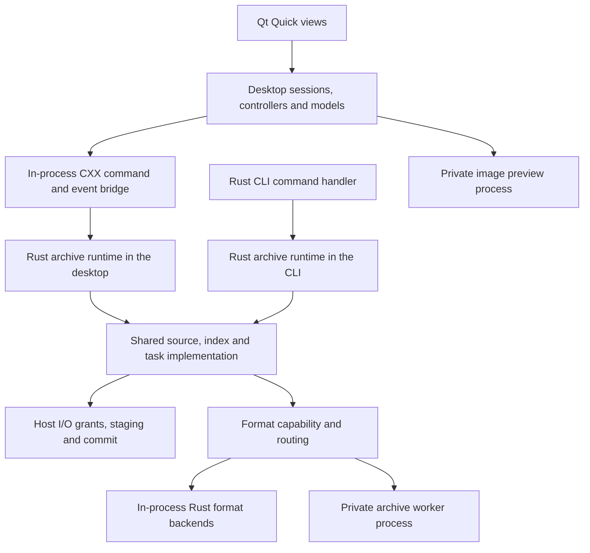
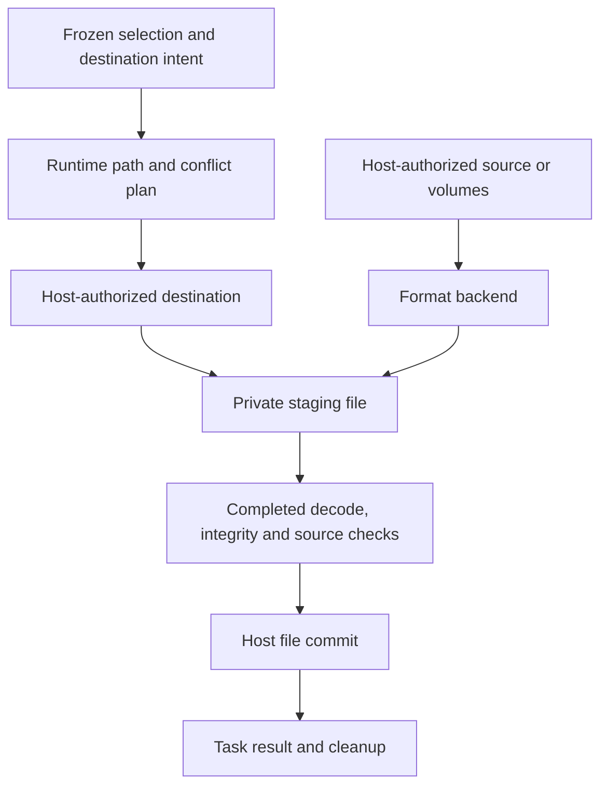

# Архитектура системы XDZip

[English](../../design/system-architecture.md) | [简体中文](../../zh-CN/design/system-architecture.md) | [繁體中文](../../zh-TW/design/system-architecture.md) | [日本語](../../ja-JP/design/system-architecture.md) | [한국어](../../ko-KR/design/system-architecture.md) | [Français](../../fr-FR/design/system-architecture.md) | [Deutsch](../../de-DE/design/system-architecture.md) | [Español](../../es-ES/design/system-architecture.md) | [Português (Brasil)](../../pt-BR/design/system-architecture.md) | Русский

Настольный клиент и клиент командной строки используют общую среду обработки архивов на Rust. Она превращает выбранный источник в индексированный сеанс, а операцию — в задачу с ограничениями ресурсов. Обработчики форматов интерпретируют данные архива. Хост разрешает доступ к файлам, управляет размещением выходных данных и публикует проверенные результаты.

## Общая схема

Два блока среды выполнения обозначают отдельные экземпляры одной реализации. Настольное приложение и CLI независимо владеют состоянием архивов и задачами. Локальный IPC настольного приложения пересылает запросы запуска и интеграции основному экземпляру GUI. Команды архивов проходят через среду выполнения внутри процесса. [Сеансы приложения](../engineering/application-sessions.md), [контракт CLI](../engineering/command-line.md).

## Обязанности модулей и направление вызовов

| Модуль | Зона ответственности и вызываемые компоненты |
| --- | --- |
| Точка входа настольного приложения и Qt Quick | `xdzip-browser`, собираемый как исполняемый файл `xdzip`, начинается в `browser_main.cpp` и загружает `Browser.qml`. `SessionPage.qml` и его представления показывают списки, выбор, диалоги и состояние задач. Они передают намерения пользователя контроллерам C++. [Точка входа](https://github.com/xiaodaozhi/xdzip/blob/main/apps/desktop/browser_main.cpp), [интерфейс QML](qt-quick-ui.md). |
| Настольные адаптеры C++ | `ApplicationSessions` координирует вкладки, окна и общий пункт доступа к задачам. `BrowserController` владеет моделью списка и состоянием запросов своего сеанса, преобразует действия интерфейса в типизированные команды и возвращает интерфейсу прогресс, ошибки и запросы. `RuntimeConnection` владеет дескрипторами моста и доставкой событий. Настройки, трей, файловые ассоциации, системное перетаскивание и интеграция с оболочкой находятся в настольных адаптерах. [Координатор сеансов](https://github.com/xiaodaozhi/xdzip/blob/main/apps/desktop/ApplicationSessions.cpp), [контроллер](https://github.com/xiaodaozhi/xdzip/blob/main/apps/desktop/BrowserController.cpp). |
| `xdzip-qt-bridge` | Скомпонованная граница CXX преобразует команды C++, строки, снимки задач и ошибки в типы Rust и обратно. Она оборачивает `Client` и `Receiver` среды выполнения в отдельно принадлежащие вызывающей стороне дескрипторы команд и событий. [Исходный код моста](https://github.com/xiaodaozhi/xdzip/blob/main/crates/xdzip-qt-bridge/src/lib.rs), [контракт моста](qt-rust-bridge.md). |
| `xdzip-cli` | Разбирает аргументы, обрабатывает запросы в терминале и отмену, напрямую вызывает `xdzip-runtime` и преобразует события в текст или JSON и коды выхода. Команды архивов используют те же правила источников и задач, что и настольное приложение. У команд установки и обновления отдельные пути входа. [Адаптер CLI](https://github.com/xiaodaozhi/xdzip/blob/main/crates/xdzip-cli/src/runtime.rs), [интеграция CLI](../integration/README.md). |
| `xdzip-runtime` | Владеет текущим `Archive` каждого экземпляра службы. `source` определяет тома и отслеживает версии источника. `formats` распознаёт и направляет форматы. `index`, `navigation`, `query`, `listing` и `disk_index` строят метаданные и выполняют запросы к ним. Служба проверяет команды и ставит в очередь задачи `extraction`, `creation`, `updating`, `checking` и `exporting`. `preview` выполняет ограниченное чтение для представления свойств. [Модули среды выполнения](https://github.com/xiaodaozhi/xdzip/blob/main/crates/xdzip-runtime/src/lib.rs), [среда выполнения продукта](../engineering/product-runtime.md). |
| `xdzip-domain`, `xdzip-codec-api` и `xdzip-extract-plan` | Модель предметной области задаёт идентификаторы, метаданные и инварианты путей. API кодеков определяет возможности форматов и контракты, такие как `ReadSource`, `PayloadCodec`, `DecodedSink`, `EncodeInput` и `EncodeOutput`. Планировщик извлечения строит отчёт по метаданным и выбору. Разрешение назначения остаётся за хостом. [Модель и данные](domain-data.md), [интерфейс кодека](https://github.com/xiaodaozhi/xdzip/blob/main/crates/xdzip-codec-api/src/lib.rs), [предварительная проверка извлечения](../engineering/extraction-preflight.md). |
| `xdzip-codec-*`, `xdzip-compression` и `xdzip-crypto` | Пакеты кодеков реализуют структуру контейнеров, сканирование метаданных, чтение содержимого и доступные для каждого формата операции записи. Пакеты сжатия и криптографии предоставляют повторно используемые алгоритмы. Интерфейсы кодеков используют потоки и приёмники, предоставленные хостом. Реестр возможностей описывает доступные операции, а маршрутизация среды выполнения проверяет конкретный архив и его записи. [Маршрутизация](https://github.com/xiaodaozhi/xdzip/blob/main/crates/xdzip-runtime/src/formats.rs), [реестр форматов](../engineering/format-registry.md). |
| `xdzip-io` | Открывает обычные входные файлы, устанавливает идентичность системных файловых объектов, фиксирует разрешённые входы создания и предоставляет разрешения назначения, временное размещение и фиксацию. На файловой границе выполняет платформенные проверки, а среда выполнения решает, какую операцию и когда публиковать. [Разрешение входов](https://github.com/xiaodaozhi/xdzip/blob/main/crates/xdzip-io/src/input.rs), [разрешения и фиксация выходов](https://github.com/xiaodaozhi/xdzip/blob/main/crates/xdzip-io/src/target.rs), [безопасность файлов](file-security.md). |
| Обновление и инструменты разработки | `UpdateController` и `xdzip-update` обрабатывают выбор, проверку и передачу обновления. Установленные сборки используют платформенные пути установки. У хоста SDK и пробников форматов отдельные точки входа. Продукт обнаруживает архивы с помощью встроенного реестра. [Обновления](../../engineering/software-update.md), [пробное использование SDK](../engineering/sdk-trial.md), [структура репозитория и модулей](../engineering/repository-layout.md). |

## Запросы и жизненный цикл настольного приложения

1. **Вход и маршрутизация.** Обычный запуск, файловые ассоциации и запросы оболочки поступают в настольное приложение. `SingleInstance` выбирает основной экземпляр для одного пользователя и сеанса входа. Основной экземпляр обрабатывает пересланные запросы и открывает или повторно использует подходящий сеанс просмотра либо операции. Автономная команда архива CLI запускает собственную службу Rust. Прилагаемая CLI может передать запрос обновления настольного приложения в GUI по локальному каналу.
2. **Приём команды.** Контроллер просмотра использует собственный `RuntimeConnection`. GUI отправляет типизированную команду и получает результат приёма и идентификатор запроса. Ограниченные повторные попытки в цикле событий обрабатывают временную конкуренцию при приёме. Архивный ввод-вывод выполняется вне потока GUI.
3. **Выполнение и доставка.** У каждой службы есть поток команд Rust для текущего архива, запросов метаданных и подготовки задач и отдельный поток задач Rust с ограниченной очередью, выполняющий по одной тяжёлой задаче. Дополнительное правило приёма настольного приложения сериализует тяжёлые операции между контроллерами. На стороне Qt поток приёма переносит события Rust в ограниченный почтовый ящик потока GUI. Контроллер сопоставляет идентификаторы запроса и сеанса и проверяет поколение и ревизию запроса при применении страниц. CLI отправляет команды и получает события в собственном процессе.
4. **Владение задачами.** Приём и прогресс отделены от итогового снимка задачи. Поток задач владеет зафиксированными входами работы. Пароли, решения о конфликтах и отмена передаются задаче-владельцу. Управление использует идентификаторы задачи и запроса к пользователю. Числовой ID задачи принадлежит её соединению со средой выполнения. Отмена и завершение не ожидают места в обычной очереди команд. Закрытие вкладки удаляет её представление просмотра, но принятые задачи могут продолжаться, а результаты остаются доступны через общий пункт задач. Явный выход из приложения прекращает приём, обрабатывает завершающие события и ожидает остановки рабочих процессов.

[Служба событий среды выполнения](https://github.com/xiaodaozhi/xdzip/blob/main/crates/xdzip-runtime/src/service.rs), [очередь задач](https://github.com/xiaodaozhi/xdzip/blob/main/crates/xdzip-runtime/src/service/tasks.rs), [доставка событий Qt](https://github.com/xiaodaozhi/xdzip/blob/main/apps/desktop/RuntimeConnection.cpp), [планирование задач](task-scheduling.md).

## Границы процессов и платформы

| Граница выполнения | Данные и обязанности |
| --- | --- |
| Основной процесс настольного приложения | GUI Qt, адаптеры C++, мост CXX и потоки среды Rust разделяют адресное пространство. Хост владеет открытыми сеансами архивов и системными разрешениями файлов. Последующие запуски могут переслать запросы по локальному IPC в области пользователя и завершиться. |
| Процесс команды CLI | Обработчик CLI вызывает ту же среду Rust как библиотеку в своём процессе. Запуск упакованной CLI или передача обновления могут включать отдельные процессы. Состояние архивов и результаты задач принадлежат собственной службе команды. |
| Рабочий процесс архивных форматов | Среда выполнения направляет чтение 7z, RAR, CAB и ISO/UDF через `xdzip-codec-native`. Она запускает прилагаемый `xdzip-native-codec` и обменивается ограниченными кадрами через stdin/stdout. Тонкий слой протокола C++ рабочего процесса вызывает обработчики Rust через `xdzip-codec-bridge`. Хост обслуживает разрешённое чтение диапазонов или томов и проверяет выходные кадры. Для записи 7z он принимает ограниченные записи по смещению в частную временную область. Пути архивов и назначения остаются у хоста. При сбое или отмене рабочего процесса операция завершается, а незавершённая временная область удаляется. Эта граница ограничивает сбои и использование ресурсов. Протокол не предоставляет полномочий файловой системы; процесс работает без песочницы разрешений ядра. |
| Рабочий процесс предпросмотра изображений | После чтения и проверки подходящей записи архива средствами Rust настольное приложение отправляет ограниченный объём закодированных байтов изображения в `xdzip-image-preview`. Рабочий процесс возвращает ограниченную миниатюру RGBA. Запрос не содержит пути архива, пароля или дескриптора назначения. Поставщик предпросмотра публикует результат только для соответствующего текущего запроса. Текстовый предпросмотр обрабатывается в среде Rust. |
| Передача платформе | Настольные адаптеры координируют запуск из файлового менеджера, открытие частной извлечённой копии во внешнем приложении и установку обновлений. Вспомогательные программы обновления или Sparkle на macOS выполняют собственную передачу установки. Обновления Store следуют каналу платформы. Рабочий процесс форматов эти запросы не обрабатывает. |

[Протокол рабочего процесса архива](../engineering/native-codecs.md), [контракт предпросмотра](../engineering/content-preview.md), [платформенная интеграция](../../engineering/installers-associations.md), [перенос записей](../../engineering/archive-transfers.md), [передача обновления](../../engineering/software-update.md).

## Открытие и просмотр архива

1. **Разрешение источника.** `Archive::open_with_password` просит `Source::open` открыть обычный файл через `xdzip-io` и определить поддерживаемый набор разделённых томов. Хост записывает идентичность, размер и метки времени каждой принятой части. Кодеки получают вход с возможностью перемещения и, когда применимо, предоставленные хостом метаданные томов.
2. **Распознавание формата и сканирование.** Среда выполнения исследует содержимое и проверяет соответствующую структуру контейнера. Имена и расширения могут помогать при поиске томов или разрешении конкретной неоднозначности. Выбранный обработчик сканирует данные в пределах своих ресурсов. Для защищённого паролем каталога пароль может потребоваться до завершения сканирования. При сбое или неполном сканировании частичный сеанс архива не публикуется.
3. **Создание снимка сеанса.** Среда выполнения отделяет физические ID записей от имён и созданных для навигации папок. Поэтому записи с одинаковыми именами остаются независимо адресуемыми. Обычный однофайловый ZIP/ZIP64 при превышении лимита памяти может потоково записывать метаданные в частный дисковый индекс. Расширенная ёмкость просмотра имеет ограничения, отличные от ограничений извлечения. Сеансы с дисковым индексом пока не поддерживают проверку всего архива или изменение.
4. **Запрос и выбор.** Запрос настольного просмотра задаёт сеанс, каталог, поиск и сортировку. Rust возвращает идентификатор результата и ограниченные страницы. Запрос продолжения должен соответствовать текущим сеансу, запросу, поколению и ревизии. Прежде чем задача использует логический выбор через несколько страниц, Rust разрешает его в физические записи или идентификаторы навигации. CLI использует физический каталог и явно указанные пути членов или ID записей. Позиция видимой строки и выходной путь отделены от физического ID записи.

Снимок описывает архив, принятый в сеанс. При соответствующих чтениях и записях идентичность и метаданные источника проверяются повторно для обнаружения изменений. Исходный файл всё же может изменяться одновременно, поэтому обнаружение выполняется по мере возможности. Обнаруженное изменение делает затронутое состояние просмотра недействительным и блокирует публикацию из устаревшего источника.

[Источники и тома](https://github.com/xiaodaozhi/xdzip/blob/main/crates/xdzip-runtime/src/source.rs), [запросы и выбор](https://github.com/xiaodaozhi/xdzip/blob/main/crates/xdzip-runtime/src/query.rs), [индекс больших архивов](../engineering/large-index.md).

## Чтение, проверка и извлечение записей

| Операция | Поток данных и результат |
| --- | --- |
| Просмотр или предварительная проверка извлечения | Использует индексированные метаданные. Предварительная проверка описывает выбор, ограничения путей и размеров, но не получает разрешение на вывод и не доказывает, что все выбранные данные можно декодировать. |
| Предпросмотр | Находит одну подходящую обычную запись текущего сеанса. Rust полностью читает и декодирует её через ограниченный приёмник и выполняет доступные для формата проверки целостности или аутентификации. Настольное приложение показывает разрешённый текст или передаёт проверенные закодированные байты изображения рабочему процессу. |
| Проверка архива | Фиксирует вход и читает весь подходящий архив через ограниченный приёмник с отбрасыванием данных либо выполняет проверку, специфичную для формата. Вывод не разрешается. Доступные проверки зависят от формата. Например, TAR и ISO/UDF позволяют проверить структуру и читаемость без гарантии контрольной суммы каждого файла. |
| Извлечение, открытие или экспорт | Фиксирует выбранные записи и читает разрешённый источник. Извлечение публикует результат в выбранном месте. При открытии файла используется частная проверенная копия, передаваемая системе. Экспорт перетаскиванием может сначала подготовить частный временный результат, затем опубликовать его в проверенном месте. |

Путь извлечения обычного файла показывает разделение декодирования и публикации.

1. **План.** Среда выполнения использует зафиксированный выбор, проверяет переносимые относительные пути и обнаруживает коллизии выходов. `xdzip-io` привязывает назначение к разрешённому каталогу. Среда разрешает запрос к пользователю, пропуск, переименование или допустимую перезапись. Кодек не может разрешить доступ к защищённым входам, изменённым объектам назначения или небезопасный обход ссылок.
2. **Декодирование.** Обработчик читает принятый источник напрямую или через рабочий процесс архива. Он передаёт байты измеряемому приёмнику с частной временной областью. Повторные попытки ввода пароля, распаковка и вспомогательная работа подчиняются ограничениям операции. Байты во временной области предварительны до успешного декодирования, проверки размера и доступной проверки формата.
3. **Фиксация и отчёт.** Перед публикацией хост повторно проверяет источник и идентичность соответствующего назначения. Каждый допустимый файл фиксируется отдельно, а фактически опубликованные файлы и байты записываются. Последующий сбой или отмена могут оставить ранее зафиксированные файлы на месте. Неопубликованные временные данные удаляются по возможности; итог сообщает о сбое, отмене, пропусках и любых предупреждениях очистки.

[Выполнение извлечения](https://github.com/xiaodaozhi/xdzip/blob/main/crates/xdzip-runtime/src/extraction/execute.rs), [проверка архива](../engineering/archive-checking.md), [работа с паролями](../engineering/password-extraction.md), [безопасное извлечение ZIP](../engineering/zip-safe-extraction.md).

## Создание или изменение архива

Создание и изменение архива подготавливают и проверяют архив как единое целое. Среда выполнения координирует работу, а кодировщик формата записывает данные через выходной интерфейс хоста. Опубликовать результат может только хост.

1. **Создание.** Среда проверяет формат и настройки вывода, получает разрешённое назначение, обходит и фиксирует принятое дерево входов. Кодировщик получает метаданные и может открывать потоки по индексу входа. Запись идёт в частную временную область. Кодировщики ZIP и TAR работают внутри процесса, 7z использует рабочий процесс архива, а ISO создаётся обработчиком оптических образов Rust внутри процесса, хотя просмотр ISO использует рабочий процесс. [Задача создания](https://github.com/xiaodaozhi/xdzip/blob/main/crates/xdzip-runtime/src/creation.rs), [запись ISO](../engineering/iso-creation.md).
2. **Изменение.** Для подходящего архива среда фиксирует источник и добавления и строит план сохранённых, добавленных, заменённых или перемещённых записей. Перезапись создаёт новый архив во временной области. Среда повторно открывает результат и проверяет ожидаемые записи и содержимое перед заменой исходного архива через полномочия хоста на обновление. Неподдерживаемые записи, зашифрованные или разделённые источники и другие несовместимые случаи отклоняются по правилам формата и задачи. После успешной замены настольный сеанс, всё ещё просматривающий источник, обновляет снимок. [Задача обновления](https://github.com/xiaodaozhi/xdzip/blob/main/crates/xdzip-runtime/src/updating.rs), [изменение и перенос](../../engineering/archive-transfers.md).
3. **Проверка и публикация.** Хост повторно открывает временный результат создания и проверяет структуру, ожидаемые записи и содержимое согласно формату и профилю создания. Он разрешает конфликты выходов и повторно проверяет соответствующие полномочия перед фиксацией. У однофайлового архива одна точка фиксации. При разделённом создании все части подготавливаются до публикации нового набора, перезапись существующих наборов отклоняется, а при частичном сбое публикации предпринимается попытка отката. Каждая часть публикуется отдельно. Отчёт задачи может содержать проблемы очистки или отката. [Создание ZIP](../engineering/zip-creation.md), [контракт фиксации файлов](file-security.md).

**Чтение результата.** `TaskAccepted` определяет поставленную в очередь работу. `Finished` завершает обычный запрос. Отдельный итоговый снимок задачи сообщает, что проверено, опубликовано, пропущено или осталось незавершённым. Количество декодированных и опубликованных байтов может различаться. Отмена является кооперативной; запрос после успешной фиксации архива целиком не отменяет публикацию.

[Состояние задачи и отмена](task-scheduling.md), [проектирование и технический справочник](../reference/README.md).
