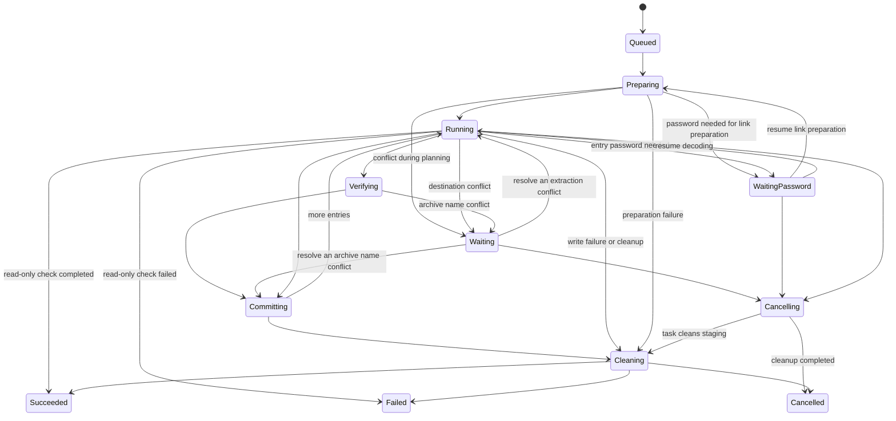

# Планирование, ход и отмена задач

[English](../../design/task-scheduling.md) | [简体中文](../../zh-CN/design/task-scheduling.md) | [繁體中文](../../zh-TW/design/task-scheduling.md) | [日本語](../../ja-JP/design/task-scheduling.md) | [한국어](../../ko-KR/design/task-scheduling.md) | [Français](../../fr-FR/design/task-scheduling.md) | [Deutsch](../../de-DE/design/task-scheduling.md) | [Español](../../es-ES/design/task-scheduling.md) | [Português (Brasil)](../../pt-BR/design/task-scheduling.md) | Русский

XDZip использует один поток команд Rust и один поток задач на каждое соединение среды выполнения. Поток команд владеет текущим архивом и подготавливает входы задач. Поток задач выполняет принятые работы, пока поток команд продолжает обслуживать запросы метаданных. [Архитектура системы](system-architecture.md) описывает расположение потоков, а [мост Qt/Rust](qt-rust-bridge.md) — доставку результатов клиенту.

## Допуск и владение задачами

| Уровень | Текущее поведение |
| --- | --- |
| Контроллер приложения | `BrowserController::attemptSubmission` сериализует тяжёлые операции между контроллерами настольного процесса, включая подготовку и очистку. Контроллер, ожидающий допуска, удерживает ограниченную команду и может отменить ожидание. Просмотр метаданных использует обычный путь команд. |
| Поток команд среды | Проверяет запрос и формирует работу. Извлечение, проверка и редактирование сохраняют нужные источник и метаданные либо выбор. Создание получает ограниченные параметры и сканирует дерево входа в потоке задач. Предварительная проверка метаданных или цели не создаёт тяжёлой задачи. |
| Очередь задач среды | Выполняет извлечение, временное открытие, создание, проверки, редактирование и экспорт по необходимости, по одной работе в порядке очереди внутри соединения. Служба может отслеживать до 32 задач с общим бюджетом 64 MiB на удерживаемые работы. Он покрывает удерживаемые входы и зарезервированное место для секретов. Фактическое декодирование, индексирование, рабочий процесс и ресурсы вывода ограничены отдельно. Перегрузка сообщается как `task_busy`. |
| Отдельная CLI | Использует те же правила планирования Rust в собственном процессе команд. Независимые процессы CLI имеют отдельные очереди, как и приложение. Безопасная авторизация вывода и проверка конфликтов применяются к каждому процессу. |

`TaskAccepted` определяет допущенную работу. `Finished` обычного запроса закрывает этот запрос. Работа может продолжать создавать снимки `TaskUpdate`, используя исходный ID запроса для корреляции и ID задачи для управления. Запись задачи приложения сохраняет владеющий контроллер даже после закрытия вкладки, чтобы запросы ответа и результаты относились к нужному соединению. [Исходный код очереди](https://github.com/xiaodaozhi/xdzip/blob/main/crates/xdzip-runtime/src/service/tasks.rs), [Допуск и маршрутизация задач](https://github.com/xiaodaozhi/xdzip/blob/main/apps/desktop/BrowserController.cpp), [Сеансы приложения](../engineering/application-sessions.md)

## Состояния и сообщаемый ход

Диаграмма показывает характерные пути. Задача может пропускать или повторять этапы в зависимости от операции. Проверка только для чтения может завершиться без фиксации. Создание или редактирование обычно проверяет подготовленный архив перед публикацией, а извлечение может фиксировать результаты многократно.

| Состояние среды | Что получает клиент |
| --- | --- |
| `queued`, `preparing` | Работа находится в очереди или подготавливает авторизованные источники, доступ к месту назначения и состояние формата. Общий объём ещё может быть неизвестен. |
| `running`, `verifying` | Содержимое читается, кодируется, декодируется или проверяется. `verifying` также обозначает повторное чтение подготовленного архива. Проверка не увеличивает число зафиксированных результатов. |
| `waiting`, `waiting_password` | Задача ждёт текущий ответ на конфликт или запрос пароля. |
| `committing` | Задача получила разрешение опубликовать файл, архив или набор томов. |
| `cancelling`, `cleaning` | Запрошена отмена или закрываются и освобождаются частные объекты. Снимок может пропустить переходное состояние, поскольку ход объединяется. |
| `succeeded`, `failed`, `cancelled` | Обычный путь выполнения завершён. Итоговый снимок содержит фактический результат, включая предыдущие фиксации и предупреждения очистки. |

`total_known` отличает неизвестный общий объём от нуля. Снимок раздельно учитывает прочитанные, декодированные, записанные, проверенные и зафиксированные байты. Работа с solid-блоком или повторное декодирование могут увеличить объём работы без публикации новых файлов. Создание считает входные файлы и байты зафиксированными только после публикации архива. Его `written_bytes` измеряет запись результата, включая возможные перезаписи заголовков. Очередь ограничивает обычные обновления `running`, `verifying` и `committing` одним за 100 ms и сохраняет только последний ожидающий снимок каждой задачи. Запросы ответа, отмена, очистка и конечные результаты обходят ограничение. Подробности результата ограничены 128 записями с числом пропущенных. [Коды состояния и поля снимка](https://github.com/xiaodaozhi/xdzip/blob/main/crates/xdzip-runtime/src/extraction/mod.rs)

## Ожидание решения

- При политике запроса конфликт имени может ждать явного решения. Запрос пароля использует отдельный одноразовый слот ответа. ID задачи, ID и тип запроса должны соответствовать текущему ожиданию. Ответы на старый или уже отвеченный запрос отклоняются.
- Ожидание сохраняет ограниченное состояние работы и место в очереди. Задача ждёт на переменной условия, освобождая мьютекс ответа на время ожидания. Решение или отмена пробуждает её независимо от места в обычной очереди команд. Ожидающая работа продолжает занимать поток задач; отдельный поток команд может обрабатывать просмотр.
- Путь пароля использует секреты в пределах задачи. Поддерживаемые ошибки пароля с возможностью повтора ограничены для каждой записи, а уже выполненная работа учитывается в бюджетах задачи. Явные ошибки целостности останавливают операцию. Отсутствующий том, исчерпанная жёсткая квота или изменение источника сообщаются соответствующим путём ошибки. Ожидание ввода отличается от управляемой пользователем паузы. [Взаимодействие с паролем](../engineering/password-extraction.md), [Правила ресурсов и файлов](file-security.md)

## Отмена и граница фиксации

`cancel` запрашивает отмену обычного запроса. Когда задача уже существует, `cancel_task` адресуется самой задаче. Эти элементы подтверждают запрос остановки. Вызывающая сторона узнаёт результат из завершения соответствующего запроса или конечного снимка задачи. У кооперативной отмены нет фиксированного срока завершения, особенно если системный вызов хоста заблокирован. Рабочий процесс архива имеет отдельный надзор. [Методы управления моста](qt-rust-bridge.md), [Надзор за процессом архива](../engineering/native-codecs.md)

| Когда приходит отмена | Последствие |
| --- | --- |
| До того как `begin_commit()` получил доступ через барьер | Текущая публикация не начинается. Задача отбрасывает или очищает неопубликованную подготовку и сохраняет предыдущие квитанции. |
| Во время одной публикации извлечения или обещанного файла | Вызов публикации может завершиться. Если файл опубликован, задача его записывает. Отмена может остановить дальнейшую работу, а конечный снимок может быть `cancelled` с ненулевым числом зафиксированных результатов. |
| Во время итоговой публикации архива | Создание и изменение сохраняют успешный результат после публикации проверенного единственного архива или полного набора томов. При разделённом создании процедуре фиксации может понадобиться откатить собственный частично опубликованный набор. Ошибка отката может установить `outcome_uncertain`. |
| После фиксации итогового результата | Поздняя отмена не может превратить успешную фиксацию в отменённый результат. |

Барьер определяет, когда отмена задачи может предотвратить публикацию. Авторизация вывода и проверка подготовки по-прежнему необходимы. Разрешённая запись может завершиться ошибкой и вернуть фактическую ошибку файловой системы. [Барьер отмены](https://github.com/xiaodaozhi/xdzip/blob/main/crates/xdzip-runtime/src/extraction/control.rs), [Публикация файлов](file-security.md)

## Ошибка, закрытие вкладки и выход

Пропуск применяется к поддерживаемым решениям конфликтов. Ошибка декодирования, ресурсов, источника или безопасности цели может остановить работу. Уже опубликованные файлы остаются учтёнными, а ошибка очистки подготовки может сопровождать успешную публикацию. Неожиданная ошибка рабочего процесса или допускающий раскрутку стека panic задачи могут дать ошибочный или неопределённый результат. Путь panic сообщает `task_abandoned` и переводит затронутую среду в состояние ошибки. Отсутствие конечного ответа после выхода процесса не доказывает, что было записано на диск.

Закрытие окна хода или вкладки архива — действие представления. Принятые работы и результаты остаются доступны через запись задач приложения. Закрытие активного запроса пароля может отменить его задачу. Явный выход обрабатывает активную работу, прекращает допуск при начале завершения, пробуждает ожидающих и продолжает извлекать события. Получатель ожидает рабочие потоки Rust перед выдачей `ShutdownReady`. Qt завершает извлечение событий и ожидает завершения получателя без блокирующего ожидания в потоке интерфейса. Также может потребоваться завершение внешней нативной передачи. [Жизненный цикл среды](../engineering/product-runtime.md), [Передача архивов](../../engineering/archive-transfers.md)
