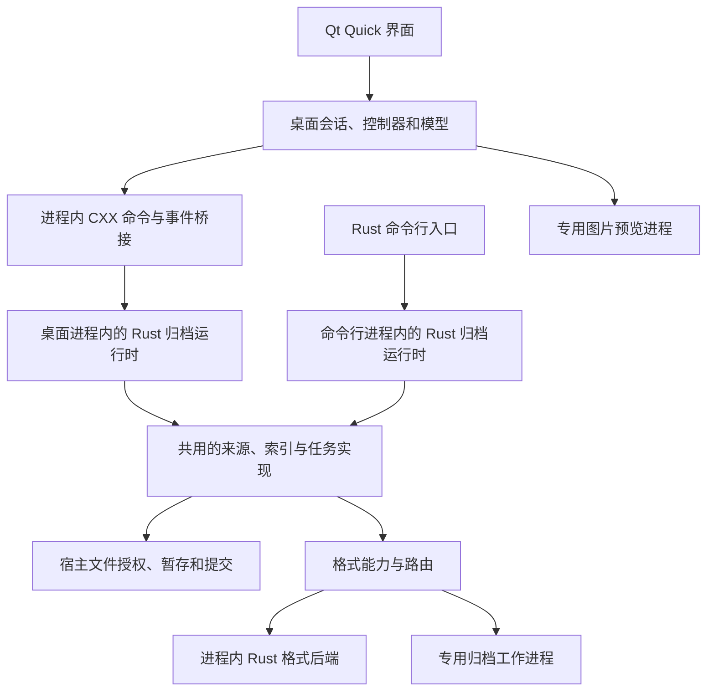
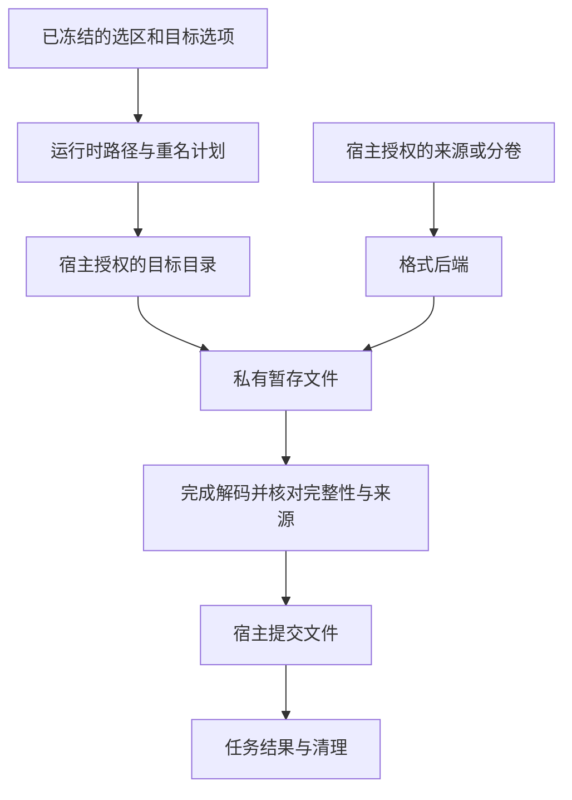

# XDZip 系统架构

[English](../../design/system-architecture.md) | 简体中文 | [繁體中文](../../zh-TW/design/system-architecture.md) | [Français](../../fr-FR/design/system-architecture.md)

桌面程序与命令行工具共用 Rust 归档运行时。运行时把用户选中的来源打开为带索引的会话，再把具体操作组织成受限任务。格式后端负责解释归档数据，宿主负责文件授权、确定写出位置，以及在验证后提交结果。

## 架构总览

图中的两个运行时是同一套实现的独立实例。桌面和 CLI 各自持有归档状态和任务。桌面的本地进程间通信将激活和系统集成请求转发给主界面实例，归档命令由各自进程内的运行时处理。[应用会话](../engineering/application-sessions.md)、[命令行契约](../engineering/command-line.md)

## 模块职责与调用方向

| 模块 | 持有的状态和调用关系 |
| --- | --- |
| 桌面入口与 Qt Quick | 桌面目标 `xdzip-browser` 构建为可执行文件 `xdzip`，从 `browser_main.cpp` 启动并加载 `Browser.qml`。`SessionPage.qml` 及其子界面呈现列表、选择、对话框和任务状态，并把用户操作发给 C++ 控制器。[桌面入口](https://github.com/xiaodaozhi/xdzip/blob/main/apps/desktop/browser_main.cpp)、[QML 界面设计](qt-quick-ui.md) |
| 桌面 C++ 适配层 | `ApplicationSessions` 协调标签页、窗口和共享任务入口。`BrowserController` 持有对应会话的列表模型和请求状态，把界面操作转为类型化命令，并把进度、错误及交互提示送回界面。`RuntimeConnection` 管理桥接句柄和事件交付。设置、托盘、文件关联、原生拖放和文件管理器集成也由桌面适配层处理。[会话协调器](https://github.com/xiaodaozhi/xdzip/blob/main/apps/desktop/ApplicationSessions.cpp)、[控制器](https://github.com/xiaodaozhi/xdzip/blob/main/apps/desktop/BrowserController.cpp) |
| `xdzip-qt-bridge` | 链接到桌面程序的 CXX 桥接，对命令、列表行、任务快照和错误做 C++ 与 Rust 类型转换。它把运行时的 `Client` 和 `Receiver` 封装为独立持有的命令句柄和事件句柄。[桥接源码](https://github.com/xiaodaozhi/xdzip/blob/main/crates/xdzip-qt-bridge/src/lib.rs)、[桥接契约](qt-rust-bridge.md) |
| `xdzip-cli` | 解析参数、处理终端提示与取消、直接调用 `xdzip-runtime`，并把返回事件转为文本或 JSON 及退出码。归档命令与桌面遵循相同的来源与任务规则。安装和更新命令有各自的入口。[CLI 运行时适配器](https://github.com/xiaodaozhi/xdzip/blob/main/crates/xdzip-cli/src/runtime.rs)、[命令行集成指南](../integration/README.md) |
| `xdzip-runtime` | 每个服务实例持有一个当前 `Archive`。`source` 解析分卷和跟踪来源版本，`formats` 负责识别和路由格式，`index`、`navigation`、`query`、`listing` 和 `disk_index` 建立并查询元数据索引。运行时服务校验命令后，将任务交给 `extraction`、`creation`、`updating`、`checking` 和 `exporting` 执行。`preview` 负责属性卡所需的受限读取。[运行时模块](https://github.com/xiaodaozhi/xdzip/blob/main/crates/xdzip-runtime/src/lib.rs)、[产品运行时](../engineering/product-runtime.md) |
| `xdzip-domain`、`xdzip-codec-api` 与 `xdzip-extract-plan` | 领域层定义身份、元数据和路径约束。格式接口声明格式能力以及 `ReadSource`、`PayloadCodec`、`DecodedSink`、`EncodeInput` 和 `EncodeOutput` 等契约。解压规划模块根据元数据和选区生成报告。目标目录授权由宿主持有。[领域和数据](domain-data.md)、[格式接口](https://github.com/xiaodaozhi/xdzip/blob/main/crates/xdzip-codec-api/src/lib.rs)、[解压预检](../engineering/extraction-preflight.md) |
| `xdzip-codec-*`、`xdzip-compression` 与 `xdzip-crypto` | 格式模块处理容器结构、元数据扫描、内容读取和各格式支持的写入操作。压缩与密码学模块提供可复用的算法。编解码器使用宿主提供的输入流和输出接收器。注册表描述各格式可用的操作，运行时还会根据归档和条目的实际状态校验。[运行时路由](https://github.com/xiaodaozhi/xdzip/blob/main/crates/xdzip-runtime/src/formats.rs)、[格式注册表](../engineering/format-registry.md) |
| `xdzip-io` | 打开普通输入文件，获取系统文件身份，冻结已授权的创建来源，并提供目标授权、暂存和提交。该模块执行平台侧的文件检查，运行时决定要执行的操作及提交时机。[输入授权](https://github.com/xiaodaozhi/xdzip/blob/main/crates/xdzip-io/src/input.rs)、[输出授权与提交](https://github.com/xiaodaozhi/xdzip/blob/main/crates/xdzip-io/src/target.rs)、[文件安全](file-security.md) |
| 更新与开发工具 | `UpdateController` 与 `xdzip-update` 负责更新选择、验证与交接，已安装版本使用各平台对应的安装流程。SDK 宿主和格式探针各有独立入口，产品从内置注册表发现归档格式。[软件更新](../engineering/software-update.md)、[SDK 试验](../engineering/sdk-trial.md)、[仓库结构与模块分工](../engineering/repository-layout.md) |

## 桌面请求与生命周期

1. **入口与路由。** 常规启动、文件关联和文件管理器操作进入桌面程序。`SingleInstance` 在同一用户与登录会话内选出主实例。主实例处理转发请求，打开或复用对应的浏览会话或操作会话。独立 CLI 的归档命令启动自己的 Rust 服务。随桌面包提供的 CLI 可以通过本地通道把桌面更新请求交给界面程序。
2. **接收命令。** 浏览控制器使用自己的 `RuntimeConnection`。界面提交类型化命令后收到接收结果和请求编号。临时的准入竞争由事件循环上的有限重试处理，归档读写在界面线程之外执行。
3. **执行与交付。** 每个运行时服务在一个 Rust 命令线程中维护当前归档、处理元数据请求和准备任务，并设有独立的 Rust 任务线程，按有界队列逐个执行重任务。桌面还有一层跨控制器的重任务准入限制。Qt 接收线程将 Rust 事件取到有界邮箱中，由界面线程处理。控制器核对请求与会话身份，应用分页结果时还会核对查询代数和修订版本。CLI 在其进程内提交命令并消费事件。
4. **任务归属。** 任务获准执行、执行进度和最终快照各自通过事件返回。任务线程持有已冻结的作业输入。密码、重名决定和取消指令都发往对应任务。任务控制使用任务与提示的身份，任务编号的作用范围是它所属的运行时连接。取消与关闭不需要等待普通命令队列腾出空间。关闭标签页会释放浏览状态，已接收的任务可以继续执行，结果仍可从共享任务入口访问。显式退出应用时，应用停止接收命令、继续处理最终事件，并等待工作线程退出。

[运行时事件服务](https://github.com/xiaodaozhi/xdzip/blob/main/crates/xdzip-runtime/src/service.rs)、[任务队列](https://github.com/xiaodaozhi/xdzip/blob/main/crates/xdzip-runtime/src/service/tasks.rs)、[Qt 事件交付](https://github.com/xiaodaozhi/xdzip/blob/main/apps/desktop/RuntimeConnection.cpp)、[任务调度](task-scheduling.md)

## 进程与平台边界

| 执行边界 | 传递的数据与职责 |
| --- | --- |
| 桌面主进程 | Qt 界面、C++ 适配层、CXX 桥接和 Rust 运行时线程共用进程地址空间。宿主持有打开的归档会话和本机文件授权。后续启动的桌面进程可以通过当前用户的本地通道转发请求后退出。 |
| CLI 命令进程 | CLI 命令处理器在自己的进程内以库的方式调用同一个 Rust 运行时。包内启动器或更新交接可以涉及其他进程。归档状态和任务结果由该命令自己的运行时服务持有。 |
| 归档格式工作进程 | 运行时把 7z、RAR、CAB 和 ISO/UDF 的读取交给 `xdzip-codec-native`。该适配器启动随包提供的 `xdzip-native-codec`，通过标准输入和标准输出交换有界数据帧。工作进程的薄 C++ 协议层经 `xdzip-codec-bridge` 调用 Rust 格式后端。宿主处理经过授权的范围和分卷读取，并校验输出帧。7z 写入通过受限的偏移写请求进入私有暂存。归档和目标路径留在宿主中。工作进程失败或取消会终止操作并丢弃未完成的暂存文件。这一进程边界用于隔离故障和限制资源，用于通信的协议不授予文件系统访问能力，工作进程本身未置于内核权限沙箱。 |
| 图片预览进程 | Rust 读完并验证适用归档条目后，桌面将受限的编码图片字节交给 `xdzip-image-preview`，取回受限的 RGBA 缩略图。请求不带归档路径、密码或目标句柄。预览提供器只把结果交给仍然匹配的当前请求。文本预览由 Rust 运行时处理。 |
| 平台交接 | 桌面适配层负责文件管理器激活、调用外部应用打开私有的解压副本以及交接更新安装。更新助手或 macOS 的 Sparkle 执行相应的安装交接，商店版本由平台渠道管理更新。这些请求不经过归档格式工作进程。 |

[归档工作进程协议](../engineering/native-codecs.md)、[图片预览契约](../engineering/content-preview.md)、[平台集成](../engineering/installers-associations.md)、[归档传输](../engineering/archive-transfers.md)、[更新交接](../engineering/software-update.md)

## 打开与浏览归档

1. **授权来源。** `Archive::open_with_password` 调用 `Source::open`，通过 `xdzip-io` 打开普通文件并解析支持的分卷集合。宿主记录每个已接收分卷的文件身份、大小和时间信息。格式后端收到可定位的输入流，并在适用时收到宿主提供的分卷元数据。
2. **识别并扫描格式。** 运行时探测内容并核验所需的容器结构。文件名或扩展名可帮助发现分卷，或解决特定的格式歧义。选定的后端在资源限额内扫描。加密目录可能需要先输入密码才能完成扫描。扫描失败或未完成时不会发布部分归档会话。
3. **建立会话快照。** 运行时分别保留物理条目 ID、文件名和用于浏览的虚拟目录，因此同名条目仍能单独寻址。普通单文件 ZIP/ZIP64 超出内存预算后，可将元数据流式写入私有磁盘索引。扩大的浏览容量与解压限额分开计算。使用磁盘索引的会话目前无法执行整包检查或修改。
4. **查询与选择。** 桌面浏览请求带上会话、目录、搜索和排序选项，Rust 返回结果身份和有界分页。后续分页必须与当前会话、查询、代数和修订版本匹配。任务使用跨页逻辑选区前，Rust 会将其解析成物理条目或目录身份。CLI 使用物理条目清单，可按明确的成员路径或条目 ID 选择。界面行的位置、目标路径与物理条目 ID 各自独立。

快照描述会话接收的归档。相关读写会再次核对来源身份和元数据以检测变化。源文件仍可能被其他程序同时改动，因此这是一种尽力检测。检测到变化时，相关浏览状态失效，任务不能基于过期来源提交结果。

[来源与分卷源码](https://github.com/xiaodaozhi/xdzip/blob/main/crates/xdzip-runtime/src/source.rs)、[查询与选择源码](https://github.com/xiaodaozhi/xdzip/blob/main/crates/xdzip-runtime/src/query.rs)、[大型归档索引](../engineering/large-index.md)

## 读取、检查与解压条目

| 操作 | 数据流和结果 |
| --- | --- |
| 浏览或解压预检 | 使用已索引的元数据。预检汇总选区、路径和大小限制，无需取得目标授权，也无法据此确认所有选中内容都能被解码。 |
| 预览 | 解析当前会话中一个符合条件的普通条目。Rust 通过有界接收器完整读取和解码，并执行格式提供的完整性或认证检查。桌面显示通过检查的文本，或把已验证的编码图片交给图片进程。 |
| 测试归档 | 冻结输入，对符合条件的归档使用有界丢弃接收器读取，或执行格式专用的全量扫描。测试不授权任何输出。可提供的校验取决于格式，例如 TAR 与 ISO/UDF 可检查结构及可读性，无法提供逐文件校验和保证。 |
| 解压、打开或导出 | 冻结所选条目并从已授权来源读取。解压提交到选定的目标，打开文件会将验证后的私有副本交给系统。拖出文件可先在私有位置准备内容，再提交到经过验证的目标。 |

以普通文件解压为例，格式解码与文件提交由不同层负责。

1. **规划。** 运行时使用冻结的选区校验可移植的相对路径并检测输出冲突。`xdzip-io` 将目标限制在已授权的目录范围内。运行时处理询问、跳过、重命名或符合条件的覆盖。格式后端不能授权覆盖受到保护的输入文件或已变化的目标，也不能允许经过不安全的链接写出。
2. **解码。** 格式后端直接读取已授权的来源，或通过归档工作进程读取。字节进入由私有暂存文件承接的计量接收器。密码重试、展开大小和辅助解码工作受操作限额约束。只有解码、大小核对及格式支持的验证成功后，暂存内容才可提交。
3. **提交与报告。** 宿主在提交前重新核对来源及相关目标身份，逐个提交符合条件的文件，并记录实际提交的文件数和字节数。后续失败或取消时，先前已提交的文件可能保留。未提交的暂存尽可能清理，最终结果报告失败、取消、跳过情况及清理警告。

[解压执行源码](https://github.com/xiaodaozhi/xdzip/blob/main/crates/xdzip-runtime/src/extraction/execute.rs)、[归档完整性检查](../engineering/archive-checking.md)、[密码交互](../engineering/password-extraction.md)、[ZIP 安全解压](../engineering/zip-safe-extraction.md)

## 创建或修改归档

创建和归档内修改都以整个归档为单位暂存和验证。运行时协调任务，格式写入器通过宿主掌管的输出接口写入，最终只有宿主可以提交。

1. **创建。** 运行时校验输出格式和参数，取得目标授权，并遍历和冻结允许使用的输入目录树。格式写入器获得元数据和按输入编号打开数据流的能力，并写入私有暂存。ZIP 与 TAR 的写入器在宿主进程内运行，7z 使用归档工作进程。ISO 创建使用进程内的 Rust 光盘镜像写入器，ISO 浏览使用工作进程。[创建任务源码](https://github.com/xiaodaozhi/xdzip/blob/main/crates/xdzip-runtime/src/creation.rs)、[ISO 写入规范](../engineering/iso-creation.md)
2. **修改。** 对符合条件的归档，运行时冻结原归档和新增来源，规划需要保留、新增、替换或移动的条目，并在暂存中生成一份新的归档。重新打开新归档并验证预期条目及内容后，宿主使用专门的归档更新授权替换原文件。格式与任务规则会拒绝不支持的条目、加密或分卷来源等不适用情况。替换成功后，仍在浏览该来源的桌面会话会刷新快照。[归档更新任务源码](https://github.com/xiaodaozhi/xdzip/blob/main/crates/xdzip-runtime/src/updating.rs)、[归档修改与传输](../engineering/archive-transfers.md)
3. **验证并提交。** 创建时，宿主重新打开暂存输出，按照格式与创建配置检查结构、预期条目和内容。它处理输出重名并在提交前复核相关授权。单文件归档有一个提交点。分卷创建先暂存所有卷，再提交为新卷组，禁止覆盖已有卷组，并在部分提交失败时尝试回滚。每个分卷各自提交。任务结果可报告清理或回滚问题。[ZIP 创建](../engineering/zip-creation.md)、[文件提交契约](file-security.md)

**如何理解结果。** `TaskAccepted` 标识已经入队的作业，`Finished` 结束普通请求。独立的最终任务快照报告已验证、已提交、已跳过及未完成的内容。解码字节数与实际提交字节数可能不同。取消由执行路径协作处理，整包提交成功之后收到的取消请求不会撤销已提交结果。

[任务状态与取消](task-scheduling.md)、[产品设计与技术参考](../reference/README.md)
