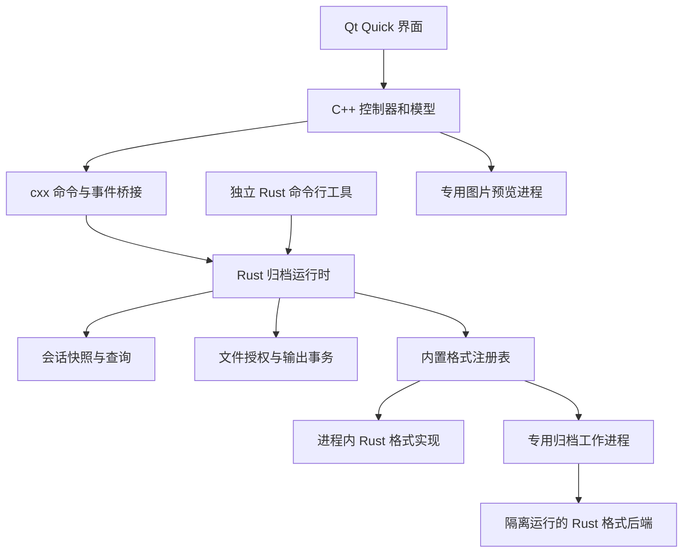

# XDZip 系统架构

[English](../../design/system-architecture.md) | 简体中文

桌面程序和独立 CLI 共用 Rust 归档运行时。桌面界面通过 Qt Quick 表达用户操作，Rust 负责选择格式、持有来源与索引，并执行任务和文件规则。CLI 无需 Qt 即可调用运行时。[仓库结构与模块分工](../engineering/repository-layout.md)

## 桌面请求与生命周期

`ApplicationSessions` 管理浏览会话和共享任务入口。会话的 `BrowserController` 通过 `RuntimeConnection` 提交命令。cxx 桥接分别提供命令句柄和事件句柄。接收线程等待运行时事件并按限额批量交给界面。界面仅在请求、会话和查询身份仍匹配时应用结果。搜索、排序或切换标签后，旧结果不会覆盖新页面。[桥接与会话契约](qt-rust-bridge.md)、[应用会话](../engineering/application-sessions.md)

关闭浏览标签会释放界面状态，后台任务仍可保有会话和来源，并可从任务入口访问。应用内重任务串行准入。运行时协作处理取消，输出已经提交时保留实际最终结果。[运行时](../engineering/product-runtime.md)、[任务生命周期](task-scheduling.md)

## 从打开归档到写出结果

1. **打开。** 运行时授权输入、解析卷组并按内容选择后端，随后记录物理条目身份。同名条目仍各有身份。
2. **浏览。** 内存索引或有界磁盘索引保存元数据，提供稳定的搜索、排序和分页。查询及选择绑定会话和快照。普通单文件 ZIP/ZIP64 可使用较大的流式索引，作业仍有独立限额。[索引行为](../engineering/large-index.md)
3. **读取或写出。** 解压时，运行时冻结所选条目，以用户选择的目录为根建立安全输出计划。编解码器读取授权范围，并向有界接收器交付字节。宿主负责重名、校验、暂存及提交。创建与修改有各自的整包保存规则。[文件安全](file-security.md)、[归档修改](../engineering/archive-transfers.md)
4. **报告。** 最终结果区分已验证、已保存、已跳过和未完成的内容。失败或取消前已提交的文件可能保留。元数据预检和整包检查各有适用范围。[元数据预检](../engineering/extraction-preflight.md)、[完整性检查](../engineering/archive-checking.md)

## 进程与平台边界

| 组件 | 职责 |
| --- | --- |
| `xdzip-domain` 与 `xdzip-codec-api` | 领域身份、能力声明和有界的格式接口。 |
| `xdzip-runtime` 与 `xdzip-io` | 管理会话、索引、查询和任务，负责平台文件授权与输出提交。 |
| `xdzip-codec-*` | 内置格式读写器，操作范围由注册表描述。ZIP 和 TAR 使用进程内 Rust 实现。支持的 7z、RAR、CAB 和光盘镜像读取路径使用随包提供的工作进程。 |
| 桌面图片预览进程 | 在归档条目读取后接收有界的编码内容，为对应请求返回受限缩略图。 |
| 桌面适配层和更新模块 | 管理 Qt 模型、外观与设置、托盘、文件关联、原生菜单及各平台更新。 |

索引位于运行时，平台文件操作由 I/O 模块及桌面适配层提供。归档与图片工作进程有各自的职责和资源限制。实验性 SDK 宿主独立运行，当前产品构建禁用第三方扩展。[归档工作进程](../engineering/native-codecs.md)、[预览契约](../engineering/content-preview.md)、[SDK 试验](../engineering/sdk-trial.md)

桌面设置不进入格式实现。索引和暂存数据分别跟随对应会话与任务。依赖从界面经运行时指向领域、格式和 I/O 接口。[数据边界](domain-data.md)、[隐私](../engineering/privacy.md)
