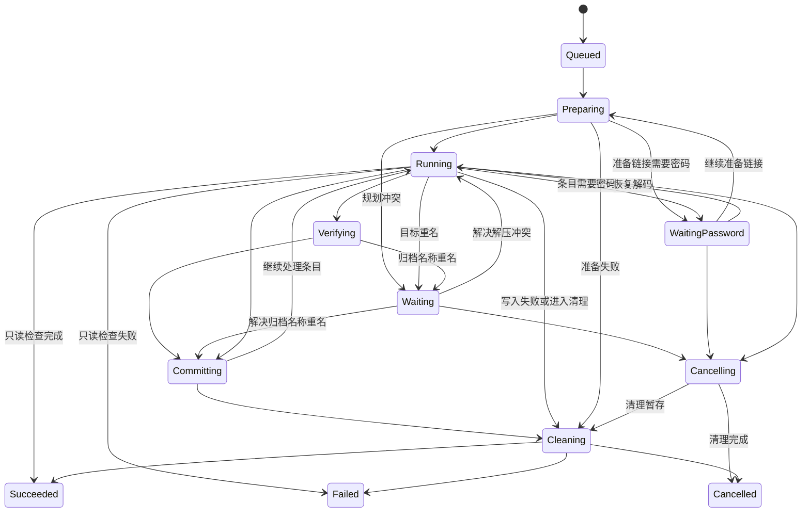

# 任务调度、进度与取消

[English](../../design/task-scheduling.md) | 简体中文 | [繁體中文](../../zh-TW/design/task-scheduling.md) | [日本語](../../ja-JP/design/task-scheduling.md) | [한국어](../../ko-KR/design/task-scheduling.md) | [Français](../../fr-FR/design/task-scheduling.md) | [Deutsch](../../de-DE/design/task-scheduling.md) | [Español](../../es-ES/design/task-scheduling.md) | [Português (Brasil)](../../pt-BR/design/task-scheduling.md) | [Русский](../../ru-RU/design/task-scheduling.md)

XDZip 的每个运行时连接各有一个 Rust 命令线程和一个任务线程。命令线程持有当前归档并准备任务输入。任务线程执行已接收的作业，命令线程仍能处理元数据请求。[系统架构](system-architecture.md)说明这些线程在哪里运行，[Qt/Rust 桥接](qt-rust-bridge.md)说明结果如何送到客户端。

## 准入与任务归属

| 层级 | 当前行为 |
| --- | --- |
| 桌面控制器 | `BrowserController::attemptSubmission` 在桌面进程内跨控制器串行准入重操作，覆盖准备和清理。等待准入的控制器保留一条有界命令，等待期间可以取消。元数据浏览使用普通命令路径。 |
| 运行时命令线程 | 校验请求并构造作业。解压、检查和修改保留相应来源及元数据或选区。创建接收有界参数，在任务线程扫描输入目录树。元数据预检和目标检查都不会创建重任务。 |
| 运行时任务队列 | 在同一连接内依入队顺序逐个运行解压、临时打开、创建、检查、编辑和导出等任务。每个服务最多跟踪 32 个任务，保留的作业数据合计上限为 64 MiB，涵盖保留的输入及为密码预留的空间。实际解码、索引、工作进程和输出另有限额。队列饱和时报告 `task_busy`。 |
| 独立 CLI | 在自己的命令进程内遵循同样的 Rust 调度规则。多个独立 CLI 进程各有自己的队列，桌面也使用自己的队列。各进程仍须执行安全输出授权和冲突检查。 |

`TaskAccepted` 标识已接收的作业，普通请求由自己的 `Finished` 结束。作业可继续产生 `TaskUpdate` 快照，通过原请求编号建立关联，通过任务编号接收控制。应用任务入口在标签页关闭后仍保留所属控制器，确保提示与结果归到正确连接。[任务队列源码](https://github.com/xiaodaozhi/xdzip/blob/main/crates/xdzip-runtime/src/service/tasks.rs)、[桌面准入与任务路由](https://github.com/xiaodaozhi/xdzip/blob/main/apps/desktop/BrowserController.cpp)、[桌面会话](../engineering/application-sessions.md)

## 状态与进度报告

图中列出典型路径，任务可根据操作类型跳过或重复某些阶段。只读检查可以在没有提交的情况下结束。创建或修改通常在发布前验证暂存归档，解压则可以多次提交。

| 运行时状态 | 客户端收到的信息 |
| --- | --- |
| `queued`、`preparing` | 正在排队或准备来源、目标权限及格式状态，此时总量可能仍未知。 |
| `running`、`verifying` | 正在读取、编码、解码或检查内容。`verifying` 也用于重新读取暂存归档。验证不会增加已提交数量。 |
| `waiting`、`waiting_password` | 正在等待当前的重名或密码答复。 |
| `committing` | 任务已取得提交许可，可以发布一个文件、整个归档或一组分卷。 |
| `cancelling`、`cleaning` | 已请求取消，或正在关闭和回收私有暂存对象。进度合并可能省略短暂的中间状态。 |
| `succeeded`、`failed`、`cancelled` | 正常执行路径已结束。最终快照记录实际结果，包括先前的提交和清理警告。 |

`total_known` 用来区分总量未知与总量为零。快照分别记录读取、解码、写入、验证和提交的字节数。固实块中的处理和重复解码可能增加工作量，但不会增加实际发布的文件。创建仅在归档发布后才把输入文件和输入字节计入已提交。`written_bytes` 计量输出写入，也可包含重写头部的数据。队列对普通的 `running`、`verifying` 和 `committing` 更新按 100 毫秒节流，每个任务只保留最新的待交付快照。提示、取消、清理和最终结果不受此节流影响。结果明细最多保留 128 条，并记录省略数量。[状态码和快照字段](https://github.com/xiaodaozhi/xdzip/blob/main/crates/xdzip-runtime/src/extraction/mod.rs)

## 等待用户决定

- 策略为询问时，重名可以等待用户选择。密码提示使用独立的一次性答复槽。任务、提示编号及提示类型必须与当前等待匹配。之前的提示或已答复的提示会拒绝再次答复。
- 等待期间保留有界的作业状态及队列占位。任务在条件变量上等待，此时释放答复互斥锁。答复和取消均可唤醒任务，无需等待普通命令队列有空位。等待的作业仍占用任务线程，独立的命令线程可以继续处理浏览请求。
- 密码仅在任务范围内保留。可以重试的密码失败按条目限制次数，已消耗的工作量继续计入任务预算。明确的完整性错误会停止操作。缺卷、触及硬性配额或来源改变由对应的错误路径报告。等待输入与用户主动暂停是两种不同的行为。[密码交互](../engineering/password-extraction.md)、[资源与文件规则](file-security.md)

## 取消与提交边界

`cancel` 请求取消普通请求。任务创建后，`cancel_task` 指向任务本身。控制方法只确认停止请求，调用方应观察对应的请求结束事件或最终任务快照来确定结果。协作取消没有固定的完成时限，尤其是宿主的系统调用仍在阻塞时。归档工作进程使用自己的进程监督机制。[桥接控制方法](qt-rust-bridge.md)、[归档工作进程监督](../engineering/native-codecs.md)

| 取消到达的时机 | 实际结果 |
| --- | --- |
| `begin_commit()` 取得提交许可前 | 当前提交不会开始。任务丢弃或清理未发布的暂存，并保留先前的提交记录。 |
| 解压或文件承诺中正在提交一个文件 | 该提交调用可以完成。如果文件已发布，任务保留对应记录。取消可以阻止后续工作，最终快照可以是 `cancelled` 且已提交数量大于零。 |
| 正在进行归档的最终提交 | 完整验证过的单文件归档或整组新分卷一旦成功发布，创建和修改会保留成功结果。分卷创建提交失败时可能回滚已经发布的部分。回滚失败可以标记 `outcome_uncertain`。 |
| 最终结果已确定后 | 迟到的取消不会把已成功提交的结果改为取消。 |

提交许可决定取消还能否阻止发布。输出授权和暂存验证仍然必需。已授权的写入也可能失败，并返回实际的文件系统错误。[取消与提交许可](https://github.com/xiaodaozhi/xdzip/blob/main/crates/xdzip-runtime/src/extraction/control.rs)、[文件提交](file-security.md)

## 失败、关闭标签页与退出应用

跳过适用于支持的重名决定。解码、资源、来源或目标安全错误可能停止作业。已发布的文件保留在结果中，发布成功仍可能伴有暂存清理警告。工作进程异常或任务中可展开的恐慌可能导致失败或结果不确定。任务恐慌路径会报告 `task_abandoned` 并使对应运行时进入故障状态。进程退出后缺少最终响应，无法据此判断哪些内容已经发布。

关闭进度窗口或归档标签页是界面操作，已接收的作业和结果仍可通过应用任务入口访问。关闭正在等待答复的密码窗口可以取消任务。显式退出会处理活动任务，关闭流程开始时停止接收新命令，唤醒等待者并继续取出事件。接收器在返回 `ShutdownReady` 前等待 Rust 工作线程退出。Qt 排空邮箱并等待接收线程结束，界面线程无需阻塞等待。原生外部传输也可能需要完成交接。[运行时生命周期](../engineering/product-runtime.md)、[归档传输](../engineering/archive-transfers.md)
