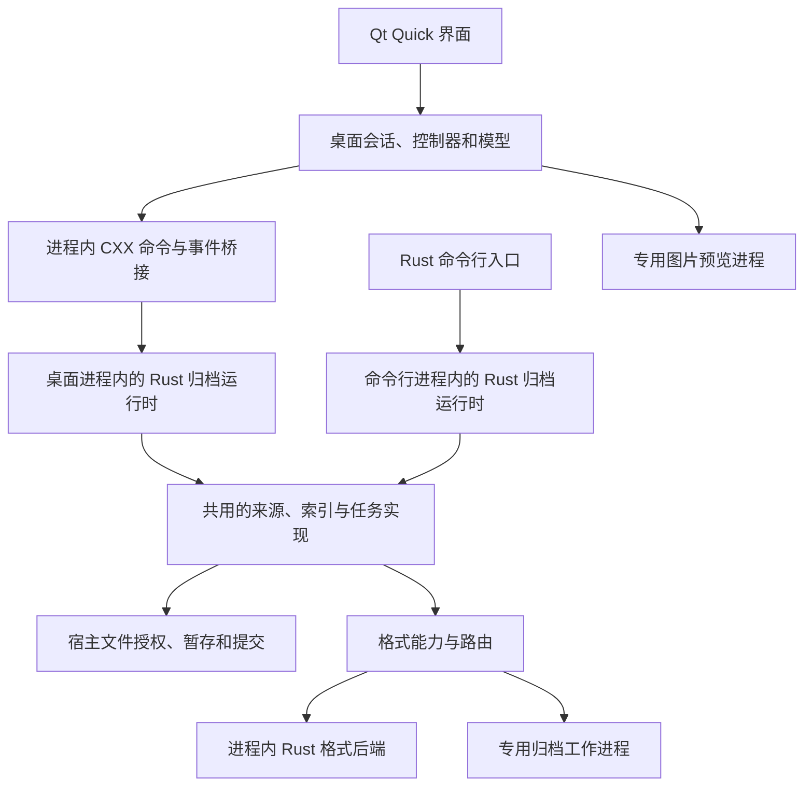
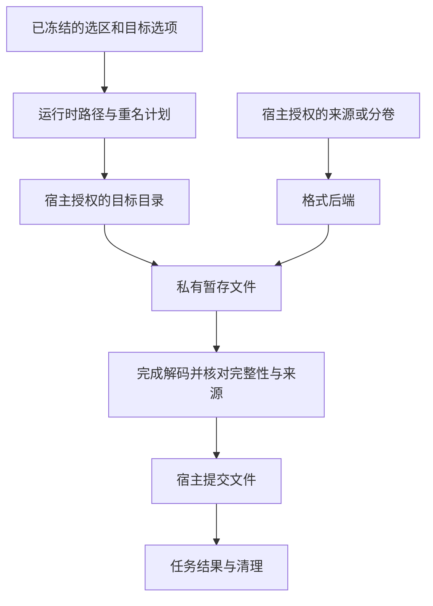

# XDZip 系統架構

[English](../../design/system-architecture.md) | [简体中文](../../zh-CN/design/system-architecture.md) | 繁體中文

桌面程式與命令列工具共用 Rust 歸檔執行時。執行時把使用者選中的來源開啟為帶索引的會話，再把具體操作組織成受限任務。格式後端負責解釋歸檔資料，宿主負責檔案授權、確定寫出位置，以及在驗證後提交結果。

## 架構總覽

圖中的兩個執行時是同一套實現的獨立例項。桌面和 CLI 各自持有歸檔狀態和任務。桌面的本地程序間通訊將啟用和系統整合請求轉發給主介面例項，歸檔命令由各自程序內的執行時處理。[應用會話](../engineering/application-sessions.md)、[命令列契約](../engineering/command-line.md)

## 模組職責與呼叫方向

| 模組 | 持有的狀態和呼叫關係 |
| --- | --- |
| 桌面入口與 Qt Quick | 桌面目標 `xdzip-browser` 構建為可執行檔案 `xdzip`，從 `browser_main.cpp` 啟動並載入 `Browser.qml`。`SessionPage.qml` 及其子介面呈現列表、選擇、對話方塊和任務狀態，並把使用者操作發給 C++ 控制器。[桌面入口](../../../apps/desktop/browser_main.cpp)、[QML 介面設計](qt-quick-ui.md) |
| 桌面 C++ 適配層 | `ApplicationSessions` 協調標籤頁、視窗和共享任務入口。`BrowserController` 持有對應會話的列表模型和請求狀態，把介面操作轉為型別化命令，並把進度、錯誤及互動提示送回介面。`RuntimeConnection` 管理橋接控制代碼和事件交付。設定、托盤、檔案關聯、原生拖放和檔案管理器整合也由桌面適配層處理。[會話協調器](../../../apps/desktop/ApplicationSessions.cpp)、[控制器](../../../apps/desktop/BrowserController.cpp) |
| `xdzip-qt-bridge` | 連結到桌面程式的 CXX 橋接，對命令、列表行、任務快照和錯誤做 C++ 與 Rust 型別轉換。它把執行時的 `Client` 和 `Receiver` 封裝為獨立持有的命令控制代碼和事件控制代碼。[橋接原始碼](../../../crates/xdzip-qt-bridge/src/lib.rs)、[橋接契約](qt-rust-bridge.md) |
| `xdzip-cli` | 解析引數、處理終端提示與取消、直接呼叫 `xdzip-runtime`，並把返回事件轉為文字或 JSON 及退出碼。歸檔命令與桌面遵循相同的來源與任務規則。安裝和更新命令有各自的入口。[CLI 執行時介面卡](../../../crates/xdzip-cli/src/runtime.rs)、[命令列整合指南](../integration/README.md) |
| `xdzip-runtime` | 每個服務例項持有一個目前 `Archive`。`source` 解析分卷和跟蹤來源版本，`formats` 負責識別和路由格式，`index`、`navigation`、`query`、`listing` 和 `disk_index` 建立並查詢後設資料索引。執行時服務校驗命令後，將任務交給 `extraction`、`creation`、`updating`、`checking` 和 `exporting` 執行。`preview` 負責屬性卡所需的受限讀取。[執行時模組](../../../crates/xdzip-runtime/src/lib.rs)、[產品執行時](../engineering/product-runtime.md) |
| `xdzip-domain`、`xdzip-codec-api` 與 `xdzip-extract-plan` | 領域層定義身份、後設資料和路徑約束。格式介面宣告格式能力以及 `ReadSource`、`PayloadCodec`、`DecodedSink`、`EncodeInput` 和 `EncodeOutput` 等契約。解壓規劃模組根據後設資料和選區生成報告。目標目錄授權由宿主持有。[領域和資料](domain-data.md)、[格式介面](../../../crates/xdzip-codec-api/src/lib.rs)、[解壓預檢](../engineering/extraction-preflight.md) |
| `xdzip-codec-*`、`xdzip-compression` 與 `xdzip-crypto` | 格式模組處理容器結構、後設資料掃描、內容讀取和各格式支援的寫入操作。壓縮與密碼學模組提供可複用的演算法。編解碼器使用宿主提供的輸入流和輸出接收器。登錄檔描述各格式可用的操作，執行時還會根據歸檔和條目的實際狀態校驗。[執行時路由](../../../crates/xdzip-runtime/src/formats.rs)、[格式登錄檔](../engineering/format-registry.md) |
| `xdzip-io` | 開啟普通輸入檔案，獲取系統檔案身份，凍結已授權的建立來源，並提供目標授權、暫存和提交。該模組執行平臺側的檔案檢查，執行時決定要執行的操作及提交時機。[輸入授權](../../../crates/xdzip-io/src/input.rs)、[輸出授權與提交](../../../crates/xdzip-io/src/target.rs)、[檔案安全](file-security.md) |
| 更新與開發工具 | `UpdateController` 與 `xdzip-update` 負責更新選擇、驗證與交接，已安裝版本使用各平臺對應的安裝流程。SDK 宿主和格式探針各有獨立入口，產品從內建登錄檔發現歸檔格式。[軟體更新](../engineering/software-update.md)、[SDK 試驗](../engineering/sdk-trial.md)、[倉庫結構與模組分工](../engineering/repository-layout.md) |

## 桌面請求與生命週期

1. **入口與路由。** 常規啟動、檔案關聯和檔案管理器操作進入桌面程式。`SingleInstance` 在同一使用者與登入會話內選出主例項。主例項處理轉發請求，開啟或複用對應的瀏覽會話或操作會話。獨立 CLI 的歸檔命令啟動自己的 Rust 服務。隨桌面包提供的 CLI 可以透過本地通道把桌面更新請求交給介面程式。
2. **接收命令。** 瀏覽控制器使用自己的 `RuntimeConnection`。介面提交型別化命令後收到接收結果和請求編號。臨時的准入競爭由事件迴圈上的有限重試處理，歸檔讀寫在介面執行緒之外執行。
3. **執行與交付。** 每個執行時服務在一個 Rust 命令執行緒中維護目前歸檔、處理後設資料請求和準備任務，並設有獨立的 Rust 任務執行緒，按有界佇列逐個執行重任務。桌面還有一層跨控制器的重任務准入限制。Qt 接收執行緒將 Rust 事件取到有界郵箱中，由介面執行緒處理。控制器核對請求與會話身份，應用分頁結果時還會核對查詢代數和修訂版本。CLI 在其程序內提交命令並消費事件。
4. **任務歸屬。** 任務獲准執行、執行進度和最終快照各自透過事件返回。任務執行緒持有已凍結的作業輸入。密碼、重名決定和取消指令都發往對應任務。任務控制使用任務與提示的身份，任務編號的作用範圍是它所屬的執行時連線。取消與關閉不需要等待普通命令佇列騰出空間。關閉標籤頁會釋放瀏覽狀態，已接收的任務可以繼續執行，結果仍可從共享任務入口訪問。顯式退出應用時，應用停止接收命令、繼續處理最終事件，並等待工作執行緒退出。

[執行時事件服務](../../../crates/xdzip-runtime/src/service.rs)、[任務佇列](../../../crates/xdzip-runtime/src/service/tasks.rs)、[Qt 事件交付](../../../apps/desktop/RuntimeConnection.cpp)、[任務排程](task-scheduling.md)

## 程序與平臺邊界

| 執行邊界 | 傳遞的資料與職責 |
| --- | --- |
| 桌面主程序 | Qt 介面、C++ 適配層、CXX 橋接和 Rust 執行時執行緒共用程序地址空間。宿主持有開啟的歸檔會話和本機檔案授權。後續啟動的桌面程序可以透過目前使用者的本地通道轉發請求後退出。 |
| CLI 命令程序 | CLI 命令處理器在自己的程序內以庫的方式呼叫同一個 Rust 執行時。包內啟動器或更新交接可以涉及其他程序。歸檔狀態和任務結果由該命令自己的執行時服務持有。 |
| 歸檔格式工作程序 | 執行時把 7z、RAR、CAB 和 ISO/UDF 的讀取交給 `xdzip-codec-native`。該介面卡啟動隨包提供的 `xdzip-native-codec`，透過標準輸入和標準輸出交換有界資料幀。工作程序的薄 C++ 協議層經 `xdzip-codec-bridge` 呼叫 Rust 格式後端。宿主處理經過授權的範圍和分卷讀取，並校驗輸出幀。7z 寫入透過受限的偏移寫請求進入私有暫存。歸檔和目標路徑留在宿主中。工作程序失敗或取消會終止操作並丟棄未完成的暫存檔案。這一程序邊界用於隔離故障和限制資源，用於通訊的協議不授予檔案系統訪問能力，工作程序本身未置於核心許可權沙箱。 |
| 圖片預覽程序 | Rust 讀完並驗證適用歸檔條目後，桌面將受限的編碼圖片位元組交給 `xdzip-image-preview`，取回受限的 RGBA 縮圖。請求不帶歸檔路徑、密碼或目標控制代碼。預覽提供器只把結果交給仍然匹配的目前請求。文字預覽由 Rust 執行時處理。 |
| 平臺交接 | 桌面適配層負責檔案管理器啟用、呼叫外部應用開啟私有的解壓副本以及交接更新安裝。更新助手或 macOS 的 Sparkle 執行相應的安裝交接，商店版本由平臺渠道管理更新。這些請求不經過歸檔格式工作程序。 |

[歸檔工作程序協議](../engineering/native-codecs.md)、[圖片預覽契約](../engineering/content-preview.md)、[平臺整合](../engineering/installers-associations.md)、[歸檔傳輸](../engineering/archive-transfers.md)、[更新交接](../engineering/software-update.md)

## 開啟與瀏覽歸檔

1. **授權來源。** `Archive::open_with_password` 呼叫 `Source::open`，透過 `xdzip-io` 開啟普通檔案並解析支援的分卷集合。宿主記錄每個已接收分卷的檔案身份、大小和時間資訊。格式後端收到可定位的輸入流，並在適用時收到宿主提供的分卷後設資料。
2. **識別並掃描格式。** 執行時探測內容並核驗所需的容器結構。檔名或副檔名可幫助發現分卷，或解決特定的格式歧義。選定的後端在資源限額內掃描。加密目錄可能需要先輸入密碼才能完成掃描。掃描失敗或未完成時不會發布部分歸檔會話。
3. **建立會話快照。** 執行時分別保留物理條目 ID、檔名和用於瀏覽的虛擬目錄，因此同名條目仍能單獨定址。普通單檔案 ZIP/ZIP64 超出記憶體預算後，可將後設資料流式寫入私有磁碟索引。擴大的瀏覽容量與解壓限額分開計算。使用磁碟索引的會話目前無法執行整包檢查或修改。
4. **查詢與選擇。** 桌面瀏覽請求帶上會話、目錄、搜尋和排序選項，Rust 返回結果身份和有界分頁。後續分頁必須與目前會話、查詢、代數和修訂版本匹配。任務使用跨頁邏輯選區前，Rust 會將其解析成物理條目或目錄身份。CLI 使用物理條目清單，可按明確的成員路徑或條目 ID 選擇。介面行的位置、目標路徑與物理條目 ID 各自獨立。

快照描述會話接收的歸檔。相關讀寫會再次核對來源身份和後設資料以檢測變化。原始檔仍可能被其他程式同時改動，因此這是一種盡力檢測。檢測到變化時，相關瀏覽狀態失效，任務不能基於過期來源提交結果。

[來源與分卷原始碼](../../../crates/xdzip-runtime/src/source.rs)、[查詢與選擇原始碼](../../../crates/xdzip-runtime/src/query.rs)、[大型歸檔索引](../engineering/large-index.md)

## 讀取、檢查與解壓條目

| 操作 | 資料流和結果 |
| --- | --- |
| 瀏覽或解壓預檢 | 使用已索引的後設資料。預檢彙總選區、路徑和大小限制，無需取得目標授權，也無法據此確認所有選中內容都能被解碼。 |
| 預覽 | 解析目前會話中一個符合條件的普通條目。Rust 透過有界接收器完整讀取和解碼，並執行格式提供的完整性或認證檢查。桌面顯示透過檢查的文字，或把已驗證的編碼圖片交給圖片程序。 |
| 測試歸檔 | 凍結輸入，對符合條件的歸檔使用有界丟棄接收器讀取，或執行格式專用的全量掃描。測試不授權任何輸出。可提供的校驗取決於格式，例如 TAR 與 ISO/UDF 可檢查結構及可讀性，無法提供逐檔案校驗和保證。 |
| 解壓、開啟或匯出 | 凍結所選條目並從已授權來源讀取。解壓提交到選定的目標，開啟檔案會將驗證後的私有副本交給系統。拖出檔案可先在私有位置準備內容，再提交到經過驗證的目標。 |

以普通檔案解壓為例，格式解碼與檔案提交由不同層負責。

1. **規劃。** 執行時使用凍結的選區校驗可移植的相對路徑並檢測輸出衝突。`xdzip-io` 將目標限制在已授權的目錄範圍內。執行時處理詢問、跳過、重新命名或符合條件的覆蓋。格式後端不能授權覆蓋受到保護的輸入檔案或已變化的目標，也不能允許經過不安全的連結寫出。
2. **解碼。** 格式後端直接讀取已授權的來源，或透過歸檔工作程序讀取。位元組進入由私有暫存檔案承接的計量接收器。密碼重試、展開大小和輔助解碼工作受操作限額約束。只有解碼、大小核對及格式支援的驗證成功後，暫存內容才可提交。
3. **提交與報告。** 宿主在提交前重新核對來源及相關目標身份，逐個提交符合條件的檔案，並記錄實際提交的檔案數和位元組數。後續失敗或取消時，先前已提交的檔案可能保留。未提交的暫存儘可能清理，最終結果報告失敗、取消、跳過情況及清理警告。

[解壓執行原始碼](../../../crates/xdzip-runtime/src/extraction/execute.rs)、[歸檔完整性檢查](../engineering/archive-checking.md)、[密碼互動](../engineering/password-extraction.md)、[ZIP 安全解壓](../engineering/zip-safe-extraction.md)

## 建立或修改歸檔

建立和歸檔內修改都以整個歸檔為單位暫存和驗證。執行時協調任務，格式寫入器透過宿主掌管的輸出介面寫入，最終只有宿主可以提交。

1. **建立。** 執行時校驗輸出格式和引數，取得目標授權，並遍歷和凍結允許使用的輸入目錄樹。格式寫入器獲得後設資料和按輸入編號開啟資料流的能力，並寫入私有暫存。ZIP 與 TAR 的寫入器在宿主程序內執行，7z 使用歸檔工作程序。ISO 建立使用程序內的 Rust 光碟映象寫入器，ISO 瀏覽使用工作程序。[建立任務原始碼](../../../crates/xdzip-runtime/src/creation.rs)、[ISO 寫入規範](../engineering/iso-creation.md)
2. **修改。** 對符合條件的歸檔，執行時凍結原歸檔和新增來源，規劃需要保留、新增、替換或移動的條目，並在暫存中生成一份新的歸檔。重新開啟新歸檔並驗證預期條目及內容後，宿主使用專門的歸檔更新授權替換原檔案。格式與任務規則會拒絕不支援的條目、加密或分捲來源等不適用情況。替換成功後，仍在瀏覽該來源的桌面會話會重新整理快照。[歸檔更新任務原始碼](../../../crates/xdzip-runtime/src/updating.rs)、[歸檔修改與傳輸](../engineering/archive-transfers.md)
3. **驗證並提交。** 建立時，宿主重新開啟暫存輸出，按照格式與建立配置檢查結構、預期條目和內容。它處理輸出重名並在提交前複核相關授權。單檔案歸檔有一個提交點。分卷建立先暫存所有卷，再提交為新卷組，禁止覆蓋已有卷組，並在部分提交失敗時嘗試回滾。每個分卷各自提交。任務結果可報告清理或回滾問題。[ZIP 建立](../engineering/zip-creation.md)、[檔案提交契約](file-security.md)

**如何理解結果。** `TaskAccepted` 標識已經入隊的作業，`Finished` 結束普通請求。獨立的最終任務快照報告已驗證、已提交、已跳過及未完成的內容。解碼位元組數與實際提交位元組數可能不同。取消由執行路徑協作處理，整包提交成功之後收到的取消請求不會撤銷已提交結果。

[任務狀態與取消](task-scheduling.md)、[產品設計與技術參考](../reference/README.md)
