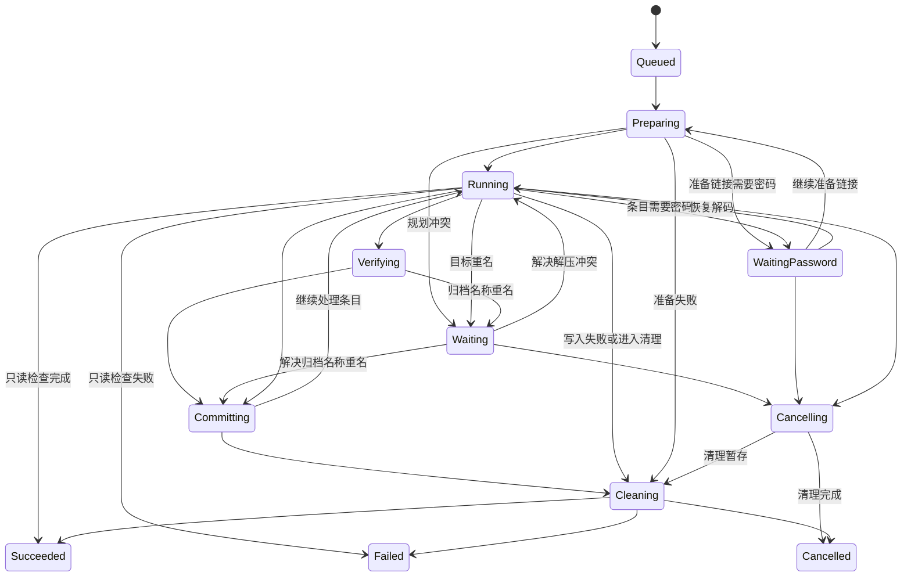

# 任務排程、進度與取消

[English](../../design/task-scheduling.md) | [简体中文](../../zh-CN/design/task-scheduling.md) | 繁體中文（台灣）

XDZip 的每個執行時連線各有一個 Rust 命令執行緒和一個任務執行緒。命令執行緒持有目前歸檔並準備任務輸入。任務執行緒執行已接收的作業，命令執行緒仍能處理後設資料請求。[系統架構](system-architecture.md)說明這些執行緒在哪裡執行，[Qt/Rust 橋接](qt-rust-bridge.md)說明結果如何送到客戶端。

## 准入與任務歸屬

| 層級 | 目前行為 |
| --- | --- |
| 桌面控制器 | `BrowserController::attemptSubmission` 在桌面程序內跨控制器序列准入重操作，覆蓋準備和清理。等待准入的控制器保留一條有界命令，等待期間可以取消。後設資料瀏覽使用普通命令路徑。 |
| 執行時命令執行緒 | 校驗請求並構造作業。解壓、檢查和修改保留相應來源及後設資料或選區。建立接收有界引數，在任務執行緒掃描輸入目錄樹。後設資料預檢和目標檢查都不會建立重任務。 |
| 執行時任務佇列 | 在同一連線內依入隊順序逐個執行解壓、臨時開啟、建立、檢查、編輯和匯出等任務。每個服務最多跟蹤 32 個任務，保留的作業資料合計上限為 64 MiB，涵蓋保留的輸入及為密碼預留的空間。實際解碼、索引、工作程序和輸出另有限額。佇列飽和時報告 `task_busy`。 |
| 獨立 CLI | 在自己的命令程序內遵循同樣的 Rust 排程規則。多個獨立 CLI 程序各有自己的佇列，桌面也使用自己的佇列。各程序仍須執行安全輸出授權和衝突檢查。 |

`TaskAccepted` 標識已接收的作業，普通請求由自己的 `Finished` 結束。作業可繼續產生 `TaskUpdate` 快照，透過原請求編號建立關聯，透過任務編號接收控制。應用任務入口在標籤頁關閉後仍保留所屬控制器，確保提示與結果歸到正確連線。[任務佇列原始碼](../../../crates/xdzip-runtime/src/service/tasks.rs)、[桌面准入與任務路由](../../../apps/desktop/BrowserController.cpp)、[桌面會話](../engineering/application-sessions.md)

## 狀態與進度報告

圖中列出典型路徑，任務可根據操作型別跳過或重複某些階段。只讀檢查可以在沒有提交的情況下結束。建立或修改通常在釋出前驗證暫存歸檔，解壓則可以多次提交。

| 執行時狀態 | 客戶端收到的資訊 |
| --- | --- |
| `queued`、`preparing` | 正在排隊或準備來源、目標許可權及格式狀態，此時總量可能仍未知。 |
| `running`、`verifying` | 正在讀取、編碼、解碼或檢查內容。`verifying` 也用於重新讀取暫存歸檔。驗證不會增加已提交數量。 |
| `waiting`、`waiting_password` | 正在等待目前的重名或密碼答覆。 |
| `committing` | 任務已取得提交許可，可以釋出一個檔案、整個歸檔或一組分卷。 |
| `cancelling`、`cleaning` | 已請求取消，或正在關閉和回收私有暫存物件。進度合併可能省略短暫的中間狀態。 |
| `succeeded`、`failed`、`cancelled` | 正常執行路徑已結束。最終快照記錄實際結果，包括先前的提交和清理警告。 |

`total_known` 用來區分總量未知與總量為零。快照分別記錄讀取、解碼、寫入、驗證和提交的位元組數。固實塊中的處理和重複解碼可能增加工作量，但不會增加實際釋出的檔案。建立僅在歸檔釋出後才把輸入檔案和輸入位元組計入已提交。`written_bytes` 計量輸出寫入，也可包含重寫頭部的資料。佇列對普通的 `running`、`verifying` 和 `committing` 更新按 100 毫秒節流，每個任務只保留最新的待交付快照。提示、取消、清理和最終結果不受此節流影響。結果明細最多保留 128 條，並記錄省略數量。[狀態碼和快照欄位](../../../crates/xdzip-runtime/src/extraction/mod.rs)

## 等待使用者決定

- 策略為詢問時，重名可以等待使用者選擇。密碼提示使用獨立的一次性答覆槽。任務、提示編號及提示型別必須與目前等待匹配。之前的提示或已答覆的提示會拒絕再次答覆。
- 等待期間保留有界的作業狀態及佇列佔位。任務在條件變數上等待，此時釋放答覆互斥鎖。答覆和取消均可喚醒任務，無需等待普通命令佇列有空位。等待的作業仍佔用任務執行緒，獨立的命令執行緒可以繼續處理瀏覽請求。
- 密碼僅在任務範圍內保留。可以重試的密碼失敗按條目限制次數，已消耗的工作量繼續計入任務預算。明確的完整性錯誤會停止操作。缺卷、觸及硬性配額或來源改變由對應的錯誤路徑報告。等待輸入與使用者主動暫停是兩種不同的行為。[密碼互動](../engineering/password-extraction.md)、[資源與檔案規則](file-security.md)

## 取消與提交邊界

`cancel` 請求取消普通請求。任務建立後，`cancel_task` 指向任務本身。控制方法只確認停止請求，呼叫方應觀察對應的請求結束事件或最終任務快照來確定結果。協作取消沒有固定的完成時限，尤其是宿主的系統呼叫仍在阻塞時。歸檔工作程序使用自己的程序監督機制。[橋接控制方法](qt-rust-bridge.md)、[歸檔工作程序監督](../engineering/native-codecs.md)

| 取消到達的時機 | 實際結果 |
| --- | --- |
| `begin_commit()` 取得提交許可前 | 目前提交不會開始。任務丟棄或清理未釋出的暫存，並保留先前的提交記錄。 |
| 解壓或檔案承諾中正在提交一個檔案 | 該提交呼叫可以完成。如果檔案已釋出，任務保留對應記錄。取消可以阻止後續工作，最終快照可以是 `cancelled` 且已提交數量大於零。 |
| 正在進行歸檔的最終提交 | 完整驗證過的單檔案歸檔或整組新分卷一旦成功釋出，建立和修改會保留成功結果。分卷建立提交失敗時可能回滾已經發布的部分。回滾失敗可以標記 `outcome_uncertain`。 |
| 最終結果已確定後 | 遲到的取消不會把已成功提交的結果改為取消。 |

提交許可決定取消還能否阻止釋出。輸出授權和暫存驗證仍然必需。已授權的寫入也可能失敗，並返回實際的檔案系統錯誤。[取消與提交許可](../../../crates/xdzip-runtime/src/extraction/control.rs)、[檔案提交](file-security.md)

## 失敗、關閉標籤頁與退出應用

跳過適用於支援的重名決定。解碼、資源、來源或目標安全錯誤可能停止作業。已釋出的檔案保留在結果中，釋出成功仍可能伴有暫存清理警告。工作程序異常或任務中可展開的恐慌可能導致失敗或結果不確定。任務恐慌路徑會報告 `task_abandoned` 並使對應執行時進入故障狀態。程序退出後缺少最終響應，無法據此判斷哪些內容已經發布。

關閉進度視窗或歸檔標籤頁是介面操作，已接收的作業和結果仍可透過應用任務入口訪問。關閉正在等待答覆的密碼視窗可以取消任務。顯式退出會處理活動任務，關閉流程開始時停止接收新命令，喚醒等待者並繼續取出事件。接收器在返回 `ShutdownReady` 前等待 Rust 工作執行緒退出。Qt 排空郵箱並等待接收執行緒結束，介面執行緒無需阻塞等待。原生外部傳輸也可能需要完成交接。[執行時生命週期](../engineering/product-runtime.md)、[歸檔傳輸](../engineering/archive-transfers.md)
